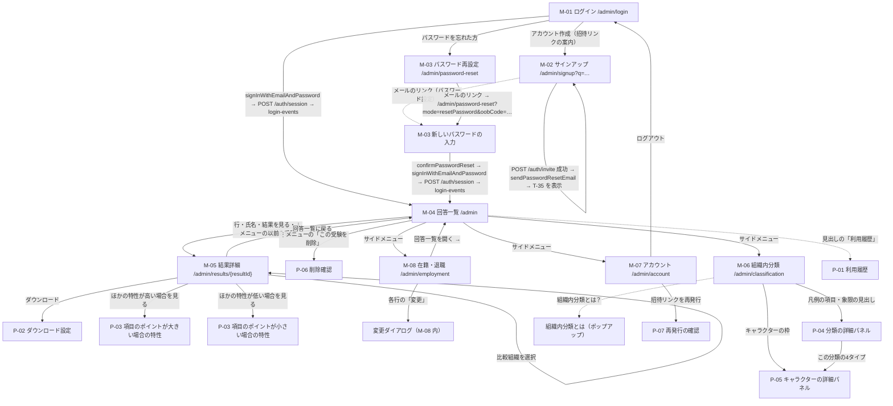

# 基本設計 06 画面設計（管理者側）とグラフ

| 項目 | 内容 |
|---|---|
| 文書名 | 適性検査システム 基本設計 06 画面設計（管理者側）とグラフ |
| 版 | 1.11（1.1 版: レビュー指摘 20 件への対応。1.2 版: 最終点検で 07 D07-15・01 D01-35・00 1.1 版との整合を反映。1.3 版: K-06（Supabase → Firebase）に伴う部分改版。1.4 版: Firebase 化後の分冊間整合（02・04 の 2.1 版への回答を反映）。1.5 版: 10 K-19 の反映。1.6 版: M7 の PR-7.1（文言・マスタ。11-3 §3.9・11-4 §3.3）の反映。1.7 版: M7 の PR-7.5（回答一覧の API。11-2 §4.1）の反映。1.8 版: M7 の PR-7.6（回答一覧の画面。11-2 §4.1）の反映。1.9 版: M7 の PR-7.7a（組織内分類。11-3 §4.1）の反映。1.10 版: M7 の PR-7.7b（在籍・退職。11-3 §4.1）の反映。1.11 版: M7 の PR-7.8a（結果詳細の枠と上半分。11-4 §4.1）の反映。変更点は §13） |
| 作成日 | 2026-09-17（1.1 版: 2026-09-21、1.2 版: 2026-09-21、1.3 版: 2026-09-21、1.4 版: 2026-09-21、1.5 版: 2026-09-24、1.6 版: 2026-11-09、1.7 版: 2026-11-10、1.8 版: 2026-11-10、1.9 版: 2026-11-10、1.10 版: 2026-11-11、1.11 版: 2026-11-11） |
| 対象 | 管理者画面（S-01、S-05〜S-11 と付随画面）、文言の出し分け、色規則、グラフ部品を実装する担当者。07（PDF）、04（API）、08（テスト）の担当者 |

## 0. 本書の位置づけ

本書は、管理者（`admin_user`）が使う画面と、その画面に載るグラフ・文言・色の設計を確定するものです。共通定義（`docs/基本設計/00_共通定義.md`。以下「00」）の用語・識別子・コレクション名・フィールド名・型名・API 規約をそのまま使い、本書で別名を作りません。

- 本書が定めるもの: 管理者画面の一覧・遷移・認可、PC 幅のレイアウト方針、各画面の項目・操作・表示条件、文言マスタ（付録C）のデータ構造と出し分け条件、色規則（信頼係数の緑系化を含む）、ApexCharts のコンポーネント仕様、ゲージ・スライダー・評価レター・立ち位置・組織内分類の描画方式、イラストの配置規約、比較未選択時の表示、負値の表示。
- 本書が定めないもの（参照のみ）: システム構成・ライブラリ版・Firebase プロジェクト設定（01 分冊）、Firestore のフィールド定義・セキュリティルール・認証の仕組み（セッション Cookie、カスタムクレーム。02 分冊）、採点式と比較計算の純関数（03 分冊）、API の入出力・エラーコード・監査ログの書き込み（04 分冊）、受検者画面（05 分冊）、AI 解説の生成処理と PDF の生成方式（07 分冊）、実装順とテスト計画（08 分冊）。
- 文言の本文は付録C を正とし、本書には複製しません。本書は「どの条件でどの文言を出すか」と「コード上の置き場所」を定めます。
- 04・07・08 分冊は本書 1.0 版と同時に執筆されました。1.1 版では、01（1.1 版）・02（1.1 版）・04（1.1 版）・07・08 が確定した事項（管理者追加の方式、ログイン記録 API、Dto の項目名、印刷用ページの認可、`onMounted`／`PdfSectionVisibility`）を本書側に取り込み、本書が依頼した項目のうち各分冊が採用しなかったもの（`availableTeamCodes`）は取り下げています。残る依頼は §8・§9 に「依頼」として明示します。

### 0.1 参照した要件

| 参照元 | 参照した内容 |
|---|---|
| 要件定義書 §3、§4 | 管理者・オーナー・管理者追加・スーパーアドミンの権限、ログイン方式 |
| 要件定義書 §5 | 管理者の業務フロー（リンク送付、結果閲覧、比較組織の選択、AI 解説、PDF、チーム・除外・削除） |
| 要件定義書 §6.2 A-01〜A-13 | 管理者機能（ログイン、回答一覧、チーム、除外、削除、利用履歴、結果詳細、比較組織選択、AI 解説、PDF、組織内分類、アカウント、幹部データの閲覧制限） |
| 要件定義書 §6.4 | 文言の出し分けのキー（タイプ、16 尺度の最大・最小、資質第一・第二候補、ソーシャルスタイル、偏差値、分類） |
| 要件定義書 §6.5 V-01〜V-09 | レーダー 3 種、ドーナツゲージ、評価レター、相性スライダー、立ち位置、組織内分類マトリクス、PDF |
| 要件定義書 §6.6 | AI 解説の表示（7 ブロック）、生成状態 |
| 要件定義書 §7 | 画面一覧 S-01、S-05〜S-11 と結果詳細の 7 セクション構成 |
| 要件定義書 §9 | PC 幅（既存 1440px）、性能（結果詳細を 1〜2 リクエストで描画）、個人情報保護 |
| 要件定義書 §11 の 3・5・6・10 番 | 母集団の統一、信頼係数の色、比較値の非永続化、母集団の定義 |
| 要件定義書 §12 | 幹部データの表示位置、削除の確認ダイアログ、PDF レイアウト、パスワード再設定・アカウント作成の画面文言、イラスト、負値のスライダー表示 |
| 付録B §9、§10 | 合致度・偏差値・評価・立ち位置の定義（表示条件の理解のため。計算は 03） |
| 付録C §1〜§8 | 文言マスタの構造と出し分け条件、色分けルール、組織内分類 |
| 付録D §1、§2 | AI 解説の 7 ブロック、JSON スキーマ、免責表示 |
| 付録E §1〜§7 | レーダーチャートの軸順・設定値・色・サイズ、ゲージ、スライダー、評価レター、組織内分類の色、PDF |
| 00 §1.11、§3.3、§3.5、§3.8、§4、§5、§8 | 不具合対応の共通ルール、ディレクトリ、マスタ型、イラスト配置、API 規約、役割、設計判断 D-xx |
| 01 §3.2、§5.3、§5.5、§8.7 | `react-apexcharts` は `next/dynamic`（`ssr: false`）で読み込む、公開サインアップの無効化（D01-09）、`middleware.ts` の認証不要パス、CSP で ApexCharts のインライン style を許可 |
| 02（Firestore データモデル） | 画面が参照するコレクション・フィールド名（00 §2.2 と同一）、セッション Cookie・招待トークン・受検者トークンの仕組み、監査ログの記録対象。K-06 で全面改版されたため節番号では参照しない |
| 03 §2.3、§4.4、§8、§9、§11 | `lib/presentation/` の責任分界、色分けの関数形、最高・最低尺度の同点規則、負値の表示規則、丸め規則、`chartOrder`、`populationSize` の表示 |
| 04 §2.4、§5、§6、§7、§8.3、§8.5、§9.1、§10 | エラーコード、管理者 API の入出力（Dto の項目名）、認証系 Route Handler、AI 解説の同期方式、Server Component からの service 呼び出し、`middleware.ts`、比較のシーケンス、06 への読み替え |
| 05 §2.5、§4、§9.1 | デザイントークンの書き方、画面の共通ルール、サイト名の仮置き（受検者側との整合） |
| 07 §6、§7.2、§9.4〜§9.6、§11 | AI 解説の状態遷移と失敗理由コード、印刷用ページの配置と認可、`PdfSectionVisibility`、レーダーの `onMounted` |
| 08 §3.4.3、§4.1 | E2E（E-13 比較 API 1 本、E-14 色）、既存との差異 4（信頼係数の色） |

### 0.2 決定事項との対応

| # | 決定事項 | 本書での対応 |
|---|---|---|
| 1 | Next.js（App Router、TypeScript）+ Firebase（Cloud Firestore、Firebase Authentication）+ Vercel。グラフは ApexCharts（react-apexcharts）（10 K-06） | §6 のレーダー 3 種は `react-apexcharts`。ゲージ・スライダー・評価レターは自前 SVG／CSS（設計判断 D06-01。§6.1）。1.11 版（M7 の PR-7.8a。10 K-23）: 結果詳細の上半分（16の特性のレーダー・合致度と信頼係数のメーター・16の特性とリスクの横棒・組織との相性の線・評価の箱）は SVG と CSS の自作になった（11-4 §2.7〜§2.11。§6）。`react-apexcharts` は、新しいレイアウトの後ろに残る旧のセクション 5・6 の資質とソーシャルスタイルのレーダー（§6.3・§6.4）だけが PR-7.8b まで使う。画面は `app/(admin)/admin/` 配下（00 §3.3）。ログイン・パスワード再設定だけがブラウザで Firebase Auth クライアント SDK（`lib/firebase/client.ts`）を使い、認証状態はサーバのセッション Cookie（`POST /auth/session`）に一本化する（00 §2.5、§4.1、D-31）。画面から Firestore には触れない |
| 2 | 要件定義書 §11 の不具合 10 件を修正 | 3・10 番: 比較系列・合致度・評価・立ち位置は同一 API 応答（同一母集団）から描く（§3.5.3）。5 番: 信頼係数の色を高いほど良い色にする（1.11 版から 3 段階。10 K-39 Q-04、11-4 §2.7.4。§5.2）。6 番: 比較値を画面状態と URL クエリだけで扱い保存しない（§3.5.3）。8 番: 画面には表示名（直感型など）を使い、内部名「感性開放型」は表示しない（§4） |
| 3 | 出題は Q1〜Q144 のみ | 管理者画面は設問を扱いません。結果詳細に設問数を表示しません |
| 4 | 既存データは移行しない | 一覧の初期状態は 0 件。0 件時の表示を定めます（§3.4.6） |
| 5 | AI 解説は Claude API。差し替え可能 | 画面は provider 名を表示しません。表示は 07 が返す `AiAnalysisOutput`（00 §3.6）だけに依存します（§3.5.9） |
| 6 | 日本語のみ。管理画面は PC 幅。M7 で管理画面も狭い画面幅に対応に改定（10 K-22） | §2 の PC 幅レイアウト方針（1440px 基準）。1.8 版（M7 の PR-7.6）から、回答一覧（M-04）の中は一覧の幅で狭い・中くらいの表示に切り替える（11-2 §2.22）。管理画面の枠（サイドメニューと本文）の狭い幅と最小幅 1280px の撤去は 11-8 の PR-7.13a。1.11 版（M7 の PR-7.8a）: 結果詳細（M-05）はサイドメニューを出さない全画面の枠で、中は参照元の幅（1180・1023・860・760・700・560px）で切り替える（11-4 §2.1・§2.17。§2.1） |

## 1. 画面一覧と遷移

### 1.1 画面一覧

画面 ID は本書内の識別子です（要件定義書の S-xx と対応付けます）。ポップアップは `P-xx`、エラー表示は `E-xx` とします。

| ID | 画面 | 要件定義書 | URL | 認証 | 役割による差 |
|---|---|---|---|---|---|
| M-01 | ログイン | S-01 | `/admin/login` | 不要 | なし |
| M-02 | 管理者サインアップ | S-01「アカウント作成」、§4「管理者追加」 | `/admin/signup?q={inviteToken}` | 不要 | なし（登録後は `admin`。00 §4.2、§5） |
| M-03 | パスワード再設定（初回のパスワード設定を兼ねる） | S-01「パスワードを忘れた方」、§9 認証 | `/admin/password-reset`（メールのリンク経由は `?mode=resetPassword&oobCode=…`） | 不要（メールのリンクに含まれる `oobCode` で新パスワードを設定） | なし |
| M-04 | 回答一覧 | S-05、A-02〜A-05 | `/admin` | 必要 | `admin` には幹部（`executive`）を表示しない（A-13、00 §5） |
| M-05 | 結果詳細 | S-06、A-07〜A-10 | `/admin/results/{resultId}?scope=organization` または `?scope=team&teamCode=A` | 必要 | `admin` は幹部の結果を開けない（404 相当。§1.3）。1.11 版: サイドメニューと共通ヘッダーを出さない全画面の枠（11-4 §2.1。§2.3） |
| M-06 | 組織内分類 | S-07、A-11 | `/admin/classification` | 必要 | `admin` の人数・パネルに既存スタッフ（幹部）を含めない（K-29）。1.9 版: 同じ人の受験は代表の受験（最新の受験）で 1 人として数え、「集計から除外」した受験は数えない（11-3 §2.2） |
| M-07 | アカウント | S-08、A-12 | `/admin/account` | 必要 | `owner`／`super_admin` のみ管理者一覧と招待リンク再発行（§3.7） |
| M-08 | 在籍・退職（1.10 版で追加） | （M7 で追加。11-3 §2.1・§2.13〜§2.17、10 K-38） | `/admin/employment` | 必要 | `admin` には既存スタッフの人を出さない（K-29）。同じ人の受験は代表の受験で 1 人として数え、「集計から除外」した受験は数えない（組織内分類と同じ人。11-3 §2.2）。各行の「変更」から変更ダイアログ（M-08 内。画面 ID は付けない。§3.8）を開き、区分・入社日・退職日を変える（役割の条件は無い） |
| P-01 | 利用履歴 | S-09、A-06 | M-04 回答一覧の見出しの「利用履歴」から開くポップアップ（1.8 版。ヘッダーには置かない。11-2 §2.4・§2.18、K-39 Q-19） | 必要 | `admin` には幹部の履歴を表示しない |
| P-02 | ダウンロード設定 | S-10、A-10 | M-05 内 | 必要 | なし |
| P-03 | ほかの特性が高い／低い場合のポップアップ（1.11 版で「項目一覧」1 つから 2 つに改めた） | S-11 | M-05 内（概要の「ほかの特性が高い場合を見る」で「項目のポイントが大きい場合の特性」、「ほかの特性が低い場合を見る」で「項目のポイントが小さい場合の特性」を開く。11-4 §2.15） | 必要 | なし |
| P-04 | 分類の詳細パネル（1.9 版で「分類の説明」から改称） | A-11 | M-06 内（凡例の項目・象限の見出しから開く右端の引き出し。11-3 §2.12） | 必要 | `admin` には回答者の一覧に既存スタッフを含めない |
| P-05 | キャラクターの詳細パネル（1.9 版で「該当者一覧」から改称） | A-11 | M-06 内（キャラクターの枠と P-04 の 4 タイプのボタンから開く。11-3 §2.12） | 必要 | `admin` には回答者の一覧に既存スタッフを含めない |
| P-06 | 削除確認 | A-05（未確認。D-11 の仮置き） | M-04 の⋮メニューの「この受験を削除」から開くポップアップ（1.8 版。11-2 §2.16） | 必要 | なし |
| P-07 | 招待リンク再発行の確認 | （既存に無し。00 §4.2 `POST /api/v1/admin/organization/invite-token`） | M-07 内 | 必要 | `owner`／`super_admin` のみ |
| E-01 | 利用不可（停止中・未所属） | 00 §5、04 §2.4 | 全管理画面（専用 URL は置かず、各ページの Server Component が本文の代わりに描画する。§1.3） | ログイン済み | `adminUsers.isSuspended`／`deletedAt`（04 の 403 `ADMIN_SUSPENDED`）、`adminUsers` 文書なし・クレーム（`organizationId`、`role`）なし（403 `ADMIN_NOT_REGISTERED`） |
| E-02 | 見つからない・権限なし | 00 §4.1（404／403） | M-05 など | 必要 | 他組織・幹部（`admin`）・削除済み |

- 既存の URL（`/admin_page?fg_p=…`、`?section=…`）は踏襲しません。00 §3.3 のルートを正とします。
- 「受検者登録（受検リンク発行）」は独立した画面ではなく、M-07 アカウントの 3 リンク（求職者用・既存スタッフ用・管理者追加用）で行います（要件定義書 §6.2 A-12、§5 の 1 番）。

### 1.2 画面遷移図



### 1.3 認可と画面の対応

認証の仕組み（Firebase Auth のセッション Cookie とカスタムクレーム。00 §4.1、§5）は 02、API 側の認可は 04 分冊です。画面側は次のとおり振る舞います。

| 状態 | 画面側の挙動 | 根拠 |
|---|---|---|
| 未ログインで `/admin/**`（認証不要パスを除く）にアクセス | `middleware.ts`（04 §8.5、01 §5.5）が `/admin/login?next={元のパス}` へ 302 する。認証不要パスは `/admin/login`、`/admin/signup`、`/admin/password-reset`、`/admin/results/{resultId}/print`（04 §8.5 `PUBLIC_ADMIN_PATHS`）。画面側は `next` を `/admin` で始まるパスのみ許可（オープンリダイレクト防止） | 04 §8.5、00 §3.7、要件定義書 §9 認証 |
| ログイン済みで M-01 にアクセス | `/admin` へリダイレクト（`login/page.tsx` の Server Component が 02 §9.11 の `verifyAdminSessionCookie()`（`lib/auth/session-cookie.ts`）で有効な Cookie を確認したときだけ。無効・期限切れならログイン画面をそのまま表示する） | 設計判断 |
| 認証済みページ（M-04〜M-08）の初期表示 | 各ページの Server Component が `requireAdmin()`（04 §2.5.1、§8.3）を呼んで `AdminContext` を得てから `lib/services/` を呼ぶ。`ApiError` の変換: 401 `UNAUTHENTICATED` → `redirect("/admin/login?next=…")`（middleware をすり抜けた Cookie 失効の保険）、403 `ADMIN_SUSPENDED`／`ADMIN_NOT_REGISTERED` → E-01 を本文の代わりに描画、404 系 → `notFound()`（E-02） | 04 §8.3「`ApiError` はページ側で `notFound()` / `redirect` に変換（06）」 |
| ログイン済みだが `adminUsers` の状態が不正（403 `ADMIN_SUSPENDED`: 停止中・削除済み、403 `ADMIN_NOT_REGISTERED`: クレームに `organizationId`／`role` が無い、`adminUsers` 文書が無い、または文書とクレームが不一致。04 §2.5.1） | E-01 を表示（T-15）。サイドメニュー・ヘッダーは出さず「ログアウト」だけを置く。ブラウザからの API 呼び出しで同じ 403 を受けたときは `window.location.reload()` で Server Component に描画し直させる（§10.4）。専用ルート（`/admin/unavailable` など）は置かない（00 §3.3 に無いため。設計判断 D06-27）。利用停止（Firebase Auth の `disabled` + `revokeRefreshTokens`。00 §5）後は Cookie 検証自体が 401 になり得るため、その場合は M-01 へ戻る | 00 §5、04 §2.4 |
| `admin` が幹部の結果詳細 URL を直接開く | 04 が 404 を返す前提で E-02「回答データが見つかりません」を表示（存在を見せない。00 §5 補足） | 要件定義書 §6.2 A-13、00 §5、04 D04-07 |
| `owner`／`super_admin` | 幹部データを一覧・詳細・分類・履歴に表示。`super_admin` は本フェーズでは `owner` と同じ画面（D-14） | 00 §5 |
| 他組織のリソース ID | 04 が 404 を返す（取得した文書の `organizationId` とクレームの `organizationId` をサーバで照合し、不一致は 404。00 §4.1 の認可 3 段階）。E-02 | 00 §2.1、§4.1、02 |
| 印刷用ページ `/admin/results/{resultId}/print`（07 §9.4） | 管理者 Cookie を要求せず、クエリ `token` を `verifyPdfToken`（04 §7.2）で検証する。本書の認証チェック・`AdminShell` はこのページに掛からない（下記のレイアウト構成） | 07 §9.4、04 §7.2、§8.5 D04-41 |

`app/(admin)/admin/layout.tsx` の役割（設計判断 D06-27）:

- このレイアウトは **認証チェックを行わず、`AdminShell` も描画しません**。`app/(admin)/admin.css`（§2.2）の読み込みと `lang="ja"` 配下の共通 `metadata`（`robots: noindex`）だけを担います。理由: Next.js の入れ子レイアウトは配下の全ルートに適用されるため、ここでセッション Cookie を確認すると、認証不要パス（M-01〜M-03）と 07 の印刷用ページ（Chromium が管理者 Cookie を持たずに開く）までログイン画面へ送ってしまい、PDF 生成が失敗します。00 §3.3 は `app/(admin)/admin/` 直下に各 `page.tsx` を置く構成のため、ルートグループで認証済みページだけを分ける構成（ファイルパスが 00 §3.3 と変わる）も採りません。
- 未ログインの遮断は `middleware.ts`（04 §8.5）に一本化し、認証済みページ（M-04〜M-08）は各 `page.tsx` の Server Component で `requireAdmin()` → `AdminShell`（`me` に `MeDto` を渡し、本文を子要素にする）の順に描画します（`AdminShell` は §2.4）。M-01〜M-03 は `AuthCard` を使い、`AdminShell` を使いません。
- 07 の `print/layout.tsx` はこのレイアウトの内側に置かれます。本書のレイアウトは CSS の読み込みだけなので、印刷用ページが本書の `components/admin/result/*`・`components/charts/*` を再利用する際に必要なクラス定義（`.compat-slider` など）がそのまま使えます。07 §9.4 の「最小の `html` / `body`」は、00 §3.3 の `app/layout.tsx`（ルートレイアウト）の内側では `html` / `body` を再定義できないため、「サイドメニュー・ヘッダーを描画しない最小のラッパー」と読み替えます（07 §9.4 で 1.2 版に反映済み。§9）。

役割の判定は `GET /api/v1/admin/me`（または Server Component から `lib/services/` 経由）で得た `role` で行い、画面はこれをキャッシュしません。`canViewExecutives = role === "owner" || role === "super_admin"` をヘルパー `lib/auth/admin-role.ts` に置きます（§10.1）。

## 2. PC 幅レイアウト方針

### 2.1 幅と対応範囲

| 項目 | 方針 | 根拠 |
|---|---|---|
| 基準幅 | 1440px（既存の確認幅） | 要件定義書 §9 対応端末 |
| 対応範囲 | 1280px〜1920px。1280px 未満ではページ全体を横スクロール可とし、レイアウトを崩さない（レスポンシブ対応は行わない）。1.8 版（M7 の PR-7.6）: 回答一覧（M-04）の中は、画面の幅ではなく一覧の幅で狭い（840px 未満）・中くらい（840〜1099px）の表示に切り替える（11-2 §2.22。10 K-22）。枠の最小幅 1280px を外すのは 11-8 の PR-7.13a で、それまでは一覧の幅が 840px 未満にならない（縦のスクロールバーを除いた表示の幅が 1388px 未満で中くらいの表示）。1.9 版（M7 の PR-7.7a）: 組織内分類（M-06）の中は、本文の幅（根の要素 `.ob-root` のコンテナクエリ。1000px 以上・900px 以下・520px 以下）と画面の幅（700px 以下で押していない象限を畳み、600px 以下で詳細パネルの形を変える）で切り替える（11-3 §2.19）。枠の最小幅を外す PR-7.13a までは、本文の幅は 900px 以下にならない（画面 1280px 以上で約 977〜1200px。1440×900 では約 1152px）。1.10 版（M7 の PR-7.7b）: 在籍・退職（M-08）の中は、本文の幅（`.ob-root` のコンテナクエリ）で、一覧を 700px 以下、分析の表を 760px 以下で切り替える（11-3 §2.19。D06-34）。PR-7.13a までは、本文の幅はこの幅にならない。1.11 版（M7 の PR-7.8a）: 結果詳細（M-05）はサイドメニューと共通ヘッダーを出さない全画面の枠（画面に固定。11-4 §2.1）で、枠の中は参照元の幅（1180・1023・860・760・700・560px）を画面の幅の `@media` で切り替える（11-4 §2.17。K-22）。枠は画面に固定されるので、PR-7.13a までの最小幅 1280px は文書の幅だけに効き、枠の中は画面の幅で並ぶ（文書は狭い画面で横に動くことがある） | 決定事項 6（管理画面は PC 幅）。設計判断 D06-02（M7 で 10 K-22 が改めた） |
| 全体構成 | 左に固定幅サイドメニュー（224px）、右に本文。本文は最大幅 1200px、左右余白 32px | 要件定義書 §7 S-05「サイドメニュー」 |
| 結果詳細の列 | 1.11 版（M7 の PR-7.8a）から、結果詳細の並びと列は 11-4 §2.1・§2.7〜§2.12（本文の最大幅 1200px）。1.10 版までの 2 列（左 7 : 右 5）・3 列の旧レイアウトは、旧のセクション 5・6（§3.5.8）だけが PR-7.8b まで使う | 11-4 §2.1 |
| 文字サイズ | 本文 14px、見出し 20px／16px。結果詳細の文字の大きさは 11-4 別表D（1.11 版。評価レター 64px・ゲージ中央 22px はやめた） | 設計判断、11-4 |
| 印刷 | 画面は `@media print` を持たない。PDF は 07 の印刷用ページが担う | 00 §6 分冊間の境界 |

### 2.2 デザイントークン

配色は既存資料に具体値が無い（付録C §7 は CSS 変数名のみ。橙だけ `rgba(255,128,0,1)`）ため、指標の色以外は設計判断です（D06-03）。受検者側（05 §2.5）とは別のスタイルシートにし、ダークモード対応は行いません。

```css
/* app/(admin)/admin.css （app/(admin)/admin/layout.tsx から読み込む。このレイアウトは CSS の読み込みのみ。§1.3 D06-27） */
:root {
  /* 画面の基調 */
  --admin-bg: #f3f5f8;
  --admin-surface: #ffffff;
  --admin-text: #1f2933;
  --admin-text-muted: #52606d;
  --admin-border: #cbd2d9;
  --admin-primary: #0b5cad;         /* 主ボタン、リンク、サイドメニューの選択状態 */
  --admin-primary-soft: #e6f0fa;
  --admin-danger: #c62828;          /* 削除、エラー */
  --admin-danger-soft: #fdecea;
  --admin-sidebar-bg: #1f2933;
  --admin-sidebar-text: #f3f5f8;
  --admin-radius: 8px;
  --admin-sidebar-width: 224px;
  --admin-content-max-width: 1200px;
  --admin-gutter: 32px;

  /* グラフ系列（付録E §1、§2 の取得値。1.11 版: 旧のセクション 5・6 のレーダーが PR-7.8b まで使う） */
  --chart-subject: #00a2ff;         /* 受検者系列 */
  --chart-comparison: #14f584;      /* 比較対象系列 */

  /* 5 段階の値域色（付録C §7。橙のみ取得値、他は設計判断 D06-03。1.11 版: 結果詳細は使わなくなった。PR-7.8b で消す） */
  --band-very-low: #8ecae6;         /* 薄い青 */
  --band-low: #2e9e5b;              /* 緑 */
  --band-middle: #d4a600;           /* 黄（白背景で読める濃さに調整） */
  --band-high: #ff8000;             /* 橙（付録C §7 の取得値） */
  --band-very-high: #d32f2f;        /* 赤 */

  /* 信頼係数専用（高いほど緑系。§5.2、D06-04。1.11 版: 結果詳細は使わなくなった。PR-7.8b で消す） */
  --reliability-very-high: #1b7f4b; /* 濃い緑 */
  --reliability-high: #7cb342;      /* 黄緑 */

  /* ソーシャルスタイル（付録E §6 の取得値） */
  --style-driving: rgb(149, 112, 161);
  --style-expressive: rgb(229, 179, 83);
  --style-analytical: rgb(65, 166, 123);
  --style-amiable: rgb(65, 148, 175);

  /* ゲージ（1.11 版: 結果詳細は使わなくなった。PR-7.8b で消す。相性スライダーの --slider-track・--slider-marker は 1.11 版で消した） */
  --gauge-track: #e5e7eb;
}
```

- フォントはシステムフォント（`system-ui, -apple-system, "Hiragino Sans", "Noto Sans JP", sans-serif`）とし、Web フォントを読み込みません（05 §2.5 と同じ方針。PDF の印刷用ページでも同じフォント指定にすることを 07 に依頼。§9）。
- ApexCharts の `chart.fontFamily` にも同じフォント列を渡します（§6.1）。
- 1.11 版（M7 の PR-7.8a）: 結果詳細の色は、11-4 §2.2 の変数（新しいレイアウトの根 `#rs2` に置く `--ink`〜`--amblt`）と、K-49・K-50 で基準に届くように変えた色の 2 つの表を正とします（`components/admin/result/result-detail.css`。11-4 別表D）。結果詳細の字体は 11-4 §2.2 の並び（先頭が Inter）です。Inter を管理画面で読み込むのは 11-8 の PR-7.13a で、それまでは並びの次の書体で描きます。上の見本の `--slider-track`・`--slider-marker` は使う規則が無くなったので `app/(admin)/admin.css` から消しました。`--chart-*`・`--band-*`・`--reliability-*`・`--gauge-track` は、旧のセクション 5・6 を消す PR-7.8b で片付けます（11 総論 6.4 の `admin.css` の行）。

### 2.3 共通レイアウト

```text
┌──────────┬────────────────────────────────────────────────────────────┐
│ サイド    │ ヘッダー: [組織名]                         [管理者名 ▾ ログアウト] │
│ メニュー  ├────────────────────────────────────────────────────────────┤
│          │                                                            │
│ 回答一覧  │   本文（最大幅 1200px、左右余白 32px）                        │
│ 組織内分類│                                                            │
│ 在籍・退職│                                                            │
│ アカウント│                                                            │
│          │                                                            │
│ (下部)    │                                                            │
│ サイト名  │                                                            │
└──────────┴────────────────────────────────────────────────────────────┘
```

| 要素 | 内容 | 根拠 |
|---|---|---|
| サイドメニュー | 「回答一覧」（`/admin`）、「組織内分類」（`/admin/classification`）、「在籍・退職」（`/admin/employment`。1.10 版。全管理者に出す）、「アカウント」（`/admin/account`）。現在位置を強調。11-8 の PR-7.13a までは今の枠の文字だけの項目 | 要件定義書 §7 S-05、10 K-38、11-3 §2.1 |
| ヘッダー左 | 組織名（`organizations.name`。`GET /api/v1/admin/me` の組織情報） | 設計判断（複数組織の管理者が混同しないため） |
| ヘッダー右 | 管理者名、「ログアウト」。1.8 版（M7 の PR-7.6）で「利用履歴」ボタンを外した（利用履歴は回答一覧の見出しの横から開く。11-2 §2.4・§2.18）。ヘッダー自体の廃止は 11-8 の PR-7.13a | 要件定義書 §6.2 A-06。10 K-39 Q-19（共通ヘッダーなし。参照元どおり） |
| サイト名 | 「適性検査」（05 §9.1 H-01 と同じ仮置き。依頼主確認事項） | 05 D05-22 |
| M-01〜M-03 | サイドメニュー・ヘッダーなし。中央に幅 420px のカード | 設計判断 |
| M-05 結果詳細（1.11 版） | 枠の種類 `frame: "detail"`（`renderAdminPage` の `frame`。省くと `"default"`）: `AdminShell` はサイドメニュー・ヘッダーを描かず、`ToastProvider` と、余白を付けない本文の入れ物（`main`。クラスなし。11-8 §2.1.2 の木）と本文だけを描く。結果詳細の枠 `#rd`（上の行の「回答一覧に戻る」と、スクロールする領域）は 11-4 の部品が描く。ログアウトは一覧などの画面から行う。読み込み中の表示とお知らせは、11-8 の PR-7.13a・PR-7.16 がどちらの枠にも出す | 11-4 §2.1・§3.6、11-8 §2.1.2 |

### 2.4 共通部品

| コンポーネント | ファイル | 種別 | 役割 |
|---|---|---|---|
| `AdminShell` | `components/admin/AdminShell.tsx` | Server | サイドメニュー・ヘッダー・本文コンテナ。認証済みページ（M-04〜M-08）の各 `page.tsx` が `requireAdmin()` の後に使う（`layout.tsx` からは使わない。§1.3 D06-27）。props に `MeDto`（04 §5.1）を受け取る。1.10 版: サイドメニューの 3 番目（組織内分類の次）に「在籍・退職」（`AdminNavKey` の `"employment"`）を足した（11-3 §2.1。見た目・アイコン・狭い幅は 11-8 の PR-7.13a が `ADMIN_NAV_ITEMS` に移すときに作る）。1.11 版: 枠の種類 `frame`（`"default"`・`"detail"`。`renderAdminPage` から渡す）を受け取り、`"detail"`（結果詳細）ではサイドメニュー・ヘッダー・本文の入れ物を描かず `ToastProvider` と本文だけを描く（§2.3、11-4 §3.6） |
| `AdminHeader` | `components/admin/AdminHeader.tsx` | Client | 組織名、管理者名、ログアウト（1.8 版で利用履歴ボタンを外した。11-2 §2.4。ファイルの削除は 11-8 の PR-7.13a） |
| `AdminUnavailable` | `components/admin/AdminUnavailable.tsx` | Server | E-01（T-15 と「ログアウト」ボタンのみ）。`requireAdmin()` が 403 を投げたときに各 `page.tsx` が本文の代わりに描画する |
| `AuthCard` | `components/admin/AuthCard.tsx` | Server | M-01〜M-03 の中央カード |
| `UsageLogDialog` | `components/admin/UsageLogDialog.tsx` | Client | P-01（回答一覧の見出しの「利用履歴」から開く。送信済みの全件・4 列。Esc・背景では閉じない。11-2 §2.18） |
| `ResultsView` | `components/admin/ResultsView.tsx` | Client | M-04 の本体。絞り込みの状態（`sessionStorage` の `ad-filter`）、表示の上限、メニューとポップアップの開閉、表示の上書きと更新・読み直し（11-2 §2.21・§2.23・§3.12）。1.8 版で作り直した（`ResultTable`・`ResultFilters` は消した） |
| `ListHeader`・`StatCards`・`ListTools`・`PersonRows`・`PopupMenu`・`EmploymentDatesDialog`・`EmptyState`・アイコン | `components/admin/results/*.tsx` | Client（アイコンは Server 可） | M-04 の見出し行・集計カード・道具の行・表・メニュー・入社日と退職日のダイアログ・0 件の表示（11-2 §3.12）。回答リンクのコピーは `components/admin/results/copy-link.ts` |
| `DeleteConfirmDialog` | `components/admin/DeleteConfirmDialog.tsx` | Client | P-06（⋮メニューの「この受験を削除」。Esc・背景では閉じない。11-2 §2.16） |
| `ResultDetailPage` | `components/admin/result/ResultDetailPage.tsx` | Server | M-05 の本文。1.11 版で作り直した: 枠 `ResultDetailFrame` の中に `ComparisonProvider`・`AiAnalysisProvider` を置き、`ResultDetailBody`（`key` は `resultId`。AI 解説の領域に `AiAnalysisSection`、見出しの塊のボタンに「ダウンロード」）と、その後ろに旧のセクション 5・6（`ResultSections`。PR-7.8b まで）を並べる（11-4 §3.6・§4.2） |
| `ComparisonProvider` | `components/admin/result/ComparisonProvider.tsx` | Client | URL クエリ（`scope`、`teamCode`）を読み、`GET …/comparison` を 1 本呼んで比較状態（§3.5.1）を React Context で配下に渡す。印刷用ページ（07）では `initialComparison` を props で受け取り API を呼ばない |
| `ComparisonScopeSelect` | `components/admin/result/ComparisonScopeSelect.tsx` | Client | 比較組織プルダウン。選択で URL クエリを更新（`router.replace`）。取得は `ComparisonProvider` が行う。1.11 版: 見えるラベルを外し、読み上げの名前を `aria-label="比較組織"`、未選択の表示を「比較組織を選択」（`RESULT_DETAIL_TEXTS`）にした（11-4 §2.3.2） |
| `ResultDetailFrame`・`ResultDetailBody`・`ResultHead`・`ResultMetaLine`・`ResultToc`・`ResultLayout`・`FoldableSection`・`ResultViewStateContext`、セクション（`sections/OverviewSection`・`TraitsSection`・`RiskSection`・`FitSection`・`ProfileSection`）、アイコン（`result-icons.tsx`）、並びとたたみ方の記憶（`result-ui-memory.ts`）、CSS（`result-detail.css`） | `components/admin/result/*` | 枠は Server、ほかは Client（アイコンと受験情報の 1 行は Server でも描ける） | M-05 の枠・見出しの塊・受験情報の 1 行・目次・新しいレイアウト（概要・16の特性・リスク・組織との相性・人物像）・折りたたみ・画面の状態（1.11 版。11-4 §3.6）。`ResultDetailBody` は `variant`（`"screen"`・`"print"`）で印刷用ページ（07）でも使う。旧の `SummarySection` などのセクション 1〜4 の部品は 1.11 版で無くなった（旧のセクション 5・6 の `ResultSections`・`DevelopmentSection` は PR-7.8b まで残る） |
| `TraitHighlightPopups` | `components/admin/result/TraitHighlightPopups.tsx` | Client | P-03 の 2 つのポップアップ（1.11 版で `TraitListDialog` を置き換えた。11-4 §2.15） |
| `DownloadDialog` | `components/admin/result/DownloadDialog.tsx` | Client | P-02。1.11 版: 「ダウンロード」のボタン（`DownloadButton`）に見た目の props（`className`・`icon`）を足した（結果詳細の見出しの塊は `rd-btn` と線のアイコン。11-4 §2.3.2）。ダイアログの中身の作り直しは 11-5 の PR-7.12 |
| `AiAnalysisSection` | `components/admin/result/AiAnalysisSection.tsx` | Client | AI 解説の生成・表示・状態遷移。1.11 版: 結果詳細の目次と新しいレイアウトの間の領域（id `ai`。目次の「AI解説」の行き先）に置き、見出しの「AI解説を表示」のボタン（`AiAnalysisHeaderButton`）は無くなった（11-6 の ai-04・ai-05。中身の作り直しは 11-6 の PR-7.9） |
| `ClassificationView` | `components/admin/classification/ClassificationView.tsx` | Client | M-06 の本体。見出し行、集計カード・説明文・マップの section、詳細パネルと「組織内分類とは」の開閉、表示の状態（チーム・対象・折りたたみ）の読み書きとチームの正規化（11-3 §2.1・§2.18・§3.8）。1.9 版で `ClassificationMatrix` を置き換えた。表示の状態（`view-state.ts`）は 1.10 版から在籍・退職のタブも持つ（M-08 と共用。D06-33） |
| `ClassificationSummary`・`ClassificationMap`・`ClassificationPanel`・`ClassificationAboutDialog`・表示の状態（`view-state.ts`）・アイコン（`icons.tsx`） | `components/admin/classification/*` | Client（アイコンは Server 可。`view-state.ts` は Client で使うモジュール） | M-06 の集計カード・マップ（軸・象限・キャラクターの枠）・詳細パネル（P-04・P-05）・「組織内分類とは」、ブラウザのメモリに置く表示の状態（`useSyncExternalStore`）、閉じるボタンの × の SVG（11-3 §3.8） |
| `EmploymentView` | `components/admin/employment/EmploymentView.tsx` | Client | M-08 の本体（1.10 版）。見出し・説明・タブ、一覧か分析と「回答一覧を開く →」、表示の状態（チームとタブ）の読み書きとチームの正規化、変更ダイアログの開閉、保存中の手元の値（代表の `resultId` ごとの区分・入社日・退職日）と送信中の人、保存と読み直し（11-3 §2.1・§2.13・§2.15・§2.18・§2.20・§3.8） |
| `EmploymentList`・`RetentionAnalysis`・`EmploymentEditDialog` | `components/admin/employment/*` | Client | M-08 の在籍者・退職者・求職者の一覧、分析「辞めやすいタイプと勤続年数」（退職の割合の棒は CSS。10 K-23）、変更ダイアログ（自分の `dialog` 要素を `showModal` で開く。`Dialog` は見出しの行に閉じるアイコンを描くので使わない）（11-3 §2.14〜§2.16・§3.8。1.10 版） |
| `AccountPage` | `components/admin/account/*.tsx` | Client | M-07 の各フォーム、コピー、管理者一覧 |
| `TraitRadarSvg` | `components/charts/TraitRadarSvg.tsx` | Client | 16の特性のレーダー（SVG の自作。吹き出しは画面の形だけ。1.11 版。§6.2、11-4 §2.8.3）。1.10 版までの ApexCharts の `TraitRadar` を置き換えた |
| `AptitudeRadar` / `SocialStyleRadar` | `components/charts/*.tsx` | Client | ApexCharts ラッパー（§6.3・§6.4）。旧のセクション 5・6 が PR-7.8b まで使う |
| `Illustration` | `components/ui/Illustration.tsx` | Client | イラスト画像（§7。404 のときの差し替えに状態を持つので Client。1.8 版までの表の Server は誤り）。1.9 版で `className`・`decorative`（飾り。`alt` を空にして読み上げない）・`loading` を足した（11-3 §3.8） |
| `Dialog`、`Button`、`Select`、`Checkbox`、`TextField`、`Toast`、`CopyButton` | `components/ui/*.tsx` | Client | 汎用部品（00 §3.3）。1.8 版（11-2 §3.12）: `Dialog` に `closeOnEsc`・`closeOnBackdrop`（どちらも既定 `true`）と見た目の上書き `className` を足した。`Toast` は 1 件ずつ（新しい通知が前の通知を置き換え、表示の時間を数え直す）、表示の時間 `durationMs`（既定は情報 2.2 秒・エラー 6 秒）と見出し `title` を指定でき、モーダルの `dialog` が開いている間はその中に出す。1.10 版（11-3 §2.20）: 丸形の見た目 `shape: "pill"`（在籍・退職の保存の通知。位置と色は同じ）を足した。1.11 版（11-4 §2.15）: `Dialog` に閉じるボタンの中身 `closeIcon`（省くと「×」の文字）と、本文の入れ物（`.dialog__body`）がはみ出して動く間だけ焦点を受ける読み上げの名前 `bodyRegionLabel`（`tabIndex 0`・`role="region"`。はみ出しは `ResizeObserver` で見る。省いたときの動きは変えない）を足した |

- ポップアップはすべて `dialog` 要素で実装し、既定は Esc と背景クリックで閉じます（`Dialog` の `closeOnEsc`・`closeOnBackdrop` の既定）。1.8 版（M7 の PR-7.6）から、削除の確認（P-06）・利用履歴（P-01）・入社日と退職日のダイアログは参照元どおり Esc で閉じず、削除の確認と利用履歴は背景でも閉じない（11-2 §2.14・§2.16・§2.18）。1.9 版（M7 の PR-7.7a）から、組織内分類の詳細パネル（P-04・P-05）は ×・Esc・パネルの外で閉じ（背景を暗くしない）、「組織内分類とは」は閉じるボタンと Esc で閉じて背景では閉じない（推定。11-3 §2.5・§2.12）。1.10 版（M7 の PR-7.7b）から、在籍・退職の変更ダイアログは「やめる」・カードの外・Esc で閉じ（どれも保存しない）、開いたら選択中の区分のボタンに焦点を移し、閉じたら押した「変更」に戻す（区分の変更でその人がほかのタブに移り「変更」が一覧から消えたときは、今のタブのボタン。11-3 §2.15）。開いた時に最初の操作要素へフォーカスを移し、閉じた時に元の要素へ戻します。
- Client Component は `"use client"` を先頭に置き、`firebase-admin`・`lib/firebase/admin.ts`・`lib/db/`・`lib/services/`・`@anthropic-ai/*` を import しません（00 §3.3、01 の Lint 設定）。`firebase/auth`（クライアント SDK）を import してよいのは `lib/firebase/client.ts` と `lib/utils/admin-auth.ts`（§10.4）だけです。API 呼び出しは `lib/utils/admin-api.ts` に集約します（§10.4）。

### 2.5 画面の共通ルール

| 項目 | ルール | 根拠 |
|---|---|---|
| 初期表示 | Server Component が `lib/services/` を直接呼んで初期データを取得し、Client Component に渡す（00 §3.3）。監査ログ（`result.list`、`result.view`、`classification.view`、`employment.view`（1.10 版）、`usage_log.view`）はサービス側で `auditLogs` に書く（02、04） | 要件定義書 §9 性能 |
| 更新操作 | すべて Route Handler（`/api/v1/admin/...`）。Server Action は使わない | 00 §4.1 |
| 通信中 | 対象の操作要素を `aria-disabled="true"` にし、二重送出を in-flight フラグで防ぐ。全画面オーバーレイは削除・AI 生成・PDF 生成のときだけ | 設計判断 |
| 通信エラー | `Toast`（`role="alert"`）に 04 の `error.message`（日本語。04 §2.4）を表示し、入力値・選択値を保持する。403 `ADMIN_SUSPENDED`／`ADMIN_NOT_REGISTERED` は `window.location.reload()` で Server Component に E-01 を描画させる（§1.3、§10.4）。401 `UNAUTHENTICATED` は `/admin/login?next={現在のパス}` へ遷移 | 00 §4.1、04 §2.4 |
| 日時 | `Intl.DateTimeFormat("ja-JP", { timeZone: "Asia/Tokyo", ... })` で `YYYY/MM/DD HH:mm` に整形（`lib/presentation/format-datetime.ts`）。API は ISO 8601 UTC。回答一覧と利用履歴は 11-2 の形（ゼロ埋めの有無）で整形する（§10.3 の `formatYmd`・`formatHm`・`formatCalendarDate`・`formatUsageLogDateTime`。1.8 版）。1.10 版: 在籍・退職の入社日・退職日は `YYYY/MM/DD`（`formatCalendarDateSlashPadded`。暦日の文字列で時間帯の変換なし）、勤続の基準日は Asia/Tokyo の暦日（`GET /api/v1/admin/employment` の `today`。11-3 §2.14・§2.17） | 00 §2.1、01 §3.2、11-2 §2.8・§2.9・§2.18、11-3 §2.14・§2.17 |
| 数値 | 丸めは `lib/presentation/rounding.ts`（03 §9.2）だけで行う。JSX で `toFixed` を直接呼ばない。1.11 版（M7 の PR-7.8a）: 結果詳細の小数第 1 位の表示（`formatOneDecimal`）、16の特性の差のバッジ（`formatDiffBadge`。小数第 1 位で 0 になる差は符号なしの「0.0」。K-44）、レーダーの吹き出しの差（`formatTooltipDiff`）を足した（11-4 §2.8.3・§2.8.5） | 03 §9 |
| 個人情報 | 氏名・電話番号は一覧・詳細・履歴に必要な箇所だけに表示し、`localStorage` に置かない。ブラウザの `console` に出さない。回答一覧の絞り込みの状態（検索語に氏名・電話番号が入り得る）は、タブを閉じると消える `sessionStorage` のキー `ad-filter` にだけ置く（1.8 版。11-2 §2.21）。1.9 版（M7 の PR-7.7a）: 組織内分類の詳細パネルの回答者の一覧にも、氏名・電話番号を出す（画面の幅 600px 以下では電話番号の列を隠す。11-3 §2.12。API も代表の受検者の氏名・電話番号を返す。04 §5.7）。組織内分類の表示の状態（チーム・全員／在籍／退職・折りたたみ）はブラウザのメモリにだけ置き、個人情報を持たない（D06-33。11-3 §2.18）。1.10 版（M7 の PR-7.7b）: 在籍・退職（M-08）は氏名を出し、電話番号は出さない（API も返さない。11-3 §3.3）。表示の状態には在籍・退職のタブも置く（D06-33） | 要件定義書 §9、01 §8.6、11-2 §2.21、11-3 §2.12・§2.18・§3.3 |
| 文言 | 画面固有の文言は `lib/presentation/admin-texts.ts` に定数として置く（§10.5）。回答一覧と利用履歴の文言は `lib/presentation/result-list-texts.ts`（1.8 版。11-2 §2.27）。組織内分類と在籍・退職の文言は `lib/presentation/classification-texts.ts` の `CLASSIFICATION_SCREEN_TEXTS`（1.9 版）と `EMPLOYMENT_SCREEN_TEXTS`（1.10 版。11-3 §2.23）。付録C の文言は `lib/masters/texts/`（§4） | 05 §4 と同じ方針 |
| 通知 | `Toast` は 1 件ずつ、画面の下の中央（下から 28px）に出し、新しい通知は前の通知を置き換える。情報は 2.2 秒（回答一覧の削除の通知は 2 秒）、エラーは 6 秒で消す。モーダルの `dialog` が開いている間に出した通知はその中に出す（暗幕の下にならず、読み上げられる）。読み上げは通知の要素の `role`（情報は `status`、エラーは `alert`）。1.8 版（M7 の PR-7.6）で、ほかの管理画面の通知もこの形になった。1.10 版（M7 の PR-7.7b）: 在籍・退職の保存の通知は丸形（`shape: "pill"`。角丸 999px・13px・太さ 700）で 2.6 秒（参照元どおり） | 11-2 §2.20・§3.12、11-3 §2.20 |
| 配色（M7） | 05 §8 の基準を管理画面に当て、文字と地は 4.5:1 以上（文字の大きさで分けない）、意味を持つ部品（枠・スイッチ・選択中のタブの印・焦点の枠・アイコンだけのボタン）は隣の色と 3:1 以上。届かない組は、文字か地か部品の色を、色相と彩度を保って明度を下げて基準に届く最初の色にする（計算と書き方は 11 総論 8.3 の配色の取り決め）。押せない状態の表示、文字のロゴ「適性検査」、飾りの線・区切り線・カードの外形線、文字に添えた印（記号だけの印を含む）、値を文字でも出す小さな図（棒・メーターを含む）と、同じ画面で値を文字でも読めるグラフの線・塗り・点（11 総論 8.3 の 20）、文字のボタンの枠（文字と地の組は確かめる）は対象外。回答一覧の色は 11-2 §2.26（K-49・K-50 で変えた色の 2 つの表）。1.8 版（M7 の PR-7.6。先に入る PR が書く）。組織内分類の色は 11-3 §2.4（分類ごとの色。`lib/presentation/classification-view.ts` の `QUADRANTS`）と §2.22（K-49・K-50 の表）。1.9 版。在籍・退職の色は 11-3 §2.22（K-49 の表の 25〜30、K-50 の表の 2）。色はページの地 #F7F9FC（11-8 の PR-7.13a の `.admin-root`）で計算した値。ただし、表の値では PR-7.13a までの今の地 #F3F5F8 の上で一覧の見出しの行・「回答一覧を開く →」・分析の脚注が 4.35〜4.44:1 と届かないので、この 3 つは PR-7.13a までは今の地で同じ方法で選んだ色（#66717C・#2E7992・#66717D）にする（11-3 §2.22 の 1.2 版、11 総論 8.5。PR-7.13a で表の値に戻す）。1.10 版。結果詳細の色は 11-4 §2.2（新しいレイアウトの根 `#rs2` の変数と、K-49・K-50 で変えた色の 2 つの表。結果詳細の地は白なので、ページの地の違いはかかわらない）。1.11 版 | 10 K-49・K-50、11 総論 5.1・8.3 |
| 焦点の見た目（M7） | 参照元が焦点の見た目を定めている部品は参照元どおり、定めていない部品（ブラウザの既定のまま）は管理画面に共通の焦点の枠（11-8 §2.2.6。#3F8DA5 の 2px を 2px 外側。`app/(admin)/admin.css` の `:where(.admin-root, .adm-focus-scope) :focus-visible`）にし、ほかの部品の値を借りない。焦点の枠は、スクロールする枠で切れず、隣の部品や欄の枠に重ならない形にする（回答一覧の区分タブは内側に描く。11-2 §2.6）。1.8 版。組織内分類（1.9 版。11-3 §2.22）: `.ob-root` の中のボタンと選択欄は参照元の輪郭 #1F2933（象限の見出しのボタンは内側 −2px、全員／在籍／退職は内側 −3px と選択中の白の線）、「組織内分類とは？」とダイアログの中の部品は共通の焦点の枠、詳細パネルの × は #1F2933、キャラクターのパネルの本文は、はみ出して焦点を受けるときだけ共通の枠を内側に縁から 1px あけて（−3px）描く（縁に接して描くと枠の外がパネルの左の影に接する）。在籍・退職（1.10 版。11-3 §2.22）: タブと「変更」は `.ob-root` の輪郭 #1F2933、変更ダイアログの中の部品（区分のボタン・日付の欄・「やめる」「保存する」）と「回答一覧を開く →」は共通の焦点の枠。結果詳細（1.11 版。11-4 §2.2）: 新しいレイアウト（`#rs2`）の中のボタン・目次のリンク・「↑ 先頭へ」は参照元の輪郭 #1F2933（2px を 2px 外側。目次のリンクは内側 −3px、並び替えのボタンは内側 −4px）、比較組織の選択欄は参照元の枠と影を K-50 で濃くした色、「回答一覧に戻る」「ダウンロード」と 2 つのポップアップの閉じるボタンと表の入れ物は共通の焦点の枠。スクロールする領域（`.rd-scroll`）は内側に 4px の余白をとり、同じ 4px の負の外側の余白で打ち消して、端に接する部品の焦点の枠が切れないようにする。キーボードで焦点を移したときは、下の縁で枠が切れず（`scroll-padding-bottom: 4px`）、留まった目次の下に部品が隠れない（目次の下から出す）。「↑ 先頭へ」のあとは見出しに焦点を移す（11-4 §2.2・§2.5。1.11 版の検証で足した） | 11 総論 5.1・8.3 の 19、11-2 §2.4、11-4 §2.2・§2.5 |
| リンクの色（M7） | リンク（`a` 要素）は、ふだん・訪れたあと・マウスを載せたとき・押している間の色を CSS に明示し、`.admin-root a`（#0B5CAD。残す）より強い指定（`:link`・`:visited` を付ける）で書く。回答一覧の氏名と「結果を見る」は 11-2 §2.8 の表。1.8 版。在籍・退職の「回答一覧を開く →」は 4 つの状態とも #2E7A94 で下線なし（11-3 §2.22。PR-7.13a までは今のページの地 #F3F5F8 で選んだ #2E7992。11-3 §2.22 の 1.2 版。1.10 版） | 11 総論 5.1・8.3 の 25 |
| 状態を色だけで表さない | 評価レター・ゲージ・信頼係数には数値または文字を必ず併記する。組織内分類の分類色には分類名を併記する。1.11 版: 結果詳細の評価の箱・メーター・リスクの棒・信頼係数は、値を文字でも出す（評価は文字、合致度のメーターと信頼係数は「NN%」、リスクは「NN%」と段階の札（低い・やや低い・注意・高い）。11-4 §2.7・§2.10） | アクセシビリティ（設計判断） |
| 比較値 | 比較計算の結果は API 応答と URL クエリ（`scope`、`teamCode`）だけで扱い、Cookie・`localStorage`・Firestore に保存しない | 要件定義書 §11 の 6 番、00 §1.11 |

## 3. 各画面の設計

### 3.1 M-01 ログイン（S-01）

```text
┌──────────────────────────────┐
│           適性検査            │
│  管理画面ログイン              │
│  メールアドレス [__________]  │
│  パスワード     [__________]  │
│  [        ログイン        ]   │
│  パスワードを忘れた方          │
│  アカウント作成（管理者追加用   │
│  リンクからご登録ください）     │
└──────────────────────────────┘
```

| 項目 | 内容 | 根拠 |
|---|---|---|
| メールアドレス | `type="email"`、必須 | 要件定義書 §6.2 A-01 |
| パスワード | `type="password"`、必須。表示切替ボタン付き | 同上 |
| ログイン | `establishSession(email, password)`（§10.4）を呼ぶ。中身は (1) Firebase Auth クライアント SDK の `signInWithEmailAndPassword(auth, email, password)`（`auth` は `lib/firebase/client.ts` が初期化したもの。00 §3.3）、(2) `user.getIdToken()` で ID トークンを取得し **`POST /auth/session`**（`{ idToken }`。04）へ送ってセッション Cookie を発行させる、(3) 応答にかかわらず `signOut(auth)` でクライアント SDK の認証状態を破棄する（認証状態をサーバ側の Cookie に一本化する。00 §4.2）。成功したら **`POST /api/v1/admin/me/login-events`**（`recordLoginEvent()`。§10.4）を 1 回呼ぶ → `next` クエリ（`/admin` 配下のみ）または `/admin` へ遷移。`login-events` が失敗（ネットワークエラー・403 など）しても遷移は続行する（監査記録の欠落として扱う。04 §5.1）。403 を受けた場合は遷移先の Server Component が E-01 を描画する。ID トークンは Cookie にもストレージにも保存しない（00 §4.1） | 00 §4.1・§4.2、D-31、04 §5.1 D04-24 |
| 失敗時 | `signInWithEmailAndPassword` の失敗（`auth/invalid-credential`、`auth/user-not-found`、`auth/wrong-password`、`auth/user-disabled`、`auth/too-many-requests` など。コード名は実装時確認）はすべて「メールアドレスまたはパスワードが正しくありません」（T-24）を表示し、理由を区別しない（停止中も同じ文言）。`POST /auth/session` が 401 を返した場合（ID トークンの検証失敗）も T-24。`POST /auth/session` のネットワーク例外は T-33 | 設計判断（要件定義書 §12: 文言は未確認） |
| `?reset=1` 付きで開かれたとき | M-03 でパスワードを変更した直後に自動ログインへ進めなかった状態（§3.3）。フォームの上に T-36「パスワードを変更しました。ログインしてください」を表示し、クエリはフォーム送信時に取り除く | §3.3 |
| パスワードを忘れた方 | `/admin/password-reset` へのリンク | 要件定義書 §7 S-01 |
| アカウント作成 | 既存にはリンクがあるが、新システムのサインアップは招待トークンが必須（00 §4.2。公開サインアップは無効化する）。設計判断 D06-05: リンク先を `/admin/signup`（トークンなし）とし、そこで「管理者追加用リンクから登録してください」の案内を出す | 要件定義書 §7 S-01、00 §4.2 |
| レート制限 | Firebase Auth の既定（同一アカウントへの連続失敗で `auth/too-many-requests`。実装時確認）に依存。画面側での追加制御なし | 01 |

- 1.x 版の `?error=auth_callback`（`/auth/callback` のコード交換失敗）は、K-06 で `/auth/callback` が廃止された（00 §3.3）ため削除しました。メールのリンクの無効・期限切れは M-03 が `verifyPasswordResetCode` で判定して T-23 を表示します（§3.3）。

### 3.2 M-02 管理者サインアップ

| 項目 | 内容 | 根拠 |
|---|---|---|
| 事前検証 | Server Component が `q` を 04 のサービス `validateInviteToken(token)`（`lib/services/invite-acceptance.ts`。04 §8.1・§8.3 で確定。トークンの SHA-256 と `organizations.inviteTokenHash` の一致、`deletedAt == null` を Admin SDK で確認し、組織名を返す。無効なら `null`）に渡し、組織名を得る。無効・欠落なら案内文 T-22「このリンクは無効です。管理者追加用リンクを組織の管理者から受け取ってください」だけを表示し、フォームを出さない | 00 §2.2 `organizations.inviteTokenHash`、04 §8.5 |
| 表示 | 「{組織名} の管理者として登録します」 | 設計判断 |
| 入力 | お名前（必須、100 文字以内）、メールアドレス（必須）。**パスワードはこの画面では入力しない**（パスワードはメールのリンクから M-03 で設定する。設計判断 D06-30） | 00 §2.2 `adminUsers.displayName`、04 `acceptInviteInputSchema`、要件定義書 §9 認証 |
| 送信 | **`POST /auth/invite`**（04。00 §4.2）を `acceptInvite({ inviteToken, name, email })`（§10.4）で呼ぶ。サーバが招待トークンを検証し、02 §9.9 の `createAdminAccount()` で Admin SDK `createUser`（乱数パスワード、`emailVerified: true`）→ カスタムクレーム（`organizationId`、`role: "admin"`）→ `adminUsers` 文書（ID = uid）→ 監査ログ `admin.signup` を作る（04 §6.3）。ブラウザから Firebase Auth の `createUserWithEmailAndPassword` は **呼ばない**（公開サインアップは無効化。00 §4.2）。200 を受けたら (1) `sendPasswordResetEmail(auth, email)`（§3.3 と同じ関数。Firebase がパスワード設定用のメールを送る）を呼び、(2) フォームを閉じて T-35「登録しました。パスワード設定用のメールを送信しました。メール内のリンクからパスワードを設定してください」を表示する（自動ログインはしない。パスワードが無いため）。(1) が失敗しても T-35 を表示し、利用者は M-01「パスワードを忘れた方」から同じメールを再送できる。確認メールは送られない（`emailVerified: true` で作成。04 D04-37 改）ため「確認メールを送信しました」の表示は置かない。途中失敗で Auth ユーザーだけが残った場合も、同じメールアドレスで再送信すれば 200 で完了する（02 D02-40） | 00 §4.2、04 §6.3、D06-30 |
| 失敗 | 404 `INVITE_TOKEN_INVALID`: フォームを閉じて T-22 を表示（事前検証後に再発行された場合）。409 `EMAIL_ALREADY_REGISTERED`: 04 の `error.message` をメールアドレス欄の下に表示し、M-01 へのリンクを添える。422 `VALIDATION_ERROR`: `details.issues` の `path` に対応する欄の下に `message` を表示。429 `RATE_LIMITED`／その他: `Toast` に `error.message` | 04 §2.4 |
| 登録後の役割 | 常に `admin`。画面で役割を選ばせない（役割はサーバがクレームに設定する） | 要件定義書 §4、00 §5 |

- 05・02 と同じく、`POST /auth/invite` は `/api/v1` の外にあり（00 §4.2「認証は `/api/v1` 配下に置かない」）、`lib/utils/admin-api.ts` の共通ラッパーから見ると「認証済みでなくても呼べる例外」です。`acceptInvite()` は 403 を E-01 に変換しません（§10.4）。
- 設計判断 D06-30: パスワードの設定を Firebase Auth の再設定メール（`sendPasswordResetEmail` → `confirmPasswordReset`）に統一する理由: (1) サーバの `createUser` にパスワードを渡さずに済み、招待経由の初期パスワードが API の本文とログに載る経路を無くせる、(2) 初期オーナー（`scripts/create-owner`。00 §3.3）も同じ経路でパスワードを設定でき、画面と運用の手順が 1 つになる、(3) メールアドレスの実在確認を兼ねる（リンクを開けた人だけがパスワードを持てる）。メールの送信は画面（クライアント SDK `sendPasswordResetEmail`）が行うことで確定した（02 D02-39、04 D04-58。サーバ API は設けない）。

### 3.3 M-03 パスワード再設定

1 つのページを 2 つのモードで使います。

| モード | 判定 | 内容 |
|---|---|---|
| 送信依頼 | URL に `oobCode` クエリが無い | メールアドレスを入力し、Firebase Auth クライアント SDK の `sendPasswordResetEmail(auth, email)` を呼ぶ（`auth` は `lib/firebase/client.ts`）。メール内のリンク先（アクション URL）は Firebase コンソールのメールテンプレート設定で `{公開 URL}/admin/password-reset` に向ける（01 の設定。ブラウザ側で `redirectTo` 相当の URL は組み立てないため、`NEXT_PUBLIC_APP_BASE_URL` も `window.location.origin` も参照しない。01 D01-35 の趣旨は維持）。結果にかかわらず「入力したメールアドレス宛に案内を送信しました」を表示（存在の有無を区別しない。`auth/user-not-found` も同じ表示） |
| 新パスワード入力 | URL に `mode=resetPassword` と `oobCode` がある | 初期表示時に `verifyPasswordResetCode(auth, oobCode)` でコードを検証し、対象のメールアドレスを得る（無効・期限切れ（`auth/invalid-action-code`、`auth/expired-action-code`。コード名は実装時確認）なら T-23「認証リンクが無効か期限切れです。もう一度お試しください」を表示し、送信依頼モードのフォームを出す）。新しいパスワードと確認を入力し、`confirmPasswordReset(auth, oobCode, newPassword)`。成功後、得たメールアドレスと新パスワードで `establishSession(email, newPassword)`（§3.1、§10.4）を呼んでセッション Cookie を発行し、`POST /api/v1/admin/me/login-events` → 「パスワードを変更しました」を表示し `/admin` へ。`establishSession` が失敗した場合は `/admin/login?reset=1` へ遷移し、M-01 で T-36 を表示する |

- メール本文は Firebase Auth のメールテンプレート（Firebase コンソールで日本語化・送信元を設定する。01）。未確認（要件定義書 §12: パスワード再設定メールの文言）。
- 実装時確認: (1) Firebase コンソールのアクション URL のカスタマイズで、メールのリンクを `/admin/password-reset?mode=resetPassword&oobCode=…` の形で本システムに向けられること（向けられない場合は Firebase の既定のアクションページでパスワードを設定させ、M-03 は送信依頼モードだけを持つ。その場合の変更後の遷移は既定ページから M-01 へ手動で戻る）。(2) Preview 環境の URL はデプロイごとに変わるため、Preview ではアクション URL を固定できない。Preview でのパスワード設定は本番・開発プロジェクトのアクション URL 先で行うか、Auth Emulator（`NEXT_PUBLIC_FIREBASE_AUTH_EMULATOR_HOST`。00 §3.2）で行う（01 の環境分離の判断に従う）。(3) `confirmPasswordReset` 後にそのメールアドレスでの `signInWithEmailAndPassword` が即時に成功すること。
- 運用者が作成した初期オーナー（`scripts/create-owner`。00 §3.3）と、M-02 で登録された管理者（D06-30）も同じ画面でパスワードを設定します（M-01「パスワードを忘れた方」→ 送信依頼 → メールのリンク → 新パスワード入力）。
- パスワードの長さは M-07 と同じ 8〜72 文字を画面側で検証します（§3.7）。Firebase Auth 側の最小長・強度規則（パスワードポリシー）は 01 が設定し、画面の規則より緩いことを実装時確認とします（SDK が `auth/weak-password` を返した場合は該当欄の下にその旨を表示する）。

### 3.4 M-04 回答一覧（S-05）

1.8 版（M7 の PR-7.6）から、M-04 と P-01 は M7 の領域別仕様書 11-2（`docs/基本設計/11_参照元の更新/11-2_回答一覧.md`）の §2 を正とし、本節はその要約と参照だけを置きます（11 総論 0.3・6.1。食い違うときは 11-2 が正）。1.7 版までの旧レイアウト（区分列、詳細アイコン、ゴミ箱アイコン、「除外する」のチェックボックス、50 件ずつのページ送り、URL のクエリによる状態の保持）はやめました（11-2 §1.3）。配色は 11-2 §2.26（K-49・K-50 で基準に届くように変えた色を含む）、文言は `lib/presentation/result-list-texts.ts`（11-2 §2.27。§10.5）です。

#### 3.4.1 構成と表示

| 部分 | 要約 | 正（11-2） |
|---|---|---|
| 構成 | 見出し行 → 集計カード 4 枚 → 道具の行（区分タブ・検索・チームで絞り込む・並び順・件数）→ 表（0 件のときは 0 件の表示）→「さらに表示」→ 注記。一覧の根の要素 `.rl-root` に書体と色の変数を置く | §2.1、§2.26 |
| 初期表示 | Server Component（`app/(admin)/admin/page.tsx`）が `listResultRows(ctx)`（`GET /api/v1/admin/results` と同じ `ResultListDto`）を呼び、`ResultsView` に渡す。URL のクエリは読まない。サーバでの取得に失敗したときは「表示できませんでした。ページを再読み込みしてください。」 | §2.1、§3.12 |
| 行 | 同じ人の受験（前回の結果でつながった受験）を 1 行にまとめ、行の表示は代表の受験（最新の受験）の値。受験回数はつながりの件数 | §2.2 |
| 見出し行 | 見出し「回答一覧」と説明、「利用履歴」（P-01）と「回答リンクをコピー」（オーナーは送る相手を選ぶメニュー、オーナー以外はすぐ求職者用をコピー） | §2.4、§2.17 |
| 集計カード | 受験した人・今月の受験・受験から1年以上たった人（1 人以上なら押すと絞り込む）・経年比較レポート。絞り込みの前の全行で数える | §2.5 |
| 区分・入社日・退職日・役職 | 区分（求職者・在籍・退職）・入社日・退職日・役職（責任者・幹部・スタッフ）は受験ごとの値（`results`）。役職が未設定で職業が 10（責任者）の人は、表示上の役職を責任者にする | §2.3、§3.1 |
| チップ | 役職の札、区分チップ（押すと区分メニュー）、入社・退職の日付、{n}回目、経年比較あり、受験から1年以上 | §2.9 |
| 狭い幅・中くらいの幅 | 画面の幅ではなく一覧の幅で切り替える（840px 未満・840〜1099px。コンテナクエリ。K-22）。枠の最小幅 1280px を外すのは 11-8 の PR-7.13a で、それまで一覧は、縦のスクロールバーを除いた表示の幅が 1388px 未満で中くらいの表示になり、狭い表示は出ない | §2.22 |
| 閲覧範囲 | オーナーは既存スタッフの行を同じ表に混ぜる（区分列は無い）。オーナー以外の一覧と利用履歴には既存スタッフの受験が出ない（サーバが返さない。画面は隠すだけの処理を持たない。K-29） | §2.25 |
| 焦点の見た目 | 参照元が定める部品は参照元どおり（一覧の輪郭 #1F2933。区分タブの輪郭はタブの内側。検索欄は入力欄に輪郭を出さず欄の枠を #3F8DA5 に）、定めない部品（区分チップ・件数の横の「絞り込みを解除」・ダイアログとポップアップの中）は管理画面に共通の焦点の枠（§2.5） | §2.4、§2.6、§2.7 |

#### 3.4.2 列

左から「受験者」（氏名のリンク・チップ・「{職業} ・ {電話番号}」）、「タイプ」（点と短縮名）、「最新の受験」（「Y/M/D HH:MM」と「前回 Y/M/D」）、「チーム」（選択欄）、「集計から除外」（スイッチ）、「操作」（「結果を見る」と⋮）です。行を押すと代表の受験の結果を開きます。氏名と「結果を見る」のリンクは、4 つの状態の色を CSS に書きます（11-2 §2.8）。1.7 版までのオーナーだけの区分列は置きません（D06-06 は 11-2 で改めた）。

#### 3.4.3 検索・絞り込み・並び順と状態の保存

区分タブ（すべて・求職者・在籍・退職と、集計カードから開く「受験から1年以上」）、検索（氏名・電話番号。空白とハイフン類を除いて部分一致。入力から 150 ミリ秒後に当てる）、チームで絞り込む（使われているチームだけ）、並び順 4 種、件数と「絞り込みを解除」（「受験から1年以上」は「すべて」に戻す。K-32 ④）を置きます。表示は最初の 100 行で、「さらに表示」で 100 行ずつ増やします（ページ送りは無い）。絞り込みと並び替えはすべて画面（`lib/presentation/result-list-view.ts`）で行い、API はクエリを受け取りません。状態は `sessionStorage` のキー `ad-filter` に保存し、開き直したときに戻します（URL のクエリは使わない。11-2 §2.6・§2.7・§2.21。D06-08 は 11-2 で改めた）。

#### 3.4.4 チーム・除外・区分・入社日と退職日・役職の更新

チーム（「チーム未設定」に戻せる。K-32 ⑦）・集計から除外・区分（区分メニュー。画面の下に入りきらないときは上向きに開く。K-43）・入社日と退職日（ダイアログ）・役職（⋮メニュー。役職で受検者区分と閲覧範囲が変わる。Q-02）は、押した直後に表示を変えて `PATCH /api/v1/admin/respondents/{respondentId}`（`updatePerson`。§10.4）を送り、通知を出します。サーバはつながった全受験に 1 回のバッチで書きます。成功は読み直し（`router.refresh()`）、失敗は表示を戻してエラーの通知です（11-2 §2.10〜§2.15・§2.20・§2.23）。

#### 3.4.5 削除（P-06）

⋮メニューの「この受験を削除」で、行の代表の受験 1 件を対象に確認のポップアップ（見出し「この受験を削除しますか？」）を出します。Esc と背景では閉じません。`DELETE /api/v1/admin/respondents/{respondentId}`（論理削除。K-04）が成功したら、通知（見出し「完了」、本文「回答データを削除しました。」、2 秒）を出して読み直し、つながりに前回があればそれが行の代表になります。404 は T-26 の通知と読み直し、それ以外の失敗はポップアップの中に文言を出します（11-2 §2.16）。

#### 3.4.6 0 件時・取得の失敗

表示対象が 0 行のときは、表の代わりに、絞り込みとタブに合わせた 5 種類の表示（条件に合う受験者がいません・既存スタッフの受験はまだありません・求職者の受験はまだありません・退職した人はいません・受験はまだありません）とボタン（絞り込みを解除・回答リンクのコピー）を出します（11-2 §2.19。求職者タブと退職タブの文言は 11 総論 7 章の 8・9 で依頼主に確認中の案）。サーバでの取得の失敗は §3.4.1 の文言です（11-2 §2.1）。

#### 3.4.7 P-01 利用履歴

| 項目 | 内容 | 正（11-2） |
|---|---|---|
| 開き方 | 回答一覧の見出しの「利用履歴」だけ（ヘッダーには置かない。Q-19） | §2.4、§2.18 |
| データ | 開くたびに `GET /api/v1/admin/usage-logs`（`fetchUsageLogs`。引数なし。§10.4）で、送信済みの全件を回答日時の新しい順に受け取る。ページ送りは無い | §2.18、§3.8 |
| 見出し・列 | 「利用履歴（{組織名}）」。「回答日時」（「YYYY/M/DD HH:MM」）・「名前」・「電話番号」・「過去の受講経験」の 4 列 | §2.18 |
| 閉じ方 | 「閉じる」と右上の閉じるアイコン。Esc と背景では閉じない | §2.18 |
| 範囲 | オーナー以外には既存スタッフの履歴を出さない（K-29）。論理削除した受験の履歴は残り、表示する（K-04） | §2.18、§2.25 |
| 狭い幅 | ポップアップの幅は画面の幅 − 32px まで。表はポップアップの中で動かし、表の入れ物ははみ出して動くときだけ焦点を受ける | §2.18 |

1.7 版までの 5 列（登録日時を含む）、見出し「利用履歴（全 {total} 件）」、50 件ずつのページ、未送信の「未回答」（T-19）はやめました（11-2 §2.18）。

### 3.5 M-05 結果詳細（S-06）

1.11 版（M7 の PR-7.8a）: 結果詳細の枠・見出しの塊・受験情報の 1 行・目次と、新しいレイアウトの上半分（概要・16の特性・特性の詳細・リスク・組織との相性・人物像）、2 つのポップアップ、折りたたみ、狭い幅は 11-4 §2 を正とします。本節に残すのは、データの取得と比較の状態（§3.5.1）、PR-7.8b まで新しいレイアウトの後ろに残る旧のセクション 5・6（§3.5.8）、AI 解説（§3.5.9。作り直しは 11-6 の PR-7.9）、ダウンロード（§3.5.11。作り直しは 11-5 の PR-7.12）です。§3.5.2〜§3.5.7 と §3.5.10 は、11-4 への参照と要約にしました。

#### 3.5.1 データの取得と比較組織の状態

要件定義書 §9（1〜2 リクエストで描画）と §11 の 6 番（比較値を保存しない）を満たすため、比較組織の選択状態は **URL クエリ**に置きます。

| 状態 | URL | 取得 |
|---|---|---|
| 比較未選択 | `/admin/results/{resultId}` | Server Component（`page.tsx`）が `requireAdmin()` → `getResultDetail(ctx, resultId)`（04 §8.3。`GET /api/v1/admin/results/{resultId}` と同じ `ResultDetailDto`）を 1 回呼ぶ。比較 API は呼ばない |
| 組織全体を選択 | `/admin/results/{resultId}?scope=organization` | 結果詳細は上と同じ（Server Component）。比較は **ブラウザ**の `ComparisonProvider`（Client）が `GET /api/v1/admin/results/{resultId}/comparison?scope=organization`（`fetchComparison`。§10.4）を 1 本呼ぶ |
| チームを選択 | `/admin/results/{resultId}?scope=team&teamCode=A` | 同上（`scope=team&teamCode=A`） |

取得方式は 04 §9.1 のシーケンスと 08 E-13「比較 API の呼び出しが 1 本」に合わせ、**結果詳細は Server Component、比較はブラウザからの `GET …/comparison` 1 本**で確定します（設計判断 D06-28。1.0 版の「Server Component が結果詳細と比較を並行取得」は取り下げ）。要件定義書 §9「1〜2 リクエストで描画」は、初期表示 1 回 + 比較 1 回で満たします（08 PF-04）。

- `ComparisonScopeSelect`（Client）は選択の変更時に `router.replace`（履歴を増やさない）で URL クエリだけを書き換えます。`ComparisonProvider`（Client）は `useSearchParams()` で `scope`／`teamCode` を読み、`parseComparisonScope`（§10.2）が `null` でなければ `fetchComparison(resultId, scope)` を呼び、結果を Context で配下の比較依存部品に渡します。クエリが変わるたびに呼び直し、応答は React の state にだけ置きます（Cookie・`localStorage`・Firestore に保存しない。要件定義書 §11 の 6 番、00 §1.11）。比較値は毎回サーバで計算されます（04 §5.5）。
- 初期表示時に URL に `scope` が付いていれば（再読み込み・ブックマーク）、マウント直後に同じ取得を行います（08 E-13「URL クエリ `scope` の再読み込みで状態が保たれる」）。
- 取得中は比較依存の項目を「読み込み中…」の枠（選択前と同じ寸法）にし、レイアウトを動かしません（1.11 版: 比較なしの 3 か所に「データを読み込んでいます」を出し、ほかの比較に依存する表示は未選択と同じにする。下の表、11-4 §2.6）。取得完了までプルダウンは `aria-disabled` にします（連続変更時は最後の選択だけを反映。前の応答は捨てる）。
- 無効なクエリ（`scope=team` で `teamCode` なし、`teamCode` が A〜Z 以外）は未選択として扱い、`router.replace` でクエリを除去します（API は呼ばない）。
- 409 `POPULATION_EMPTY` の扱いは §3.5.3（1.11 版: 下の表の `empty`）。404 `RESULT_NOT_FOUND`（表示中に削除された場合など）は `Toast` に `error.message` を出し、比較依存の項目を選択前の表示に戻します。
- 印刷用ページ（07 §9.4）は Cookie を持たないため API を呼べません。07 の `lib/services/print-data.ts` がサーバ側で計算した `ComparisonDto`（または未選択なら `null`）を `ComparisonProvider` の `initialComparison` に渡して描画します。
- AI 解説（§3.5.9）は Client Component が生成・取得を行います。

比較状態の型（`ComparisonProvider` が配下に渡すもの）:

```ts
// components/admin/result/ComparisonProvider.tsx（抜粋）
import type { ComparisonDto } from "@/lib/services/comparison"; // 04 §5.5
import type { ComparisonScope } from "@/lib/scoring/types";

export type ComparisonState =
  | { readonly kind: "none" }                                              // 比較未選択（scope なし・無効）
  | { readonly kind: "loading"; readonly scope: ComparisonScope }
  | { readonly kind: "ready"; readonly scope: ComparisonScope; readonly comparison: ComparisonDto }
  | { readonly kind: "empty"; readonly scope: ComparisonScope }            // 409 POPULATION_EMPTY（§3.5.3）
  | { readonly kind: "error"; readonly scope: ComparisonScope; readonly message: string };

export interface ComparisonProviderProps {
  readonly resultId: string;
  readonly initialComparison?: ComparisonDto | null;   // 印刷用ページ（07）専用。指定時は API を呼ばない
  readonly children: React.ReactNode;
}
export function ComparisonProvider(props: ComparisonProviderProps): JSX.Element;
export function useComparison(): ComparisonState;
```

状態ごとの比較なしの文言（1.11 版。11-4 §2.6 が正）。新しいレイアウトの根 `#rs2` の `data-comparison` 属性にも状態（`kind`）を写します（E2E と印刷用ページの待ち合わせ用。11-4 §3.6）。

| 状態（`kind`） | 比較なしの文言（組織内のポジション・組織との合致度・組織との相性の凡例の 3 か所） |
|---|---|
| `none`（未選択） | 右上で比較組織を選ぶと表示されます |
| `loading`（読み込み中） | データを読み込んでいます |
| `ready`（比較あり） | （出さない） |
| `empty`（0 人。409 `POPULATION_EMPTY`） | 「{比較組織名}」には比べられる回答がありません |
| `error`（失敗。通知に `error.message` を出す） | 右上で比較組織を選ぶと表示されます |

比較組織プルダウンの選択肢:

| 値 | 表示 | 根拠 |
|---|---|---|
| （未選択） | 比較組織を選択 | 要件定義書 §6.2 A-08 |
| `organization` | 組織全体 | 同上 |
| `team:A` … `team:Z` | Aチーム … Zチーム | 同上、00 §1.8 |

- 26 チームすべてを常に同じ表記で表示します（既存踏襲。要件定義書 §6.2 A-08）。設計判断 D06-09（1.1 版で確定）: 1.0 版で 04 に依頼した `availableTeamCodes`（未使用チームに「（0 名）」を併記する案）は 04 が採用しませんでした（04 D04-48: 閲覧者の可視範囲で数えたチーム人数は `fetchPopulation()` の母集団と食い違う）。本書は D06-09 の「含まれない場合は全チームを同じ表記で表示」を確定形とし、依頼を取り下げます。母集団 0 件のチームを選んだときの表示は §3.5.3（409 `POPULATION_EMPTY`）です。

#### 3.5.2 ヘッダー部

1.11 版（M7 の PR-7.8a）で 11-4 に移しました。枠の上の行の「回答一覧に戻る」は 11-4 §2.3.1、見出しの塊（見出し「{氏名}様の診断結果」、比較組織の選択欄、「ダウンロード」）は 11-4 §2.3.2、受験情報の 1 行（受験日・職業・タイプ・信頼係数）は 11-4 §2.4、目次は 11-4 §2.5 です。見出しの近くの「AI解説を表示」のボタン（11-6 の ai-04・ai-05）と、1.10 版までの補足行（区分・回答日時・比較対象と母集団人数・注記。K-39 Q-27）は無くなりました。「回答一覧に戻る」の行き先（`/admin`。`history.back()` は使わない。一覧の区分タブ・検索語・チーム・並び順は、一覧が `sessionStorage` の `ad-filter` から戻す。11-2 §2.21）は変えていません。

#### 3.5.3 比較に依存する項目と母集団人数の表示

1.11 版で 11-4 §2.6 に移しました。比較に依存する表示は、すべて同じ 1 つの `ComparisonDto`（04 §5.5）から描きます（要件定義書 §11 の 3・10 番）。比較組織名と人数は「{比較組織名}（{n}人）」の形で、組織との合致度のカードと、16の特性・組織との相性の凡例に出します。人数が 1 人のとき・本人が母集団に入っていないときの注記（1.10 版までの T-11・T-27・T-28）と偏差値の表示（D06-10）は無くなりました（K-39 Q-26・Q-27。`includesSubject` と `deviationScore` は API に残します）。0 人（409 `POPULATION_EMPTY`）は §3.5.1 の表の `empty` です。母集団の決め方（本人と幹部を含める。D-05・D-06）は変えていません（02 の `fetchPopulation()`、03 §7）。

#### 3.5.4 セクション 1 サマリー

1.11 版で、11-4 の新しいレイアウトの概要（`rs-ov`。タイプのカード、評価の箱を含む組織内のポジションのカード、組織との合致度のカード、信頼係数のカード、下段の 3 枚（いちばん高い特性・いちばん低い特性・注意したいリスク）。11-4 §2.7）に置き換えました。1.10 版までの評価レター・合致度と信頼係数のゲージ・2 枚の 16 軸レーダー・リスクの 7 ゲージは無くなり、16の特性のレーダーは 1 枚（11-4 §2.8.3。D06-25）、リスクは 7 行の棒（11-4 §2.10）になりました。タイプの適性職種は人物像（11-4 §2.12）に出します（D06-11）。

#### 3.5.5 セクション 2 個人特性

1.11 版で、11-4 の 16の特性（`rs-tr`。凡例・並び替え・レーダー・項目の説明・一覧。11-4 §2.8）、特性の詳細（`rs-det`。11-4 §2.9）、人物像（`rs-pf`。タイプの特徴・適性・適性職種・アドバイス。11-4 §2.12）に置き換えました。最も数値が高い項目・小さい項目は概要の下段のカード（11-4 §2.7.5）に移り、全尺度同点の注記（D06-12）は出さなくなりました。「他項目のポジティブ・ネガティブを確認」のボタンは、下段のカードの「ほかの特性が高い場合を見る　＞」「ほかの特性が低い場合を見る　＞」の 2 つのボタン（§3.5.10）になりました。特性の詳細のカテゴリの並びは 11-4 §2.9 です。

#### 3.5.6 セクション 3 組織との相性

1.11 版で、11-4 の組織との相性（`rs-fit`。凡例、5 つの軸の線と本人・平均の印、比較ありのときの一言とポジションの説明。11-4 §2.11）に置き換えました。相性スライダー（`CompatSlider`）は無くなりました。負の値は 0 の位置に置くだけで、数値と注記は出しません（D-07）。ホバーで保存値を出すツールチップも無くなりました。線の行は、今の相性スライダーと同じ読み上げの名前（「{軸}: {左の言葉} から {右の言葉} のうち {位置}」。`role="img"`）で本人の位置を伝えます（11-4 §2.11）。

#### 3.5.7 セクション 4 比較対象内での立ち位置・リスク（再掲）

1.11 版で無くなりました（再掲しない）。組織内のポジションは概要のカード（11-4 §2.7.2）と組織との相性のポジションの説明（11-4 §2.11）、リスクは概要の注意したいリスクのカード（11-4 §2.7.5）とリスクのセクション（`rs-rk`。11-4 §2.10）に出します。ポジションの閾値は 03 の `POSITION_RULES` が正で、`texts/positions.ts` には再定義しません（03 §4.4、§11）。

#### 3.5.8 セクション 5 育成方法、セクション 6 ソーシャルスタイル

1.11 版: 11-4 の育て方（`rs-ln`。11-4 §2.13）と接し方（`rs-ss`。11-4 §2.14）に置き換えるのは 11-4 の PR-7.8b です。それまでは、本項の旧のセクション 5・6（`ResultSections`・`DevelopmentSection`）を新しいレイアウトの後ろにそのまま残します（11-4 §4.2・§4.4）。

育成方法:

| 項目 | データ | 出し分け | 根拠 |
|---|---|---|---|
| 4 軸レーダー | `result.aptitudes` | 軸順は `APTITUDE_KEYS`（直感型・柔軟型・目標達成型・専門追求型）。ラベルは表示名（`AptitudeDefinition.label`）。最大値は自動 | 付録E §1、§2 |
| 見出し | 「第一候補: 直感型」 | `result.aptitudeFirst` → `label` | 付録C §4 |
| 14 項目 | `DEVELOPMENT_GUIDES[aptitudeFirst].items` を §4.2 の項目順で表示 | | 付録C §4 |
| 第二候補を見る | トグルボタン。押すと見出しが「第二候補: 柔軟型」になり `DEVELOPMENT_GUIDES[aptitudeSecond]` を表示。ボタン文言は「第一候補に戻る」 | 状態は Client の `useState`（URL に載せない） | 要件定義書 §6.4、付録C §4 |

ソーシャルスタイル:

| 項目 | データ | 出し分け | 根拠 |
|---|---|---|---|
| スタイル名 | `STYLE_TEXTS[socialStyle].typeName`（「ドライビングタイプ」） | `result.socialStyle` | 付録C §5 |
| 偉人イラスト・偉人名 | `public/images/styles/{socialStyle}.svg`、`STYLE_TEXTS[socialStyle].greatPersonName` | | 付録C §5、00 §3.8 |
| 本文 | `STYLE_TEXTS[socialStyle].body` | 改行を保持して表示（`white-space: pre-line`） | 付録C §5 |
| 4 軸レーダー | `result.socialStyles` | 軸順は `chartOrder`（ドライビング・エクスプレッシブ・エミアブル・アナリティカル）。最大 30 固定。負値は 0 に丸めて描画（03 D3-06） | 付録E §1、03 §11 |
| 本タイプの対処法 | `interactionHeading`、`identify`、`praise`、`response`、`phrases` とそれぞれの見出し | | 付録C §5 |
| タイプ別の対処法 | `STYLE_INTERACTIONS[viewer][subject]` を閲覧者 4 スタイル分（「ドライビングなあなたは」…「アナリティカルなあなたは」の 4 見出し）縦に並べ、`subject = result.socialStyle` 列の文言を表示 | 閲覧者のスタイルは既存でも入力しない（4 見出しを全部表示） | 付録C §5 の表 |

#### 3.5.9 セクション 7 AI 解説

1.11 版: 置き場所を、目次と新しいレイアウトの間の AI 解説の領域（id `ai`。目次の「AI解説」の行き先。11-4 §2.1）に移しました。見出しの近くの「AI解説を表示」のボタン（`AiAnalysisHeaderButton`）は無くなり、生成と表示はこの領域の中のボタンで行います（11-6 の ai-04・ai-05）。下の「セクション 7 へスクロール」は、この領域へのスクロールです。中身の作り直しは 11-6 の PR-7.9 です。

データは結果詳細応答の `aiAnalysis`（04 §5.4: `{ status, startedAt, error, latest }`。`latest` は `{ aiAnalysisId, provider, model, promptVersion, generatedAt, reliability, output }` または `null`）と、`POST`／`GET …/ai-analysis` の応答（同じ形。04 §5.9 `AiAnalysisDto`）です。本書 1.0 版の `aiGenerationStatus`／`aiGenerationError`／`latestAiAnalysis` は、04 の確定名 `aiAnalysis.status`／`aiAnalysis.error`／`aiAnalysis.latest` に読み替えます（04 §10）。`AiAnalysisSection`（Client）は初期値として `aiAnalysis` を props で受け取り、以後の状態を `useState` で持ちます。

| 状態（`aiAnalysis.status`） | 表示 | 操作 | 根拠 |
|---|---|---|---|
| `not_generated` | セクション見出しと「AI解説を表示」ボタン、免責表示（T-09） | ボタンで `requestAiAnalysis(resultId)`（`POST /api/v1/admin/results/{resultId}/ai-analysis`）。04 は **同期方式**（応答まで生成を待つ。04 §5.9、§7.1）のため、応答が返るまでボタンを無効化し T-17「AI解説を生成しています。1〜2 分かかることがあります。」とスピナーを表示する。ブラウザ側の `fetch` にはタイムアウトを設けない（04 の `maxDuration` 300 秒に委ねる） | 要件定義書 §6.2 A-09、付録D §1、04 §5.9 |
| `generating`（初期表示でこの状態、または `POST` が 409 `AI_ALREADY_GENERATING` を返した） | T-17 とスピナー。ボタンは無効化 | 別タブ・別管理者が生成中。3 秒間隔で `fetchAiAnalysis(resultId)`（`GET …/ai-analysis`）をポーリングし、`completed`／`failed` になったら止める。最大 **10 分**（04 D04-34 の滞留判定と同じ。10 分経過時点の GET で 04 が `failed` に戻すため、超過はほぼ起きない）。10 分を超えても `generating` のままなら T-29「時間内に完了しませんでした。ページを再読み込みしてください」を表示 | 要件定義書 §6.6、04 §5.9 手順 2、§7.1、D04-34 |
| `completed` | 7 ブロック（下表。`aiAnalysis.latest.output`）と生成日時（`latest.generatedAt` を §10.3 で整形）、「AI解説を非表示」ボタン。再表示は再生成せず保存済みを表示（`POST` は `completed` のとき保存済みを返す。04 §5.9 手順 2） | 「AI解説を非表示」で本文を畳む（状態は Client のみ） | 要件定義書 §6.2 A-09 |
| `failed` | T-18「AI解説の生成に失敗しました。」と「再試行」ボタン。`aiAnalysis.error`（理由コード。07 §4.6・04 §5.9）を下表で日本語に写して小さく表示する。理由コードをそのまま見せない | 再試行で `POST`（`not_generated` と同じ流れ） | D-10、07 §6.4 |

`POST` の応答・失敗ごとの扱い:

| 応答 | 画面の処理 |
|---|---|
| 200（`status: "completed"`） | `completed` の表示に切り替え、セクション 7 へスクロール |
| 409 `AI_ALREADY_GENERATING` | `generating` の表示に切り替え、上表のポーリングを開始 |
| 429 `AI_DAILY_LIMIT_EXCEEDED` | 04 の `error.message`（「本日の AI 解説の生成回数の上限に達しました」）をセクション内に表示し、「AI解説を表示」「再試行」ボタンを **無効化** する（同じ画面の再押下で再度 429 になるため。再読み込みで解除） |
| 502 `AI_GENERATION_FAILED` | `failed` の表示に切り替える（`details.reason` に理由コード。`aiAnalysis.error` と同じ語彙） |
| 404 `RESULT_NOT_FOUND` | `Toast` に `error.message`。ボタンは無効化 |
| ネットワーク断・ブラウザ側のタイムアウト（`fetch` が例外を投げた） | サーバでは生成が続いている可能性があるため、`fetchAiAnalysis` で状態を確認し（04 §7.1「ブラウザは 502 やタイムアウトを受けたら GET で状態を確認する」）、`generating` ならポーリングへ、`completed`／`failed` ならその表示へ |

`aiAnalysis.error`（理由コード）の表示文言（`lib/presentation/admin-texts.ts` の `AI_FAILURE_TEXTS`。コードの語彙は 07 §4.6 の `AiFailureReason` + 04 §5.9 の `internal_error` が正）:

| 理由コード | 表示（T-30 群） |
|---|---|
| `provider_error` | AI サービスとの通信に失敗しました。時間をおいて再試行してください |
| `rate_limited` | AI サービスが混み合っています。時間をおいて再試行してください |
| `invalid_request`、`auth_error`、`config_error` | AI 連携の設定に問題があります。運用担当者にお問い合わせください |
| `timeout` | 生成に時間がかかりすぎたため中断しました。再試行してください |
| `invalid_json`、`truncated` | AI の応答を解釈できませんでした。再試行してください |
| `refusal` | AI が解説の生成を行いませんでした。再試行してください |
| `internal_error`、未知の値、`null` | 生成処理でエラーが発生しました。再試行してください |

7 ブロックと JSON キー（付録D §1、§2。`AiAnalysisOutput` は 00 §3.6）:

| 順 | 見出し（付録D §1） | JSON キー | 表示形 |
|---:|---|---|---|
| 1 | この人物の要約 | `summary` | 段落 |
| 2 | 総合判定／即戦力性／離職リスク | `verdict.sougou`、`verdict.sokusenryoku`、`verdict.teichaku_risk` | 3 つのバッジ（文字色は共通。判定値に色を付けない。設計判断 D06-15: 付録D に色の規定がなく、AI の判定に指標色を流用すると意味が混ざるため） |
| 3 | このサロンで活きる強み（付録D §1 の「このクリニックで活きる強み」を置き換え。付録D §5、10 K-19） | `strengths[]` | 箇条書き |
| 4 | 採用前に見極めたい注意点 | `cautions[]` | 箇条書き |
| 5 | 面接で深掘りすべき質問 | `questions[]`（`q`、`intent`） | 質問文を太字、意図を下に小さく |
| 6 | 長く働いてもらうための接し方・育て方 | `retention.levers[]`（`label`、`text`） | 「関わり方」「任せ方」「認め方」「伸ばし方」の順に見出し＋本文 |
| 7 | 辞めそうなサイン＆引き止めの一手 | `retention.sign`、`retention.action` | 2 段落 |

- 免責表示は付録D §1 の文言の「院長」を「責任者」に置き換えたもの（T-09。10 K-19）を `lib/presentation/admin-texts.ts` に置き、ボタンの下と本文の末尾に表示します。
- 推定: 同期方式（04 §7.1）では、応答を待っている間に画面を離れて接続が切れても、サーバ側の関数は処理を続けることが多いと考えられますが、実行基盤（Vercel）の挙動に依存し、要件定義書・付録・他分冊に根拠はなく保証されません。画面はこれに依存しない設計とします: 戻ってきたときは初期表示の `aiAnalysis.status` に従い、`generating` なら上表のとおり GET でポーリングします。打ち切られて `generating` のまま残った結果文書は、`results.aiGenerationStartedAt`（フィールド名は 02 が確定）から 10 分経過後の POST／GET で 04 が `failed` に戻します（04 D04-34）。

#### 3.5.10 P-03 項目一覧

1.11 版で、11-4 §2.15 の 2 つのポップアップ「項目のポイントが大きい場合の特性」「項目のポイントが小さい場合の特性」（`TraitHighlightPopups`。概要の下段のカードの 2 つのボタンで開く）に置き換えました。16 行を項目順に並べ（値の並べ替えの `sortTraitsForList` と、最高・最低の行の強調とバッジは無くなった）、閉じるボタン（読み上げの名前「閉じる」）・Esc・背景を押すと閉じ、開いたボタンに焦点を戻します（`components/ui/Dialog.tsx`）。

#### 3.5.11 P-02 ダウンロード設定

| 項目 | 内容 | 根拠 |
|---|---|---|
| 選択肢（ラジオ） | 「全画面ダウンロード」（`mode=full`）／「評価・組織との合致度・リスクを非表示にしてダウンロード」（`mode=restricted`）。既定は `full` | 要件定義書 §6.2 A-10、付録E §7、00 §1.8 |
| 比較組織 | 現在の比較状態（§3.5.1 `ComparisonState`）を PDF に引き継ぐ（D06-16）。`kind: "ready"` のときだけ URL クエリの `scope`／`teamCode` を付け、ダイアログに「比較対象: 組織全体（12 名）」を表示。`kind: "none"` のときは `scope` を付けず「比較組織: 未選択」を表示（比較項目は「比較組織を選択すると表示されます」のまま印字）。`kind: "empty"`（母集団 0 件。§3.5.3）のときも **`scope` を付けず**、「比較組織: 未選択（比較対象がいないため比較なしで出力します）」を表示（04 D04-35: `scope` 指定かつ母集団 0 件は 409 になるため、画面側で外して要求する） | 要件定義書 §9 出力「結果詳細と同一レイアウト」、04 §5.10 D04-35 |
| ダウンロードを開始する | `downloadPdf(resultId, { mode, scope?, teamCode? })`（§10.4）で `GET /api/v1/admin/results/{resultId}/pdf?mode=full&scope=organization`（04 §5.10 で確定。`scope`／`teamCode` は §5.5 と同じ形式）。応答（`application/pdf`）を Blob として保存。ファイル名は 04 §5.10 の `Content-Disposition`（`result-{resultId 先頭 8 文字}-{mode}.pdf`）から取る | 要件定義書 §6.2 A-10、04 §5.10 |
| 生成中 | ボタンを無効化し「PDF を生成しています…」。最大 120 秒（01 §5.4、04 §7.2） | 01、04 |
| 失敗: 409 `POPULATION_EMPTY` | `scope` 付きで要求した後に母集団が 0 件になった場合（別タブでの除外操作など）。ダイアログ内に T-31「比較対象がいないため、比較なしで出力します」を表示し、`scope`／`teamCode` を外して **自動で 1 回だけ再要求** する。あわせて `ComparisonProvider` に再取得を促す（プルダウンの状態を §3.5.3 の `empty` に揃える） | 04 §5.10 D04-35 |
| 失敗: それ以外（500 `PDF_GENERATION_FAILED`、404、ネットワーク） | ダイアログ内に `error.message` を表示（ダイアログは閉じない） | 04 §5.10 |

`restricted` で非表示にするもの（07 が印刷用ページで参照する一覧。§9。1.11 版で新しいレイアウトの要素に改めた。正は 11-4 §2.18）:

| 非表示にする項目 | 出現箇所 |
|---|---|
| 評価の箱（`rs-hyo`） | 概要の組織内のポジションのカード（カードは文字と絵だけになる） |
| 組織との合致度のカード（`rs-gat`） | 概要（信頼係数のカードが 2 列の左に入る） |
| 注意したいリスクのカード（`rs-risk1`）、リスクのセクション（`rs-rk`）と目次の「リスク」 | 概要の下段（残る 2 枚が左から並ぶ）、リスク |
| AI 解説（見出し・7 ブロック・免責表示）と目次の「AI解説」 | AI 解説の領域（07 D07-15。本文にリスク数値の引用が必須のため。1.2 版で追加） |

- 設計判断 D06-26（依頼主確認事項）: 立ち位置・偏差値は、付録E §7 の文言「評価・組織との合致度・リスクを非表示」に含まれないと解釈し、`restricted` でも表示します（比較選択時）。ただし立ち位置は評価と同じく偏差値から決まる比較指標であり（付録B §10）、既存の `restricted` PDF で実際にどう扱われているかは PDF の実物が未取得のため未確認です（要件定義書 §12）。確認の結果によっては非表示に切り替えられるよう、07 の `PdfSectionVisibility` に `showPosition` を持たせることを §9 で依頼します（07 §9.5 は本書 1.0 版の記述を根拠に「印字する」としているため、両分冊が同時に影響を受けます）。
- AI 解説の PDF への掲載は 07 が確定しました（07 §7.2 D07-15: `completed` **かつ `full`** のときのみ掲載し、**`restricted` では掲載しない**）。本書 1.0 版・1.1 版の提案「`restricted` でも掲載する（判定はリスク値ではないため）」は、付録D §3「cautions の書き方（必須）」がリスク数値の引用を必須としており AI 解説の本文にリスク値が必ず含まれるため、07 が不採用としました。本書は 1.2 版で 07 に合わせます（`restricted` の非表示対象に「AI 解説（セクション 7 全体）」を加える）。依頼主が「`restricted` でも掲載する」と明示的に確認した場合のみ、07 §9.5 `visibilityForMode()` の 1 行で切り替えます（依頼主確認事項。08 D08-27）。

### 3.6 M-06 組織内分類（S-07）

1.9 版（M7 の PR-7.7a）から、M-06・P-04・P-05 と「組織内分類とは」は M7 の領域別仕様書 11-3（`docs/基本設計/11_参照元の更新/11-3_在籍・退職と組織内分類.md`）の §2 を正とし、本節はその要約と参照だけを置きます（11 総論 0.3・6.1。食い違うときは 11-3 が正）。1.8 版までのレイアウト（英語名の分類名、キャラクターの横 1 列、ホバーで背景と枠を分類色にするカード、P-05 の氏名から結果詳細へのリンク、除外中のバッジ、クエリ `includeExcluded`）はやめました（11-3 §1.3・§2.10〜§2.12）。配色は 11-3 §2.4・§2.22（K-49・K-50 で基準に届くように変えた色を含む）、文言は `lib/presentation/classification-texts.ts`（11-3 §2.23。§10.5）です。在籍・退職（M-08）は §3.8 です。

#### 3.6.1 構成と表示

| 部分 | 要約 | 正（11-3） |
|---|---|---|
| 構成 | 見出し行（見出し「組織内分類」と「組織内分類とは？」）→ section「組織内分類マップ」（集計カード → 説明文 → 軸と 4 象限）。根の要素 `.ob-root` に書体と色の変数を置き、詳細パネルと「組織内分類とは」は `.ob-root` の外（後ろ）に描く。利用履歴ボタンは置かない（zaiseki-25） | §2.1、§2.5、§2.22 |
| 初期表示 | Server Component（`app/(admin)/admin/classification/page.tsx`）が `getClassification(ctx)`（`GET /api/v1/admin/classification` と同じ `ClassificationDto`。人の一覧）を呼び、`ClassificationView` に渡す。URL のクエリは読まない。サーバでの取得に失敗したときは、見出し行の下に「表示できませんでした。ページを再読み込みしてください。」だけを出す | §2.1、§3.8 |
| 集計カード | 人数（ラベルは全員「回答者」・在籍「在籍中の人」・退職「退職した人」）、割合バーと凡例（分類ごとの人数と割合。押すと P-04）、チーム（チームが 2 種類以上のときだけ）、全員／在籍／退職（求職者は全員だけに入る）。集計と絞り込みは画面で行う | §2.6〜§2.8 |
| マップ | 軸（横: 意見を聞く・意見を主張する、縦: 感情表現を抑える・感情を表す。向きは D06-17）、4 象限（左上 アナリティカル・右上 ドライビング・左下 エミアブル・右下 エクスプレッシブ。見出しはカタカナ名と日本語名・人数と割合のピル・折りたたみ）、16 キャラクターの枠（分類の中の位置の順。ひらがな名・短縮名・印（典型・{分類}寄り・中央寄り）・人数。人数で背景の濃さが変わり、0 人の枠は灰色。押すと P-05） | §2.4、§2.9〜§2.11 |
| 詳細パネル | 画面の右端の引き出し（P-04・P-05。§3.6.2）。背景を暗くせず、×・Esc・パネルの外で閉じ、閉じたら開いた要素に焦点を戻す | §2.12 |
| 組織内分類とは | 「組織内分類とは？」から開くポップアップ（見出しと本文。改行と空白を保つ）。閉じるボタンと Esc で閉じ、背景では閉じない（推定） | §2.5 |
| 表示の状態 | チーム・対象・折りたたみはブラウザのメモリ（`components/admin/classification/view-state.ts`）に置き、サイドメニューでの移動では残り、再読み込みで既定に戻る。選んでいたチームの人がいなくなったら「すべて」に戻す | §2.7、§2.18 |
| 狭い幅 | 本文の幅（`.ob-root` のコンテナクエリ。1000px 以上・900px 以下・520px 以下）と画面の幅（700px 以下で押していない象限を畳む、600px 以下で詳細パネルの形）で切り替える（K-22）。枠の最小幅 1280px を外す 11-8 の PR-7.13a までは、本文の幅が 900px 以下にならない（§2.1） | §2.19 |
| 焦点の見た目 | §2.5 の焦点の見た目の行（`.ob-root` の輪郭 #1F2933、象限の見出しのボタンは内側 −2px、全員／在籍／退職は内側 −3px と白の線、「組織内分類とは？」とダイアログの中は共通の焦点の枠、詳細パネルの × は #1F2933） | §2.22 |
| 通知・読み直し | 書き込みの操作を持たないので通知を出さず、時間ごとの読み直しもしない（新しい受験や回答一覧での変更は開き直したときに出る） | §2.20 |

#### 3.6.2 P-04 分類の詳細パネル、P-05 キャラクターの詳細パネル

| パネル | 要約 | 正（11-3） |
|---|---|---|
| P-04 | 上部に日本語名の丸いラベル、見出し（カタカナ名）、「{n}人（全体の{p}%）」（今の人数が 0 なら「0人」）。本文に分類の説明文（付録C §8。カタカナ名で始まる）、「この分類の4タイプ」（4 つのボタン。押すと P-05 に切り替える）、回答者の一覧 | §2.12 |
| P-05 | 上部にイラスト、「{カタカナの分類名}（{日本語名}）」の丸いラベル、見出し（ひらがな名）、「{短縮名}タイプ」。本文に位置の箱（4×4 のミニ図・印・位置の説明）、「特徴」（`TYPE_TEXTS[type].characteristics`）、「適性」（「{適性}に適性があります」と適性職種）、回答者の一覧 | §2.12 |
| 回答者の一覧 | 今の絞り込み（チーム・対象）の後の、その分類またはタイプの人を受験日時の新しい順。「お名前」（空なら「（未入力）」）・「職業」（無ければ「—」）・「チーム」（「{X}チーム」、未設定は「—」）・「受験日」（`YYYY/MM/DD`。Asia/Tokyo）・「電話番号」（空なら「—」。画面の幅 600px 以下では列を隠す）。0 人は `CLASSIFICATION_EMPTY_MESSAGE`。氏名は結果詳細へのリンクにせず、除外中の札（1.8 版までの T-34）は出さない（除外した受験は人に入らない） | §2.12 |

#### 3.6.3 人数の数え方

`GET /api/v1/admin/classification`（04 §5.7）が返す人（`ClassificationDto.people`。同じ人を代表の受験で数え、除外した受験を除いた閲覧範囲の人）を、画面が数えて絞り込みます（`lib/presentation/classification-view.ts` の `summarizeClassification`・`panelMembers`。11-3 §3.7）。

| 条件 | 値 | 根拠・判断 |
|---|---|---|
| 組織・削除 | 同一 `organizationId`、`results.deletedAt == null`（04 のサーバ側クエリ） | 00 §2.1・§2.2、04 §5.7 |
| 同じ人 | 前回の結果でつながった同じ人の受験は、代表の受験（最新の受験）で 1 人として数える（回答一覧と同じまとめ方で、違いは除外の扱いだけ）。古い受験は数えない | 10 K-39 Q-10、11-3 §2.2 |
| 除外フラグ | 「集計から除外」した受験は数えず、パネルの回答者にも出さない（1.9 版。1.8 版までは数えていた。D06-18） | 10 K-39 Q-24、11-3 §2.2 |
| 受検者区分 | `admin` は `applicant` のみ、`owner`／`super_admin` は両方（閲覧者の可視範囲で数える。owner と admin で人数が異なり得る） | 00 §5、10 K-29、04 D04-31 |
| 採点バージョン | 条件にしない（分類は `results.aptitudeType` の所属分類で、比較計算ではない） | 00 §2.4 |
| 分類 | タイプの所属分類（00 §1.6）で数え、`results.socialStyle`（4 値の最大）では数えない | D06-19、04 D04-33 |
| チーム・全員／在籍／退職 | 画面で絞る（チームで絞ってから全員／在籍／退職の数を数え、対象で絞って人数・分類ごと・タイプごとの人数を数える）。区分（求職者・在籍・退職）は代表の受験の値で、求職者は全員だけに入る | 11-3 §2.3・§2.7・§2.8 |

### 3.7 M-07 アカウント（S-08）

```text
アカウント
┌─ アカウント情報 ──────────────────────────────────────────────┐
│ お名前          山田 花子                     [変更]           │
│ メールアドレス   （Firebase Auth の email）     [変更]           │
│ 役割            オーナー                                      │
├─ 受検リンク ───────────────────────────────────────────────┤
│ 求職者用回答リンク        https://…/exam?q=…&p=user      [コピーする] │
│ 既存スタッフ用回答リンク   https://…/exam?q=…&p=executives [コピーする] │
│   責任者のみ回答データを閲覧できます                                │
│ 管理者追加用リンク   発行日時: 2026-09-17 12:00（オーナーのみ）           │
│   [管理者追加用リンクを発行する]                                      │
│   （発行直後のみ）https://…/admin/signup?q=…  [コピーする]            │
│   ※ このリンクはこの画面を離れると再表示できません                       │
├─ 管理者一覧（オーナーのみ） ───────────────────────────────────┤
│ お名前 ／ メールアドレス ／ 役割 ／ 状態 ／ 登録日                     │
├─ パスワード ───────────────────────────────────────────────┤
│ [パスワードを変更する]                                          │
├────────────────────────────────────────────────────────────┤
│ [ログアウト]                                                   │
└────────────────────────────────────────────────────────────┘
```

| 項目 | 内容 | API | 根拠 |
|---|---|---|---|
| お名前 | `adminUsers.displayName`（00 §2.2。API の JSON キーは `name`）。「変更」でインライン編集 → 保存（`updateMe({ name })`）。成功で応答（`MeDto`）の `name` を表示に反映し `Toast`「変更しました」 | `PATCH /api/v1/admin/me` `{ "name": "…" }` | 要件定義書 §6.2 A-12、04 §5.1 |
| メールアドレス | Firebase Auth の `email`（`GET /api/v1/admin/me` の `email`。`adminUsers` 文書には持たない。00 §2.2）。「変更」で新アドレスと **現在のパスワード** を入力 → `reauthenticate(currentPassword)`（§10.4。クライアント SDK で再認証して ID トークンを得る）→ `updateMe({ email, reauthIdToken })`。Firebase Auth クライアント SDK の `updateEmail`／`verifyBeforeUpdateEmail` をブラウザから直接呼ばない（04 がサーバ側で `reauthIdToken` を検証し Admin SDK `updateUser({ email })` を行い、監査ログ `account.update` を書く。04 §5.1 D04-47 改・D04-57）。変更は即時に反映され確認メールは送られない（`pendingEmail` は無い）。応答は `MeUpdatedDto`（`reloginRequired: true`）で、セッション Cookie が削除されているため、`Toast`「メールアドレスを変更しました。もう一度ログインしてください」（T-37）を出して `/admin/login?reset=1` 相当（T-36 と同じ趣旨の案内）へ遷移する。失敗: 再認証失敗（`auth/invalid-credential` など）は T-38「現在のパスワードが正しくありません」を現在のパスワード欄の下に表示し API を呼ばない、422 `CURRENT_PASSWORD_MISMATCH` も同じ欄に `error.message`、409 `EMAIL_ALREADY_REGISTERED` は `error.message` を新アドレス欄の下に表示、422 `VALIDATION_ERROR` は `details.issues` の `message` を表示 | `PATCH /api/v1/admin/me` `{ "email": "…", "reauthIdToken": "…" }` | 要件定義書 §6.2 A-12、04 §5.1 D04-23・D04-47 改・D04-57 |
| 役割 | `owner` →「オーナー」、`admin` →「管理者」、`super_admin` →「スーパーアドミン」。表示のみ（変更は運用者が `scripts/set-admin-role` で行う。00 §4.2、§5） | `GET /api/v1/admin/me` | 00 §5 |
| 求職者用回答リンク | `{appBaseUrl()}/exam?q={organizationId}&p=user`（基底 URL はサーバの `appBaseUrl()`。01 §4.3） | `GET /api/v1/admin/me` の `links.applicant`（04 §5.1 が生成。00 §4.2「受検リンク 2 種」） | 要件定義書 §6.2 A-12、D-12 |
| 既存スタッフ用回答リンク | `…/exam?q={organizationId}&p=executives`。説明文「責任者のみ回答データを閲覧できます」（T-08。10 K-19） | `links.executive` | 要件定義書 §4、§6.2 A-12 |
| 管理者追加用リンク | `owner`／`super_admin` にのみ節を表示（`admin` には出さない）。常時表示するのは「発行日時: {links.adminInviteIssuedAt}」（未発行なら「未発行」）だけで、リンクの平文は `GET /api/v1/admin/me` では返らない（`links.adminInvite` は常に `null`。04 §5.1 D04-56。Firestore には `organizations.inviteTokenHash` だけを保存する。02 D02-35）。平文は下の「発行する」の応答でだけ得られ、その場で表示・コピーさせる。ページを離れると再表示できない旨の注記（T-39）を添える。要件定義書 §6.2 A-12「アカウント画面に管理者追加用リンク」（常時表示）との差異は依頼主確認事項（00 D-35、09 §6.1） | `GET /api/v1/admin/me` の `links.adminInviteIssuedAt` | 要件定義書 §6.2 A-12、00 §2.2、04 D04-56 |
| コピーする | `navigator.clipboard.writeText`。成功で `Toast`「コピーしました」。失敗時は入力欄を選択状態にして手動コピーを促す | | 要件定義書 §6.2 A-12 |
| 管理者追加用リンクを発行する | `owner`／`super_admin` のみ。P-07「新しいリンクを発行すると、これまでの管理者追加用リンクは使えなくなります。」→ 実行。成功で応答の `adminInvite` を「コピーする」付きで表示し、発行日時を `rotatedAt` に更新して `Toast`「発行しました」。表示した平文は React state にだけ置き、ストレージに保存しない | `POST /api/v1/admin/organization/invite-token`（04 §5.2 D04-25 で確定） | 00 §4.2、04 §5.2、D04-56 |
| 管理者一覧 | `owner`／`super_admin` のみ表示（`admin` には節ごと出さない。API は `admin` に 403 `ROLE_REQUIRED` を返す）。同一組織の `adminUsers`（削除済みを除く）の氏名（`name`。`adminUsers.displayName`）・メールアドレス（`email`。04 §5.11 が Admin SDK `getUsers` で引いて返す。`null` なら「—」）・役割（`role` → §10.1 のラベル）・状態（`isSuspended`: 「有効」／「停止中」）・登録日（`createdAt`）。`createdAt` 昇順（04 の返却順のまま）。役割変更・停止の操作は本フェーズでは置かない（04 §5.12 D04-50。運用者が `scripts/set-admin-role` で行う。00 §4.2）。データは Server Component（`account/page.tsx`）が `listAdminUsers(ctx)`（04 §8.3）で取得し、`AccountPage` に渡す | `GET /api/v1/admin/admin-users`（04 §5.11 で確定。D04-49） | 要件定義書 §4（管理者追加）、依頼範囲「アカウント（管理者一覧、招待、役割）」。設計判断 D06-20 |
| パスワードを変更する | 現在のパスワード（必須。04 D04-23）、新しいパスワード（8〜72 文字）、確認（一致しなければ送信しない）。`reauthenticate(currentPassword)`（§10.4。クライアント SDK `signInWithEmailAndPassword` → `getIdToken()` → `signOut(auth)`。04 D04-47 改）で `reauthIdToken` を得て `updateMe({ password, reauthIdToken })`。Firebase Auth クライアント SDK の `updatePassword` をブラウザから直接呼ばない（04 がサーバ側で `reauthIdToken` の `uid` 一致と `auth_time` 5 分以内を検証してから Admin SDK `updateUser({ password })` と `revokeRefreshTokens` を行い、監査ログ `account.update` を書く）。成功（`reloginRequired: true`。Cookie は削除済み）で `Toast`「パスワードを変更しました。もう一度ログインしてください」（T-37）を出して `/admin/login?reset=1` へ遷移する（他端末のセッションも失効する旨を P-08 で事前に案内）。失敗: 再認証失敗は T-38 を現在のパスワード欄の下に表示し API を呼ばない、422 `CURRENT_PASSWORD_MISMATCH` も同じ欄に `error.message`、422 `VALIDATION_ERROR`（Firebase のパスワードポリシー違反を含む）は該当欄の下に表示、429 `RATE_LIMITED`（再認証の `auth/too-many-requests` を含む）は `Toast` | `PATCH /api/v1/admin/me` `{ "password": "…", "reauthIdToken": "…" }` | 要件定義書 §6.2 A-12、04 §5.1 D04-23・D04-47 改・D04-57 |
| ログアウト | `logout()`（§10.4）= `DELETE /auth/session`（Cookie 削除 + `revokeRefreshTokens`。00 §4.2、04）→ `/admin/login`。ブラウザ側の Firebase Auth にはログイン後の状態を残していない（§3.1 の `signOut(auth)`）ため、クライアント SDK の呼び出しは不要 | `DELETE /auth/session` | 要件定義書 §6.2 A-12 |

- 受検リンクの生成規則はサーバ（04 §5.1 の `appBaseUrl()`）に置き、画面は返された文字列を表示するだけにします（基底 URL の扱いを 1 箇所にするため。ブラウザ側は `NEXT_PUBLIC_APP_BASE_URL` を直接参照しない。01 D01-35）。
- リンクは QR コードにしません（要件になし）。

### 3.8 M-08 在籍・退職（追加）

1.10 版（M7 の PR-7.7b）で新設しました。M-08 と変更ダイアログは M7 の領域別仕様書 11-3（`docs/基本設計/11_参照元の更新/11-3_在籍・退職と組織内分類.md`）の §2.13〜§2.20・§2.22・§2.23 を正とし、本節はその要約と参照だけを置きます（11 総論 0.3・6.1。食い違うときは 11-3 が正）。配色は 11-3 §2.22（K-49 の表の 25〜30、K-50 の表の 2）、文言は `lib/presentation/classification-texts.ts` の `EMPLOYMENT_SCREEN_TEXTS`（11-3 §2.23。§10.5）です。変更ダイアログには画面 ID を付けず、「在籍・退職の変更ダイアログ（M-08 内）」と呼びます（P-08 は §3.7 のパスワードの変更の案内で使っているため）。

| 部分 | 要約 | 正（11-3） |
|---|---|---|
| 構成 | 根の要素 `.ob-root` の中の `.ob-pg` に、見出し「在籍・退職」・説明・タブ（分析・在籍者・退職者・求職者）と、タブの下に一覧（在籍者・退職者・求職者）か分析。一覧（または 0 人の枠）の下に「回答一覧を開く →」（`/admin`。分析のタブには出さない）。変更ダイアログは `.ob-root` の外（後ろ）に描く。利用履歴ボタンは置かない | §2.1、§2.13、§2.14、§2.22 |
| 初期表示 | Server Component（`app/(admin)/admin/employment/page.tsx`）が `getEmployment(ctx)`（`GET /api/v1/admin/employment` と同じ `EmploymentDto`。人の一覧と基準日 `today`）を呼び、`EmploymentView` に渡す。URL のクエリは読まない。サーバでの取得に失敗したときは、見出しの位置に「表示できませんでした。ページを再読み込みしてください。」だけを出す | §2.1、§3.3、§3.8 |
| タブ | 開いた直後は「分析」（§2.18 で引き継いだタブがあればそれ）。在籍者・退職者・求職者の数は、チームで絞った後の人を区分（在籍・退職・求職者）で分けて数える | §2.13 |
| 一覧 | 列は お名前（空なら「（お名前なし）」）・タイプ（分類の濃い色の丸と短縮名）・入社日・退職日（退職者のタブ）か職業（ほかのタブ）・勤続・「変更」。入社日・退職日は `YYYY/MM/DD`（`formatCalendarDateSlashPadded`。時間帯の変換なし）、無ければ「—」。並びは勤続の長い順で、勤続が出ない人は後ろで氏名の日本語順。0 人のときは点線の枠にタブごとの 1 行目と共通の 2 行目。チームの列と結果詳細へのリンクは置かない | §2.14 |
| 変更ダイアログ | 見出し「{お名前}さん」・説明・区分の 3 つのボタン（在籍・退職・求職者。初期は今の区分）・入社日・退職日（区分が退職のときだけ。隠しても入力した値は残る）・「やめる」「保存する」・エラーの欄。退職で退職日が空なら今日（保存する時点の Asia/Tokyo の日付）。入社日・退職日が 1900-01-01〜2100-12-31 の実在する日でなければ（日付の欄に途中までの入力があるときも。ブラウザは値を空にして `validity.badInput` を立てるので、空の欄と区別する）「日付が正しくありません。」（11 総論 7.2 の 11 の案）、退職日が入社日より前なら「退職日が入社日より前になっています。」をエラーの欄に出して閉じない。「やめる」・カードの外・Esc で保存せずに閉じる。開いたら選択中の区分のボタン、閉じたら押した「変更」に焦点を移す（その人がほかのタブに移って「変更」が一覧から消えたときは今のタブのボタン）。回答一覧の入社日・退職日のダイアログ（§3.4.4。退職日を入れると区分が退職になる）とは規則が違う（どちらも参照元どおり） | §2.15 |
| 分析 | 見出し「辞めやすいタイプと勤続年数」と説明（チームで絞っているときは先頭に「{チーム}の」）、数字のカード 4 枚（退職した人・在籍中の人・平均の勤続（退職した人）・平均の勤続（在籍中））と、勤続未入力者がいれば 5 枚目、注意書き（退職 0 人と 1〜2 人）、タイプ別の表（在籍 + 退職が 1 人以上のタイプ。退職の割合の高い順 → 退職の人数 → 人数 → マップの順。3 人未満に「参考」。退職の割合の棒は CSS。10 K-23）、脚注。求職者は入れない（退職の割合の分母は在籍 + 退職） | §2.16 |
| 勤続 | 満了の月数（入社日から、退職した人は退職日、在籍中と求職者は基準日まで）。表示は「{n}か月」「{n}年」「{n}年{m}か月」、計算できなければ「—」。平均は `Math.round`（.5 は切り上げ）。基準日は `today`（データをサーバで読んだ時刻の Asia/Tokyo の日付） | §2.17 |
| 保存と通知 | 保存するとダイアログを閉じ、手元の値でその人の表示（タブの数・一覧・分析）をすぐ変え、丸形の通知「{お名前}さんを保存しました」（2.6 秒）を出してから `PATCH /api/v1/admin/respondents/{respondentId}`（`updatePerson` の `employment`。つながった全受験に書く。値が変わらなくても送る）。送信中はその行の「変更」を `aria-disabled` にして重ねて送らせない。成功は読み直し（`router.refresh()`。タブ・チームは保つ）、失敗は元の表示に戻してエラーの通知（404 は読み直す）。時間ごとの読み直しはしない | §2.15、§2.20、§3.4 |
| 表示の状態 | チームとタブは組織内分類と共用のブラウザのメモリ（`components/admin/classification/view-state.ts`。D06-33）に置き、サイドメニューでの移動では残り、再読み込みで既定（すべて・分析）に戻る。在籍・退職にはチームの選択欄・札を出さず、分析の説明の「{チーム}の」だけが手がかり。選んでいたチームの人がいなくなったら「すべて」に戻す | §2.18 |
| 狭い幅 | 本文の幅（`.ob-root` のコンテナクエリ）が 700px 以下で一覧を 2 列（見出しの行を隠し、値の前のラベル「入社」「退職」「職業」「勤続」を出す。見出し 20px）、760px 以下で分析の表を 3 列（退職の割合と 2 つの勤続を次の行）にする（K-22。D06-34）。枠の最小幅 1280px を外す 11-8 の PR-7.13a までは、本文の幅がこの幅にならない（§2.1）。変更ダイアログは最大の幅 380px で、狭い画面では左右 16px を残して幅いっぱい | §2.19 |
| 焦点の見た目 | タブと「変更」は `.ob-root` の輪郭 #1F2933、変更ダイアログの中の部品と「回答一覧を開く →」は管理画面に共通の焦点の枠（§2.5） | §2.22 |
| リンクの色 | 「回答一覧を開く →」は #2E7A94（PR-7.13a までは今のページの地で選んだ #2E7992。上の配色）を、ふだん・訪れたあと・マウスを載せたとき・押している間の 4 つの状態に明示する（`.admin-root a` より強い指定。下線なし） | §2.14、§2.22 |
| 閲覧範囲 | 組織内分類と同じ人（同じ人は代表の受験で 1 人、除外した受験は数えない、`admin` には既存スタッフを出さない。K-29）。電話番号は出さない（API も返さない）。区分の変更に役割の条件は無く、見えている人を変えられる | §2.2、§2.15、§3.3 |
| 配色 | 11-3 §2.22 の K-49 の表の 25〜30（一覧の見出しの行・「—」と狭い幅のラベル・「回答一覧を開く →」・数字のカードの補足と「参考」と狭い幅の勤続のラベル・勤続未入力者のカードの補足・脚注）と K-50 の表の 2（変更ダイアログの日付の入力欄の枠）。一覧のタイプの丸と退職の割合の棒は分類の濃い色のまま（§5.3）。色はページの地 #F7F9FC（11-8 の PR-7.13a の `.admin-root`）で計算した値。ただしページの地の上の 3 つの文字（一覧の見出しの行・「回答一覧を開く →」・脚注）は、PR-7.13a までは今の地 #F3F5F8 で選んだ色（#66717C・#2E7992・#66717D。表の値は今の地で 4.5:1 にわずかに届かない。11-3 §2.22 の 1.2 版、11 総論 8.5。PR-7.13a で表の値に戻す） | §2.4、§2.22 |

## 4. 文言マスタの構造と出し分け

### 4.1 ファイル構成（`lib/masters/texts/`）

付録C の文言をコード内定数として持ちます（00 D-01）。文言本文は付録C からそのまま転記し、本書には複製しません。すべて Next.js・Firebase 非依存の純粋な TypeScript です（00 §3.3）。

| ファイル | 付録C | エクスポート | 型 |
|---|---|---|---|
| `type-texts.ts` | §1 | `TYPE_TEXTS` | `Readonly<Record<AptitudeTypeKey, AptitudeTypeTexts>>` |
| `trait-details.ts` | §2 | `TRAIT_DETAIL_SENTENCES`、`TRAIT_DETAIL_CATEGORIES` | `readonly TraitDetailSentence[]`、`readonly TraitDetailCategoryDefinition[]` |
| `trait-highlights.ts` | §3 | `TRAIT_HIGHLIGHT_TEXTS` | `Readonly<Record<TraitKey, TraitHighlightTexts>>` |
| `development-guides.ts` | §4 | `DEVELOPMENT_GUIDES`、`DEVELOPMENT_GUIDE_ITEMS` | `Readonly<Record<AptitudeKey, DevelopmentGuide>>`、`readonly DevelopmentGuideItemDefinition[]` |
| `style-texts.ts` | §5 | `STYLE_TEXTS` | `Readonly<Record<SocialStyleKey, SocialStyleTexts>>` |
| `style-interactions.ts` | §5 末尾の表 | `STYLE_INTERACTIONS`、`STYLE_VIEWER_HEADINGS` | `Readonly<Record<SocialStyleKey, Readonly<Record<SocialStyleKey, string>>>>`、`Readonly<Record<SocialStyleKey, string>>` |
| `positions.ts` | §6 | `POSITION_DEFINITIONS` | `Readonly<Record<PositionKey, PositionDefinition>>`（00 §3.5。閾値は 03 の `POSITION_RULES` から導出） |
| `classifications.ts` | §8 | `CLASSIFICATION_TEXTS`、`CLASSIFICATION_AXES` | `Readonly<Record<SocialStyleKey, ClassificationTexts>>`、`ClassificationAxes` |
| `trait-descriptions.ts` | §9 | `TRAIT_DESCRIPTIONS` | `Readonly<Record<TraitKey, TraitDescriptionTexts>>`（11-4 §3.3） |
| `index.ts` | | 上記の再エクスポート | |

### 4.2 型定義（`lib/masters/texts/types.ts`）

```ts
// lib/masters/texts/types.ts
import type {
  AptitudeKey, AptitudeTypeKey, SocialStyleKey, TraitKey, PositionKey,
} from "@/lib/scoring/types";

/** 付録C §1: 適性タイプ別の 5 種の文言（キャラクター名は AptitudeTypeDefinition が持つ） */
export interface AptitudeTypeTexts {
  readonly key: AptitudeTypeKey;
  readonly aptitudeHeading: string;   // 「<人と接する機会の多い仕事>に適性があります」
  readonly characteristics: string;   // 特徴
  readonly suitableJobs: string;      // 適性職種
  readonly advice: string;            // アドバイス
}

/** 付録C §2: 特性詳細のカテゴリ（配列の順 = 付録C §2 の記載順 = 結果詳細の表示順。11-4 §2.9、D06-13） */
export const TRAIT_DETAIL_CATEGORY_KEYS = [
  "interpersonal", "behavior", "work", "environment", "emotion",
] as const;
export type TraitDetailCategoryKey = (typeof TRAIT_DETAIL_CATEGORY_KEYS)[number];
export interface TraitDetailCategoryDefinition {
  readonly key: TraitDetailCategoryKey;
  readonly label: string;             // 対人関係 / 行動特性 / 業務対応 / 環境適応 / 情緒及び精神面
  readonly sortOrder: number;
}
export interface TraitDetailSentence {
  readonly category: TraitDetailCategoryKey;
  readonly sortOrder: number;                       // カテゴリ内の定義順（付録C §2 の表の行順）
  readonly text: string;
  readonly appliesTo: readonly AptitudeTypeKey[];   // 表示するタイプ
}

/** 付録C §3: 項目詳細（高い場合／低い場合のポジティブ・ネガティブ）。読点区切りの文字列をそのまま持つ */
export interface TraitHighlightTexts {
  readonly key: TraitKey;
  readonly highPositive: string;
  readonly highNegative: string;
  readonly lowPositive: string;
  readonly lowNegative: string;
}

/** 付録C §4: 育成方法 14 項目 */
export const DEVELOPMENT_GUIDE_ITEM_KEYS = [
  "characteristics", "approach", "thinking", "dominant_sense", "impression", "emotion",
  "personality", "top_priority", "listening", "behavior", "speaking", "learning_style",
  "compatibility", "interpersonal",
] as const;
export type DevelopmentGuideItemKey = (typeof DEVELOPMENT_GUIDE_ITEM_KEYS)[number];
export interface DevelopmentGuideItemDefinition {
  readonly key: DevelopmentGuideItemKey;
  readonly label: string;             // 特徴 / 本タイプへのアプローチ / 思考 / 優位感覚 / 周りからの印象 / 感情 / 性格 / 最優先対象 / 聞き方 / 行動 / 話し方 / 学習スタイル / 他タイプとの相性 / 対人関係
  readonly sortOrder: number;         // 付録C §4 の記載順
}
export interface DevelopmentGuide {
  readonly key: AptitudeKey;
  readonly items: Readonly<Record<DevelopmentGuideItemKey, string>>;
}

/** 付録C §5: ソーシャルスタイル別文言 */
export interface SocialStyleTexts {
  readonly key: SocialStyleKey;
  readonly typeName: string;            // ドライビングタイプ
  readonly greatPersonName: string;     // ナポレオン
  readonly body: string;                // 本文（改行を含む）
  readonly interactionHeading: string;  // 対処法見出し
  readonly identifyHeading: string;     // 見分け方（見出し）
  readonly identify: string;
  readonly praiseHeading: string;
  readonly praise: string;
  readonly responseHeading: string;     // 効果的な対応（見出し）
  readonly response: string;
  readonly phrasesHeading: string;      // 声かけ例（見出し）
  readonly phrases: string;
}

/** 付録C §8: 組織内分類のキャラクター 1 件（分類の中の位置と位置の説明。11-3 §3.9） */
export interface ClassificationCharacterText {
  readonly aptitudeType: AptitudeTypeKey;
  readonly column: 0 | 1;                           // 0 = 左、1 = 右
  readonly row: 0 | 1;                              // 0 = 上、1 = 下
  readonly positionDescription: string;             // 位置の説明
}

/** 付録C §8: 組織内分類 */
export interface ClassificationTexts {
  readonly key: SocialStyleKey;
  readonly description: string;                     // 分類の説明文
  readonly emotionAxis: "suppress" | "express";     // 感情を抑える / 感情を表す
  readonly assertionAxis: "listen" | "assert";      // 意見を聞く / 意見を主張する
  readonly characterOrder: readonly AptitudeTypeKey[]; // 分類の中の位置の順（左上・右上・左下・右下）
  readonly characters: readonly ClassificationCharacterText[]; // characterOrder と同じ順
}
export interface ClassificationAxes {
  readonly emotion: { readonly suppress: string; readonly express: string }; // 感情表現を抑える / 感情を表す
  readonly assertion: { readonly listen: string; readonly assert: string };  // 意見を聞く / 意見を主張する
}

/** 付録C §9: 16の特性の説明（結果詳細の 16の特性で項目を押したときに出す 2 行。11-4 §3.3） */
export interface TraitDescriptionTexts {
  readonly key: TraitKey;
  readonly description: string;       // 1 行目（どんな力か）
  readonly highLow: string;           // 2 行目（高いとき・低いとき）
}
```

`PositionDefinition`（00 §3.5）の `description` は付録C §6 の箇条書きを改行（`\n`）区切りで持ちます。画面では `split("\n")` して箇条書きにします。

### 4.3 画面項目ごとの出し分け条件

1.11 版（M7 の PR-7.8a）: 結果詳細（M-05）の新しいレイアウトの項目ごとの出し分けは、11-4 §2（各セクション）と、そのための表示データを 1 回で作る `buildResultDetailView`（11-4 §3.5。§4.4）が正です。下の表の M-05 の行は、1.11 版で改めた行（版を書いた行）のほかは 1.10 版までの旧のレイアウトの記録で、育成方法とソーシャルスタイルの行は PR-7.8b まで旧のセクション 5・6（§3.5.8）に当たります。

| 画面・項目 | 出し分けのキー | 参照するマスタ | 条件 | 付録C |
|---|---|---|---|---|
| M-05 サマリー／個人特性: タイプ名・キャラクター名・イラスト | `result.aptitudeType` | `APTITUDE_TYPE_DEFINITIONS`（03） | タイプに 1 対 1 | §1 の表 |
| M-05 タイプ: 適性（見出し）・特徴・適性職種・アドバイス | `result.aptitudeType` | `TYPE_TEXTS` | タイプに 1 対 1 | §1 |
| M-05 特性詳細（5 カテゴリ） | `result.aptitudeType` | `TRAIT_DETAIL_SENTENCES` | `appliesTo.includes(aptitudeType)` の文をカテゴリ順・定義順に列挙（1.11 版: カテゴリの並びとカードの見出しは 11-4 §2.9） | §2 |
| M-05 項目詳細: 最も高い項目 | `pickHighestTrait(result.traits)` | `TRAIT_HIGHLIGHT_TEXTS[key].highPositive` / `.highNegative` | 同点は軸順で先（03 §8.3） | §3 |
| M-05 項目詳細: 最も低い項目 | `pickLowestTrait(result.traits)` | `.lowPositive` / `.lowNegative` | 同上 | §3 |
| P-03 2 つのポップアップ（1.11 版。1.10 版までは項目一覧） | 16 尺度すべて | `TRAIT_HIGHLIGHT_TEXTS` | 項目順（11-4 §2.15。1.10 版までは `sortTraitsForList` の順） | §3 |
| M-05 育成方法 14 項目（第一候補） | `result.aptitudeFirst` | `DEVELOPMENT_GUIDES` | 初期表示 | §4 |
| M-05 育成方法 14 項目（第二候補） | `result.aptitudeSecond` | `DEVELOPMENT_GUIDES` | 「第二候補を見る」押下中 | §4 |
| M-05 育成方法の見出し | `aptitudeFirst` / `aptitudeSecond` | `APTITUDE_DEFINITIONS[].label`（表示名。内部名は出さない） | | §4 の表、00 §1.4 |
| M-05 ソーシャルスタイル: スタイル名・偉人名・本文・対処法 4 種 | `result.socialStyle` | `STYLE_TEXTS` | スタイルに 1 対 1 | §5 |
| M-05 タイプ別の対処法 | 閲覧者 4 スタイル × `result.socialStyle` | `STYLE_INTERACTIONS[viewer][result.socialStyle]`、見出しは `STYLE_VIEWER_HEADINGS[viewer]` | 4 見出しをすべて表示 | §5 の表 |
| M-05 比較対象内での立ち位置（1.11 版: 組織内のポジション） | `comparison.position` | `POSITION_DEFINITIONS` | 比較選択時のみ。未選択は固定文言（1.11 版: 比較なしの文言。§3.5.1 の表）。概要は名前と説明の 1 行目、組織との相性は名前と説明の全行（各行の先頭の「・」を除く。11-4 §2.7.2・§2.11） | §6 |
| M-05 評価・合致度・信頼係数・リスクの色（1.11 版: リスクの 4 段階と信頼係数の 3 段階だけ。評価と合致度は色分けしない） | 表示値（受験情報の 1 行の信頼係数は丸める前の値） | `lib/presentation/colors.ts`（1.11 版: `riskLevel`・`reliabilityTone`） | §5 | §7 |
| M-06 象限の分類名・説明文 | 4 分類 | `SOCIAL_STYLE_DEFINITIONS`（カタカナ名 `labelKatakana`・日本語名 `labelJa`）、`CLASSIFICATION_TEXTS[style].description`（カタカナ名で始まる。P-04）。分類の色は `QUADRANTS`（11-3 §2.4。1.9 版） | 固定 | §8 |
| M-06 キャラクター名（ひらがな）・タイプ名・位置・印 | 16 タイプ | `APTITUDE_TYPE_DEFINITIONS[].characterNameHiragana`、`.shortLabel`、`CLASSIFICATION_TEXTS[style].characters`（分類の中の位置）。印は位置から計算する（`leanOf`。11-3 §2.4） | 固定 | §8、D-04 |
| P-05 位置の説明・特徴・適性・適性職種 | クリックしたタイプ | `CLASSIFICATION_TEXTS[style].characters[].positionDescription`、`TYPE_TEXTS[type].characteristics`・`.aptitudeHeading`（山かっこを除いた「{適性}に適性があります」。`aptitudeHeadingPlain`）・`.suitableJobs`（1.9 版。11-3 §2.12） | 固定 | §1、§8 |
| P-04・P-05 回答者 0 人 | 回答者の人数 | 固定文言 `CLASSIFICATION_EMPTY_MESSAGE`（「この分類の回答者はまだいません。」。11-3 §3.9。分類・キャラクターのどちらのパネルでも同じ文言） | 0 人 | §8 末尾 |
| 比較未選択の固定文言（1.11 版: 比較なしの文言） | `comparison` なし（1.11 版: `ComparisonState.kind`） | 「比較組織を選択すると表示されます」（1.11 版: 「右上で比較組織を選ぶと表示されます」ほか。§3.5.1 の表、11-4 §2.6） | 評価・合致度・立ち位置（1.11 版: 組織内のポジション・組織との合致度・組織との相性の凡例の 3 か所） | 要件定義書 §6.2 A-08 |

### 4.4 出し分け関数（`lib/presentation/`）

1.11 版（M7 の PR-7.8a）: 結果詳細の新しいレイアウトの表示データは、`buildResultDetailView(detail)`（`lib/presentation/result-detail-view.ts`。比較に依存しない文と値をまとめて 1 回で作る純関数）と、`lib/presentation/result-detail-rules.ts` の規則の関数（`sortTraitKeys`・`rankRisks`・`fitLean`・`positionLines`・`noComparisonText` など）、`lib/presentation/result-view-state.ts`（画面の状態とクエリの形）で作ります（型と関数は 11-4 §3.5 が正）。下の `resolveResultTexts` は、PR-7.8b まで旧のセクション 5・6 が使い、PR-7.8b で `buildResultDetailView` に置き換えて消します（項目の名前の `traitLabel` は 1.11 版で消した）。`comparison-view.ts` の `populationNote` と偏差値の表示の切り替え（`SHOW_DEVIATION_SCORE`）は 1.11 版で消しました（K-39 Q-26・Q-27）。`formatPopulationLabel` は、ダウンロードのポップアップが使う間だけ残します（11-5 の PR-7.12 で消す）。`toPositionView` の `descriptionLines` は、各行の先頭の「・」を除いた行です（`positionLines`）。

```ts
// lib/presentation/result-texts.ts
import type { ScoreResult, AptitudeTypeKey, SocialStyleKey, AptitudeKey } from "@/lib/scoring/types";
import type {
  AptitudeTypeTexts, TraitDetailCategoryKey, TraitDetailSentence, TraitHighlightTexts,
  DevelopmentGuide, SocialStyleTexts,
} from "@/lib/masters/texts/types";
import type { TraitHighlight } from "@/lib/presentation/trait-highlights"; // 03 §2.3

export interface TraitDetailGroup {
  readonly category: TraitDetailCategoryKey;
  readonly label: string;
  readonly sentences: readonly string[];   // 該当文のみ、定義順
}

export interface ResultTexts {
  readonly type: AptitudeTypeTexts;
  readonly characterName: string;                       // カタカナ（結果詳細）
  readonly traitDetails: readonly TraitDetailGroup[];   // 該当 0 件のカテゴリは含めない
  readonly highest: { readonly highlight: TraitHighlight; readonly label: string; readonly positive: string; readonly negative: string };
  readonly lowest: { readonly highlight: TraitHighlight; readonly label: string; readonly positive: string; readonly negative: string };
  readonly allTraitsEqual: boolean;                     // 注記の表示（D06-12）
  readonly developmentFirst: { readonly key: AptitudeKey; readonly label: string; readonly guide: DevelopmentGuide };
  readonly developmentSecond: { readonly key: AptitudeKey; readonly label: string; readonly guide: DevelopmentGuide };
  readonly style: SocialStyleTexts;
  readonly styleInteractions: ReadonlyArray<{ readonly viewer: SocialStyleKey; readonly heading: string; readonly text: string }>;
}

/** 比較に依存しない文言をすべて解決する。純関数 */
export function resolveResultTexts(result: ScoreResult): ResultTexts;

/** 特性詳細だけを解決する（P-05 やテストで単独利用） */
export function resolveTraitDetails(aptitudeType: AptitudeTypeKey): readonly TraitDetailGroup[];
```

```ts
// lib/presentation/comparison-view.ts
import type { ComparisonResult, ComparisonScope, PositionKey } from "@/lib/scoring/types";
import type { PositionDefinition } from "@/lib/masters/types";

export interface PositionView {
  readonly key: PositionKey;
  readonly label: string;
  readonly descriptionLines: readonly string[];  // PositionDefinition.description を改行で分割
  readonly imagePath: string;                    // /images/positions/{key}.svg
}

/** 「組織全体」「Aチーム」 */
export function formatScopeLabel(scope: ComparisonScope): string;
/** 「比較対象: 組織全体（12 名）」 */
export function formatPopulationLabel(scope: ComparisonScope, populationSize: number): string;
export function toPositionView(comparison: Pick<ComparisonResult, "position">): PositionView;
// populationNote は 1.11 版で消した（§3.5.3）
```

- `resolveResultTexts` は `lib/masters/` と 03 の `lib/presentation/trait-highlights.ts` だけに依存します。Firestore・API に触れません（03 §8.1）。
- マスタの不変条件テスト（08 へ。§10.6）: `TRAIT_DETAIL_SENTENCES` の `appliesTo` が `APTITUDE_TYPE_KEYS` の要素のみで空でないこと、`TYPE_TEXTS`・`TRAIT_HIGHLIGHT_TEXTS`・`DEVELOPMENT_GUIDES`・`STYLE_TEXTS` が全キーを持つこと、`STYLE_INTERACTIONS` が 4×4 すべて非空であること、`CLASSIFICATION_TEXTS[].characterOrder` の和集合が 16 タイプと一致し、各タイプの `socialStyle`（03 マスタ）と分類が一致すること。

## 5. 色規則

1.11 版（M7 の PR-7.8a）で、結果詳細の色規則を 11-4 §3.4 の形に書き直しました。リスクは表示値の 4 段階（11-4 §2.10）、信頼係数は 3 段階と一文（11-4 §2.7.4・§2.4。K-39 Q-04）で、合致度と評価は色分けしません（K-39 Q-03）。1.10 版までの 5 段階の値域（付録C §7 の `bandOf`）と指標ごとの色（`BAND_COLORS`・`RELIABILITY_COLORS`・`GRADE_COLORS`・`riskColor`・`matchScoreColor`・`reliabilityColor`・`gradeColor`）は消しました。CSS の `--band-*`・`--reliability-*` は、旧のセクション 5・6 を消す PR-7.8b で片付けます（§2.2）。

### 5.1 リスクの 4 段階（11-4 §2.10）

`riskLevel(displayValue)` の段階です。判定は表示値（`toDisplayPercent`。0〜100 に収めて四捨五入した整数。03 D3-13）で行います。行の地・線・札・棒・数字の色と名前の太さは 11-4 §2.10 の表が正で、`RISK_LEVEL_STYLES` に同じ値を持ちます（概要の注意したいリスクの数字の色 `overviewValue` は 11-4 §2.7.5）。

| `RiskLevel` | 札の文字 | 表示値 |
|---|---|---|
| 1 | 低い | 20 未満 |
| 2 | やや低い | 20 以上 40 未満 |
| 3 | 注意 | 40 以上 60 未満 |
| 4 | 高い | 60 以上 |

### 5.2 信頼係数の 3 段階と色の置き場所（`lib/presentation/colors.ts`）

| `ReliabilityTone` | 値 | 数字（とメーターの塗り）の色 | 一文（概要のカード） |
|---|---|---|---|
| `low` | 40 未満 | #B42318 | 11-4 §2.7.4 |
| `mid` | 40 以上 80 未満 | #B45309 | 同上 |
| `good` | 80 以上 | #15805E | 同上 |

- 概要の信頼係数のカードは表示値（四捨五入した整数）で、受験情報の 1 行は丸める前の値で判定します（参照元どおり。03 D3-13 の例外。11-4 §2.4）。受験情報の 1 行は 80 以上のとき値を通常の色にします（11-4 §2.4）。
- 合致度（メーター）と評価（評価の箱）は色分けしません（00 §1.11 の 5 番、D-09。K-39 Q-03）。

```ts
// lib/presentation/colors.ts（1.11 版。11-4 §3.4）
export type RiskLevel = 1 | 2 | 3 | 4;                       // 1 低い・2 やや低い・3 注意・4 高い
export interface RiskLevelStyle {
  readonly label: "低い" | "やや低い" | "注意" | "高い";
  readonly rowBackground: string; readonly line: string; readonly badgeBackground: string; readonly badgeText: string;
  readonly bar: string; readonly value: string; readonly overviewValue: string; readonly nameWeight: 600 | 700;
}
export const RISK_LEVEL_STYLES: Readonly<Record<RiskLevel, RiskLevelStyle>>;   // 11-4 §2.10・§2.7.5 の表
export function riskLevel(displayValue: number): RiskLevel;                    // 20 未満 1、40 未満 2、60 未満 3、それ以外 4

export type ReliabilityTone = "low" | "mid" | "good";
export const RELIABILITY_TONE_COLORS: Readonly<Record<ReliabilityTone, string>>; // #B42318・#B45309・#15805E
export function reliabilityTone(value: number): ReliabilityTone;              // 40 未満 "low"、80 未満 "mid"、それ以外 "good"
```

- 段階の色は CSS（`result-detail.css`。11-4 別表D）が、行と値に付けるクラス（リスクは `.rs.lv1`〜`.lv4`、信頼係数は概要のカードの `t-low`・`t-mid`・`t-good` と受験情報の 1 行の `b.low`・`b.mid`）で描きます。部品は段階をクラスと札の文字に写すだけです。TypeScript の定数（上の 2 つ）は 11-4 の表と同じ値を持ち、単体テストの M7-result-04・05 が表の値と比べます。CSS の色は M7-result-38・39 が文字と部品の基準（K-49・K-50）を確かめます。
- 色に依存しない情報: 評価は文字、合致度のメーターと信頼係数は「NN%」、リスクは「NN%」と段階の札を出します（§2.5）。

### 5.3 ソーシャルスタイルの色・グラフ系列の色

| 用途 | 色 | 根拠 |
|---|---|---|
| 受検者系列（レーダー 3 種） | `#00a2ff`（1.11 版: 16の特性のレーダーは線 #2563EB・塗り `rgba(37,99,235,.18)`。資質とソーシャルスタイルのレーダーは PR-7.8b まで旧のまま） | 付録E §1、§2、11-4 §2.8.3 |
| 比較対象系列（16 軸レーダー） | `#14f584`（1.11 版: 平均は線 #16A34A・塗り `rgba(22,163,74,.15)`） | 同上 |
| 組織内分類 Driving | `rgb(149,112,161)` | 付録E §6、11-3 §2.4 |
| 組織内分類 Expressive | `rgb(229,179,83)` | 同上 |
| 組織内分類 Analytical | `rgb(65,166,123)` | 同上 |
| 組織内分類 Amiable | `rgb(65,148,175)` | 同上 |
| 相性スライダーのマーカー | `#1fa463`（緑。具体値は未取得のため設計判断。1.11 版: 相性スライダーは無くなり、組織との相性の本人の印は #3F8DA5、平均の印は白の丸と 2px #8896A5 の縁。11-4 §2.11） | 付録E §4「緑の四角マーカー」 |

1.11 版（M7 の PR-7.8a）: 16の特性のレーダーの色（目盛・軸・軸の名前・本人・平均・点）は 11-4 §2.8.3 の表が正で、`TraitRadarSvg` の `TRAIT_RADAR_COLORS` に同じ値を持ちます。育て方・接し方の小さいレーダーの色は 11-4 §2.13.2（PR-7.8b）です。

`SocialStyleDefinition.color`（00 §3.5）には付録E §6 の値を `rgba(149,112,161)` の表記のまま持ち、画面では CSS 変数 `--style-*` を使います。1.9 版（M7 の PR-7.7a）: 組織内分類は、11-3 §2.4 の `QUADRANTS`（`lib/presentation/classification-view.ts`）の主色（上の表と同じ色の HEX。付録E §6 も HEX で書く）を style 属性で使い、`--style-*` を使う画面は無くなった（`app/(admin)/admin.css` に定義だけが残る。消す PR は 11 総論 6.4 の `admin.css` の行）。1.10 版（M7 の PR-7.7b）: 在籍・退職の一覧のタイプの丸と分析の退職の割合の棒は、`QUADRANTS` の濃い色（`colors.dark`）を style 属性で使う（タイプ名に添えた印と、値を文字でも出す棒で、K-50 の対象外。11-3 §2.4）。

## 6. グラフのコンポーネント仕様

### 6.1 共通事項と描画方式の判断

1.11 版（M7 の PR-7.8a）: グラフを SVG と CSS で描く方針（10 K-23）に沿って、結果詳細の上半分を置き換えました（D06-01・D06-21 の改めは、ApexCharts を消す PR-7.8b）。16の特性のレーダーは自作の SVG の `TraitRadarSvg`（§6.2、11-4 §2.8.3）、合致度と信頼係数のメーター・リスクの棒・組織との相性の線・評価の箱は CSS（11-4 §2.7・§2.10・§2.11、別表D）です。`TraitRadar`（ApexCharts）・`DonutGauge`・`CompatSlider`・`GradeLetter` は消しました。旧のセクション 5・6 の `AptitudeRadar`・`SocialStyleRadar`（ApexCharts。§6.3・§6.4）は、PR-7.8b で小さいレーダー `MiniRadarSvg`（11-4 §2.13.2）に置き換えて、ApexCharts の依存とともに消します。下の表の ApexCharts の行は、それまでの旧のセクション 5・6 に当たります。

| 項目 | 内容 | 根拠 |
|---|---|---|
| レーダー 3 種 | `react-apexcharts`（`type: "radar"`）。`next/dynamic` で `ssr: false` 読み込み（1.11 版: 16の特性は `TraitRadarSvg`。資質とソーシャルスタイルは PR-7.8b まで ApexCharts） | 決定事項 1、01 §3.2、10 K-23 |
| 退職の割合の棒（M-08 の分析） | CSS で描く（グラフのライブラリを使わない。1.10 版） | 10 K-23、11-3 §2.16 |
| ゲージ・スライダー・評価レター | 自前描画（SVG／CSS）。設計判断 D06-01（1.11 版: 無くなった。メーター・リスクの棒・相性の線・評価の箱は CSS。11-4 別表D） | 付録E §3「ApexCharts の radialBar または独自 SVG で再現可能」、10 K-23 |
| アニメーション | すべて無効（`chart.animations.enabled = false`） | PDF 化（07）で描画途中の状態を取り込まないため。設計判断 D06-21 |
| ツールチップ・データラベル | 無効 | 付録E §1 の取得値 |
| 凡例 | 下部。系列名は「{氏名}」と「比較対象」 | 付録E §1 |
| フォント | `chart.fontFamily` に §2.2 のフォント列 | |
| 読み込み中 | チャート領域と同じサイズの空枠（レイアウトのずれ防止） | |

ゲージ・スライダーを自前 SVG にする理由（D06-01。1.10 版までの記録。1.11 版でゲージ・スライダーは無くなり、メーターなどは CSS で描く。10 K-23）:

1. 結果詳細 1 画面にゲージが 18 個（信頼係数 2、合致度 2、リスク 7 × 2 箇所 = 14。要件定義書 §7 のセクション 1・2・4）あり、ApexCharts のインスタンスを増やすより SVG の方が軽い（要件定義書 §9 性能）。
2. 色を `lib/presentation/colors.ts` の関数で直接指定でき、Server Component で描けるため PDF の印刷用ページ（07）でも JavaScript なしに確定描画できる。
3. スライダーは ApexCharts に対応するチャート種別がない。

### 6.2 `TraitRadarSvg`（16 尺度。V-01。1.11 版）

1.11 版（M7 の PR-7.8a）で、ApexCharts の `TraitRadar`（サマリーの 626×450 と個人特性の 440×440 の 2 枚）を、16の特性のセクションの 1 枚の自作の SVG（`components/charts/TraitRadarSvg.tsx`。Client）に置き換えました。寸法・目盛・軸・色・点・吹き出しは 11-4 §2.8.3 が正です。

```ts
// components/charts/TraitRadarSvg.tsx（1.11 版。抜粋）
export function TraitRadarSvg(props: {
  readonly traits: ReadonlyArray<{ readonly key: TraitKey; readonly label: string; readonly value: number }>; // 項目順（00 §1.2）
  readonly averages: TraitScores | null;   // 比較あり（ComparisonState.kind === "ready"）のときだけ traitAverages
  readonly variant: "screen" | "print";    // print は吹き出しの当たりの線と吹き出しを付けない
}): JSX.Element;
```

- 座標は `lib/presentation/radar-geometry.ts`（`TRAIT_RADAR`・`radarPoint`・`formatPoint`・`labelAnchor`）で求めます。viewBox 0 0 560 460、中心 (280, 230)、半径 150 = 30 点。軸は項目順に真上から時計回り。値は丸めずに位置を求め、0〜30 に収め、SVG の座標の文字だけを小数第 1 位で書きます（03 §9.2）。
- `role="img"` と読み上げの名前「16の特性レーダーチャート」を付けます。比較ありのときは平均の多角形と点も描きます（多角形は本人の多角形の下）。凡例は 16の特性のセクションの凡例（11-4 §2.8.2）で、SVG の中には置きません。
- 吹き出し（画面の形だけ）: 軸ごとの当たりの線にマウスが載ると、`document.body` の直下に吹き出し（`.rd-tip`）を出し、項目名と本人の値、比較ありのときは平均と差（「サロン平均 {平均}点（差 {差}）」。差は `formatTooltipDiff`）を出します。外れたら隠し、どこかがスクロールしたら隠します（11-4 §2.8.3）。
- アニメーションと描画完了の待ちは無く、印刷用ページ（07）でも同じ部品を `variant="print"` で描きます（`onMounted` は無くなった。§9）。

### 6.3 `AptitudeRadar`（資質 4 型。V-02）

```ts
// components/charts/AptitudeRadar.tsx（options の差分のみ。構造は 1.10 版の TraitRadar（ApexCharts）と同じ。PR-7.8b で消す）
import { APTITUDE_DEFINITIONS } from "@/lib/masters/indicators/aptitudes"; // 03。sortOrder 順 = 直感型・柔軟型・目標達成型・専門追求型

export interface AptitudeRadarProps {
  readonly subjectName: string;
  readonly subject: AptitudeScores;   // 0 以上、1.25 刻み
  readonly onMounted?: () => void;    // §6.2 と同じ（07 §9.6）
}

export function aptitudeRadarOptions(onMounted?: () => void): ApexOptions {
  return {
    chart: { type: "radar", toolbar: { show: false }, animations: { enabled: false }, fontFamily: CHART_FONT_FAMILY, events: onMounted ? { mounted: () => onMounted() } : undefined },
    xaxis: { categories: ORDERED_APTITUDES.map((d) => d.label) },   // 表示名（直感型…）。内部名は使わない（00 §1.4）
    yaxis: { show: false, min: 0 },                                 // 最大値は自動（付録E §2 yaxis_max null）
    stroke: { width: 5, curve: "straight" },
    fill: { type: "solid", opacity: 0.5 },
    markers: { size: 5 },
    legend: { show: true, position: "bottom" },
    dataLabels: { enabled: false },
    tooltip: { enabled: false },
    colors: [CHART_COLORS.subject],
  };
}
```

- 系列は 1 本（受検者）。サイズは `CHART_SIZES.aptitudeRadar`。
- 4 型すべて 0 のとき（付録B §4 の例）は ApexCharts が最大値を決められないため、`yaxis.max` に 10 を仮置きして空のレーダーを描きます（設計判断）。

### 6.4 `SocialStyleRadar`（ソーシャルスタイル 4 分類。V-03）

```ts
// components/charts/SocialStyleRadar.tsx（options の差分のみ。PR-7.8b で消す）
import { SOCIAL_STYLE_DEFINITIONS } from "@/lib/masters/indicators/social-styles"; // 03。chartOrder を使う
import { clampForRadar } from "@/lib/presentation/negative-values";                // 03 §8.4

const ORDERED_STYLES = [...SOCIAL_STYLE_DEFINITIONS].sort((a, b) => a.chartOrder - b.chartOrder);
// => driving, expressive, amiable, analytical（付録E §1。同点優先順 sortOrder とは別）

export interface SocialStyleRadarProps {
  readonly subjectName: string;
  readonly subject: SocialStyleScores;   // 負値あり（描画時に clampForRadar）
  readonly onMounted?: () => void;       // §6.2 と同じ（07 §9.6）
}

export function socialStyleRadarOptions(onMounted?: () => void): ApexOptions {
  return {
    chart: { type: "radar", toolbar: { show: false }, animations: { enabled: false }, fontFamily: CHART_FONT_FAMILY, events: onMounted ? { mounted: () => onMounted() } : undefined },
    xaxis: { categories: ORDERED_STYLES.map((d) => d.labelKatakana) },  // ドライビング・エクスプレッシブ・エミアブル・アナリティカル
    yaxis: { show: false, min: 0, max: 30 },                            // 付録E §2 yaxis_max 30
    stroke: { width: 5, curve: "straight" },
    fill: { type: "solid", opacity: 0.5 },
    markers: { size: 5 },
    legend: { show: true, position: "bottom" },
    dataLabels: { enabled: false },
    tooltip: { enabled: false },
    colors: [CHART_COLORS.subject],
  };
}

export function socialStyleRadarSeries(subjectName: string, styles: SocialStyleScores): ApexAxisChartSeries {
  return [{ name: subjectName, data: ORDERED_STYLES.map((d) => clampForRadar(styles[d.key])) }];
}
```

### 6.5 `DonutGauge`（ドーナツゲージ。V-04）

1.11 版（M7 の PR-7.8a）で消しました。合致度と信頼係数は、概要のカードの数字「NN%」と横のメーター（CSS。11-4 §2.7.3・§2.7.4）に、リスクは 7 行の横棒と「NN%」（CSS。11-4 §2.10）になりました。

### 6.6 `CompatSlider`（相性スライダー。V-06）

1.11 版で消しました。組織との相性は、5 つの軸の線と本人・平均の印（CSS。11-4 §2.11）になりました。印の位置は 0〜100 に収めた値で、負の値は 0 の位置に置くだけで、数値と注記は出しません（D-07）。

### 6.7 `GradeLetter`（評価レター。V-05）

1.11 版で消しました。評価は、組織内のポジションのカードの評価の箱（`rs-hyo`。CSS。11-4 §2.7.2）になり、色分けしません（K-39 Q-03）。比較あり以外の状態では「—」を出します（11-4 §2.6）。

### 6.8 グラフ用データ整形（`lib/presentation/chart-series.ts`）

画面部品が `ScoreResult` / `ComparisonResult` から直接系列を作らず、次の関数を通します（テスト対象を 1 箇所にするため）。

```ts
// lib/presentation/chart-series.ts（1.11 版。11-4 §3.5）
export interface RadarAxis<K extends string> { readonly key: K; readonly label: string }
export const TRAIT_RADAR_AXES: readonly RadarAxis<TraitKey>[];              // 項目順（00 §1.2）
export const APTITUDE_RADAR_AXES: readonly RadarAxis<AptitudeKey>[];
export const SOCIAL_STYLE_RADAR_AXES: readonly RadarAxis<SocialStyleKey>[];  // chartOrder 順
export function traitRadarValues(traits: TraitScores): readonly number[];   // 丸めない
export function aptitudeRadarValues(aptitudes: AptitudeScores): readonly number[];
export function socialStyleRadarValues(styles: SocialStyleScores): readonly number[]; // 負値は 0（03 §8.4）
```

- 1.11 版: ゲージ・スライダーの関数（`reliabilityGauge`・`matchScoreGauge`・`riskGauges`・`compatSliders` と `GaugeView`・`SliderView`）は消しました。リスクの並びと段階は `rankRisks`（`result-detail-rules.ts`）と `riskLevel`（§5.1）、メーターと相性の線の値は `buildResultDetailView` と部品で求めます（11-4 §3.5）。

## 7. イラスト画像の配置規約

既存の画像ファイルは依頼主から提供されず、**実装者が SVG で作成** します（10 K-05、00 D-13、08 D08-20）。次の規約で配置します（00 §3.8 2.1 版と一致）。

| 種別 | パス | 枚数 | 使用画面 | 推奨サイズ（`viewBox`） |
|---|---|---|---|---|
| 適性タイプ・組織内分類のキャラクター（同一ファイル。K-05） | `public/images/types/{AptitudeTypeKey}.svg` | 16 | M-05 サマリー・個人特性（512×512 相当で表示）。M-06 のキャラクターの枠（62×112。本文の幅 1000px 以上 80×136・900px 以下 52×88・520px 以下 44×74）、P-05 の上部（84×148。画面の幅 600px 以下 64×112）、P-04 の 4 タイプのボタン（30×52）。枠に縦横比を保って収め、下にそろえる（1.9 版。11-3 §2.11・§2.12・§2.19）。M-08 の分析の表（38×38 の丸。地 #EEF2F5。自作の正方形の絵は全体が丸に入る。1.10 版。11-3 §2.16）。1.11 版: M-05 は概要のタイプのカードの絵の箱（幅 116px。11-4 §2.7.1）と人物像の絵の箱（幅 130px。11-4 §2.12） | 512×512 |
| 資質 | `public/images/aptitudes/{AptitudeKey}.svg` | 4 | M-05 育成方法（見出し横。任意。PR-7.8b から育て方。11-4 §2.13） | 256×256 |
| ソーシャルスタイル（偉人） | `public/images/styles/{SocialStyleKey}.svg` | 4 | M-05 ソーシャルスタイル（PR-7.8b から接し方。11-4 §2.14） | 512×512 |
| 立ち位置 | `public/images/positions/{PositionKey}.svg` | 5 | M-05 セクション 1・4（1.11 版: 概要の組織内のポジションのカード。高さ 96px。11-4 §2.7.2） | 600×400 |

- ファイル名は識別子そのもの（例: `attendant.svg`、`sensory_open.svg`、`driving.svg`、`strong_leader.svg`）です。日本語ファイル名・空白・大文字は使いません。
- 適性タイプとキャラクターは同一ファイル `public/images/types/` を使います（K-05 で確定。`public/images/characters/` は作らない。1.3 版までの別パス案は取り下げ）。表示サイズは使用画面側の `width`／`height` で変えます。依頼主が後日正式な画像を提供する場合は同名の SVG（または `img` の `src` を変えて PNG）で差し替えます。
- `Illustration` コンポーネント（`components/ui/Illustration.tsx`）は `alt` にタイプ名・キャラクター名などの表示名を入れ、画像が 404 のときは表示名だけの枠（`--admin-primary-soft` 背景）に差し替えます（`onError`）。素材が揃う前でも画面が崩れません。1.9 版（11-3 §3.8）: `className`（`img` と代わりの枠に足すクラス）、`decorative`（飾り。真のとき `img` は `alt` を空にして `aria-hidden`、代わりの枠も文字・`role`・読み上げ名を付けず `aria-hidden`）、`loading`（`img` の `loading` 属性）を足しました。組織内分類のイラストはすべて飾りで（名前は隣の文字で出す）、キャラクターの枠は `loading="lazy"` です。省いたときの振る舞い（結果詳細・PDF）は変えていません。
- 画像は `next/image` ではなく `img` 要素で読み込み、幅・高さを固定します（PDF の印刷用ページで最適化画像の URL を扱わないため。07 と共用）。
- 1.11 版（M7 の PR-7.8a）: 結果詳細の新しいレイアウトの絵は飾りとして `alt=""`（`decorative`）にします（名前は隣の文字で読める。11-4 §2.21）。絵の箱の地・角丸・枠・余白は 11-4 §2.7・§2.12（と PR-7.8b の §2.13・§2.14）、絵の中身と縦横比は K-05 のままです。
- 命名の一覧（コピー用）:

```text
public/images/types/       attendant.svg follower.svg specialist.svg creator.svg professional.svg generalist.svg scientist.svg pioneer.svg conductor.svg controller.svg artist.svg reviewer.svg promoter.svg actor.svg receptionist.svg freelancer.svg
public/images/aptitudes/   sensory_open.svg environment_receptive.svg self_actualizing.svg inquiry_logical.svg
public/images/styles/      driving.svg expressive.svg analytical.svg amiable.svg
public/images/positions/   strong_leader.svg cooperative_leader.svg follower.svg passive_follower.svg unfit.svg
```

## 8. API との対応と 04 分冊への依頼

### 8.1 画面と API の対応

| 画面 | 初期表示（Server Component → `requireAdmin()` → `lib/services/`。04 §8.3） | ブラウザからの呼び出し（Route Handler・Firebase Auth クライアント SDK） |
|---|---|---|
| M-01 | なし（セッション Cookie が有効なら `/admin` へ。§1.3） | クライアント SDK `signInWithEmailAndPassword` → `getIdToken()` → `POST /auth/session` → `signOut(auth)` → `POST /api/v1/admin/me/login-events`（04 §5.1） |
| M-02 | `validateInviteToken(token)`（04 のサービス。Admin SDK で `organizations.inviteTokenHash` を照合） | `POST /auth/invite`（04）→ クライアント SDK `sendPasswordResetEmail` |
| M-03 | なし（`oobCode` クエリの有無で表示切替） | クライアント SDK `sendPasswordResetEmail`、`verifyPasswordResetCode`、`confirmPasswordReset` → `signInWithEmailAndPassword` → `POST /auth/session` → `signOut(auth)` → `POST /api/v1/admin/me/login-events` |
| M-04 | `listResultRows(ctx)`（`GET /api/v1/admin/results` と同じ `ResultListDto`。クエリなしの全行。1.8 版。11-2 §2.1・§3.12） | `PATCH /api/v1/admin/respondents/{respondentId}`（`updatePerson`。チーム・除外・区分と入社日・退職日・役職）、`DELETE /api/v1/admin/respondents/{respondentId}`（`deleteRespondent`）。成功のあとは `router.refresh()` で Server Component を読み直す（11-2 §2.23） |
| P-01 | なし（回答一覧の見出しの「利用履歴」でポップアップを開くたびに、ブラウザから取得する） | `GET /api/v1/admin/usage-logs`（`fetchUsageLogs`。引数なし。送信済みの全件。11-2 §2.18） |
| M-05 | `getResultDetail(ctx, resultId)`（`GET /api/v1/admin/results/{resultId}` 相当）1 回 | `GET …/comparison?scope=&teamCode=`（比較選択時に 1 本。§3.5.1 D06-28）、`POST` / `GET …/ai-analysis`、`GET …/pdf?mode=&scope=&teamCode=` |
| M-06 | `getClassification(ctx)`（`GET /api/v1/admin/classification` と同じ `ClassificationDto`。人の一覧。1.9 版。11-3 §2.1・§3.8） | なし（集計・絞り込み・パネルは画面で行い、時間ごとの読み直しはしない。11-3 §2.20） |
| M-08 | `getEmployment(ctx)`（`GET /api/v1/admin/employment` と同じ `EmploymentDto`。人の一覧と基準日。1.10 版。11-3 §2.1・§3.8） | 変更ダイアログの保存で `PATCH /api/v1/admin/respondents/{respondentId}`（`updatePerson` の `employment`。つながった全受験に書く。11-3 §3.4）。成功のあとは `router.refresh()` で Server Component を読み直す（11-3 §2.20） |
| M-07 | `getMe(ctx)`、`listAdminUsers(ctx)`（owner／super_admin のとき） | `PATCH /api/v1/admin/me`（氏名・メール・パスワード）、`POST /api/v1/admin/organization/invite-token`、`DELETE /auth/session` |
| 共通（M-04〜M-08） | `getMe(ctx)`（役割・組織名。`AdminShell` の表示に使う。`requireAdmin()` の `AdminContext` と同じ取得を 1 回にまとめる） | `DELETE /auth/session`（ログアウト） |

### 8.2 04 分冊への依頼（本書が必要とする入出力）

Dto の名称は 04 分冊が確定しています。本書 1.0 版の依頼は 04 §5 で採否が確定したため、本表は「04 の確定形と、本書がそれに合わせた読み替え」を示します（04 §10 の 06 宛の読み替えと対応）。

| API | 04 の確定形（本書が従うもの） | 本書 1.0 版の依頼からの差分 |
|---|---|---|
| `GET /api/v1/admin/results`（04 §5.3） | クエリなし（04 2.5 版から）。応答は `ResultListDto`（`generatedAt`、`rows`）。行は同じ人の受験をまとめた代表の値（`resultId`、`respondentId`、`name`、`phoneNumber`、`occupationCode`、`teamCode`、`isExcluded`、`employmentStatus`、`hiredOn`、`leftOn`、`staffRole`、`aptitudeType`、`submittedAt`）と、つながりの受験 `exams`（`resultId`、`respondentId`、`submittedAt`、`hasLongitudinalReport`。`[0]` が代表）。04 2.4 版までは、クエリ `q`、`teamCode`（`none` を含む）、`excluded`、`kind`、`sort`、`order`、`page`、`pageSize` と受験ごとの item（`kind`・`socialStyle`・`aiGenerationStatus` を含む）だった | `q` は電話番号も対象（ラベルを「氏名・電話番号で検索」に変更）。`excluded`、`sort=teamCode\|occupationCode`、`aptitudeType`・`socialStyle`・`aiGenerationStatus` は本フェーズの画面で使わない（§3.4.3）。1.7 版: 04 2.5 版で、クエリなしで同じ人の受験をまとめた全行（`ResultListDto`）を返す形に改めた（11-2 §3.5）。1.8 版: M-04 は Server Component で同じ `ResultListDto` を `listResultRows` から受け取り、検索・絞り込み・並び替え・表示の上限は画面で行う（11-2 §2.6〜§2.8・§2.21。§3.4.3）。04 2.4 版までのクエリと item は M-04 では使わない |
| `GET /api/v1/admin/results/{resultId}`（04 §5.4） | `resultId`、`respondent`（`respondentId`、`name`、`occupationCode`、`kind`、`diagnosisExperience`、`teamCode`、`isExcluded`）、`submittedAt`、`scoringVersion`、`scores`（`ScoreResult`。指標キーは snake_case のまま。D04-28）、`aiAnalysis`（`status`、`startedAt`、`error`、`latest`） | `aiGenerationStatus` → `aiAnalysis.status`、`aiGenerationError` → `aiAnalysis.error`、`latestAiAnalysis` → `aiAnalysis.latest`（§3.5.9）。`availableTeamCodes` は 04 が不採用（D04-48）のため取り下げ（§3.5.1 D06-09） |
| `GET …/comparison`（04 §5.5） | `ComparisonResult` 全項目（丸めなし）+ `resultId`、`scoringVersion`、`includesSubject`、`computedAt`。母集団 0 件は 409 `POPULATION_EMPTY` | `includesSubject` を注記に使う（§3.5.3）。ブラウザから `fetchComparison` で呼ぶ（§3.5.1 D06-28） |
| `GET …/pdf`（04 §5.10） | `mode`、`scope`、`teamCode`。`Content-Disposition: attachment; filename="result-{resultId 先頭 8 文字}-{mode}.pdf"`。`scope` 指定かつ母集団 0 件は 409 `POPULATION_EMPTY` | 409 を受けたら `scope` を外して再要求（§3.5.11） |
| `GET /api/v1/admin/classification`（04 §5.7） | クエリなし（04 2.7 版から。`includeExcluded` は廃止し、付いていても無視する）。応答は `ClassificationDto`（`people`: 代表の受験の `resultId`・`aptitudeType`・`submittedAt`・`employmentStatus` と、代表の受検者の `name`・`phoneNumber`・`occupationLabel`・`teamCode`。代表の `submittedAt` の降順）。04 2.6 版までは `{ total, styles: [{ socialStyle, count, types: [{ aptitudeType, count, members: [...] }] }] }` だった | 1.9 版: M-06 は人の一覧を Server Component で受け取り、分類ごと・タイプごとの集計と絞り込みは画面で行う（11-3 §2.6〜§2.12。§3.6.3）。1.8 版までの読み替え（`style` → `socialStyle`、`type` → `aptitudeType`、`respondents` → `members`）と `includeExcluded` の省略（D06-18）は使わなくなった |
| `GET /api/v1/admin/employment`（04 §5.7。1.10 版で追加） | クエリなし（付いていても無視する）。応答は `EmploymentDto`（`today`: 基準日 `YYYY-MM-DD`（Asia/Tokyo）、`people`: 代表の受験の `resultId`・`aptitudeType`・`submittedAt`・`employmentStatus`・`hiredOn`・`leftOn` と、代表の受検者の `respondentId`・`name`・`occupationLabel`・`teamCode`。組織内分類と同じ人・同じ順。電話番号は返さない） | 本書 1.0 版の依頼には無い（M7 で追加。11-3 §3.3）。区分・入社日・退職日の更新は M-04 と同じ `PATCH /api/v1/admin/respondents/{respondentId}` を使う（API を足さない。11-3 §3.4） |
| `GET /api/v1/admin/usage-logs`（04 §5.8） | クエリなし（04 2.5 版から）。応答は `UsageLogListDto`（`items`、`total`）。item は `usageLogId`、`respondentId`、`resultId`、`name`、`phoneNumber`、`kind`、`diagnosisExperience`、`registeredAt`、`submittedAt`（04 2.5 版から送信済みだけを返すので常に値がある。型は `string \| null` のまま）。04 2.4 版までは `PagedDto` で、送信されていない履歴（`submittedAt` が `null`）も返した | `respondentName` → `name`（§3.4.7）。1.7 版: 応答は `{ items, total }`（`UsageLogListDto`）で、送信済みの全件を `submittedAt` 降順で返す（クエリなし。04 §5.8、11-2 §3.8）。1.8 版: P-01 はページ送りなしで全件を 4 列で出す（`registeredAt`・`usageLogId` などは表示しない。§3.4.7） |
| `GET /api/v1/admin/me`（04 §5.1） | `adminUserId`、`name`、`email`（`string \| null`）、`role`、`canViewExecutives`、`organization`（`organizationId`、`name`、`code`、`customerNumber`）、`links`（`applicant`、`executive`、`adminInvite`（常に `null`。D04-56）、`adminInviteIssuedAt`） | 1.4 版: 管理者追加用リンクは常時表示せず、発行日時と「発行する」ボタンだけを置く（§3.7）。`canViewExecutives` は API 応答にも含まれるが、画面は §10.1 のヘルパーで `role` から求めてもよい（同じ規則） |
| `PATCH /api/v1/admin/me`（04 §5.1） | `{ name?, email?, password?, reauthIdToken? }`（`email`／`password` を変えるときは `reauthIdToken` 必須。D04-47 改）。応答は `MeUpdatedDto`（`MeDto` + `reloginRequired`）。`reloginRequired: true` のとき Cookie は削除済み。422 `CURRENT_PASSWORD_MISMATCH`、409 `EMAIL_ALREADY_REGISTERED`、429 `RATE_LIMITED` | 1.4 版: `currentPassword` を API に送らず、ブラウザの再認証で得た `reauthIdToken` を送る。`pendingEmail`・確認メール（T-32）は廃止（D04-57）。変更後は再ログイン（§3.7、§10.4） |
| `POST /api/v1/admin/me/login-events`（04 §5.1） | 本文なし、204。`admin.login` を記録 | ログイン成功後・招待受理後に必ず呼ぶ（§3.1、§3.2） |
| `GET /api/v1/admin/admin-users`（04 §5.11。D04-49 改で確定） | `{ items: [{ adminUserId, name, email, role, isSuspended, createdAt }], total }`。`admin` は 403 `ROLE_REQUIRED`。`email` は Admin SDK `getUsers` から（`null` あり） | `id` → `adminUserId`。1.4 版: メールアドレスを表示する（§3.7）。D06-20 を更新 |
| `POST /api/v1/admin/organization/invite-token`（04 §5.2。D04-25 で採用） | `{ adminInvite, rotatedAt }`。平文を得られる唯一の手段（D04-56）。トークンは base64url 43 文字 | 1.4 版: 応答の `adminInvite` をその場で表示・コピーさせ、ページを離れると再表示できない（§3.7 P-07、T-39） |
| `POST /auth/invite`（04。00 §4.2） | `{ inviteToken, name, email }` → `{ organizationName, email, nextUrl }`。404 `INVITE_TOKEN_INVALID`、409 `EMAIL_ALREADY_REGISTERED` | M-02 の送信先（§3.2）。1.3 版で `password` を本文から外した（D06-30。パスワードは M-03 の再設定メールで設定）。04 §6.3（2.0〜2.1 版）で同じ形に確定（回答済み (1)） |
| `POST /auth/session`（04。00 §4.1） | `{ idToken }` → 200 とセッション Cookie（`Set-Cookie`）。ID トークンの検証失敗は 401 | M-01・M-03 の `establishSession()`（§10.4）。**画面は「ID トークンが有効なら 200」を前提**にし、停止中・未所属の判定は遷移先の `requireAdmin()` → E-01 に委ねる（§1.3）。04 D04-54 で「有効な ID トークンなら常に Cookie を発行し、判定は `requireAdmin()` に委ねる」と確定（回答済み (2)。応答は 200 `{ expiresAt }`。有効期間は 7 日・延長なし。D04-53） |
| `DELETE /auth/session`（04。00 §4.2） | 本文なし、204。Cookie 削除と `revokeRefreshTokens` | M-07 のログアウトと E-01 の「ログアウト」（§3.7、§1.3） |
| `validateInviteToken(token)`（04 の `lib/services/`） | 招待トークンの平文 → `{ organizationId, organizationName }`。無効・期限切れ・組織削除済みは `ApiError(404, INVITE_TOKEN_INVALID)` | M-02 の Server Component が事前検証に使う（§3.2）。04 §8.1 `lib/services/invite-acceptance.ts` の `validateInviteToken()`（無効なら `null`。例外を投げない）で確定（回答済み (3)） |
| エラーコード（04 §2.4） | E-01 の判定に `ADMIN_SUSPENDED` と `ADMIN_NOT_REGISTERED`（いずれも 403）を使う。`error.message` は日本語でそのまま表示可 | 1.0 版は `ADMIN_SUSPENDED` のみだった（§1.3、§10.4） |

1.3 版（K-06）で 04 に確認・依頼した事項と回答（1.4 版ですべて反映済み）:

1. `POST /auth/invite` の入力からパスワードを外し `{ inviteToken, name, email }` とする → **確定**（04 §6.3。`createUser` は乱数パスワード、`emailVerified: true`。02 D02-39）。再設定メールの送信は **画面（クライアント SDK `sendPasswordResetEmail`）** が行う（04 D04-58）。§3.2 の (1) はそのまま。
2. `POST /auth/session` は有効な ID トークンに対して常に Cookie を発行し、判定は `requireAdmin()` に委ねる → **確定**（04 D04-54）。§3.1 の失敗時の表示は変更なし。
3. 招待トークンの事前検証関数 → `lib/services/invite-acceptance.ts` の `validateInviteToken()`（04 §8.1・§8.3）で **確定**。
4. `PATCH /api/v1/admin/me` のメールアドレス変更 → **即時反映・`pendingEmail` なし**（04 D04-57）。現在のパスワードの検証は **ブラウザの再認証で得た `reauthIdToken`** をサーバで検証する方式（04 D04-47 改）。変更後は全セッションを失効させ `reloginRequired: true`（§3.7、§10.4 に反映。T-32 は廃止、T-37〜T-39 を追加）。
5. `admin.login` の監査記録 → **`POST /api/v1/admin/me/login-events` を維持**（04 D04-24 改。`POST /auth/session` では書かない）。§3.1・§3.3・§8.3 の呼び出しはそのまま。
6. 利用履歴の幹部除外 → **`usageLogs.respondentKind` の複製**（02 §3.7、04 §5.8 D04-62）で確定（§3.4.7）。

1.4 版で新たに反映した 04・02 の確定事項: 管理者追加用リンクは再発行の応答でだけ表示（04 D04-56、02 D02-35。§3.7）、管理者一覧に `email`（04 D04-49 改。§3.7）、セッション Cookie 7 日・延長なし（04 D04-53）、イラストは SVG・同一ファイル（10 K-05。§7）。

### 8.3 監査ログ

画面は監査ログを直接書きません。`auditLogs`（00 §2.2）への `result.view`、`result.comparison`、`result.pdf_export`、`result.ai_generate`、`classification.view`、`employment.view`（1.10 版）、`usage_log.view`、`respondent.update_team`、`respondent.update_exclusion`、`respondent.delete`、`account.update`、`organization.rotate_invite_token`、`admin.signup`（`POST /auth/invite` が Admin SDK で書く。04 D04-36 改）の記録はサービス（04）またはリポジトリ（02）が書きます（`action` の一覧は 04 §2.6・02 §11）。

例外は `admin.login` です。`POST /auth/session` はクレーム・`adminUsers` を検証せず `organizationId` を確定できない（04 D04-54）ため、04 D04-24 改のとおり **画面がセッション Cookie の発行直後に `POST /api/v1/admin/me/login-events` を 1 回呼ぶ** 形で確定しました（§3.1、§3.3。§8.2 の回答 (5)）。呼び忘れると要件定義書 §9 の「アクセスログ」のうちログイン記録が残らないため、E2E（08）で「ログイン後に `admin.login` が 1 件記録される」ことを確認対象にします（§11）。

画面側のもう 1 つの要件は「同じ操作を 1 回の閲覧で二重に呼ばない」ことです（Server Component の取得を 1 回にまとめる。比較は URL クエリが変わったときだけ 1 本呼ぶ。React の Strict Mode の二重実行で `GET …/comparison` が 2 回走らないよう、`ComparisonProvider` は取得中の `AbortController` を持ち、同じ `scope` に対する重複呼び出しを抑止する）。

## 9. PDF（07 分冊）との関係

| 項目 | 本書の決定 | 07 への依頼 |
|---|---|---|
| レイアウト | 結果詳細（§3.5）のセクション 1〜7 を同じ順で A4 縦に並べる（要件定義書 §9「結果詳細と同一レイアウト」、D-18）。1.11 版（M7 の PR-7.8a）: 印刷用ページも結果詳細と同じ部品（`ResultDetailBody` と各セクション）を `variant="print"` で描き、見出しの塊・受験情報の 1 行・目次・AI 解説の領域・新しいレイアウト（概要〜人物像）の順に並べ、その後ろに PR-7.8b まで旧のセクション 5・6 を置く。本文の並びの間は、画面の `.rd-body` と同じ 16px（印刷用ページの本文の入れ物に同じ指定。11-4 §2.18・別表D の 17）。画面の状態（11-4 §2.18 の `ResultViewState`）は `initialViewState` で受け取って部品の初めの状態にする（省くと既定。ダウンロードのポップアップから PDF に渡すのは 11-5 の PR-7.12） | 印刷用ページは 07 §9.4 のとおり `app/(admin)/admin/results/[resultId]/print/page.tsx`（`print/layout.tsx` 付き）で確定。本書の `app/(admin)/admin/layout.tsx` は認証チェックも `AdminShell` も持たない CSS 読み込みだけのレイアウトにした（§1.3 D06-27）ため、印刷用ページに本書の認証リダイレクトは掛からず、`components/admin/result/*` と `components/charts/*` が必要とする CSS クラスは継承される。07 §9.4「最小の `html` / `body`」は、00 §3.3 のルートレイアウト（`app/layout.tsx`）の内側では `html` / `body` を再定義できないため、「サイドメニュー・ヘッダーを描画しない最小のラッパー」と読み替えるよう申し送る |
| 認可 | 印刷用ページは管理者 Cookie を要求せず、`token` クエリを `verifyPdfToken`（04 §7.2）で検証する。未認証の遮断は `middleware.ts`（04 §8.5）で `/admin/results/{resultId}/print` が除外済み | 本書からの追加依頼なし（07 §9.4、04 D04-41、01 §5.5 で確定） |
| 比較の受け渡し | 画面はブラウザから `GET …/comparison` を呼ぶ（§3.5.1 D06-28）が、印刷用ページは Cookie を持たないため API を呼べない | 07 の `lib/services/print-data.ts` が計算した `ComparisonDto`（未選択なら `null`）を `ComparisonProvider` の `initialComparison` に渡す。`initialComparison` 指定時、`ComparisonProvider` は API を呼ばず `kind: "ready"`（または `"none"`）で固定する。母集団 0 件は 04 §5.10 が 409 で返すため印刷用ページには到達しない |
| 非表示（`restricted`） | §3.5.11 の表（評価、合致度 ×2、リスク ×2、AI 解説。1.11 版: 評価の箱、合致度のカード、注意したいリスクのカードとリスクのセクション、AI 解説の領域。11-4 §2.18） | `import type { PdfSectionVisibility } from "@/lib/pdf/visibility"`（07 §9.5 が置く。`showGrade`、`showMatchScore`、`showRisks`、`showPosition`、`showAiAnalysis`）を、各セクション部品（`SummarySection`、`TraitSection`、`PositionRiskSection`、`AiAnalysisSection`）が `visibility?: PdfSectionVisibility` prop で受け取る。画面では省略し、省略時はすべて `true` として扱う（`const v = visibility ?? ALL_VISIBLE`）。`showPosition` は D06-26（§3.5.11）の確認結果で立ち位置・偏差値を非表示に切り替えるためのもので、07 §9.5 の `visibilityForMode` は当面 `true` を返す（07 1.2 版で追加済み）。1.11 版: `ResultDetailBody` が `visibility` を受け取り、`showGrade`・`showMatchScore`・`showRisks` を新しいレイアウトの部品に、`showAiAnalysis` を AI 解説の領域と目次に渡す（11-4 §2.18。`SummarySection`・`TraitSection`・`PositionRiskSection` は無くなった） |
| 比較組織 | 比較状態が `ready` のときだけ URL クエリの `scope`／`teamCode` を PDF に引き継ぐ（D06-16、§3.5.11） | `pdf` エンドポイントで受け取り、印刷用ページに渡す（04 §5.10 で確定） |
| グラフ | レーダーはアニメーション無効（D06-21）。ゲージ・スライダー・評価レターは SVG／CSS で JavaScript 不要。1.11 版: 16の特性のレーダーは自作の SVG（`TraitRadarSvg`。§6.2）で、描画完了の待ちは要らない。メーター・リスクの棒・相性の線・評価の箱は CSS | レーダー 3 部品の `onMounted?: () => void`（§6.2〜§6.4。ApexCharts の `chart.events.mounted`）を `PrintReadyMarker` から渡し、期待個数（4 個）が揃ったら `data-print-ready` を立てる（07 §9.6 で確定）。1.11 版: 期待個数は旧のセクション 5・6 の資質とソーシャルスタイルのレーダーの 2 個（`PRINT_RADAR_COUNT`）。PR-7.8b で 0 個にし、待ちの仕組みの作り直しは 11-5 の PR-7.12（07 §9.6） |
| 画面固有の操作要素 | ボタン（戻る、ダウンロード、AI 解説の表示切替、第二候補を見る、他項目の一覧）は印刷しない（1.11 版: 新しいレイアウトのボタン類（たたむ・並び替え・項目の説明・ほかの特性）は画面と同じ位置・見た目で描き、見出しの塊の「ダウンロード」は描かない。11-4 §2.18） | 第二候補は PDF で第一候補に続けて印字（07 D07-18 で確定。本書の提案どおり） |
| AI 解説 | `completed` かつ `full` のときのみ掲載。`restricted` では掲載しない（§3.5.11。本書 1.1 版までの「`restricted` でも掲載」は 1.2 版で取り下げ） | 07 D07-15 で確定（依頼主確認事項。08 D08-27） |
| フォント | §2.2 のシステムフォント列 | 印刷用ページだけ Noto Sans JP を `@font-face` で読み込む（07 §9.7 D07-20 で確定）。画面はシステムフォントのまま |
| ゲージのサイズ | `DonutGaugeProps.size` の既定 120（1.11 版: ゲージは無くなった） | PDF では 96 を使う（07 §9.5、§11 (5)。1.11 版で不要になった） |

## 10. 型定義・定数・ヘルパー（本書が定義するもの）

### 10.1 役割ヘルパー（`lib/auth/admin-role.ts`）

```ts
// lib/auth/admin-role.ts（表示用。判定関数の実体は 02 §9.2 の lib/auth/claims.ts）
import type { AdminRole } from "@/lib/db/types";   // 02 §5.3
export { canViewExecutives } from "@/lib/auth/claims"; // 02 §9.2 の実装を再エクスポート（owner / super_admin → true）。本書で再定義しない

export const ADMIN_ROLE_LABELS: Readonly<Record<AdminRole, string>> = {
  owner: "オーナー", admin: "管理者", super_admin: "スーパーアドミン",
} as const;
```

### 10.2 比較範囲の URL 変換（`lib/presentation/comparison-scope-params.ts`）

```ts
// lib/presentation/comparison-scope-params.ts
import type { ComparisonScope, TeamCode } from "@/lib/scoring/types";

const TEAM_CODE_PATTERN = /^[A-Z]$/;

/** URL クエリ → ComparisonScope。無効なら null（未選択） */
export function parseComparisonScope(params: { readonly scope?: string; readonly teamCode?: string }): ComparisonScope | null {
  if (params.scope === "organization") return { kind: "organization" };
  if (params.scope === "team" && params.teamCode && TEAM_CODE_PATTERN.test(params.teamCode)) {
    return { kind: "team", teamCode: params.teamCode as TeamCode };
  }
  return null;
}

/** ComparisonScope → URL クエリ文字列（先頭の ? なし） */
export function toComparisonQuery(scope: ComparisonScope | null): string {
  if (scope === null) return "";
  return scope.kind === "organization" ? "scope=organization" : `scope=team&teamCode=${scope.teamCode}`;
}

/** プルダウンの value（"organization" | "team:A"）との相互変換 */
export function toSelectValue(scope: ComparisonScope | null): string;
export function fromSelectValue(value: string): ComparisonScope | null;

export const TEAM_CODES: readonly TeamCode[] = [..."ABCDEFGHIJKLMNOPQRSTUVWXYZ"] as TeamCode[];
export function teamLabel(code: TeamCode): string { return `${code}チーム`; }   // 要件定義書 §6.2 A-03
```

### 10.3 日時整形（`lib/presentation/format-datetime.ts`）

```ts
// lib/presentation/format-datetime.ts
const FORMATTER = new Intl.DateTimeFormat("ja-JP", {
  timeZone: "Asia/Tokyo", year: "numeric", month: "2-digit", day: "2-digit", hour: "2-digit", minute: "2-digit", hour12: false,
});
/** ISO 8601（UTC）→ "2026/09/17 10:30"。null は "未回答" などの代替文言を呼び出し側が決める */
export function formatDateTime(iso: string): string {
  return FORMATTER.format(new Date(iso));
}

// 回答一覧・利用履歴の整形（1.8 版。11-2 §2.8・§2.9・§2.16・§2.18・§3.11）。Asia/Tokyo。24 時は 00 にする
export function formatYmd(iso: string): string;              // "2026/9/7"（月日をゼロ埋めしない）
export function formatHm(iso: string): string;               // "09:05"（時と分は 2 けた）
export function formatCalendarDate(ymd: string): string;     // "2025-04-01" → "2025/4/1"（暦日。時間帯の変換をしない）
export function formatUsageLogDateTime(iso: string): string; // "2026/9/07 09:05"（年 4 けた・月はゼロ埋めしない・日と時と分は 2 けた）

// 組織内分類の受験日（1.9 版。11-3 §2.12・§3.7）。Asia/Tokyo
export function formatDateSlashPadded(iso: string): string;  // "2026-09-06T15:00:00.000Z" → "2026/09/07"（年 4 けた・月と日は 2 けた）

// 在籍・退職の入社日・退職日（1.10 版。11-3 §2.14・§3.7）。暦日の文字列を分けるだけで時間帯の変換をしない。形の違う値はそのまま返す
export function formatCalendarDateSlashPadded(ymd: string): string; // "2025-04-01" → "2025/04/01"（月と日は 2 けた）
```

### 10.4 API クライアント（`lib/utils/admin-api.ts`）

```ts
// lib/utils/admin-api.ts（Client Component からの API 呼び出しを集約。応答型は 04 §8.2 の Dto を import する）
import type {
  MeDto, MeUpdatedDto, UpdateMeInput, ComparisonDto, PersonUpdatedDto, AiAnalysisDto,
  UsageLogListDto, AdminUserListDto,
} from "@/lib/services/dto";                       // 04 §8.2
import type { EmploymentStatus, StaffRole } from "@/lib/db/types";
import type { ComparisonScope } from "@/lib/scoring/types";

/** 04 §2.4 のエラー応答。ブラウザ側では ApiErrorCode を string として受ける（未知のコードを落とさない） */
export class AdminApiError extends Error {
  constructor(readonly status: number, readonly code: string, message: string, readonly details: Readonly<Record<string, unknown>> = {}) {
    super(message);
    this.name = "AdminApiError";
  }
}

// 認証系（/api/v1 の外。403 → E-01 の変換は行わない）
export function acceptInvite(input: { inviteToken: string; name: string; email: string }): Promise<{ organizationName: string; email: string; nextUrl: string }>;   // POST /auth/invite（04）。1.3 版で password を外した（D06-30）
export function recordLoginEvent(): Promise<void>;                                   // POST /api/v1/admin/me/login-events（04 §5.1）。失敗は呼び出し側が握りつぶす（§3.1）
export function logout(): Promise<void>;                                             // DELETE /auth/session（04）。応答にかかわらず /admin/login へ遷移する（§3.7）

// lib/utils/admin-auth.ts（ブラウザ専用。firebase/auth を import してよいのはこのファイルと lib/firebase/client.ts だけ。00 §3.3）
/**
 * signInWithEmailAndPassword → getIdToken → POST /auth/session → signOut(auth) の順に行い、
 * セッション Cookie を発行させる。失敗は AdminAuthError（reason: "invalid_credential" | "session_rejected" | "network"）。
 * ID トークンはこの関数の外に出さない（00 §4.1）。M-01（§3.1）と M-03（§3.3）が使う
 */
export function establishSession(email: string, password: string): Promise<void>;
/**
 * 現在のパスワードによる再認証（04 D04-47 改）: signInWithEmailAndPassword(auth, email, currentPassword) → getIdToken() → signOut(auth)。
 * 戻り値の ID トークンは PATCH /api/v1/admin/me の reauthIdToken にだけ使い、保存しない。失敗は AdminAuthError（reason: "invalid_credential" | "too_many_requests" | "network"）。M-07（§3.7）が使う
 */
export function reauthenticate(email: string, currentPassword: string): Promise<string>;
export function requestPasswordReset(email: string): Promise<void>;                  // sendPasswordResetEmail(auth, email)。auth/user-not-found は成功扱い（§3.3）
export function verifyResetCode(oobCode: string): Promise<string>;                   // verifyPasswordResetCode。戻り値はメールアドレス
export function completePasswordReset(oobCode: string, newPassword: string): Promise<void>;   // confirmPasswordReset

// 結果詳細・比較・AI・PDF
export function fetchComparison(resultId: string, scope: ComparisonScope, signal?: AbortSignal): Promise<ComparisonDto>;   // GET …/comparison（04 §5.5）。409 POPULATION_EMPTY は AdminApiError のまま投げ、ComparisonProvider が "empty" に変換
export function requestAiAnalysis(resultId: string): Promise<AiAnalysisDto>;         // POST …/ai-analysis（同期。04 §5.9）
export function fetchAiAnalysis(resultId: string): Promise<AiAnalysisDto>;           // GET …/ai-analysis
export function downloadPdf(resultId: string, params: { mode: "full" | "restricted"; scope?: ComparisonScope | null }): Promise<{ blob: Blob; filename: string }>;   // GET …/pdf。filename は Content-Disposition から

// 回答一覧（1.7 版。11-2 §3.6・§3.8。1.8 版から M-04 の ResultsView と P-01 の UsageLogDialog が使う）
/** PATCH /api/v1/admin/respondents/{id}（04 §5.6）。updateRespondent を置き換えた。送った項目だけを、つながった全受験に書く */
export function updatePerson(respondentId: string, patch: {
  teamCode?: string | null; isExcluded?: boolean;
  employment?: { status: EmploymentStatus; hiredOn: string | null; leftOn: string | null };
  staffRole?: StaffRole;
}): Promise<PersonUpdatedDto>;
export function deleteRespondent(respondentId: string): Promise<void>;               // 404 RESPONDENT_NOT_FOUND は AdminApiError のまま投げる（§3.4.5、11-2 §2.16）
export function fetchUsageLogs(): Promise<UsageLogListDto>;                          // GET /api/v1/admin/usage-logs（04 §5.8）。送信済みの全件を 1 回で受け取る（ページ送りなし。11-2 §2.18）

// アカウント
export function updateMe(patch: { name?: string; email?: string; password?: string; reauthIdToken?: string }): Promise<MeUpdatedDto>;   // PATCH /api/v1/admin/me（04 §5.1）。reloginRequired が true なら Cookie は削除済みで、呼び出し側が /admin/login?reset=1 へ遷移する（§3.7）
export function rotateInviteToken(): Promise<{ adminInvite: string; rotatedAt: string }>;   // POST /api/v1/admin/organization/invite-token（04 §5.2）
```

- 応答型は 04 §8.2 の Dto をそのまま使います（本書 1.0 版の `RespondentPatchResponse`、`AiAnalysisStatusResponse`、`UsageLogItem`、`AdminUserItem` は 04 の `RespondentUpdatedDto`、`AiAnalysisDto`、`UsageLogItemDto`、`AdminUserListDto` に読み替え。1.7 版で受検者の更新は `PersonUpdatedDto`、利用履歴は `UsageLogListDto` に改めた。11-2 §3.6・§3.8）。管理者一覧（`listAdminUsers`）は Server Component から取得するため、ブラウザ側の関数は置きません（§3.7）。
- `/api/v1/admin/**` を呼ぶ関数は共通ラッパー `adminFetch()` を通し、次の変換を行います: (1) 401 `UNAUTHENTICATED` → `window.location.assign("/admin/login?next=" + encodeURIComponent(location.pathname + location.search))`。(2) 403 `ADMIN_SUSPENDED` または `ADMIN_NOT_REGISTERED` → `window.location.reload()`（再読み込み後に Server Component が E-01 を描画する。§1.3 D06-27。専用ルートは置かない）。(3) それ以外のエラー応答 → `AdminApiError` を投げ、呼び出し側が画面ごとの扱い（§3）を決める。(4) ネットワーク例外 → `AdminApiError(0, "NETWORK_ERROR", T-33)`。
- `acceptInvite()` と `recordLoginEvent()` は (2) の変換を行いません（登録直後・ログイン直後は 403 でも遷移先の Server Component が E-01 を描画するため）。
- `lib/utils/admin-auth.ts` の関数は `AdminApiError` ではなく `AdminAuthError` を投げます。Firebase Auth のエラーコード（`auth/…`）は `reason` に丸め、画面には出しません（T-24・T-23・T-33 の文言だけを使う）。Auth Emulator を使うローカル・CI では `lib/firebase/client.ts` が `NEXT_PUBLIC_FIREBASE_AUTH_EMULATOR_HOST`（00 §3.2）で `connectAuthEmulator` を呼びます（この関数群は変更不要）。

### 10.5 画面文言（`lib/presentation/admin-texts.ts`）

要件定義書・付録に文言があるものはそのまま、それ以外は設計判断です。

1.8 版（M7 の PR-7.6）: 回答一覧（M-04）と利用履歴（P-01）の文言は `lib/presentation/result-list-texts.ts` の `RESULT_LIST_TEXTS` にまとめ、差し込みは関数にしました（11-2 §2.27。同じ規則）。回答一覧と利用履歴だけが使っていた B-12（除外する）・T-14・T-19・T-21 と、`noMatchingResults`（§3.4.6 の旧文言）・`unassignedTeam`（チームの「未設定」）・`deleted`（「削除しました」）・どこからも使われていなかった `reload`（「再読み込み」）は `admin-texts.ts` から消しました。B-01（利用履歴）・B-13（削除する）・B-14（キャンセル）・T-20・T-26・T-33 と `RESPONDENT_KIND_LABELS`（結果詳細と PDF が使う）は残し、`result-list-texts.ts` から使います（写さない）。

1.9 版（M7 の PR-7.7a）: 組織内分類（M-06・P-04・P-05・「組織内分類とは」）の文言は `lib/presentation/classification-texts.ts` の `CLASSIFICATION_SCREEN_TEXTS` にまとめ、差し込みは関数にしました（11-3 §2.23。同じ規則）。付録C の文言（分類の説明文・位置の説明・特徴・適性・適性職種・軸の語・0 人の文言）は `lib/masters/texts/` から読み、取得の失敗の文は回答一覧と同じ `RESULT_LIST_TEXTS.loadFailed` を使います（写さない）。組織内分類だけが使っていた T-07（`classificationEmpty`）と T-34（`excludedBadge`）は `admin-texts.ts` から消しました。

1.10 版（M7 の PR-7.7b）: 在籍・退職（M-08）と変更ダイアログの文言は、同じ `classification-texts.ts` の `EMPLOYMENT_SCREEN_TEXTS` にまとめ、差し込みは関数にしました（11-3 §2.23。同じ規則）。区分の名前は `EMPLOYMENT_STATUS_LABELS`（`lib/presentation/employment.ts`）、取得の失敗の文は `RESULT_LIST_TEXTS.loadFailed`、通信の失敗は T-33 を使い（写さない）、分析の表の狭い幅の勤続のラベルは CSS の `content`（11-3 §2.22）です。変更ダイアログの「日付が正しくありません。」は 11 総論 7.2 の 11 の案で、依頼主の確認までは案のまま使います。サイドメニューの「在籍・退職」は N-04 として `admin-texts.ts` の `nav.employment` に足しました。

1.11 版（M7 の PR-7.8a）: 結果詳細（M-05・P-03）の文言は `lib/presentation/result-detail-texts.ts` の `RESULT_DETAIL_TEXTS` などにまとめ、差し込みは関数にしました（11-4 §2.20。同じ規則）。結果詳細だけで使っていた B-09・T-04・T-10〜T-13・T-27・T-28 は消し、T-02 は `RESULT_DETAIL_TEXTS` に移し、T-01 は「様」の前の空白を除きました（PDF のページの見出しも同じ関数を使う）。B-05・B-06 は旧の AI 解説の領域（11-6 の PR-7.9 で消す）、B-07・B-08 は旧のセクション 5（PR-7.8b で消す）が使う間だけ残します。

| ID | 文言 | 根拠 |
|---|---|---|
| H-01 | 適性検査 | 05 §9.1 と同じ仮置き |
| N-01 / N-02 / N-03 | 回答一覧 ／ 組織内分類 ／ アカウント | 要件定義書 §7 S-05 |
| N-04 | 在籍・退職（サイドメニューの 3 番目。1.10 版） | 10 K-38、11-3 §2.1・§2.23 |
| B-01 | 利用履歴 | 要件定義書 §6.2 A-06 |
| B-02 | 回答一覧に戻る | 要件定義書 §6.2 A-07 |
| B-03 | ダウンロード | 要件定義書 §6.2 A-10 |
| B-04 | ダウンロードを開始する | 同上 |
| B-05 / B-06 | AI解説を表示 ／ AI解説を非表示 | 要件定義書 §6.2 A-09 |
| B-07 / B-08 | 第二候補を見る ／ 第一候補に戻る | 要件定義書 §6.4（後者は設計判断） |
| B-09 | （1.11 版で廃止。2 つのポップアップを開くボタンは「ほかの特性が高い場合を見る　＞」「ほかの特性が低い場合を見る　＞」。11-4 §2.7.5） | — |
| B-10 | コピーする | 要件定義書 §6.2 A-12 |
| B-11 | ログイン | 要件定義書 §7 S-01 |
| B-12 | （1.8 版で廃止。回答一覧のスイッチは 11-2 §2.11 の「除外中」「集計に含む」） | — |
| B-13 / B-14 | 削除する ／ キャンセル | 設計判断 |
| B-15 | 招待リンクを再発行する | 設計判断 |
| T-01 | {氏名}様の診断結果（1.11 版で「様」の前の空白を除いた。11-4 §2.3.2） | 要件定義書 §7 S-06、11-4 §2.3.2 |
| T-02 | 比較組織を選択（1.11 版で `RESULT_DETAIL_TEXTS` に移した。11-4 §2.3.2） | 要件定義書 §6.2 A-08 |
| T-03 | 組織全体 | 同上 |
| T-04 | （1.11 版で廃止。比較なしの文言は §3.5.1 の表、11-4 §2.6） | — |
| T-05 | 全画面ダウンロード | 付録E §7 |
| T-06 | 評価・組織との合致度・リスクを非表示にしてダウンロード | 付録E §7 |
| T-07 | （1.9 版で廃止。組織内分類の 0 人の文は `CLASSIFICATION_EMPTY_MESSAGE`「この分類の回答者はまだいません。」。11-3 §2.12・§3.9） | — |
| T-08 | 責任者のみ回答データを閲覧できます | 要件定義書 §4（「院長先生」を「責任者」に置き換え。10 K-19） |
| T-09 | ※ 診断スコア（16特性・ソーシャルスタイル・リスク指標）をもとにAIが自動生成しています。生成結果は責任者が内容をご確認のうえご活用ください。 | 付録D §1（「院長」を「責任者」に置き換え。10 K-19） |
| T-10 | （1.11 版で廃止。0 人は「「{比較組織名}」には比べられる回答がありません」。§3.5.1 の表、11-4 §2.6） | — |
| T-11 | （1.11 版で廃止。人数と本人の包含の注記は出さない。K-39 Q-27） | — |
| T-12 | （1.11 版で廃止。負の相性は左端に置くだけで注記を出さない。D-07、D06-14） | — |
| T-13 | （1.11 版で廃止。全尺度同点の注記は出さない。D06-12） | — |
| T-14 | （1.8 版で廃止。削除の確認は 11-2 §2.16 の「この受験を削除しますか？」） | — |
| T-15 | このアカウントは現在利用できません。組織の管理者にお問い合わせください。 | 設計判断（E-01） |
| T-16 | 回答データが見つかりません | 設計判断（E-02） |
| T-17 | AI解説を生成しています。1〜2 分かかることがあります。 | 設計判断 |
| T-18 | AI解説の生成に失敗しました。 | 設計判断 |
| T-19 | （1.8 版で廃止。利用履歴は送信済みだけを出す。11-2 §2.18） | — |
| T-20 | 初めて診断する ／ 過去に診断したことがある | 要件定義書 §6.1 U-01 |
| T-21 | （1.8 版で廃止。0 件の表示は 11-2 §2.19 の 5 種類） | — |
| T-22 | このリンクは無効です。管理者追加用リンクを組織の管理者から受け取ってください。 | 設計判断（要件定義書 §12: 文言は未確認） |
| T-23 | 認証リンクが無効か期限切れです。もう一度お試しください | 設計判断（§3.3。`verifyPasswordResetCode` の失敗） |
| T-24 | メールアドレスまたはパスワードが正しくありません | 設計判断（§3.1） |
| T-25 | 登録が完了しました。ログインしてください | 1.3 版で未使用（M-02 は T-35 に変更。定数は互換のため残してよい） |
| T-26 | この回答データはすでに削除されています | 設計判断（§3.4.5、04 D04-30） |
| T-27 | （1.11 版で廃止。K-39 Q-27） | — |
| T-28 | （1.11 版で廃止。K-39 Q-27） | — |
| T-29 | 時間内に完了しませんでした。ページを再読み込みしてください | 設計判断（§3.5.9。ポーリング 10 分超過） |
| T-30 群 | AI 解説の失敗理由コードの表示文言（§3.5.9 の表。`AI_FAILURE_TEXTS`） | 設計判断（07 §4.6 の語彙に対応） |
| T-31 | 比較対象がいないため、比較なしで出力します | 設計判断（§3.5.11、04 D04-35） |
| T-32 | （1.4 版で廃止。確認メール方式は採らない。04 D04-57） | — |
| T-37 | {メールアドレス／パスワード}を変更しました。もう一度ログインしてください | 設計判断（§3.7。04 D04-57 の `reloginRequired`） |
| T-38 | 現在のパスワードが正しくありません | 04 §2.4 `CURRENT_PASSWORD_MISMATCH` と同じ文言（§3.7 の再認証失敗） |
| T-39 | このリンクはこの画面を離れると再表示できません。必要な相手にすぐに共有してください | 設計判断（§3.7。04 D04-56） |
| T-33 | 通信に失敗しました。ネットワーク接続を確認して再度お試しください | 設計判断（§10.4 ネットワーク例外） |
| T-34 | （1.9 版で廃止。組織内分類のパネルは除外中の札を出さず（除外した受験は人に入らない。11-3 §2.12）、回答一覧は `RESULT_LIST_TEXTS.excludedOn`（11-2 §2.11）） | — |
| T-35 | 登録しました。パスワード設定用のメールを送信しました。メール内のリンクからパスワードを設定してください | 設計判断（§3.2、D06-30。1.3 版で追加） |
| T-36 | パスワードを変更しました。ログインしてください | 設計判断（§3.1 `?reset=1`、§3.3。1.3 版で追加） |

### 10.6 マスタの不変条件（08 へ）

| ID | 検証内容 |
|---|---|
| X-01 | `TYPE_TEXTS`、`TRAIT_HIGHLIGHT_TEXTS`、`DEVELOPMENT_GUIDES`、`STYLE_TEXTS`、`CLASSIFICATION_TEXTS`、`POSITION_DEFINITIONS` が対応するキー集合の全要素を持ち、各文字列が空でない |
| X-02 | `TRAIT_DETAIL_SENTENCES` の `appliesTo` が空でなく、重複がなく、`APTITUDE_TYPE_KEYS` の要素のみ。カテゴリごとの `sortOrder` が連番 |
| X-03 | `DEVELOPMENT_GUIDES[*].items` が 14 項目すべてを持つ |
| X-04 | `STYLE_INTERACTIONS` が 4×4 = 16 件すべて非空。`STYLE_VIEWER_HEADINGS` が 4 件 |
| X-05 | `CLASSIFICATION_TEXTS[*].characterOrder` の和集合が 16 タイプと一致し、各タイプの `APTITUDE_TYPE_DEFINITIONS[type].socialStyle` が所属分類と一致する |
| X-06 | `POSITION_DEFINITIONS[*].minDeviation` / `maxDeviation` が 03 の `POSITION_RULES` と一致する（再定義していない） |
| X-07 | 16 タイプすべてについて `resolveTraitDetails(type)` の各カテゴリが付録C §2 の表から期待される文の集合と一致する（付録C からの転記漏れ検出） |
| X-08 | （1.11 版で 11-4 の M7-result-04・05 に置き換えた）`riskLevel` の境界（表示値 20・40・60）と `RISK_LEVEL_STYLES` の名前・色・太さ、`reliabilityTone` の境界（40・80。概要は表示値、受験情報の 1 行は丸める前の値）と `RELIABILITY_TONE_COLORS` が 11-4 §2.10・§2.7.4・§2.7.5 の表のとおり。1.10 版までは `bandOf` の境界、`reliabilityColor`・`riskColor`・`gradeColor` |
| X-09 | `parseComparisonScope` の無効値（`scope=team` のみ、`teamCode=a`、`teamCode=AA`）が null |
| X-11 | （1.11 版で廃止。`populationNote` を消した。§3.5.3） |
| X-12 | `AI_FAILURE_TEXTS` が 07 §4.6 の `AiFailureReason` 全値と `internal_error` を持ち、未知の値・`null` で既定文言を返す |
| X-10 | `traitRadarSeries` の軸順が `TRAIT_DEFINITIONS.sortOrder` 順、`socialStyleRadarSeries` の軸順が `chartOrder` 順で、負値が 0 に丸められる（1.11 版: `chart-series.ts` の `TRAIT_RADAR_AXES`・`SOCIAL_STYLE_RADAR_AXES` と値の関数で確かめる。`radar-options.ts` は PR-7.8b で消す） |

## 11. テスト観点（08 分冊への引き渡し）

1.8 版（M7 の PR-7.6）: 回答一覧（M-04）と利用履歴（P-01）のテスト観点は 11-2 §5 の `M7-list-NN`（単体 M7-list-04〜20・49・51、E2E M7-list-34〜47・50・52、手動 M7-list-48）が正です（08 §3.2.3・§3.4.3）。下の表の M-04・P-01 の観点（チーム・除外の更新、削除の確認、幹部の表示）は、その ID に置き換えて確かめます。

1.9 版（M7 の PR-7.7a）: 組織内分類（M-06・P-04・P-05・「組織内分類とは」）のテスト観点は 11-3 §5 の `M7-zaiseki-NN` のうち組織内分類の分（単体 M7-zaiseki-04〜11・20〜23・47、結合 M7-zaiseki-24・25・27〜30、E2E M7-zaiseki-31〜36・41〜43・48、手動 M7-zaiseki-45、計測 M7-zaiseki-46）が正です（08 §3.2.3・§3.3.5・§3.4.3・§3.9）。下の表の組織内分類の観点（幹部の表示）は、その ID に置き換えて確かめます。

1.10 版（M7 の PR-7.7b）: 在籍・退職（M-08 と変更ダイアログ）のテスト観点は 11-3 §5 の `M7-zaiseki-NN` のうち在籍・退職の分（単体 M7-zaiseki-12〜19・21・22・47、結合 M7-zaiseki-26〜29、E2E M7-zaiseki-37〜43・48、手動 M7-zaiseki-45、計測 M7-zaiseki-46）が正です（08 §3.2.3・§3.3.5・§3.4.3・§3.9）。ページ全体の狭い幅と、今のページの地 #F3F5F8 のままの axe は、11-8 の PR-7.13a まで fixme です（11 総論 5.1・8.5）。

1.11 版（M7 の PR-7.8a）: 結果詳細（M-05・P-03）のテスト観点は 11-4 §5 の `M7-result-NN` のうち PR-7.8a の分（単体 M7-result-01〜07・11〜14・16〜19・38・39、結合 M7-result-20、E2E M7-result-21〜29・32〜35、手動 M7-result-37）が正です（08 §3.2.3・§3.3.5・§3.4.3）。E-12〜E-15 は M7-result-21〜25 に置き換えました（11-4 §5.5）。390px の文書と `.rd-scroll` の横のスクロールは、管理画面の最小幅 1280px を外す 11-8 の PR-7.13a と、旧のセクション 5・6 を消す PR-7.8b まで fixme です（11 総論 5.1、11-4 §4.4）。下の表の結果詳細の行のうち、版を書いていない観点は 1.10 版までの記録です。

| 区分 | 観点 |
|---|---|
| 単体（`lib/presentation/`、`lib/masters/texts/`） | §10.6 の X-01〜X-10、`resolveResultTexts` の代表ケース（付録C §2 のコンダクタータイプの表示例）、`populationNote(0/1/2)`（1.11 版で消した）、`formatPopulationLabel`。1.11 版: `buildResultDetailView`・`result-detail-rules.ts`・`radar-geometry.ts`・`result-view-state.ts`・`rounding.ts` の足した関数・`colors.ts`（11-4 §5.1） |
| 単体（コンポーネント） | `DonutGauge` の `strokeDasharray` が値に比例、負値・100 超のクランプ、`CompatSlider` の負値で注記が出る、`GradeLetter(null)` が固定文言、`TraitRadar` の options が付録E §2 のキーと一致（1.11 版: この 4 部品は消した。`TraitRadarSvg` の座標と色、新しいレイアウトの部品の HTML、`result-detail.css` の色と焦点の枠の形を確かめる。11-4 §5.1） |
| 結合（画面） | `admin` で幹部行が一覧・分類・履歴に出ない、`owner` で出る。比較未選択で評価・合致度・立ち位置が固定文言、選択で表示。URL クエリの再読み込みで比較状態が保たれる（マウント時に `GET …/comparison` が 1 本呼ばれる）。409 `POPULATION_EMPTY` で比較依存項目が選択前表示に戻り T-10 が出る（1.11 版: 比較なしの 3 か所に 0 人の文言が出る。11-4 の M7-result-23）。チーム・除外の変更が API を呼び、失敗時に元に戻る。削除に確認ダイアログが出る。削除で 404 を受けたら `Toast` T-26 と一覧再取得。印刷用ページ（07）が `app/(admin)/admin/layout.tsx` 経由でもログイン画面へリダイレクトされない（D06-27） |
| E2E（Playwright、1440×900） | ログイン（`POST /api/v1/admin/me/login-events` が 1 回呼ばれる）→ 一覧 → 詳細 → 比較選択 → AI 解説生成（モック provider。同期応答）→ PDF ダウンロード → 組織内分類 → アカウントの受検リンクコピー → 管理者追加用リンクの発行と応答リンクの表示（owner） → 管理者追加（招待リンク → `POST /auth/invite` → T-35 の案内。自動ログインはしない。08 E-18 で Emulator の `oobCode` からパスワードを設定してログイン）→ メールアドレス変更（再認証 → `reloginRequired` でログイン画面へ）。信頼係数 90% のゲージ色が緑系、リスク 90% が赤であることを DOM の `stroke` 属性で確認（要件定義書 §11 の 5 番の受入。08 E-14。1.11 版: 11-4 の M7-result-24 で、信頼係数の数字とメーターの塗り、リスクの行の色を計算した色で確かめる） |
| 不具合対応の受入（00 §1.11） | 3・10 番: レーダーの比較対象系列の値と合致度に使う平均が同一 API 応答から来ていること（比較選択 1 回あたり `GET …/comparison` のネットワークリクエストが 1 本。08 E-13 と同じ観点）。6 番: 比較選択後に `adminUsers` 文書が変化しない、2 つのタブで別のチームを選んでも互いに影響しない。5 番: 上記の色確認 |

## 12. 未確認事項・設計判断一覧

00 §8 の D-xx を踏襲したものと、本書で追加した D06-xx を一覧化します。

| ID | 区分 | 内容 | 本書での仮置き | 影響分冊 |
|---|---|---|---|---|
| D-04 | 設計判断 | キャラクター名のカタカナ／ひらがな | 結果詳細はカタカナ、組織内分類・P-05 はひらがな（§3.5.4、§3.6） | 06 |
| D-07 | 決定済み（10 K-20。参照元どおり。1.11 版で更新） | 相性 5 軸が負値のときの表示 | 0 の位置に印を置くだけで、数値と注記は出さない（参照元どおり。00 §8 D-07、11-4 §2.11。1.10 版までは「0 の位置にマーカー、数値非表示、注記を表示」） | 06、07 |
| D-09 | 決定済み（10 K-39 Q-03。1.11 版で更新） | 合致度の色分け | 色分けしない（評価も同じ。00 §8 D-09、11-4 §2.7.2・§2.7.3。1.10 版までは「既存どおり（高いほど赤）」） | 06、07 |
| D-11 | 未確認（要件定義書 §12） | 削除の確認ダイアログ | 表示する（P-06） | 04、06 |
| D-13 | 決定済み（10 K-05。1.4 版で §7 を更新） | 適性タイプとキャラクターの画像が同一か | 依頼主は提供せず実装者が SVG で作成。同一ファイル `public/images/types/{AptitudeTypeKey}.svg`（§7） | 06、07 |
| D-14 | 未確認（要件定義書 §4） | スーパーアドミンの機能 | 画面は `owner` と同一 | 06 |
| D06-01 | 設計判断 | ゲージ・スライダー・評価レターの描画方式 | 自前 SVG／CSS。レーダー 3 種のみ ApexCharts（§6.1） | 06、07 |
| D06-02 | 設計判断（M7 で 10 K-22 が改めた） | 対応する画面幅 | 1280〜1920px。未満は横スクロール。レスポンシブなし（§2.1）。1.8 版: 回答一覧の中は一覧の幅で狭い・中くらいの表示に切り替える（11-2 §2.22）。1.9 版: 組織内分類の中は本文の幅（1000px・900px・520px）と画面の幅（700px・600px）で切り替える（11-3 §2.19）。1.10 版: 在籍・退職の中は本文の幅（一覧 700px・分析の表 760px）で切り替える（D06-34）。枠の狭い幅と最小幅の撤去は 11-8 の PR-7.13a | 06、08、11-2、11-3、11-8 |
| D06-03 | 決定済み（10 K-20・K-49・K-50。1.11 版で更新） | 指標色の具体値 | 結果詳細の色は 11-4 §2.2（`#rs2` の変数と、K-49・K-50 で変えた色の 2 つの表）。リスクの 4 段階と信頼係数の 3 段階は §5（1.10 版までは「§2.2 の値。依頼主のブランド色があれば置換」） | 06、07 |
| D06-04 | 決定済み（10 K-39 Q-04。1.11 版で更新） | 信頼係数の「逆順」の解釈 | 40 未満 #B42318・80 未満 #B45309・80 以上 #15805E の 3 段階と一文（概要は表示値、受験情報の 1 行は丸める前の値で判定。§5.2、00 §1.11 の 5 番、11-4 §2.4・§2.7.4）。1.10 版までは「単純逆順では 80 以上が薄い青になるため、上位 2 段階を黄緑・濃い緑に置き換える」 | 00、03、06、07、08 |
| D06-05 | 設計判断 | ログイン画面の「アカウント作成」リンク先 | `/admin/signup`（トークンなし）で案内文のみ表示 | 06 |
| D06-06 | 未確認（要件定義書 §12。1.8 版で 11-2 が改めた） | 幹部データの一覧上の表示位置 | 同一表に「区分」列（オーナーのみ）と区分フィルタ。1.8 版: 区分列と区分フィルタをやめ、既存スタッフの受験は求職者の受験と同じ表に混ぜる（区分列・既存スタッフのラベルなし。オーナーだけ。11-2 §2.8・§2.25）。区分タブ（求職者・在籍・退職）は受験ごとの区分で、受検者区分とは別（11-2 §2.3・§2.6） | 04、06、11-2 |
| D06-07 | 設計判断（1.8 版で 11-2 が改めた） | 下書き中（未送信）の受検者の一覧表示 | 一覧には出さず、利用履歴で「未回答」として見える。1.8 版: 利用履歴は送信のときに作り、送信済みだけを出す（11-1 §2.7.4、11-2 §2.18・§3.3。K-39 Q-18）ので、下書き中の受検者は一覧にも利用履歴にも出ない（「未回答」の行は無い） | 04、06、11-2 |
| D06-08 | 設計判断（1.8 版で 11-2 が改めた） | 回答一覧の検索・絞り込み・並び替え・ページング（要件になし） | 氏名部分一致、区分、チーム、回答日時／氏名の並び替え、50 件ページ（§3.4.3）。1.8 版: 参照元どおり、区分タブ・検索（氏名と電話番号。空白とハイフン類を除く）・使われているチームの絞り込み・並び順 4 種・100 行ずつの「さらに表示」を画面で行い、状態は URL のクエリではなく `sessionStorage` の `ad-filter` に置く（11-2 §2.6〜§2.8・§2.21） | 04、06、11-2 |
| D06-09 | 設計判断（1.1 版で確定） | 比較組織プルダウンでの未使用チームの扱い | 26 チームを常に同じ表記で表示。`availableTeamCodes` の依頼は 04 が不採用（D04-48）のため取り下げ。母集団 0 件は選択後に 409 `POPULATION_EMPTY` → T-10 で示す | 04、06 |
| D06-10 | 決定済み（10 K-39 Q-26。1.11 版で更新） | 偏差値の数値表示（要件・付録に記載なし） | 出さない（`deviationScore` は API に残す。11-4 §2.6。1.10 版までは「立ち位置の近くに小数第 1 位で表示。定数で非表示化可能」） | 06、07 |
| D06-11 | 決定済み（10 K-20。1.11 版で更新） | サマリーのタイプ欄に「適性（見出し）」と「適性職種」のどちらを出すか（要件定義書 §7 と付録C §1 で表記が異なる） | 概要のタイプのカードは適性（見出し）だけ、適性職種は人物像の「向いている仕事」に出す（参照元どおり。11-4 §2.7.1・§2.12。1.10 版までは「両方表示」） | 06 |
| D06-12 | 決定済み（10 K-20。1.11 版で更新） | 16 尺度が全て同点のときの項目詳細 | 注記を出さない。いちばん高い特性といちばん低い特性はどちらも協力性で、一覧の札は「最も高い」だけ（03 §8.3、11-4 §2.7.5・§2.8.5。1.10 版までは「最高・最低に同じ尺度を表示し注記を添える」） | 06 |
| D06-13 | 決定済み（10 K-20。1.6 版で更新） | 特性詳細 5 カテゴリの表示順 | 付録C §2 の記載順（対人関係・行動特性・業務対応・環境適応・情緒及び精神面。参照元定義の並び。11-4 §2.9） | 06、11-4 |
| D06-14 | 決定済み（10 K-20。参照元どおり。1.11 版で更新） | 負値スライダーの注記 | 出さない（D-07。1.10 版までは「※ 計算値が 0 未満のため左端に表示しています」を表示） | 06、07 |
| D06-15 | 設計判断 | AI 判定 3 種のバッジ色 | 色を付けない（指標色と混同させない） | 06、07 |
| D06-16 | 設計判断 | PDF に比較組織の選択を引き継ぐ | `pdf` エンドポイントに `scope`／`teamCode` を渡す。未選択なら比較項目は固定文言のまま印字 | 04、07 |
| D06-17 | 設計判断 | 組織内分類マトリクスの軸の向き（付録C §8 に上下左右の記載なし） | 上 = 感情を抑える、左 = 意見を聞く（1.9 版: 参照元の作り直した組織内分類も同じ向き。11-3 §2.9） | 06 |
| D06-18 | 決定済み（10 K-39 Q-24。1.9 版で改めた） | 組織内分類の人数に除外者を含めるか | 含めない。「集計から除外」した受験は数えず、パネルの回答者にも出さない（回答一覧の「集計から除外」の説明「オンにすると、組織内分類の人数に入れません。」のとおり。11-3 §2.2）。04 §5.7 のクエリ `includeExcluded` は廃止された。1.8 版までは含めていた（`includeExcluded` の既定 `true` に依存し、P-05 で除外中の該当者に「除外中」バッジ（T-34）を付けていた） | 04、06、11-3 |
| D06-19 | 設計判断 | 組織内分類の分類人数の数え方 | `results.aptitudeType` の所属分類で数える（`socialStyle` では数えない） | 04、06 |
| D06-33 | 設計判断（1.9 版。1.10 版で在籍・退職のタブを足した。11-3 §2.18） | 組織内分類と在籍・退職の表示の状態（チーム・全員／在籍／退職・折りたたみ・在籍・退職のタブ）の置き場所 | ブラウザのメモリ（`components/admin/classification/view-state.ts` のモジュールの変数。`useSyncExternalStore`）。サイドメニューでの移動では残り、ページを読み込み直すと既定に戻る（参照元は 1 つの HTML アプリの変数で同じ動き）。Cookie・`sessionStorage`・`localStorage`・Firestore に置かず、個人情報を持たない（チームの記号・対象・折りたたみ・タブだけ）。サーバの描画では既定の値だけを使い、書き換えはブラウザのイベントと、チームを正規化したあとの `useEffect` からだけ行う（リクエストをまたいで状態が混ざらないように）。チームは 2 つの画面に効き（在籍・退職ではタブの数・一覧・分析と分析の説明の「{チーム}の」）、対象・折りたたみは組織内分類、タブ（既定「分析」）は在籍・退職に効く（1.10 版） | 06、11-3 |
| D06-34 | 決定済み（10 K-22。1.10 版。11-3 §1.4 の 5） | 在籍・退職の一覧と分析の表の狭い幅の判定 | 本文の幅（`.ob-root` のコンテナクエリ）で判定する（一覧は 700px 以下、分析の表は 760px 以下。値は参照元の CSS のまま）。参照元は画面の幅（`@media`）で判定し、サイドメニューが幅を取る画面では一覧が本文からはみ出し、分析の表の右が切れる（K-20 例外 (3)） | 06、11-3 |
| D06-20 | 設計判断（04 で確定済み。1.4 版で更新） | アカウント画面の管理者一覧・招待リンク再発行（要件になし。依頼範囲の指示） | オーナーのみ閲覧・再発行。API は 04 §5.11 `GET /api/v1/admin/admin-users`（D04-49 改。`email` を含む）と 04 §5.2 `POST …/invite-token`（D04-25）で確定。管理者一覧にメールアドレスを表示する。招待リンクの平文は再発行の応答でだけ表示する（D04-56。依頼主確認事項 00 D-35）。役割変更・停止は本フェーズでは運用者（`scripts/set-admin-role`。00 §4.2、04 D04-50） | 02、04、06 |
| D06-21 | 設計判断 | ApexCharts のアニメーション | 全画面で無効（PDF の確定描画のため） | 06、07 |
| D06-22 | 未確認（要件定義書 §12） | パスワード再設定・サインアップの画面文言 | §3.2、§3.3、§10.5 の設計判断文言 | 06 |
| D06-23 | 未確認（要件定義書 §12） | サイト名 | 「適性検査」（05 D05-22 と同じ仮置き） | 05、06 |
| D06-24 | 設計判断 | 比較組織の選択状態の置き場所 | URL クエリ（`scope`、`teamCode`）。Cookie・ストレージ・Firestore に置かない。応答は `ComparisonProvider` の React state だけに置く | 04、06、07 |
| D06-25 | 決定済み（10 K-23。1.11 版で更新） | 付録E §2 の 16 軸レーダー 2 サイズ（626×450、440×440）の画面位置への割り当て | 16の特性のレーダーは 1 枚（16の特性のセクション。viewBox 560×460。§6.2、11-4 §2.8.3）にし、2 サイズの割り当ては無くなった（1.10 版までは「JSON の並び順（サマリー → 個人特性）から 626×450 をサマリー、440×440 を個人特性に割り当てる」） | 06、07 |
| D06-26 | 設計判断（依頼主確認事項） | `restricted` PDF での立ち位置・偏差値の扱い | 付録E §7 の文言「評価・組織との合致度・リスクを非表示」に含まれないと解釈し表示する（§3.5.11）。既存 PDF での扱いは未確認（要件定義書 §12）。07 1.2 版で `PdfSectionVisibility.showPosition`（当面 `true`）が追加され、確認結果で切り替えられる（§9、07 §9.5、08 U-14） | 06、07、08 |
| D06-29 | 設計判断（1.2 版。07 D07-15 に合わせる） | `restricted` PDF の AI 解説 | 1.1 版までの「`restricted` でも掲載」を取り下げ、07 D07-15（`completed` かつ `full` のときのみ掲載）に従う。理由は付録D §3 がリスク数値の引用を必須としているため。依頼主が「掲載する」と確認した場合は 07 §9.5 の 1 行で切り替える（§3.5.11、§9） | 06、07、08 |
| D06-27 | 設計判断 | `app/(admin)/admin/layout.tsx` の役割と E-01 の実現方法 | レイアウトは CSS 読み込みのみ（認証チェック・`AdminShell` を持たない）。未認証の遮断は `middleware.ts`（04 §8.5）、認証済みページは各 `page.tsx` が `requireAdmin()` → `AdminShell`。403 `ADMIN_SUSPENDED`／`ADMIN_NOT_REGISTERED` は Server Component が E-01 を描画し、ブラウザ側は再読み込みで委ねる。`/admin/unavailable` などの専用ルートは置かない（00 §3.3 に無い）。理由: 入れ子レイアウトの認証チェックは 07 の印刷用ページ（Cookie なし）にも掛かり PDF 生成が失敗する。ルートグループで分ける構成は 00 §3.3 のファイルパスと変わるため採らない（§1.3、§9） | 04、06、07 |
| D06-28 | 設計判断（04・08 との整合） | 比較計算の取得経路 | 結果詳細は Server Component、比較はブラウザからの `GET …/comparison` 1 本（`ComparisonProvider`）。1.0 版の「Server Component が並行取得」は取り下げ（04 §9.1、08 E-13・PF-04 と一致）。印刷用ページは 07 が計算した `ComparisonDto` を `initialComparison` で渡す（§3.5.1） | 04、06、07、08 |
| D06-30 | 設計判断（1.3 版。10 K-06） | 管理者の認証画面での Firebase Auth の使い方 | ログインは `signInWithEmailAndPassword` → `getIdToken` → `POST /auth/session` → `signOut(auth)`（00 §4.1・§4.2）。招待（M-02）ではパスワードを入力させず、`POST /auth/invite` 後に再設定メール（`sendPasswordResetEmail`）でパスワードを設定させる。パスワード再設定（M-03）は `verifyPasswordResetCode` → `confirmPasswordReset` → 自動ログイン。`/auth/callback` と `redirectTo` は廃止し、メールのアクション URL は Firebase コンソールで設定する（01）。ログアウトは `DELETE /auth/session`。理由は §3.2 の補足。メール送信の主体は画面（クライアント SDK）で確定（02 D02-39、04 D04-58）。アクション URL のカスタマイズ可否は実装時確認（§3.3、09 §6.4 の 8） | 01、02、04、06、08 |
| D06-32 | 設計判断（1.4 版。04 D04-47 改・D04-57 に従う） | メール・パスワード変更時の再認証と変更後の再ログイン | 現在のパスワードはクライアント SDK の再認証（`reauthenticate()`。§10.4）で検証し、得た ID トークンを `reauthIdToken` として `PATCH /api/v1/admin/me` に送る。変更後は Cookie が削除されるため T-37 を表示してログイン画面へ遷移する（他端末も失効。P-08 で事前に案内）。確認メール方式（`pendingEmail`、T-32）は廃止 | 04、06、08 |
| D06-31 | 設計判断（1.3 版。10 K-06） | 画面が参照する保存先の表記 | 1.x 版のテーブル・列名（`admin_users.name`、`results.aptitude_type` など）を 00 §2.2 のコレクション・フィールド名（`adminUsers.displayName`、`results.aptitudeType` など）に置き換えた。API の JSON キー（`name`、`resultId` など）は 04 の Dto のままで変更しない。RLS による絞り込みはサーバ側クエリの `organizationId` 等価条件とクレーム照合（00 §4.1）に読み替えた | 04、06 |

## 13. 改版履歴

| 版 | 日付 | 内容 |
|---|---|---|
| 1.0 | 2026-09-17 | 初版 |
| 1.3 | 2026-09-21 | K-06（Supabase → Firebase。10）に伴う部分改版。§0・§0.2、§1.1（M-03 の URL、E-01 の条件）、§1.2 の遷移図、§1.3（Cookie 検証、クレーム照合）、§3.1（`establishSession`: `signInWithEmailAndPassword` → `POST /auth/session` → `signOut`。`?error=auth_callback` を廃止し `?reset=1` を追加）、§3.2（招待の入力からパスワードを外し、再設定メールで設定。D06-30）、§3.3（`sendPasswordResetEmail`・`verifyPasswordResetCode`・`confirmPasswordReset`。`/auth/callback`・`redirectTo` を廃止）、§3.4.2・§3.4.7・§3.5.9・§3.6.3・§3.7 のフィールド名（D06-31）、§3.7 のログアウト（`DELETE /auth/session`）とメール・パスワード変更の注記、§8.1〜§8.3 の API 対応と 04 への確認事項 6 件、§10.4 に `lib/utils/admin-auth.ts` と `logout()` を追加、§10.5 に T-35・T-36 を追加（T-25 は未使用）、§11 の受入観点、D06-19・D06-20・D06-24 の表記。最終確認で §2.4 の Client Component の import 禁止対象（`firebase-admin`・`lib/firebase/admin.ts` を追加、`firebase/auth` の許可先を明記）と §3.4.7 の削除済み受検者の履歴行（物理削除は行わない。10 K-04）を改めた。レイアウト・グラフ設定・文言の出し分け・色規則は変更なし |
| 1.2 | 2026-09-21 | 最終点検（09）。07 D07-15 に合わせて `restricted` PDF の AI 解説を「掲載しない」に改版し §3.5.11 の非表示一覧に追加（D06-29）。01 D01-35 に従い §3.3 の `redirectTo` を `window.location.origin` に、§3.7 のリンク表記を `appBaseUrl()` に改版。00 1.1 版 D-25 の反映を §5.2・D06-04 に記載。07 1.2 版で `showPosition` が追加されたことを §9・D06-26 に反映。§3.7 の招待リンク再発行を 04 §5.2 確定形に |
| 1.1 | 2026-09-21 | レビュー指摘への対応。must: (1) M-02 の管理者登録をブラウザ `signUp` から `POST /auth/invite` → `signInWithPassword` → `login-events` に変更（§1.2、§3.2、§8.1、§10.4 `acceptInvite`）。(2) ログイン成功後の `POST /api/v1/admin/me/login-events` と `?error=auth_callback` の文言を追加（§3.1、§8.1、§8.3、§10.4 `recordLoginEvent`、T-23）。(3) `app/(admin)/admin/layout.tsx` から認証チェックと `AdminShell` を外し、未認証の遮断を `middleware.ts` に一本化。印刷用ページ（07 §9.4）にリダイレクトが掛からない構成にした（§1.3、§2.4、§9、D06-27）。should: 比較の取得経路をブラウザからの `GET …/comparison` 1 本に確定（§2.4 `ComparisonProvider`、§3.5.1、§8.1、§10.4 `fetchComparison`、D06-28）、メール・パスワード変更を `PATCH /api/v1/admin/me` に統一（§3.7、§10.4）、管理者一覧を 04 §5.11 の確定形に更新（§3.7、D06-20）、AI 解説を 04 の `aiAnalysis` Dto・同期方式・409／429／502 の扱い・10 分ポーリング・失敗理由の日本語表に書き換え（§3.5.9、X-12）、離脱時の生成継続を推定表記に変更（§3.5.9）、組織内分類・利用履歴の項目名を 04 §5.7／§5.8 に合わせ `includeExcluded` の扱いを明記（§3.4.7、§3.6.2、§3.6.3、D06-18）、`includesSubject` による注記を追加（§3.5.3、§4.4、T-11・T-27・T-28、X-11）、検索ラベルを「氏名・電話番号で検索」にし未使用クエリを明記（§3.4.1、§3.4.3）、削除の 404 を一覧再取得に分岐（§3.4.5、T-26）、PDF の 409 `POPULATION_EMPTY` を `scope` なしで自動再要求（§3.5.11、T-31）、E-01 の判定に `ADMIN_NOT_REGISTERED` を追加し `/admin/unavailable` を廃止（§1.1、§1.3、§2.5、§10.4）、D06-04 と 00 §1.11 の差異を明記し 00 の改版を依頼（§5.2、§12）、レーダー 3 部品に `onMounted` を追加し `PdfSectionVisibility` の受け取り方と `showPosition` の依頼を具体化（§6.2〜§6.4、§9）、レーダーサイズの割り当てを推定表記に（§3.5.4、§3.5.5、§6.2、D06-25）、`restricted` での立ち位置表示を設計判断 D06-26 に（§3.5.11、§9）、ゲージ個数を 18 に訂正（§6.1）、負値スライダーのツールチップを出さない形に統一（§3.5.6、§6.6）。あわせて `availableTeamCodes` の依頼を取り下げ（§3.5.1、D06-09）、§8.2 を 04 の確定形との対応表に改め、§0.1 に 04・07・08 を追加 |
| 1.4 | 2026-09-21 | Firebase 化後の分冊間整合。04 2.0〜2.1 版・02 2.1 版の確定に合わせ、§1.3（`verifyAdminSessionCookie`、クレーム不一致）、§3.2（`createAdminAccount`、`emailVerified: true`、再送で回復、メール送信は画面で確定）、§3.4.7（`usageLogs.respondentKind`）、§3.7（管理者追加用リンクは発行の応答でだけ表示・発行日時の常時表示、管理者一覧にメールアドレス、メール・パスワード変更は `reauthenticate()` + `reauthIdToken` と変更後の再ログイン。`pendingEmail`・確認待ち・T-32 を廃止し T-37〜T-39 を追加）、§7（イラストは実装者作成の SVG、適性タイプとキャラクターは同一ファイル。10 K-05）、§8.2（04 の確定形と 1.3 版の依頼 6 件への回答）、§8.3（`login-events` 確定）、§10.1（`canViewExecutives` は 02 の実装を再エクスポート、`AdminRole` は `lib/db/types`）、§10.4（`reauthenticate`、`updateMe` の型、`MeUpdatedDto`）、§11（E2E: 招待後は自動ログインしない、リンク発行、再認証）、D-13・D06-20・D06-30 を更新し D06-32 を追加。レイアウト・グラフ設定・文言の出し分け・色規則は変更なし |
| 1.5 | 2026-09-24 | 本番デプロイで判明した事項の反映（10 K-19 アイリストのサロン向け）。§3.4.1・§3.5.2・§3.5.4・§3.7 の画面例の文言（職業名、「院長（先生）」→「責任者」）、§3.4.2 の職業（コード 1〜8。旧コード 9 は「その他」と表示。PR #13・#14）、§3.5.9 の AI 解説の見出し（「このサロンで活きる強み」）と免責表示、§3.7 の既存スタッフ用回答リンクの説明文、§10.5 の T-08・T-09 を改めた |
| 1.6 | 2026-11-09 | M7 の PR-7.1（文言・マスタ。11-3 §3.9・11-4 §3.3）。§3.5.5 の特性詳細のカテゴリ順と D06-13 を参照元定義の並び（対人関係・行動特性・業務対応・環境適応・情緒及び精神面）に、§3.6.1 のキャラクターの並びを分類の中の位置の順に、§3.6.2 と §4.3 の P-05 の 0 名の文言を `CLASSIFICATION_EMPTY_MESSAGE` に、§4.1 に `trait-descriptions.ts`（付録C §9）、§4.2 の型（`TRAIT_DETAIL_CATEGORY_KEYS` の順、`ClassificationCharacterText` と `ClassificationTexts.characters`、`TraitDescriptionTexts`） |
| 1.7 | 2026-11-10 | M7 の PR-7.5（回答一覧の API。11 総論 6.1、11-2 §4.1）。§10.4 の API クライアントの `updateRespondent` を `updatePerson`（チーム・除外・区分と入社日・退職日・役職。応答 `PersonUpdatedDto`）に置き換え、`fetchUsageLogs` を引数なし（応答 `UsageLogListDto`。送信済みの全件）にした。API の形が変わったことを §3.4.7 の P-01 のデータ（全件を 1 回受け取り、50 件ずつのページは画面で分ける）と列（送信済みだけなので「未回答」は出ない）、§3.4.2 の下書きの段落と D06-07（下書き中の受検者は利用履歴にも出ない）、§3.4.4 の手順 2（`PATCH` はつながった全受験に書き、行は送った項目だけを応答の値で更新する。同じ人のほかの行は再読み込みまで前の値）、§8.1 の M-04・P-01、§8.2 の回答一覧・利用履歴の行に注記した（M-04・P-01 の画面の作り直しと D06-07 の改めは PR-7.6） |
| 1.8 | 2026-11-10 | M7 の PR-7.6（回答一覧の画面。11 総論 5.4・6.1、11-2 §4.1）。M-04 と P-01 は 11-2 §2 を正とし、§3.4 の全体（§3.4.1〜§3.4.6 の旧レイアウトの図・列・検索・URL のクエリ・更新・削除・0 件）と §3.4.7 を 11-2 の要約と参照に置き換えた（配色は 11-2 §2.26。K-49・K-50）。§0.2 の 6・§2.1・D06-02 に K-22（回答一覧の中は一覧の幅で狭い・中くらいの表示。枠の最小幅の撤去は 11-8 の PR-7.13a）。§1.1 の P-01（回答一覧の見出しから開く）・P-06（⋮メニューから開く）と §1.2 の遷移図（行・氏名・結果を見る・⋮メニュー、見出しの利用履歴）。§2.3 のヘッダーから「利用履歴」を外した（ヘッダーの廃止は PR-7.13a）。§2.4 の部品の表（`ResultTable`・`ResultFilters` を消し、`ResultsView` と `components/admin/results/` を足した。`UsageLogDialog`・`DeleteConfirmDialog` の役割、`Dialog` の `closeOnEsc`・`closeOnBackdrop`・`className`、`Toast` の 1 件ずつ・`durationMs`・`title`）と、Esc・背景で閉じないポップアップ。§2.5 に通知・配色（対象外は 11 総論 6.1 の 06 §2.1〜§2.5 の行のとおり）・焦点の見た目・リンクの色の行（11 総論 5.1・8.3）と、日時・個人情報（`sessionStorage` の `ad-filter`）・文言（`result-list-texts.ts`）の注記。§3.5.2 の「回答一覧に戻る」（絞り込みの状態は `sessionStorage` から戻る）。§8.1・§8.2 の M-04・P-01（`listResultRows`・`updatePerson`・`fetchUsageLogs`。§8.2 の左の列は 04 2.5 版の確定形に改めた）。§10.3 に整形関数 4 つ、§10.4 の注記（消した `ResultListItemDto` を import から外した）、§10.5 で消した文言（B-12・T-14・T-19・T-21 ほか）と残す文言。§11 に 11-2 §5 の M7-list-NN、§12 の D06-06〜08 の改め |
| 1.9 | 2026-11-10 | M7 の PR-7.7a（組織内分類。11 総論 5.4・6.1、11-3 §4.1）。M-06・P-04・P-05 と「組織内分類とは」は 11-3 §2 を正とし、§3.6 の全体（§3.6.1〜§3.6.3 の旧レイアウトの図・ポップアップ・集計条件）を 11-3 の要約と参照（構成・初期表示・集計カード・マップ・詳細パネル・表示の状態・狭い幅・焦点の見た目、数え方（同じ人は代表の受験、除外した受験は数えない、採点版は条件にしない、分類は所属分類））に置き換えた（配色は 11-3 §2.4・§2.22。K-49・K-50）。§1.1 の M-06 の役割による差と P-04「分類の詳細パネル」・P-05「キャラクターの詳細パネル」への改称、§1.2 の遷移図（P-05 から結果詳細への移動をやめ、凡例・見出し → P-04、枠と P-04 の 4 タイプ → P-05、「組織内分類とは？」のポップアップ）、§2.1 と D06-02（本文の幅 1000・900・520px と画面の幅 700・600px。PR-7.13a までは本文 900px 以下にならない）、§2.4 の部品の表（`ClassificationMatrix` を 11-3 §3.8 の部品に置き換え、`Illustration` を Client にして `className`・`decorative`・`loading`）とポップアップの閉じ方、§2.5 の配色と焦点の見た目と個人情報（組織内分類の詳細パネルの回答者の一覧）、§4.3 の M-06・P-04・P-05 の行、§5.3 の組織内分類の色（`QUADRANTS` を使い、`--style-*` を使う画面が無くなった）、§7 のイラストの大きさと飾りの扱い、§8.1・§8.2 の M-06（`getClassification(ctx)`、人の一覧の `ClassificationDto`）、§10.3 の `formatDateSlashPadded`、§10.5（T-07・T-34 の廃止、`classification-texts.ts`）、§11（`M7-zaiseki-NN`）、§12（D06-17 の注記、D06-18 を「除外者を数えない（K-39 Q-24）」に改め、表示の状態をブラウザのメモリに置く D06-33 を足した） |
| 1.10 | 2026-11-11 | M7 の PR-7.7b（在籍・退職。11 総論 5.4・6.1、11-3 §4.1）。§3.8 を新設し、M-08 在籍・退職と変更ダイアログを 11-3 の要約と参照（構成・初期表示・タブ・一覧・変更ダイアログ・分析・勤続・保存と通知・表示の状態・狭い幅・焦点の見た目・リンクの色・閲覧範囲・配色）で書いた（配色は 11-3 §2.22。K-49・K-50）。§1.1 に M-08 の行（変更ダイアログには画面 ID を付けない）、§1.2 の遷移図（サイドメニュー → M-08、M-08 → 変更ダイアログ、「回答一覧を開く →」→ M-04）、§1.3・§2.4・§8.1 の「認証済みページ（M-04〜M-07）」を M-04〜M-08 に、§2.1 と D06-02（在籍・退職の中は本文の幅 700px・760px）、§2.3 のサイドメニュー（回答一覧・組織内分類・在籍・退職・アカウント。K-38。PR-7.13a までは今の枠の文字だけの項目）、§2.4 の部品の表（`EmploymentView`・`EmploymentList`・`RetentionAnalysis`・`EmploymentEditDialog`、`AdminShell` の在籍・退職の項目、`view-state` のタブ、`Toast` の `shape: "pill"`）と変更ダイアログの閉じ方と焦点、§2.5（監査ログ `employment.view`、入社日・退職日の整形と勤続の基準日、在籍・退職の個人情報、文言、丸形の通知、配色・焦点の見た目・リンクの色）、§3.6 の前置き、§5.3（一覧のタイプの丸と退職の割合の棒は `QUADRANTS` の濃い色）、§6.1（退職の割合の棒は CSS。K-23）、§7（分析のイラスト 38×38 の丸）、§8.1・§8.2（M-08 と `GET /api/v1/admin/employment`・`EmploymentDto`、変更ダイアログの `PATCH`）、§8.3（`employment.view`）、§10.3（`formatCalendarDateSlashPadded`）、§10.5（N-04「在籍・退職」と `EMPLOYMENT_SCREEN_TEXTS`）、§11（在籍・退職のテスト観点は 11-3 §5 の在籍・退職の分）、§12（D06-33 にタブを足して確定の形に、D06-34 を足した） |
| 1.11 | 2026-11-11 | M7 の PR-7.8a（結果詳細の枠と上半分。11 総論 5.4・6.1、11-4 §4.1）。M-05 の枠・見出しの塊・受験情報の 1 行・目次・新しいレイアウトの上半分（概要・16の特性・特性の詳細・リスク・組織との相性・人物像）・2 つのポップアップ・折りたたみ・狭い幅は 11-4 §2 を正とし、§3.5.2〜§3.5.7・§3.5.10 を 11-4 の要約と参照にした。§3.5.1 に比較の状態ごとの比較なしの文言（読み込み中を含む）と `data-comparison` を足し、§3.5.8（旧のセクション 5・6 は PR-7.8b まで残す）・§3.5.9（置き場所を AI 解説の領域 `ai` にし、見出しの「AI解説を表示」を消した）・§3.5.11（非表示の PDF の要素）を改めた。§0.2 の決定事項 1・2・6（K-23・K-39 Q-04・K-22）、§1.1・§1.2（P-03 を 2 つのポップアップに）、§2.1（結果詳細の枠と幅）、§2.2（結果詳細の色は 11-4 §2.2。`--slider-*` を消した）、§2.3（枠の種類 `frame: "detail"`）、§2.4（部品の表を 11-4 §3.6 に。`AdminShell`・`Dialog`・`DownloadDialog`・`AiAnalysisSection` の改め）、§2.5（数値・配色・焦点の見た目・状態を色だけで表さない）、§4.3・§4.4（`buildResultDetailView`。`populationNote` を消した）、§5（リスクの 4 段階と信頼係数の 3 段階。合致度と評価は色分けしない。5 段階の値域と指標ごとの色を消した）、§6（`TraitRadarSvg`。`TraitRadar`・`DonutGauge`・`CompatSlider`・`GradeLetter` とゲージ・スライダーの関数を消した）、§7（結果詳細の絵の箱と `alt=""`）、§9（印刷用ページも同じ部品を `variant="print"` で描く。レーダーの期待個数は 2）、§10.5（B-09・T-04・T-10〜T-13・T-27・T-28 を廃止、T-01・T-02 を改めた）、§10.6（X-08 を 11-4 の M7-result-04・05 に、X-11 を廃止）、§11（11-4 §5 の `M7-result-NN`）、§12（D-07・D-09（00 2.11 版に合わせた）・D06-03・D06-04・D06-10〜D06-12・D06-14・D06-25。D06-01・D06-21 は PR-7.8b）を改めた |

以上。
