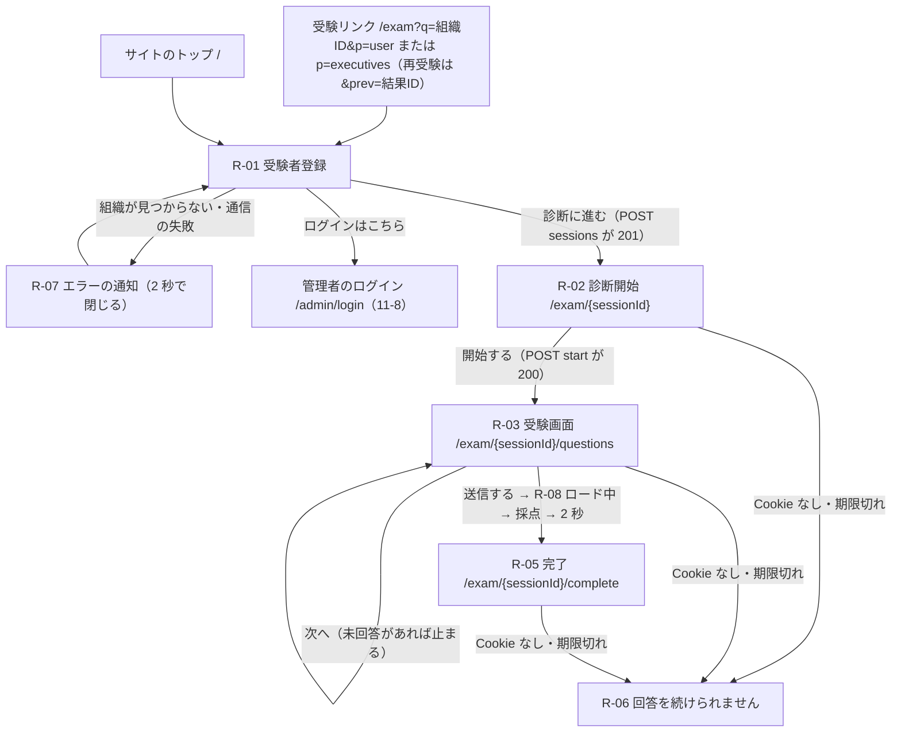

# 11-1 受験者側と採点（M7 領域別仕様書）

| 項目 | 内容 |
|---|---|
| 文書名 | 適性検査システム M7 領域別仕様書 11-1 受験者側と採点 |
| 版 | 1.0 |
| 作成日 | 2026-11-05 |
| 担当キー | `exam`（テスト ID は `M7-exam-NN`） |
| 対象 | 受験者登録（R-01）・診断開始（R-02）・受験画面（R-03）・完了（R-05）・続けられないとき（R-06）・エラーの通知（R-07）・ロード中（R-08）、既存スタッフ用リンク、再受験の入口（受験者側）、送信のときの採点と保存。これらを作る実装担当とレビュー担当、05・02・03・04・08 の改版担当 |
| 対応する PR | PR-7.2（データ項目のうち本書の分）、PR-7.3（受検者画面）、PR-7.4（再受験のつながりのうち受け取りと送信） |

## 0. この文書について

### 0.1 位置づけ

- 本書は、参照元の受験者側の更新（2026-11-04 取得）をアプリに再現するための領域別仕様書で、M7 の総括 `docs/基本設計/11_参照元の更新への追従.md` の下に置く。実装担当が本書だけを見て、受験者側の画面・API・送信のときの保存を作れる粒度で書く。
- 本書と既存の分冊（05 の全体、00 §1.8〜§1.10・§2.2・§3.3・§3.5・§3.7、02 §3.3〜§3.5・§3.7・§8.4・§10・§11、03 §2.3・§4.3、04 §4、08 の受検者側のテスト）が食い違うときは本書を正とし、4 章のとおり各分冊を改版する。05 は本書で大きく変わるため 2.0 版として書き直す。
- 選択肢は書かない。依頼主の決定（10 の K-20〜K-40）を当てはめた最終の仕様だけを書く。参照元と変える箇所は「参照元: …／アプリ: …（K-xx）」と書く。
- 推定は「推定」、取得物から分からないものは「未確認」と書き、6 章にまとめる。

### 0.2 前提とする決定

| 決定 | 本書での当てはめ |
|---|---|
| K-20 | 参照元どおりを原則とする。例外は (1) これまでの決定 (2) セキュリティ上の問題 (3) 参照元の明らかな不具合・誤字 (4) 他社の名称・ロゴ・画像 |
| K-21 | 職業の末尾に「責任者」（職業コード 10）を加える（参照元の「院長」の読み替え）。コード 9 は欠番（旧データの「その他」の表示用） |
| K-27 | 全問必須のまま（未回答では次へ進めず、送信もできない）。必須の示し方と見た目は参照元に合わせる |
| K-28 | 区分を受験のときに保存する。求職者用リンクは「求職者」、既存スタッフ用リンクと再受験は「在籍」 |
| K-31 ① | 再受験リンクの前回の結果は、同じ組織の削除されていない結果で、まだほかの結果の前回になっていないときだけつなぐ。合わなければ通常の受験として登録する |
| K-32 ①②③ | Step 1 の見出しを「Step 1」にする。送信は 1 回だけ。「すでに受験された方・ログインはこちら」の行き先は管理者のログイン画面 |
| K-37 | サービス名は「適性検査」（参照元の製品名は使わない）。受験者側のブラウザのタブ名も「適性検査」 |
| K-39 | 参照元どおりとした事項のうち本書に関わるもの: Q-02（役職。職業「責任者」を役職の既定に使うのは 11-2。本書は職業コード 10 を作る）、Q-11（4 ステップ・各ステップ 1 画面）、Q-12（「戻る」なし）、Q-14（送信の確認なし・「ロード中」）、Q-15（無効なリンクは「診断に進む」で知らせる）、Q-16（登録画面の見た目。配色のコントラストは K-48 で改める）、Q-17（電話番号は必須の検査だけ）、Q-18（利用履歴は送信のときに記録）、Q-31（再受験を作る）、Q-33（再受験は既存スタッフ扱い）、Q-34（前回の値を引き継がない）、Q-35（前回が削除されたらつながりを切る）、Q-44（受験者登録に「すでに受験された方・ログインはこちら」） |
| K-04 | 削除は論理削除のまま。受験者の Cookie の 7 日は「再開できる期間」 |
| K-29 | 既存スタッフの情報は責任者（オーナー）だけに見せる（利用履歴の複製項目を保つ） |
| K-40 | 参照元の文言・デザインを本書にそのまま書いてよい（公開のリポジトリ）。ただし K-31 の対象（参照元のセキュリティ上の問題の詳細）は書かない |
| K-41 | 受験画面を開き直したときは、未回答の設問がある最初のステップから表示する。途中までの回答は保存したまま表示する。前のステップに戻らないこと（K-39 Q-12）は変わらない |
| K-42 | お名前は 100 文字まで、電話番号は 30 文字まで（例外 (2)）。前後の空白を除いて保存し、空白だけの入力は未入力とみなす。電話番号の書式・桁数を検査しないこと（K-39 Q-17）は変わらない |
| K-48 | 文字のコントラストが 05 §8 の基準（文字 4.5:1 以上）に届かない参照元の配色を、届く色にする（届かない組の文字か地の色を、色相を保って濃くする）。押せない状態の表示は対象外で参照元どおり。K-39 Q-16 のうち配色のコントラストを了承した点を改める（ほかの見た目は参照元どおり） |
| 決定事項 2・3・4 | 前回の不具合 10 件は直したまま（優劣性を 12 に上書きしない）。出題は Q1〜Q144。既存システムのデータは移行しない |

### 0.3 根拠の書き方

- 参照元の定義: 「参照元定義（2026-11-04 取得）の …」と書き、ページ・再利用要素・プラグインの名前と要素 id で示す。本書の主な定義は次のとおり。以下、本文では「参照元定義の …」と略す。
  - 受験者登録: ページ index（ページ要素 bUNhT）。見出し Text G（bUhbF）、入力欄 bUhcP（お名前）・bUhcm（電話番号）、プルダウン bUkeA（職業）・bUkgD（過去の診断経験）、ボタン Button C（bUhcs）、リンク Link A、アイコン bUhcU・bUhcr・bUkdv・bUkgF、ワークフロー「Button C の ButtonClicked」2 本と「PageLoaded」3 本。
  - 受験画面: ページ user_form（bUcbt）と再利用要素 Element - Multistep Form（bTWZD。名前の先頭に絵文字が付く）。診断開始のまとまり（bUgHA）、受験のまとまり g:form（bTWeX）、ステップ表示の行 g:step-numbers-row（bTWeZ）、ステップ Step 1〜5（bTWex・bTWfn・bTWgd・bTWhG・bTWhd）、ボタン 次へ（bTWhp）・Back（bTWhq）・送信する（bTWhk）、ロード中（FloatingGroup A、bUjDR）、送信のワークフロー（Button A の ButtonClicked、bTWqF。手順 0〜67）。
  - 完了: ページ endpage（Icon A・Text G・Text D）。
  - スタイル: `Input_input_14___login_page_`、`Button_primary_15_bold_`、`Text_23pt_600_header_`、`Text_15_400_dark_light_`、`Text_15_500_dark_light_`、`Group_group_section___dark_light_`、`RadioButtons_primebutton_` ほか。色トークン primary・text・surface・destructive・Light Grey・#Page Background。
  - 通知の部品: プラグイン「Sweet Alert」（SweetAlert2 6.6.10 を使う）。
- 参照元の実行時 CSS: 「参照元の実行時 CSS（2026-11-04 取得）」と書く。受験者登録ページと受験画面ページを開いたときにブラウザが受け取った、要素ごとの CSS と Bubble のラジオボタンの CSS（`.radio`・`.radio-primary`）、SweetAlert2 の CSS。
- 参照元の画面: 「参照元の画面（2026-11-04）」と書く。テスト受験者 1 名で受験者登録（入力前・入力後）と診断開始まで開いたもの。設問の画面・完了ページの画面写真は無く、その見た目は定義から書いた（6 章）。色の「実測」は、この画面写真の画素の値。
- アプリと前回の仕様: リポジトリのパス（例 `components/respondent/RegistrationForm.tsx`、`docs/基本設計/05_画面設計_受検者.md` §5.3）。

### 0.4 用語

| 用語 | 本書での意味 |
|---|---|
| 受験 | 画面の文言は参照元どおり「受験」と書く（受験者登録、受験リンク）。コード・データの識別子は今のまま（`respondents`、受検者 API、`RespondentKind` など） |
| 受検者区分 | `respondents.kind`（`applicant` = 求職者用リンクで登録、`executive` = 既存スタッフ用リンクまたは再受験で登録）。閲覧範囲を決める |
| 区分 | 求職者・在籍・退職（`results.employmentStatus`。定義は 11-2 §2.3・§3.1）。本書は受験のときの値だけを定める |
| 再受験リンク | 前回の結果の ID を `prev` に付けた既存スタッフ用リンク（§2.2.8）。発行は 11-7 |
| 前回の結果 | `results.previousResultId` が指す受験（定義は 11-7。本書は送信のときに書く） |
| 前回の候補 | 再受験リンクで登録したときに、つなげられると判定した前回の結果の ID（`respondents.previousResultId`。本書） |
| ステップ | 受験画面の 4 つの区切り（Step 1〜4）。各ステップの設問を 1 画面に並べる（K-39 Q-11） |
| 今のステップ | 受験画面に表示しているステップ（§2.4.8） |
| モバイル表示 | 受験画面の画面幅が 920px 以下のときの表示（§2.1.4） |

### 0.5 K-19 の置き換え

画面の文言は置き換え後のアプリの文言で書き、置き換えた箇所は（参照元: …）で原文を残す。本書の範囲で置き換えるのは職業の「院長」（→「責任者」。K-21）だけで、受験者側の画面の文言（登録・案内文・設問・完了）に「院長」「医院」「クリニック」と歯科の職種・業務の語は無い（職業の選択肢はアプリの職業マスタの名前）。言い換えに迷う文言は無い。

### 0.6 ほかの領域との分担

| 領域 | 本書との関係 |
|---|---|
| 11-2 回答一覧 | 区分・入社日・退職日・役職の定義（`results.employmentStatus`・`hiredOn`・`leftOn`・`staffRole`。11-2 §2.3・§3.1）と、既存の結果への区分の付与（`scripts/backfill-m7.ts`。11-2 §3.1）。本書は送信のときにその初期値を書く。職業コード 10 の定数を本書が定め、11-2 が役職の札の既定に使う。利用履歴を送信のときに作るのは本書、表示（送信済みだけ、`submittedAt` の新しい順）は 11-2 |
| 11-3 在籍・退職と組織内分類 | 本書が書いた区分を読む |
| 11-5 比較 | 再受験した人の古い結果を母集団から外す（K-39 Q-10）。本書が書く `results.previousResultId` を読む |
| 11-6 AI 解説 | AI 解説の 3 系統の状態など、`results` に足す項目の作成時の値を 11-6 が定め、本書の送信（`submitSession()`）がその値を書く。職業「責任者」（コード 10）の受験の扱いは 11-6 |
| 11-7 再受験と経年比較 | 再受験リンクの発行（形は本書 §2.2.8）、`results.previousResultId` の定義とつながりの不変条件（§3.3）、手動の組み合わせ。本書は再受験リンクの受け取りと、送信のときのつながりの確定を行う |
| 11-8 管理画面の枠 | 管理者のログイン画面（本書のリンクの行き先）、受験リンクを表示するアカウント画面（形は今のまま。§2.1.1）、管理画面の Web フォント。Inter は本書も 11-8 §2.2.2 と同じ `@fontsource/inter` の同梱で入れる（同じ書体を 2 つの方法で入れない。§2.1.3） |

## 1. 範囲

### 1.1 差分 ID と本書での扱い

差分 ID は M7 の差分の一覧（総括 `11_参照元の更新への追従.md`）の番号。受験者側（`exam-NN`）のほか、ほかの領域の差分のうち受験者側で作る部分を末尾に挙げる。

| ID | 項目 | 扱い | 決定 | 本書の節 |
|---|---|---|---|---|
| exam-01・misc-29 | 職業の追加（参照元: 「院長」。コード 10・末尾。misc-29 はデータの側から見た同じ差分） | 作る（「責任者」・コード 10・末尾） | K-21 | §2.2.4 |
| exam-02 | 「すでに受験された方・ログインはこちら」 | 作る（行き先は管理者のログイン画面） | K-39 Q-44、K-32 ③ | §2.2.7 |
| exam-03 | 再受験の入口（prev → 再受験元の回答 → 前回の回答） | 作る（つなぐ条件を付ける） | K-39 Q-31、K-31 ① | §2.2.8、§2.7.3 |
| exam-04 | 幹部用リンクの見出しと p の判定 | 作る（参照元どおり） | K-20 | §2.2.1、§2.2.2 |
| exam-05 | 無効な組織リンク | 作る（フォームを出し、「診断に進む」で知らせる） | K-39 Q-15 | §2.2.6、§2.1.5 |
| exam-06 | URL の「amp;」を除く | 作る | K-20 | §2.2.1 |
| exam-07 | 登録画面の見た目 | 作る（参照元どおり。ただし文字のコントラストが基準に届かない配色は変える。ボタンは R-02・R-03 も同じ） | K-39 Q-16、K-48 | §2.2.2、§2.2.3、§2.1.3 |
| exam-08 | 登録の入力チェック | 作る（必須だけ。お名前・電話番号の長さの上限と前後の空白の除去を足す） | K-39 Q-17、K-42 | §2.2.5 |
| exam-09 | ログイン中の管理者の転送 | 作らない | — | §1.3 |
| exam-10 | 受験者の登録内容（変化なし・実装済み） | 変えない（保存の項目を足すだけ） | — | §2.2.6 |
| exam-11 | 診断開始と下書き（変化なし・実装済み） | 作る（アプリが足した補足 3 行を消す） | K-20 | §2.3 |
| exam-12 | 4 ステップ・各ステップ 1 画面 | 作る | K-39 Q-11 | §2.4.1、§2.4.2 |
| exam-13 | ステップごとの見出しと案内文 | 作る（Step 1 の見出しは「Step 1」） | K-39 Q-11、K-32 ① | §2.4.1 |
| exam-14 | ステップ表示 | 作る（文字のコントラストが基準に届かない色は変える） | K-20、K-48 | §2.4.3、§2.1.3 |
| exam-15 | 設問の番号表記 | 作る（全問「{番号}. 」） | K-20（Q1 の空白は例外 (3)。7 章で確認） | §2.4.4 |
| exam-16 | 回答の保存と再開 | 作る（選んだ時点で保存。開き直したときは未回答の設問がある最初のステップから） | K-39 Q-11、K-41 | §2.4.5、§2.4.8 |
| exam-17 | 「戻る」ボタンが無い | 作る（戻れない） | K-39 Q-12 | §2.4.6、§2.4.9 |
| exam-18 | 未回答のまま進める・送信できる | 参照元と変える（全問必須） | K-27 | §2.4.6 |
| exam-19 | 「次へ」で優劣性を 12 に上書き（変化なし） | 再現しない | 決定事項 2 | §1.3 |
| exam-20 | 最終ステップ用の旧式（変化なし。到達しない） | 作らない | — | §1.3 |
| exam-21 | 送信（確認なし・「ロード中」・2 秒） | 作る（送信は 1 回だけ。「ロード中」の文字の色は変える） | K-39 Q-14、K-32 ②、K-48 | §2.4.7、§2.1.6 |
| exam-22 | 送信のときに保存するデータ（変化なし・実装済み） | 変えない（項目を足す） | — | §2.7 |
| exam-23 | 利用回数管理は送信のときに作る | 作る | K-39 Q-18 | §2.7.4 |
| exam-24 | 完了ページ | 作る | K-20 | §2.5 |
| exam-25 | 使われていない「送信完了！」ポップアップ | 作らない（参照元でも出ない） | — | §1.3 |
| exam-26 | 一括再採点と test ページ | 作らない | 決定事項 4 | §1.3 |
| exam-27 | 採点式（変化なし・実装済み） | 変えない | — | §2.7.1 |
| exam-M1 | 職業「責任者」（参照元: 院長）が役職の既定になる | 本書は職業コード 10 と定数を作る。札と役職は 11-2 | K-21、K-39 Q-02 | §2.2.4 |
| exam-M2 | 再受験リンクの q | 参照元と変える（q は受験リンクと同じ組織 ID） | K-31 ① | §2.2.8 |
| exam-M3 | 入力欄のスタイル | 作る | K-39 Q-16 | §2.2.3 |
| keinen-01（受け取りと送信） | 前回の回答のつながり | 作る（登録で候補、送信で確定） | K-39 Q-31、K-31 ① | §2.2.8、§2.7.3 |
| keinen-M3（受験者側） | 同じ再受験リンクで 2 回受けたとき | 枝分かれを作らない | K-31 ① | §2.7.3 |
| keinen-M1・list-M2（受験者側） | 再受験で前回の値を引き継がない | 作る（参照元どおり） | K-39 Q-34 | §2.7.2 |
| ai-M3（受験者側） | 再受験は既存スタッフ扱い | 作る | K-39 Q-33 | §2.2.8 |
| list-03・zaiseki-16（受験者側） | 区分を受験のときに保存 | 作る | K-28 | §2.7.2 |
| keinen-23 | 受験者登録の「すでに受験された方・ログインはこちら」（exam-02 と同じ） | 作る（exam-02 として。11-7 §2.17 は本書を参照） | K-39 Q-44、K-32 ③ | §2.2.7 |
| keinen-24（受験者側） | 既存スタッフ用リンク（`p=executives`）で登録すると既存スタッフの受験になる（変化なし・実装済み） | 変えない（判定は §2.2.1。表示制限は 11-7 §2.3） | — | §2.2.1 |
| misc-M4（受験者側） | 下書きの「回答者情報」（幹部／その他） | 作らない（受検者区分 `respondents.kind` で表す。対応不要） | — | §1.3 |

### 1.2 作るもの

1. 受験者登録（R-01）を参照元の見た目にする: ラベルの無いプレースホルダーとアイコンの入力欄 4 つ、過去の診断経験はプルダウン、主色 #3F8DA5（文字と、白い文字の地の色は 13）、共通ヘッダーなし、見出し「受験者登録」（既存スタッフ用リンクは「受験者登録(幹部用)」）、「すでに受験された方・ログインはこちら」。サイトのトップ `/` にも同じ画面を出す。
2. 無効な受験リンクでもフォームを出し、「診断に進む」で通知（R-07「エラー」）を出す。URL の「amp;」を除いて開き直す。
3. 職業に「責任者」（コード 10）を末尾に加える。
4. 入力チェックを必須だけにする（電話番号の書式・桁数の検査と正規化をやめる）。ただし、お名前 100 文字・電話番号 30 文字の上限と、前後の空白の除去（空白だけは未入力）は設ける（K-42）。
5. 診断開始（R-02）を参照元の見た目にし、アプリが足した補足 3 行を消す。
6. 受験画面（R-03）を 4 ステップ・各ステップ 1 画面（Q1〜41、Q42〜82、Q83〜123、Q124〜144）にし、ステップ表示・見出し・案内文・設問の表記・ラジオボタンを参照元の見た目にする。「戻る」は出さない。
7. 回答を選んだ時点で保存する。表示するステップは、未回答の設問がある最初のステップ（K-41）。
8. 全問必須（K-27）: 未回答があると「次へ」「送信する」で進まず、未回答の設問を参照元の赤で示す。
9. 送信は確認なしで「ロード中」（R-08）を出し、採点と保存のあと 2 秒待って完了へ。二重送信を防ぐ。
10. 完了（R-05）を参照元の文言とアイコンにする。
11. 再受験リンクを受け取り、条件を満たす前回の結果だけを送信のときにつなぐ（K-31 ①）。再受験は既存スタッフ扱い。
12. 送信のときに区分（K-28）・前回の結果・利用履歴（Q-18）を書く。
13. 参照元の配色のうち、文字と地の組で 05 §8 の基準（文字 4.5:1 以上）に届かない 12 組を、届く色にする（K-48。§2.1.3）。押せない状態の表示と、枠線・線・アイコンの色は参照元どおり。

### 1.3 作らないもの・再現しないもの

| 事項 | 理由 |
|---|---|
| ログイン中の管理者を管理画面へ転送する（exam-09） | 参照元は受験者も管理者も同じ利用者の仕組みのため、受験の登録で管理者のログインが上書きされないように転送している。アプリは管理者と受験者の認証が別で、転送しなくても同じ結果（管理者のログインは受験で変わらない）になる |
| 「次へ」で優劣性を 12 に上書きする（exam-19） | 決定事項 2（前回の不具合 1） |
| 最終ステップの「次へ」の旧式（exam-20） | 参照元でも押せない（ボタンのまとまりが最終ステップで非表示） |
| 「送信完了！」ポップアップ（exam-25） | 参照元でも出す処理が無い |
| 一括再採点と test ページの保守ボタン（exam-26） | 決定事項 4（既存データを移行しない）。保守用 |
| Step 5（Q165〜Q204）と Step 4 の中の Q145〜Q164 | 参照元でも表示されない。決定事項 3 |
| 「Back」ボタン | 参照元で表示する条件が無い（K-39 Q-12） |
| ステップ番号の丸を押してステップを移る処理 | 参照元で無効（ワークフローが止めてある） |
| 受験者を Bubble の利用者として作る処理、「Onboarding %」の更新、下書きの「回答者情報」（misc-M4） | Bubble の仕組みに由来する。アプリは `respondents`・`assessmentSessions` で同じことを表す |
| ページの読み込み中の全面ローダー（user_form の fg:loading）と、読み込み中の「Loading...」 | Bubble の読み込み表示。アプリはサーバで描いて返す |
| ダークモードの表示 | 参照元の受験者はダークモードにならない（条件は利用者の設定で、受験者には無い） |
| アプリが足していた要素: 受験リンクを開き直したときの再開の案内（ResumeBanner）、診断開始の補足 3 行、全体の進捗バーと「{回答済み} / 144」、送信の確認ダイアログ（R-04）、「戻る」、下部固定のボタン、共通ヘッダー「適性検査」、未回答の件数の表示、項目名のラベル・必須の印・補足文・入力欄の下のエラー文言、無効リンクの専用画面（organization_not_found）、ページ番号の画面（page_not_found） | 参照元に無い（K-20）。項目名とエラー文言は読み上げ用に見えない形で残す（§2.1.7） |

### 1.4 参照元と変えるもの

| # | 事項 | 参照元 | アプリ | 決定 |
|---|---|---|---|---|
| 1 | 未回答 | 未回答の検査が無く、未回答のまま「次へ」で進み「送信する」で送れる（未回答は 0 点として計算されると推定） | 全問必須。未回答があると進まず、未回答の設問を赤で示す（§2.4.6） | K-27 |
| 2 | Step 1 の見出し | 「1 / 5」（「現在のステップ / 5」の残り） | 「Step 1」（ほかのステップと同じ形） | K-32 ① |
| 3 | 送信 | 「送信する」を無効にしない（二度押しで回答データが二重にできうる） | 1 回だけ送る（画面の操作の止めと、サーバの状態の確認。§2.4.7） | K-32 ② |
| 4 | 「すでに受験された方・ログインはこちら」の行き先 | signup ページ（パラメータなし） | 管理者のログイン画面 `/admin/login` | K-32 ③ |
| 5 | 再受験リンクの前回の結果 | 確かめ方は書かない（K-31） | 同じ組織・論理削除されていない・まだほかの結果の前回になっていない結果だけをつなぐ。合わなければ通常の受験として登録する（§2.2.8、§2.7.3） | K-31 ① |
| 6 | 再受験リンクの形 | 組織の表し方が受験リンクと違う（詳細は書かない。K-31） | 受験リンクと同じ組織 ID の `q` に `prev` を足す（§2.2.8） | K-31 ① |
| 7 | つながる候補がある受験の受検者区分 | `p` だけで決まる | 前回の候補を受け付けた受験は、`p` にかかわらず既存スタッフ（`executive`） | K-39 Q-33、K-29 |
| 8 | 入力の長さ | お名前・電話番号に上限なし | お名前 100 文字・電話番号 30 文字まで（保存と表示を壊さないための上限。§2.2.5） | K-42（例外 (2)） |
| 9 | 前後の空白 | 扱いの定義なし（未確認） | お名前・電話番号の前後の空白を除いて保存し、空白だけは未入力とみなす（§2.2.5） | K-42 |
| 10 | Q1 の番号の表記 | Q1 だけ「1.人の好き嫌いが多い」（空白なし）。ほかの 203 問は「2. 大勢の前でも平気である」 | 全問「{番号}. {設問文}」（7 章で確認） | K-20 例外 (3) |
| 11 | Q1 の選択肢の字間 | Q1 のラジオボタンだけスタイルが違い、字間 1px | 全問同じ（字間 0） | K-20 例外 (3) |
| 12 | 幅 320px の受験画面 | 受験画面の要素の最小幅が 320px で、外側の幅 90% より広くなり、横にはみ出すと推定 | はみ出さない（最小幅を付けない） | K-20 例外 (3) |
| 13 | 開き直したときのステップ | Step 1 から（画面の状態の初期値が 1 のため。推定） | 未回答の設問がある最初のステップから。途中までの回答は保存したまま表示する（§2.4.8） | K-41（依頼主の判断）。K-04（再開できる期間）と K-39 Q-12（前のステップに戻らない）は変わらない |
| 14 | 受験を続けられないとき（Cookie が無い・期限切れ） | 受験者登録（パラメータなし）へ戻す。組織が分からないので、そこからは登録できない | 「回答を続けられません」の案内（R-06）を出す | K-20 例外 (3) |
| 15 | 通知の改行 | 「Sweet Alert」の本文の改行は空白として表示される（SweetAlert2 6.6.10 は本文を `textContent` で入れ、CSS に改行を残す指定が無い） | 改行で折り返す（§2.1.5） | K-39 Q-15（了承された文言に「（改行）」がある）、K-20 例外 (3) |
| 16 | 通知のアイコン | 種類の指定が無く、部品の既定（success）が使われるかは未確認 | アイコンを出さない（§2.1.5） | 参照元が未確認のためのアプリの判断（6 章の 6） |
| 17 | 配色（文字のコントラスト） | 文字と地の 12 組が 05 §8 の基準（文字 4.5:1 以上）に届かない。ボタンの地 #3F8DA5 の白い文字 3.77:1、プレースホルダー #A1A1A1 2.58:1、プルダウンの未選択 #9C9C9C 2.75:1、リンク #4083A9 3.95:1、ボタンのホバー・押下 3.25:1、ステップ表示の番号・ラベル（ホバー・押下を含む）1.89〜3.77:1、「ロード中」3.68:1 | 届かない組の文字か地の色を、色相と彩度を保って明度だけを下げ、基準に届く最初の色にする。ボタンの地 #397F94（4.53:1）、プレースホルダーとプルダウンの未選択 #767676（4.54:1）、リンク #3B799C（4.52:1）など。12 組の参照元の色・比とアプリの色・比は §2.1.3 の表。押せない状態の表示と、枠線・線・アイコンの色は参照元どおり | K-48 |

見た目を変えない次の追加は「変えるもの」に数えない: 入力欄の読み上げ用の名前とエラー文言（§2.1.7）、キーボードで操作したときのフォーカスの枠、未保存の選択の `sessionStorage` への退避（§2.4.5）、保存の途中でタブを閉じるときのブラウザの確認（§2.4.9）。

## 2. 仕様

### 2.1 共通

#### 2.1.1 画面とルート

| R-ID | 画面 | URL | ファイル | 変更 |
|---|---|---|---|---|
| R-01 | 受験者登録 | `/`、`/exam`（クエリ `q`・`p`・`prev`） | `app/(respondent)/page.tsx`（新設。`/`）、`app/(respondent)/exam/page.tsx` | 作り直し |
| R-02 | 診断開始 | `/exam/{sessionId}` | `app/(respondent)/exam/[sessionId]/page.tsx` | 見た目と遷移先 |
| R-03 | 受験画面 | `/exam/{sessionId}/questions`（ステップ番号は URL に入れない） | `app/(respondent)/exam/[sessionId]/questions/page.tsx`（新設） | 作り直し |
| （移行） | 旧ページの URL | `/exam/{sessionId}/questions/{1〜20 など}` | `app/(respondent)/exam/[sessionId]/questions/[...legacy]/page.tsx`（新設） | `/exam/{sessionId}/questions` へリダイレクト（M7 の公開の時点で受験中の人のため） |
| R-04 | 送信確認ダイアログ | — | — | 廃止（K-39 Q-14） |
| R-05 | 完了 | `/exam/{sessionId}/complete` | `app/(respondent)/exam/[sessionId]/complete/page.tsx` | 文言とアイコン |
| R-06 | 続けられないとき・予期しない失敗 | R-02・R-03・R-05 の URL のその場 | `components/respondent/ExamErrorView.tsx` ほか | 種別を 2 つにする |
| R-07 | エラーの通知 | R-01・R-02・R-03 の上に重ねる | `components/respondent/ExamAlertDialog.tsx`（新設） | 新設 |
| R-08 | ロード中 | R-03 の上に重ねる | `components/respondent/LoadingOverlay.tsx`（新設。`BusyOverlay` を置き換え） | 新設 |

- 受験リンクの形は今のまま変えない: 求職者用 `{サイトの URL}/exam?q={organizationId}&p=user`、既存スタッフ用 `{サイトの URL}/exam?q={organizationId}&p=executives`（`lib/services/admin-account.ts`。表示は 11-8・11-2）。再受験リンクは §2.2.8。
- ブラウザのタブ名は全画面「適性検査」（参照元: 「First」。K-37）。`app/layout.tsx` の今の値のまま。

#### 2.1.2 画面の流れ



サーバ（Server Component）が返す画面（05 §1.3 を置き換える）:

| URL | Cookie が有効でセッションと一致 | `status` | `startedAt` | 返す画面 |
|---|---|---|---|---|
| `/`、`/exam` | 見ない | — | — | R-01（URL に「amp;」があれば先に §2.2.1 のリダイレクト） |
| `/exam/{sessionId}` | いいえ | — | — | R-06（`session_unavailable`） |
| `/exam/{sessionId}` | はい | `submitted` | — | `/exam/{sessionId}/complete` へリダイレクト |
| `/exam/{sessionId}` | はい | `draft` | null | R-02 |
| `/exam/{sessionId}` | はい | `draft` | あり | `/exam/{sessionId}/questions` へリダイレクト |
| `/exam/{sessionId}/questions` | いいえ | — | — | R-06（`session_unavailable`） |
| `/exam/{sessionId}/questions` | はい | `submitted` | — | `/exam/{sessionId}/complete` へリダイレクト |
| `/exam/{sessionId}/questions` | はい | `draft` | null | `/exam/{sessionId}` へリダイレクト |
| `/exam/{sessionId}/questions` | はい | `draft` | あり | R-03（今のステップは §2.4.8） |
| `/exam/{sessionId}/questions/{何か}` | — | — | — | `/exam/{sessionId}/questions` へリダイレクト（Cookie が無効なときは、先に `questions/layout.tsx` のセッションの検証が R-06（`session_unavailable`）を出す。有効なときの判定はリダイレクト先で行う） |
| `/exam/{sessionId}/complete` | いいえ | — | — | R-06（`session_unavailable`） |
| `/exam/{sessionId}/complete` | はい | `draft` | — | `/exam/{sessionId}` へリダイレクト |
| `/exam/{sessionId}/complete` | はい | `submitted` | — | R-05 |

- Cookie の検証は今のまま（`requireRespondentSessionFromCookies`。04 §2.5.2。トークンのハッシュの一致・期限・`deletedAt == null`・パスの `sessionId` の一致）。組織が論理削除されているときも R-06。

#### 2.1.3 配色・文字・寸法

受験者側の画面のトークン（`app/(respondent)/exam.css` の `.exam-root` に置く。今の 05 §2.5 のトークンはすべて置き換える）:

| トークン | 値 | 用途 | 根拠 |
|---|---|---|---|
| `--color-bg` | #F7F9FC | 画面の背景 | 参照元定義の色トークン「#Page Background」（rgba(247,249,252)）。ページのスタイル `Page_page___dark_light_` |
| `--color-surface` | #FFFFFF | 入力欄・カードの地 | 色トークン primary_contrast・background |
| `--color-text` | #4C4B4B | 文字 | 色トークン text（rgba(76,75,75)） |
| `--color-primary` | #3F8DA5 | 主色。ステップ表示の丸の枠と線、入力欄のフォーカスの枠、フォーカスの枠（§2.1.7）、R-08 のアイコン、R-05 のアイコンのホバー、押せない状態のボタンの文字。押せない状態のほかは、文字と、白い文字の地に使わない（下の K-48 のトークンを使う） | 色トークン primary（rgba(63,141,165)） |
| `--color-button` | #397F94 | ボタン（診断に進む・開始する・次へ・送信する）の地、済んだステップの丸の地 | K-48（参照元は主色 #3F8DA5。下の表の 3） |
| `--color-button-hover` | rgba(50,111,130,0.9) | ボタンのホバー・押下の地（基の色 #326F82 の 90%） | K-48（参照元はスタイル `Button_primary_15_bold_` の rgba(63,141,165,0.9)。表の 4） |
| `--color-primary-50` | rgba(63,141,165,0.5) | 今と先のステップの丸のホバー・押下の地 | 受験画面の g:step-#（bTWel）の条件 |
| `--color-primary-10` | rgba(63,141,165,0.1) | 押せない状態のボタンの地、今のステップの丸の地 | `Button_primary_15_bold_` の押せない状態、bTWel の条件 |
| `--color-step-number-current` | #337286 | 今のステップの丸の番号 | K-48（参照元は主色。表の 6） |
| `--color-step-number-future` | #2E2E2E | 先のステップの丸の番号（丸ごと不透明度 70% で表示） | K-48（参照元は text #4C4B4B。表の 8） |
| `--color-step-label` | #377A8F | 今と済んだステップのラベル | K-48（参照元は主色。表の 7） |
| `--color-step-circle-hover-done` | #447E91 | 済んだステップの丸のホバー・押下の地 | K-48（参照元は rgba(63,141,165,0.5)。表の 9） |
| `--color-step-number-current-hover` | #24515F | 今のステップの丸のホバー・押下のときの番号 | K-48（参照元は主色。表の 10） |
| `--color-step-number-future-hover` | #141313 | 先のステップの丸のホバー・押下のときの番号（丸ごと不透明度 70% で表示） | K-48（参照元は text #4C4B4B。表の 11） |
| `--color-loading-text` | #387D93 | R-08 の「ロード中」の文字 | K-48（参照元は主色。表の 12） |
| `--color-line` | #D5D5D5 | カードの枠、ステップの先の線、入力欄のアイコン | 色トークン surface（rgba(213,213,213)） |
| `--color-input-border` | #F2F4F8 | 入力欄・プルダウンの枠 | 色トークン Light Grey（rgba(242,244,248)） |
| `--color-placeholder` | #767676 | 入力欄のプレースホルダー | K-48（参照元は `Input_input_14___login_page_` の #A1A1A1。表の 1） |
| `--color-select-placeholder` | #767676 | プルダウンの未選択の表示 | K-48（参照元は画面（2026-11-04）の実測の #9C9C9C。定義は未確認。表の 2） |
| `--color-select-text` | #252525 | プルダウンの選んだ値の文字 | 参照元の画面の実測（定義は未確認） |
| `--color-select-arrow` | #999999 | プルダウンの矢印 | 参照元の画面の実測 |
| `--color-destructive` | #DD0D0D | 未回答の印。入力欄の不正の枠は rgba(221,13,13,0.7) | 色トークン destructive（rgba(221,13,13)）、`Input_input_14___login_page_` |
| `--color-select-focus` | #52A8EC | プルダウンのフォーカスの枠と影 | 職業・過去の診断経験のプルダウン（bUkeA・bUkgD）の条件 |
| `--color-select-invalid` | #FF0000 | プルダウンの不正の枠と影 | 同 |
| `--color-link` | #3B799C（ホバー #205F82、押下 #134B70） | ログインのリンク | K-48（参照元は実行時 CSS（Link A の文字色）の #4083A9。表の 5）。ホバー・押下は参照元（Link A の条件）のまま |
| `--color-radio-border` | #CCCCCC | ラジオボタンの円 | 参照元の実行時 CSS の `.radio label::before` |
| `--color-radio-checked` | #337AB7 | 選んだラジオボタンの円と点 | 参照元の実行時 CSS の `.radio-primary`（ラジオボタンの色「primary」は Bootstrap の色で、主色 #3F8DA5 ではない） |
| `--color-step-row-border` | rgba(76,75,75,0.2) | ステップ表示の行の下の線 | スタイル `Group_group_transparent___bottom_border___hovering_` の明るい表示の条件 |
| `--color-step-circle-border` | rgba(76,75,75,0.3) | ステップの丸の枠 | bTWel |
| `--color-step-circle-bg` | rgba(76,75,75,0.1) | ステップの丸の地 | bTWel |
| `--color-overlay-light` | rgba(255,255,255,0.5) | R-08 の全面 | FloatingGroup A（bUjDR） |
| `--color-overlay-dark` | rgba(0,0,0,0.4) | R-07 の背景 | SweetAlert2 6.6.10 の `.swal2-container.swal2-shown` |
| `--font-inter` | "Inter" | Inter の書体の名前（`@fontsource/inter` の CSS が定める名前）。11-8 §2.2.2 の `.admin-root` と同じ変数名 | 参照元のフォントのトークン（既定のフォント Inter） |
| `--font-body` | var(--font-inter)（ラテン文字）, "Hiragino Sans", "Hiragino Kaku Gothic ProN", "Noto Sans JP", "Yu Gothic", Meiryo, sans-serif | 本文 | 参照元のフォントのトークン（既定のフォント Inter）。日本語は Inter に無いので代わりのフォント（参照元は OS の既定。画面写真はゴシック体） |
| `--font-radio` | Arial, 上の日本語のフォント | ラジオボタンの文言 | ラジオボタン 204 個の設定（Arial） |

- Inter の読み込み: 参照元は Google Fonts から読む／アプリ: 管理画面（11-8 §2.2.2）と同じく npm の `@fontsource/inter` で同梱し、アプリから配信する（総論 8.3 の 7。同じ書体を 2 つの方法で入れない。実行時に外部（Google Fonts）へ取りに行かない。CSP の `font-src 'self' data:` のまま）。
  - 入れ方: 実装の時点の最新の版を固定して入れる（`pnpm add -E @fontsource/inter`。`package.json` の `dependencies`）。11-8 の PR-7.13a が先に入っていれば、入れてあるものを使う。
  - 読み込む太さ: 400・500・600。太さごとの CSS（`import "@fontsource/inter/400.css";`・`500.css`・`600.css`）を `app/(respondent)/layout.tsx` の先頭で読み込む。各 CSS は字の範囲（`unicode-range`）ごとにファイルが分かれ、使う字の範囲のファイルだけが読まれる。`font-display` は各 CSS の既定（`swap`）のまま。
  - 書体の名前は `"Inter"`。`.exam-root` に `--font-inter: "Inter"` を置き、`--font-body` の先頭に使う（上の表）。管理画面の書体の変数（`--font-admin` など）は 11-8。
- コントラスト（K-48）: 受験者側のすべての画面（R-01〜R-03・R-05〜R-08）の文字と地の組を、05 §8 の基準（文字は 4.5:1 以上。文字の大きさで分けない）で確かめ、届かない組だけを変える。ホバー・押下・フォーカスのときの組も同じに確かめる。K-39 Q-16 では依頼主が参照元の配色のコントラストを了承していたが、K-48 でこの点を改めた（ほかの見た目は参照元どおり）。受験画面・診断開始・完了・続けられないときも同じトークンを使う（K-20）。
  - 計算: WCAG 2 の相対輝度とコントラスト比の式で計算する。半透明の色と、不透明度 70% の丸は、下の色に重ねて表示される色（8 ビットに丸めた値）で計算する。比は小数第 3 位を四捨五入して書く。
  - 変え方: 組の片方の色だけを変える（白い文字の地なら地、明るい地の上の色の文字なら文字）。HSL の色相と彩度を保ち、明度を参照元の色の値から 0.5% ずつ下げ、比が 4.5:1 以上になる最初の色（いちばん明るい色）にする。
  - 対象外: 押せない状態の表示（「診断に進む」「開始する」の押せない状態。文字 #3F8DA5、地 rgba(63,141,165,0.1)。画面の背景に重ねて #E5EEF3 で 3.21:1、白のカードに重ねて約 3.4:1）は基準の対象外のため、参照元どおり。
  - 同じ色を枠線・線・アイコンにも使う箇所は、その用途が 05 §8 の基準（意味を持つ枠線と部品は 3:1 以上）に届いているため、参照元の色のまま（主色 #3F8DA5 は画面の背景の上で 3.58:1、白の上で 3.77:1、R-08 の全面の上で 3.68:1）。届かない文字と地の用途だけに K-48 のトークンを当てる。済んだステップの丸も、地だけを #397F94 にし、枠は #3F8DA5 のまま。
  - 基準に届いていて変えない組: 本文 #4C4B4B（白の上で 8.69:1、背景の上で 8.24:1。先のステップのラベルを含む）、プルダウンの選んだ値 #252525（白の上で 15.33:1）、未回答の印 #DD0D0D（白の上で 5.08:1）、リンクのホバー #205F82（背景の上で 6.59:1）と押下 #134B70（8.78:1）、R-07 の見出し #595959（白の上で 7.00:1）と本文 #545454（7.57:1）。

K-48 で変えた組（参照元の色・比 → アプリの色・比）:

| # | 文字／地 | 画面 | 参照元 | アプリ | トークン |
|---:|---|---|---|---|---|
| 1 | 入力欄のプレースホルダー／入力欄の地（白） | R-01 | #A1A1A1・2.58:1 | #767676・4.54:1 | `--color-placeholder` |
| 2 | プルダウンの未選択の表示／プルダウンの地（白） | R-01 | #9C9C9C（実測）・2.75:1 | #767676・4.54:1 | `--color-select-placeholder` |
| 3 | 白い文字／ボタン（診断に進む・開始する・次へ・送信する）の地。白い番号／済んだステップの丸の地 | R-01〜R-03 | #3F8DA5・3.77:1 | #397F94・4.53:1 | `--color-button` |
| 4 | 白い文字／ボタンのホバー・押下の地 | R-01〜R-03 | rgba(63,141,165,0.9)。白の上で #5298AE、画面の背景の上で #5198AE。どちらも 3.25:1 | rgba(50,111,130,0.9)（基の色 #326F82）。白の上でも画面の背景の上でも #467D8E・4.58:1 | `--color-button-hover` |
| 5 | ログインのリンク／画面の背景（#F7F9FC） | R-01 | #4083A9・3.95:1 | #3B799C・4.52:1 | `--color-link` |
| 6 | 今のステップの丸の番号／丸の地（rgba(63,141,165,0.1)。背景に重ねて #E5EEF3） | R-03 | #3F8DA5・3.21:1 | #337286・4.59:1 | `--color-step-number-current` |
| 7 | 今と済んだステップのラベル／画面の背景 | R-03 | #3F8DA5・3.58:1 | #377A8F・4.58:1 | `--color-step-label` |
| 8 | 先のステップの丸の番号／丸の地（丸ごと不透明度 70%。地は背景に重ねて #EBEDF0） | R-03 | #4C4B4B（表示は #7F7F80）・3.41:1 | #2E2E2E（表示は #6A6B6C）・4.55:1 | `--color-step-number-future` |
| 9 | 白い番号／済んだステップの丸のホバー・押下の地 | R-03 | rgba(63,141,165,0.5)（背景に重ねて #9BC3D0）・1.89:1 | #447E91（不透明）・4.53:1 | `--color-step-circle-hover-done` |
| 10 | 今のステップの丸の番号／ホバー・押下の地（#9BC3D0） | R-03 | #3F8DA5・2.00:1 | #24515F・4.60:1 | `--color-step-number-current-hover` |
| 11 | 先のステップの丸の番号／ホバー・押下の地（丸ごと不透明度 70%。地は背景に重ねて #B7D3DE） | R-03 | #4C4B4B（表示は #7F7F80）・2.55:1 | #141313（表示は #585859）・4.53:1 | `--color-step-number-future-hover` |
| 12 | 「ロード中」／R-08 の全面（rgba(255,255,255,0.5)。白のカードに重ねて #FFFFFF、画面の背景に重ねて #FBFCFE） | R-08 | #3F8DA5・3.68:1（#FBFCFE の上。#FFFFFF の上は 3.77:1） | #387D93・4.52:1（#FFFFFF の上は 4.64:1） | `--color-loading-text` |

- 4 は、参照元の形（基の色の 90%）を保ち、基の色 #3F8DA5 の明度を下げて #326F82 にした。ボタンが白のカードの上（開始する・送信する）でも、画面の背景の上（診断に進む・次へ）でも、同じ色で届く。
- 9 は、α 0.5 のままではどの色でも届かない（黒でも 4.17:1）ため、表示される色 #9BC3D0 の色相と彩度を保って明度を下げ、不透明の色にした。今と先のステップの丸のホバー・押下の地は rgba(63,141,165,0.5) のまま（10・11 で番号の色を変える）。
- 12 は、全面の下にある色のうち暗い方（画面の背景）でも届く色にした。
- 寸法の単位はすべて CSS の px。参照元のスタイル名の「23pt」「14pt」は名前だけで、値は px（`%fs: 23` など）。

#### 2.1.4 枠と幅の切り替え

| 枠 | 使う画面 | 寸法 | 根拠 |
|---|---|---|---|
| 狭い枠 | R-01・R-05・R-06 | 上の余白 134px（70px + 64px）、下の余白 96px（32px + 64px）。中身の幅は最大 500px で左右に 20px の内側の余白（中身は最大 460px）、中央寄せ。画面幅が 490px 未満のときは外側の左右に 8px を足す | 参照元定義の index の g:content（bUNhl。上余白 70px・下の内側の余白 32px）、GR - section 1（bUNiV。上下の内側の余白 64px、要素の間 50px、幅 490px 未満で左右 8px）、Auth: Sign Up（bUhaz。最大幅 500px、左右の内側の余白 20px）。endpage も同じ構成 |
| 広い枠 | R-02・R-03 | 上の余白 50px、幅は画面の 90%（中央寄せ） | 参照元定義の user_form の Section: Onboarding（bUccV。上余白 50px、最大幅 90%） |

画面幅による切り替え:

| 条件 | 変わるもの | 根拠 |
|---|---|---|
| 幅 490px 未満 | 狭い枠の外側の左右に 8px | bUNiV の条件 |
| 幅 768px 未満 | 23px の見出し（R-01・R-02・R-05・R-06）を 19px にする | スタイル `Text_23pt_600_header_` の条件 |
| 幅 920px 以下 | 受験画面のモバイル表示（§2.4.2・§2.4.3）: ステップのラベルを出さない、ステップの線の上余白を 0、番号の並びの最小幅を 100%、設問の欄の左右に 8px | 受験画面の var - mobile mode?（bTWhx）= 画面幅 ≦ App Level Setting の「Mobile Breakpoint (px)」。型の既定値 920（実際の値は未確認） |

- `viewport` は今のまま（`width=device-width, initial-scale=1`。拡大を禁止しない）。
- 画面全体が横に動くことは無い（幅 320px でも。§1.4 の 12）。

#### 2.1.5 R-07 エラーの通知

参照元の受験者登録の「エラー」の通知（プラグイン「Sweet Alert」= SweetAlert2 6.6.10）と同じ見た目の通知を、受験者側のエラーの表示に共通で使う。

| 項目 | 仕様 | 根拠 |
|---|---|---|
| 背景 | 画面全体に固定、rgba(0,0,0,0.4)、内側の余白 10px。表示中はページを縦に動かさない | SweetAlert2 の `.swal2-container`、`body.swal2-shown` |
| 箱 | 白、角丸 5px、幅 500px（画面が狭いときは背景の内側いっぱい）、内側の余白 20px、中央寄せ、文字は中央揃え。フォント 'Helvetica Neue', Helvetica, Arial と日本語の代わりのフォント | SweetAlert2 の `.swal2-modal`、プラグインの幅の既定値 500 |
| 見出し | 30px・太さ 600・#595959、下の余白 0.4em | `.swal2-title` |
| 本文 | 18px・太さ 300・#545454・行間 normal。本文の改行で折り返す（§1.4 の 15） | `.swal2-content` |
| アイコン | 出さない（§1.4 の 16） | — |
| ボタン | 出さない | 参照元のアクションの「show Confirm Button?」が false |
| 閉じ方 | 表示から 2,000 ミリ秒で自動で閉じる。Esc でも閉じる。背景を押しても閉じない（推定） | アクションの「Timer Duration」2000。Esc・背景の扱いはプラグインの既定値（Esc 可、背景不可）を推定 |
| 動き | 表示: 0.3 秒で拡大（70% → 105% → 95% → 100%）。消去: 0.15 秒で 50% に縮小しながら消える。`prefers-reduced-motion: reduce` では動かさない | SweetAlert2 6.6.10 の CSS の `.swal2-show`（`showSweetAlert` 0.3 秒）・`.swal2-hide`（`hideSweetAlert` 0.15 秒） |
| 読み上げ | `role="alertdialog"`、`aria-modal="true"`、見出しと本文を `aria-labelledby`・`aria-describedby` で結ぶ。表示したら箱にフォーカスを移し、閉じたら呼び出したボタンに戻す | アプリ（見た目を変えない） |
| 重ね方 | 同時に 1 つだけ。表示中に次の通知が来たら、内容を差し替えて 2,000 ミリ秒を数え直す | アプリ |

通知に出す文言（文言は §2.8）:

| 場面 | 見出し | 本文 |
|---|---|---|
| R-01: 組織が見つからない（`q` が無い・形が違う・組織が無い・論理削除済み） | R7-01「エラー」 | R7-02「リンクが正しくありません。（改行）再度ご確認の上、リンクにアクセスしてください。」 |
| R-01: お名前・電話番号が上限を超える | R7-01 | V-02・V-04 |
| R-01〜R-03: 通信の失敗・タイムアウト・5xx | R7-01 | E-01 |
| R-03: 「次へ」「送信する」の前の保存に失敗 | R7-01 | E-02 |
| R-01〜R-03: 429 `RATE_LIMITED` | R7-01 | E-06 |
| R-01〜R-03: 端末がオフライン（`navigator.onLine === false`） | R7-01 | E-07 |

#### 2.1.6 R-08 ロード中

| 項目 | 仕様 | 根拠 |
|---|---|---|
| 全面 | 画面全体に固定、背景 rgba(255,255,255,0.5)。下の画面を押せない | FloatingGroup A（bUjDR。最小 320×250px、上下左右 0 の位置。画面全体を覆うと推定） |
| 中身 | 中央に回転するアイコン（30×30px、#3F8DA5。8 つの点を丸く並べた形。Font Awesome 4 の spinner と同じ形を SVG で描く）と、その下 10px に「ロード中」（LD-01。15px・太字・行間 1.5・#387D93） | Icon B（bUjDX。fa-spinner、回転、主色）、Text（bUjDn）。「ロード中」の色は参照元: 主色 #3F8DA5（3.68:1）／アプリ: #387D93（4.52:1）（K-48。§2.1.3 の表の 12）。アイコンは文字でなく 3:1 に届くので主色のまま |
| 動き | アイコンは回り続ける。`prefers-reduced-motion: reduce` では止める | — |
| 読み上げ | 「ロード中」を `role="status"` で読む。表示中は本体に `aria-busy="true"` | アプリ |
| 出す時 | 「送信する」を押してから完了画面に移るまで（§2.4.7）。「次へ」を押したときに保存が終わっていなければ、終わるまで（§2.4.6） | 参照元は送信の手順 0 で出し、手順 66 で隠す |

#### 2.1.7 見た目を変えないアクセシビリティの手当て

05 §8 のうち次を残す（見た目は参照元のまま）。

| 項目 | 仕様 |
|---|---|
| 項目名 | 入力欄・プルダウンに `aria-label`（「お名前」「電話番号」「職業」「過去の診断経験」）。画面には出さない |
| エラー | 不正な項目に `aria-invalid="true"` と、見えないエラー文言（V-01〜V-06）を `aria-describedby` で結ぶ。「診断に進む」で未入力があったときは、見えない読み上げ用の領域（`aria-live="polite"`）で V-00 を読む |
| フォーカス | ボタン・リンク・ラジオボタンは、キーボードで操作したとき（`:focus-visible`）だけ 2px #3F8DA5 の枠（外側 2px）。入力欄・プルダウンは参照元のフォーカスの見た目（§2.2.3）で示す |
| 見出し | 各画面に h1 を 1 つ（R-01 の見出し、R-02 の見出し、R-03 の「Step n」、R-05 の「回答完了」、R-06 の見出し） |
| 言語 | `html lang="ja"`（今のまま） |
| 拡大 | 拡大を禁止しない |
| 動き | `prefers-reduced-motion: reduce` で R-07 の動き・R-08 の回転・ラジオボタンの点の動きを止める |

- タップできる大きさ（今の 05 §2.2 の 48px）の基準は、参照元の寸法に置き換える（K-20、K-39 Q-16）。
- コントラストは、文字と地の組を 05 §8 の基準（文字 4.5:1 以上）に合わせる（K-48。§2.1.3。押せない状態の表示は対象外）。K-48 の対象は文字のコントラストで、入力欄・プルダウンの枠やラジオボタンの円など、文字でない部分の色は今のとおり参照元の色（K-20、K-39 Q-16）。

### 2.2 R-01 受験者登録

#### 2.2.1 URL とパラメータ

| パラメータ | 扱い | 根拠 |
|---|---|---|
| `q` | 組織 ID（`organizations` の文書 ID）。画面を開いた時点では確かめない（無い・形が違う・存在しない組織でもフォームを出す）。「診断に進む」で確かめる（§2.2.6） | 参照元定義の index の Button C の ButtonClicked（組織の検索が 0 件ならアラート）。ページの読み込み時に検査が無い |
| `p` | `executives` と完全に一致するときだけ既存スタッフ（`kind = executive`）。それ以外（`user`・無し・空・ほかの値・大文字小文字の違い）はすべて求職者（`kind = applicant`） | index の SignUp の後の手順（`p = "executives"` のときだけ幹部にする）と見出しの条件 |
| `prev` | 再受験リンクの前回の結果の ID（§2.2.8）。画面には何も出さない | index の SignUp（再受験元の回答 = `prev` の回答データ） |
| 「amp;」 | URL のクエリに「amp;」が含まれていたら、すべて取り除いた URL へリダイレクトする（`&amp;` に書き換えられて貼られたリンクの救済） | index の PageLoaded（JavaScript で「amp;」を取り除いて `location.replace`） |

- 同じ名前のパラメータが複数あるとき（`?q=a&q=b`）はその値を使わない（無いものとして扱う。今のまま）。
- 「amp;」のリダイレクトはサーバ（`page.tsx`）で行う: クエリの各キーと値から「amp;」をすべて取り除いたクエリを作り、元と違えば `redirect()` する（`lib/presentation/exam-url.ts` の `stripAmpFromSearchParams`。§3.5）。参照元は URL 全体から取り除くが、アプリの URL のパスに「amp;」は無いので結果は同じ。
- `/` も `/exam` と同じ処理で R-01 を出す（参照元の受験者登録はサイトのトップ。§2.2.7）。
- 区分の取り違えを防ぐ再開の案内（今の `ResumeBanner`）は出さない（§1.3）。画面を開いたときにサーバで組織を読まない（`getOrganizationForAssessment` を呼ばない）。

#### 2.2.2 画面の構成と寸法

狭い枠（§2.1.4）の中に、上から次の順に並べる。

| 順 | 要素 | 文言（§2.8） | 寸法・見た目 | 根拠 |
|---:|---|---|---|---|
| 1 | 見出し（h1） | R1-01「受験者登録」。`p = executives` のときは R1-01X「受験者登録(幹部用)」 | 23px・太さ 600・行間 1.4・#4C4B4B・左寄せ・幅 100%（幅 768px 未満で 19px） | Text G（bUhbF）、`Text_23pt_600_header_` |
| — | 見出しと入力欄の間 | — | 32px | step 1 - user info（bUhbA）の要素の間 32px |
| 2 | お名前 | プレースホルダー R1-P1「お名前を入力」 | 高さ 40px（§2.2.3） | bUhcP |
| 3 | 電話番号 | R1-P2「電話番号を入力」 | 高さ 45px | bUhcm |
| 4 | 職業 | 未選択の表示 R1-P3「職業を選択」 | 高さ 48px（選択肢は §2.2.4） | bUkeA |
| 5 | 過去の診断経験 | 未選択の表示 R1-P4「選択してください。」、選択肢 R1-09「初めて診断する」・R1-10「過去に診断したことがある」 | 高さ 48px | bUkgD（静的な 2 択） |
| — | 入力欄どうしの間 | — | 20px | g:inputs（bUhbl）の要素の間 20px |
| — | 最後の入力欄とボタンの間 | — | 40px（32px + ボタンの上余白 8px） | bUhbA の要素の間、Button C の上余白 |
| 6 | 診断に進む | B-01「診断に進む」 | 幅 100%、高さ 45px 以上、下余白 8px（§2.2.3） | Button C（bUhcs）、`Button_primary_15_bold_` |
| — | ボタンとリンクの間 | — | 74px（ボタンの下余白 8px + 50px + リンクの上余白 16px） | bUNiV の要素の間 50px、Link A の上余白 16px。参照元の画面（2026-11-04）でもボタンの下端からリンクの文字の上端まで約 77px（文字の上の余白を含む） |
| 7 | すでに受験された方・ログインはこちら | R1-12 | 14px・太さ 400・行間 1・#3B799C・中央・下線なし。ホバー #205F82、押下 #134B70 | Link A、参照元の実行時 CSS。文字の色は参照元: #4083A9（3.95:1）／アプリ: #3B799C（4.52:1）（K-48。§2.1.3 の表の 5）。ホバー・押下は参照元どおり |

- 項目名のラベル、「*」の印、「以下の項目を入力し…」、「ハイフンなしでも入力できます」、「* は必須項目です」、入力欄の下のエラー文言、ボタンの下の「未入力の項目があります」は出さない（§1.3。読み上げ用は §2.1.7）。
- 幅 1440px の画面では、見出しの上端が上から約 134px、入力欄の幅が 460px（左端が 490px）になる（参照元の画面（2026-11-04）と同じ）。

#### 2.2.3 入力欄の見た目と状態

| 部品 | 通常 | ホバー・押下・フォーカス | 不正 | 根拠 |
|---|---|---|---|---|
| お名前・電話番号（`input type="text"`） | 枠 1px #F2F4F8、角丸 10px、地 #FFFFFF、文字 16px・太さ 400・#4C4B4B・字間 1px、内側の余白 左 50px・右 10px、プレースホルダー #767676 | 枠 #3F8DA5 | フォーカスが外れていて不正のとき、枠 rgba(221,13,13,0.7) | `Input_input_14___login_page_`、参照元の実行時 CSS（bUhcP・bUhcm）。プレースホルダーの色は参照元: #A1A1A1（2.58:1）／アプリ: #767676（4.54:1）（K-48。§2.1.3 の表の 1） |
| 職業・過去の診断経験（`select`） | 枠 1px #F2F4F8、角丸 約 2px（実測。定義は未確認）、地 #FFFFFF、文字 16px、内側の余白 左 50px。未選択の表示は #767676、選んだ値は #252525（実測）。右端から約 10px に下向きの小さな矢印（幅 約 8px、#999999。`appearance: none` にして SVG で描く） | フォーカスで枠 #52A8EC と外側の影（ずれ 0・ぼかし 6px・#52A8EC） | 不正のとき、枠 #FF0000 と外側の影（ぼかし 6px・#FF0000）。フォーカス中でも赤 | bUkeA・bUkgD の条件（後の条件が勝つ）。未選択の表示の色は参照元: 実測の #9C9C9C（2.75:1）／アプリ: #767676（4.54:1）（K-48。§2.1.3 の表の 2） |
| 左のアイコン | 入力欄の左端の幅 40px の欄の中に、上下中央・左から 10px。お名前は「user」20px・線の太さ 2、電話番号は「phone-call」18px、職業は「users」18px、過去の診断経験は「info」18px（いずれも線の太さ 1.5）。色 #D5D5D5。押せない（入力欄の前に重ねるだけ） | 変わらない | 変わらない | アイコン bUhcU・bUhcr・bUkdv・bUkgF（Feather Icons、色 surface） |
| 診断に進む | 地 #397F94、文字 #FFFFFF・15px・太さ 600・行間 1・中央、角丸 10px、左右の内側の余白 16px | 地 rgba(50,111,130,0.9) | — | `Button_primary_15_bold_`、参照元の実行時 CSS（bUhcs）。地の色は参照元: #3F8DA5（3.77:1）、ホバー・押下 rgba(63,141,165,0.9)（3.25:1）／アプリ: #397F94（4.53:1）、rgba(50,111,130,0.9)（4.58:1）（K-48。§2.1.3 の表の 3・4） |
| 診断に進む（押せない状態） | 地 rgba(63,141,165,0.1)、文字 #3F8DA5 | 変わらない | — | `Button_primary_15_bold_` の押せない状態。参照元の画面の入力前の表示（実測で地 #E3EDF3・文字 #3F8DA5）。押せない状態の表示は K-48 の対象外のため、参照元どおり |

- 押せない状態にする条件（アプリ）: 4 項目のどれかが未入力（前後の空白を除いて空、またはプルダウンが未選択）のとき、または登録の通信中。押せない状態でも押すことはでき（`aria-disabled="true"`。HTML の `disabled` は使わない）、押したときは §2.2.5 の検査を行う。参照元で押せない状態になる条件は未確認（入力後の画面写真でも押せない状態の見た目のまま）。
- アイコンは Feather Icons（MIT ライセンス）の形を SVG で描いて `components/respondent/ExamIcons.tsx` に置く（ライセンスの表記をファイルの先頭のコメントに残す）。参照元の画像は使わない（K-05 の趣旨。アイコンはイラストではない）。
- 入力欄は `autocomplete="name"`（お名前）・`autocomplete="tel"`（電話番号）を付ける（見た目は変わらない）。電話番号の入力欄は `type="text"` のまま（参照元の内容の形式「text」。数字のキーボードに固定しない）。

#### 2.2.4 職業の選択肢

| 職業コード | 表示（並び順） | 識別子 | 根拠 |
|---:|---|---|---|
| 1 | アイリスト | `eyelist` | K-19 |
| 2 | アイリスト（アシスタント・見習い） | `eyelist_assistant` | K-19 |
| 3 | ネイリスト | `nailist` | K-19 |
| 4 | 美容師 | `hairdresser` | K-19 |
| 5 | エステティシャン | `esthetician` | K-19 |
| 6 | 受付 | `reception` | K-19 |
| 7 | 事務スタッフ | `office_staff` | K-19 |
| 8 | その他 | `other` | K-19 |
| 10 | 責任者（参照元: 院長） | `manager` | K-21。参照元定義のオプションセット「職業」の「院長」（職業コード 10、並び順 10、末尾） |

- コード 9 は使わない（K-19 より前の旧データの「その他」の表示用。新規の登録では受け付けない）。保存済みの文書の読み取りは 1〜10 を受け付ける（9 は「その他」、10 は「責任者」と表示）。
- 定数 `MANAGER_OCCUPATION_CODE = 10` を `lib/masters/occupations.ts` に置き、職業「責任者」を判定する箇所（11-2 の役職の札の既定、11-6 の AI 解説の出し分け）はこの定数を使う。
- プルダウンの並びは上の表の順（先頭に選べない「職業を選択」）。

#### 2.2.5 入力チェック

| 項目 | 規則 | 不正のときの表示 | 根拠 |
|---|---|---|---|
| お名前 | 必須。前後の空白（半角・全角）を除いて 1 文字以上、100 文字（コードポイント）以内。改行を含まない | 赤枠（§2.2.3）。100 文字を超えたときは「診断に進む」で R-07（本文 V-02） | 参照元: 必須（入力欄の「空にできない」の設定）、上限なし。アプリ: 100 文字の上限と、前後の空白の除去（空白だけは未入力）（K-42。§1.4 の 8・9） |
| 電話番号 | 必須。前後の空白を除いて 1 文字以上、30 文字以内。書式・桁数・文字の種類は検査しない。正規化しない（全角の数字・ハイフンもそのまま） | 赤枠。30 文字を超えたときは「診断に進む」で R-07（本文 V-04） | K-39 Q-17（必須の検査だけ）。参照元は入力のまま保存。アプリ: 30 文字の上限と、前後の空白の除去（空白だけは未入力）（K-42。§1.4 の 8・9）。書式・桁数を検査しないことは K-42 でも変わらない |
| 職業 | 必須。1〜8、10 のどれか | 赤枠と影 | 参照元: 必須 |
| 過去の診断経験 | 必須。`first_time`／`experienced` | 赤枠と影 | 参照元: 必須 |

検査の時機:

| 時機 | 動作 |
|---|---|
| 項目からフォーカスが外れたとき | その項目だけ検査し、不正なら赤枠にする |
| 入力が変わったとき | 赤枠の項目が正しくなったら赤枠を消す |
| 「診断に進む」を押したとき（Enter を含む） | 4 項目を検査する。不正があれば送らず、不正な項目をすべて赤枠にし、最初の不正な項目へスクロールしてフォーカスを移し、V-00 を読み上げる。上限を超えた項目があれば R-07 も出す |

- 上限を超えたときの通知の文言（V-02 は 7 章の 4、V-04 は 7 章の 3）は依頼主に確認する（上限そのものは K-42 で決まった）。
- 電話番号の今の規則（`normalizePhoneNumber` で正規化したあと `^[0-9+()\-]{8,20}$`。04 D04-06、05 D05-16）はやめる。登録の検査から `lib/utils/phone-number.ts` を外す（回答一覧の検索で使うかは 11-2）。
- サーバの検証（§3.4.1）も同じ規則にする。

#### 2.2.6 「診断に進む」の処理

| 手順 | 処理 |
|---|---|
| 1 | §2.2.5 の検査。不正があれば止める |
| 2 | `q` が無い、または文書 ID の形（英数字 1〜128 文字）でなければ、API を呼ばずに R-07（R7-01・R7-02） |
| 3 | 端末がオフラインなら R-07（E-07） |
| 4 | ボタンを押せない状態にし、`POST /api/v1/respondent/sessions`（§3.4.1）に `{ organizationId: q, kind, name, phoneNumber, occupationCode, diagnosisExperience, previousResultId? }` を送る。`name`・`phoneNumber` は前後の空白を除いた値。`previousResultId` は `prev` が文書 ID の形のときだけ付ける |
| 5 | 応答で分ける（下の表） |

| 応答 | 画面の動作 |
|---|---|
| 201 | 応答の `nextUrl`（`/exam/{sessionId}`）へ `router.replace`。遷移が終わるまでボタンを押せない状態のまま（ロード中の表示は出さない。参照元も出さない） |
| 404 `ORGANIZATION_NOT_FOUND`、404 `NOT_FOUND`、422 `VALIDATION_ERROR` で `details.issues[].path` の先頭が `organizationId` | R-07（R7-01・R7-02）。画面はそのまま |
| 422 で `path` の先頭が `name`・`phoneNumber`・`occupationCode`・`diagnosisExperience` | その項目を赤枠にして最初の項目にフォーカス（画面の検査をすり抜けたときの保険） |
| 422 でそのほかの `path`、400、415 | R-07（R7-01・E-01） |
| 429 `RATE_LIMITED` | R-07（R7-01・E-06） |
| 5xx・通信の失敗・30 秒のタイムアウト | R-07（R7-01・E-01）。入力した値は残す |

- 二重の登録の防止は今のまま（通信中はボタンを押しても送らない。応答を受け取れずにもう一度押して 2 件目ができた場合は管理者が一覧で削除できる。05 D05-14）。
- 登録で作る文書・保存する値は §3.4.1・§3.2（今の 4 文書（受検者・受検セッション・利用履歴・監査ログ）から利用履歴を外す。§2.7.4）。

#### 2.2.7 「すでに受験された方・ログインはこちら」

- 行き先は管理者のログイン画面 `/admin/login`（K-32 ③。`next/link` の `Link`）。参照元は signup ページ（パラメータなし）へ移る。
- R-01 は `/` にも出るので、管理者がサイトのトップを開いたときの入口にもなる（参照元と同じ）。今の `/` の仮のページ（見出し「適性検査」だけ。`app/page.tsx`）はやめる。

#### 2.2.8 再受験リンクの受け取り

再受験リンクの形（11-7 が結果詳細から発行する）:

```text
{サイトの URL}/exam?q={organizationId}&p=executives&prev={前回の結果の resultId}
```

- 参照元: 既存スタッフ用リンクの形に前回の回答の ID を付けたもの（組織の表し方は違う。詳細は書かない。K-31）／アプリ: 受験リンクと同じ組織 ID を `q` に使う（K-31 ①）。
- 登録画面の見た目は既存スタッフ用リンクと同じ（見出し「受験者登録(幹部用)」。氏名などは前回から自動で入れない。参照元どおり）。

登録（`POST /api/v1/respondent/sessions`）のときの前回の候補の判定（サーバ。`lib/services/respondent-registration.ts`）:

| 手順 | 処理 |
|---|---|
| 1 | `previousResultId` が無い、または文書 ID の形でなければ、候補なし |
| 2 | `results/{previousResultId}` を読む。無い、`organizationId` が登録の組織と違う、`deletedAt` が `null` でない、のどれかなら候補なし |
| 3 | 同じ組織で `previousResultId == {previousResultId}` かつ `deletedAt == null` の `results` を 1 件まで読む（§3.2.5 のインデックス）。あれば候補なし（すでにほかの結果の前回になっている） |
| 4 | ここまで通れば候補あり: `respondents.previousResultId` に保存し、受検者区分を `executive` にする（`kind` の入力が `applicant` でも。§1.4 の 7） |
| 5 | 候補なしのときは `respondents.previousResultId = null` とし、受検者区分は `kind` の入力どおりにして、通常の受験として登録する。受験者には何も知らせない（K-31 ①「合わなければ通常の受験として登録」） |

- 候補は送信のときにもう一度確かめて、つなぐかを確定する（§2.7.3）。登録から送信までの間に前回が削除された・別の受験が先につながった場合はつながない。
- 前回の値（チーム・集計から除外・区分・入社日・退職日・役職）は引き継がない（K-39 Q-34。参照元どおり）。登録の直後はチーム未設定・集計に含む。区分は送信のときに「在籍」（§2.7.2）。

### 2.3 R-02 診断開始

広い枠（§2.1.4）の中に、カードを 1 つ置く。

| 要素 | 文言（§2.8） | 寸法・見た目 | 根拠 |
|---|---|---|---|
| カード | — | 幅 100%（画面の 90%）、枠 1px #D5D5D5、角丸 8px、地 #FFFFFF、内側の余白 上下 30px・左右 32px、最小の高さ 125px、中の要素の間 20px | 診断開始のまとまり（bUgHA）、`Group_group_section___dark_light_` |
| 見出し（h1） | R2-01「診断を開始する」 | 23px・太さ 600・行間 1.4・左寄せ（幅 768px 未満で 19px） | Title（bUgLr） |
| 見出しと本文の間 | — | 8px | g:title（bUgLm） |
| 本文 | R2-02「下記のボタンをクリックして、診断を開始してください。」 | 15px・太さ 400・行間 1.5・左寄せ | bUgLs、`Text_15_400_dark_light_` |
| 開始する | B-02「開始する」 | 中央、最小 150×40px、上余白 30px（本文との間は 20px + 30px）、`Button_primary_15_bold_` と同じ見た目（§2.2.3） | Button C（bUgHF） |

- アプリが足していた補足 3 行（R2-03「全 144 問、4 ステップです」、R2-04、R2-05）は出さない（§1.3）。
- 「開始する」の処理は今のまま（`POST /api/v1/respondent/sessions/{sessionId}/start`。冪等。200 のときだけ進む。05 D05-32）。進む先を `/exam/{sessionId}/questions` にする。通信中はボタンを押せない状態（§2.2.3）にし、ロード中の表示は出さない。

| 応答 | 画面の動作 |
|---|---|
| 200 | `router.replace("/exam/{sessionId}/questions")` |
| 409 `SESSION_ALREADY_SUBMITTED` | `router.replace("/exam/{sessionId}/complete")` |
| 401 `RESPONDENT_TOKEN_INVALID`・`RESPONDENT_TOKEN_EXPIRED`、404 `NOT_FOUND` | R-06（`session_unavailable`）をその場に出す |
| 429 | R-07（E-06） |
| そのほか・通信の失敗 | R-07（E-01）。R-02 に残る |

### 2.4 R-03 受験画面

#### 2.4.1 ステップ構成と案内文

| ステップ | 設問 | 問数 | 見出し | 案内文 | 根拠 |
|---:|---|---:|---|---|---|
| 1 | Q1〜Q41 | 41 | Q-01「Step 1」（参照元: 「1 / 5」。K-32 ①） | Q-G1「直感的にサクサクと回答してください！」 | Step 1（bTWex）、見出し bTWfh、案内文 bTWfm |
| 2 | Q42〜Q82 | 41 | 「Step 2」 | Q-G2「出来るだけ「どちらでもない」は選ばないで」 | Step 2（bTWfn）、bTWgX、bUeYH |
| 3 | Q83〜Q123 | 41 | 「Step 3」 | Q-G3「今半分です！後少し頑張りましょう」 | Step 3（bTWgd）、bTWhA、bUkZU |
| 4 | Q124〜Q144 | 21 | 「Step 4」 | Q-G4「あまり考えすぎず直感的に答えましょう」 | Step 4（bTWhG）、bTWhX、bUkZg |

- ステップの数は 4（参照元定義の var - Number of Steps の 1〜4）。Q145 以降は出さない（決定事項 3。参照元も同じ）。
- 設問はステップの中で設問番号の昇順。並べ替えない。
- 区切りの実体は `lib/masters/question-layout.ts` の `QUESTION_STEP_SIZES = [41, 41, 41, 21]`（§3.5）。今の `QUESTION_PAGE_LAYOUT`（1 ステップ 36 問・5 ページ）はやめる。

#### 2.4.2 画面の構成と寸法

広い枠（§2.1.4）の中に、上から次の順に並べる。

| 要素 | 寸法・見た目 | 根拠 |
|---|---|---|
| 受験のまとまり | 上下の内側の余白 32px、要素の間 16px、中央寄せ（最小幅は付けない。§1.4 の 12） | g:form（bTWeX） |
| ステップ表示の行 | 幅 100%、内側の余白 15px、下の線 1px rgba(76,75,75,0.2)、下余白 16px（中身は §2.4.3） | g:step-numbers-row（bTWeZ）、`Group_group_transparent___bottom_border___hovering_` |
| 設問の欄 | 最大幅 960px、中央寄せ、要素の間 16px。モバイル表示では左右に 8px の余白 | g:step-content（bTWew） |
| ステップのカード | 今のステップだけを出す。幅 100%、枠 1px #D5D5D5、角丸 8px、地 #FFFFFF、内側の余白 上 16px・左右 32px・下 48px。中の要素の間: Step 1 は 25px、Step 2〜4 は 16px | Step 1〜4、`Group_group_section___dark_light_` |
| カードの先頭 | 見出し（h1）と案内文。間 8px。見出しは 15px・太さ 400・行間 1.5・#4C4B4B、案内文は 16px・太さ 400・行間 1.5・#4C4B4B | g:title（bTWfg ほか）、`Text_15_400_dark_light_`、`Text_text_14pt_400b___dark_light_`（文字の大きさは要素の 16px） |
| 設問（§2.4.4） | 設問文と選択肢の間 8px | 設問のまとまり（bTWfB ほか） |
| 送信する（Step 4 だけ） | カードの最後、中央、上余白 30px、最小 150×40px、`Button_primary_15_bold_` と同じ見た目（§2.2.3。地は K-48 の色） | bTWhk |
| 次へ（Step 1〜3 だけ） | カードの下（要素の間 16px）、最大幅 960px の右端に寄せる、最小 120×40px、`Button_primary_15_bold_` と同じ見た目（§2.2.3。地は K-48 の色）。見た目は常に押せる状態（未回答があっても変えない。§2.4.6） | Group Buttons（bTWhl。右寄せ、最大幅 960px、最終ステップで非表示）、次へ（bTWhp） |

- 共通ヘッダー・下部固定のボタン・進捗バー・「{ページ} / 5」・「{回答済み} / 144」・未回答の件数は出さない（§1.3）。

#### 2.4.3 ステップ表示

| 項目 | 仕様 | 根拠 |
|---|---|---|
| 並び | 横 1 列に [先頭の線][番号 1〜4][末尾の線]。番号の並びは最小幅 640px・最大幅 960px で、ほかの部分を左右の線が埋める（モバイル表示では番号の並びを幅 100%） | 行の中の div（bTWkd）・RG - Step #s（bTWed）・div copy（bTWkj） |
| 番号のセル | セルの最小幅 40px。セルの中は [左の線][丸とラベル][右の線]、間 16px。線は残りの幅を埋める | Group A（bTWee）、線 bTWef・bTWej |
| 丸 | 外寸 35×35px の円、枠 2px rgba(76,75,75,0.3)、地 rgba(76,75,75,0.1)。中央に番号「1」〜「4」（17px・太さ 500・行間 1・#2E2E2E） | g:step-#（bTWel）、番号 bTWep。番号の色は参照元: text #4C4B4B／アプリ: #2E2E2E（K-48。この色が出るのは先のステップの丸だけ。§2.1.3 の表の 8） |
| 今のステップの丸 | 枠 #3F8DA5、地 rgba(63,141,165,0.1)、番号 #337286 | bTWel・bTWep の条件。番号の色は参照元: #3F8DA5（3.21:1）／アプリ: #337286（4.59:1）（K-48。表の 6） |
| 済んだステップの丸 | 枠 #3F8DA5、地 #397F94、番号 #FFFFFF | 同。地の色は参照元: #3F8DA5（枠と同じ。3.77:1）／アプリ: #397F94（4.53:1）（K-48。表の 3）。枠は 3:1 に届くので #3F8DA5 のまま |
| 先のステップの丸 | 不透明度 70%（番号は #2E2E2E を 70% で表示し #6A6B6C に見える。地は #EBEDF0 に見える） | 同。番号の比は参照元 3.41:1／アプリ 4.55:1（K-48。表の 8） |
| 丸のホバー・押下 | 地 rgba(63,141,165,0.5)。ただし済んだステップの丸の地は #447E91。番号は、今のステップ #24515F、先のステップ #141313（丸ごと 70% で #585859 に見える）、済んだステップ #FFFFFF。押しても何も起きない（カーソルは変えない） | bTWel の条件（ホバー・押下の地は状態の条件より後で勝つ）、丸のクリックのワークフローは無効。参照元はどの丸も地 rgba(63,141,165,0.5) で番号は状態の色のまま（済んだ 1.89:1、今 2.00:1、先 2.55:1）／アプリは K-48 で上の色（4.53〜4.60:1。表の 9〜11） |
| ラベル | 丸の下 8px に「Step1」〜「Step4」（Q-L。空白なし）、13px・太さ 500・行間 1.5・高さ 20px・中央。今のステップ以下は #377A8F、それより先は #4C4B4B。モバイル表示では出さない | Text A（bTWeq）。今のステップ以下の色は参照元: #3F8DA5（3.58:1）／アプリ: #377A8F（4.58:1）（K-48。表の 7） |
| 線 | 高さ 2px、角丸。丸の中心の高さに置く（参照元は上余白 −20px。モバイル表示では 0） | 線の要素 |
| 先頭の線の色 | 常に #3F8DA5 | bTWkd |
| セルの左の線の色 | 番号 ≦ 今のステップなら #3F8DA5、番号 > 今なら #D5D5D5 | bTWef の条件 |
| セルの右の線の色 | 番号 < 今のステップなら #3F8DA5、番号 ≧ 今なら #D5D5D5 | bTWej の条件 |
| 末尾の線の色 | 今が Step 4 なら #3F8DA5、それ以外は #D5D5D5 | bTWkj の条件 |
| 読み上げ | 行全体に `aria-label`「ステップ {n} / 4」（Q-04）。丸とラベルは `aria-hidden` | アプリ |

#### 2.4.4 設問と選択肢

| 項目 | 仕様 | 根拠 |
|---|---|---|
| 設問文 | 「{番号}. {設問文}」（Q-N。半角のピリオドと半角の空白。全問同じ。§1.4 の 10）。16px・太さ 500・行間 1.5・#4C4B4B・左寄せ。設問文は設問マスタ（付録A）のまま加工しない（K-11） | 各設問の Text（bTWfD ほか）、`Text_15_500_dark_light_` |
| 選択肢の並び | 5 択を 1 列に縦に並べる（そう思う／どちらかと言えばそう思う／どちらでもない／どちらかと言えばそう思わない／そう思わない。`choice_code` 1〜5 の順）。選択肢のまとまりは設問文の下 8px、左余白 10px、上下の内側の余白 3px、左の内側の余白 20px、行の間 10px | RadioButtons（bUchf ほか。左余白 10px、最小幅 200px）、参照元の実行時 CSS の `.radio`（1 列のグリッド、行の間 10px、上下 3px、左 20px） |
| 選択肢の文言 | 16px、`--font-radio`、字間 0、左右の内側の余白 6px。行の幅いっぱいを押せる。文字色は定義なし（未確認）。アプリは #4C4B4B | ラジオボタンの設定（16px・Arial・字間 0）、`.radio label` |
| 円 | 選択肢のラベル（左右の内側の余白 6px）の左端から 20px 左に、外寸 15×15px の円（枠 1px #CCCCCC、地 #FFFFFF）。選んだ選択肢は枠 #337AB7 と、中央の 9×9px の点 #337AB7（0.1 秒で拡大して出る） | `.radio label::before`・`::after`、`.radio-primary` |
| 部品 | `fieldset`（設問 1 問）と `legend`（設問文）、`input type="radio"`（`name="q{番号}"`、`value` = `choice_code`）を `appearance: none` にして上の円を描く。矢印キーで選べる | アプリ（見た目は上の表） |
| 未回答の印 | §2.4.6 | — |

#### 2.4.5 回答の保存

参照元: 選んだ時点で下書きに保存する（ラジオボタン 204 個とも下書きの項目に自動で結び付く）／アプリ: 選んだ時点で保存する（参照元どおり。K-39 Q-11）。

| 項目 | 仕様 |
|---|---|
| 保存の単位 | 選択が変わるたびに、未送信の選択（今のステップの設問）をまとめて `PUT /api/v1/respondent/sessions/{sessionId}/answers`（§3.4.2）で送る。送信中に選んだ分は、その応答のあとに続けて送る（同時に送るのは 1 本だけ）。待ち時間（間引き）は入れない |
| 成功 | 送った値が今の選択と同じ設問を「未送信」から外す。すべて送れたら、退避（下記）を消す |
| 失敗 | 401・404 は R-06。409 は完了画面へ（`router.replace`）。それ以外（通信の失敗・5xx・429・オフライン）は未送信のまま残し、次の選択のときと「次へ」「送信する」のときに送り直す。この時点では通知を出さない |
| 退避 | 選ぶたびに、未送信の選択を `sessionStorage` のキー `tk_exam_step:{sessionId}:{stepNo}` に `{"42":3,"43":1}` の形で書く（選択の値だけ。個人情報は書かない。読み書きは `try/catch` で囲み、使えない環境でも動く）。今のキー `tk_exam_draft:{sessionId}:{pageNo}`（値は同じ形で、設問番号をキーにした選択）は、読み込みのときにこのセッションの分を新しい退避と同じく取り込んでから消す（M7 の公開の時点で受験中の人の、保存前の選択を失わないため。キーのページ番号は使わない。設問番号 1〜144・値 1〜5 でないものは捨てる）。「戻る」用の `tk_exam_flash:` は消す |
| 開いたとき | サーバの保存済みの回答を初期値にし、このセッションの退避（全ステップ分と、上の今のキーの分）をその上に重ねて「未送信」とし、すぐに保存する（ステップごとに分けて送る） |
| 押した表示 | 保存中・保存の失敗を画面に出さない（参照元も出さない） |

- 「次へ」に結び付ける処理は、保存と次のステップの表示だけ（採点・上書きをしない。決定事項 2）。

#### 2.4.6 「次へ」と未回答

参照元: 未回答の検査が無い／アプリ: 全問必須（K-27）。

| 操作 | 未回答がある | すべて回答済み |
|---|---|---|
| 「次へ」（Step 1〜3） | 進まない。今のステップの未回答の設問すべてに印を付け、最初の未回答の設問の先頭までスクロールし、その最初の選択肢にフォーカスを移す | 未送信の選択を保存し終えるのを待つ（終わっていなければその間 R-08）。保存できたら次のステップを表示し、ステップ表示の行が画面の上に来るようにスクロールして、見出し（h1）にフォーカスを移す（参照元: ステップ表示の行までスクロール）。URL は変えない。保存に失敗したら進まず R-07（E-02。429 は E-06、オフラインは E-07） |
| 「送信する」（Step 4） | 同じく進まない | §2.4.7 |

未回答の印:

| 項目 | 仕様 |
|---|---|
| 設問文 | 色を #DD0D0D にする |
| 文言 | 設問文のすぐ下に Q-02「回答してください」（14px・太さ 400・#DD0D0D）。`aria-describedby` で選択肢と結ぶ |
| 出す時 | 「次へ」「送信する」を押して未回答があったときだけ（回答の前からは出さない） |
| 消す時 | その設問に回答した時点 |

- 「次へ」「送信する」の見た目は未回答があっても変えない（押せない状態にしない。参照元の見た目。K-27「必須の示し方と見た目は参照元に合わせる」）。未回答の件数は出さない。印の色は参照元の不正の色（destructive）。
- 「戻る」は出さない（K-39 Q-12）。前のステップの回答は、送信で未回答が見つかったとき（§2.4.7）を除いて表示し直さない。

#### 2.4.7 送信

参照元: 「送信する」を押すと確認なしで「ロード中」を出し、採点と保存のあと 2,000 ミリ秒待って完了ページへ移る（送信のワークフローの手順 0・65〜67）。アプリも同じにし、二重送信を防ぐ（K-39 Q-14、K-32 ②）。

| 手順 | 処理 | 失敗のとき |
|---|---|---|
| 1 | 今のステップの未回答を確かめる（§2.4.6）。あれば止める | — |
| 2 | 送信中の印を立て（以後の「送信する」は無視）、R-08 を出す | — |
| 3 | 未送信の選択を保存し終えるまで待つ | R-08 を消して R-07（E-02 など）。送信中の印を下ろす |
| 4 | `POST /api/v1/respondent/sessions/{sessionId}/submit`（本文なし。§3.4.3）。サーバが採点し、結果・利用履歴などを 1 つのトランザクションで保存する（§2.7） | 下の表 |
| 5 | 200 なら、このセッションの退避をすべて消し、R-08 を出したまま 2,000 ミリ秒待ってから、応答の `nextUrl`（`/exam/{sessionId}/complete`）へ `router.replace` する | — |

| `submit` の応答 | 画面の動作 |
|---|---|
| 409 `SESSION_ALREADY_SUBMITTED` | 成功と同じ（手順 5。二重送信の後の方） |
| 422 `ANSWERS_INCOMPLETE` | R-08 を消し、`details.missing`（無ければ `details.invalid`）の最初の設問があるステップを今のステップにし、そのステップの未回答に印を付けてスクロールする（前のステップでも表示する。保存がどこかで失われた場合の例外） |
| 401・404 `NOT_FOUND`・404 `SESSION_NOT_FOUND` | R-06（`session_unavailable`） |
| 429 | R-08 を消して R-07（E-06） |
| 5xx・通信の失敗・30 秒のタイムアウト | R-08 を消して R-07（E-01）。回答は保存済みなので、もう一度「送信する」を押すと手順 1 からやり直す |

- サーバの二重送信の防止は今のまま（トランザクションの中で `status` を読み直し、`draft` のときだけ結果を作る。2 回目は 409）。結果の文書が 2 つできることは無い。
- 送信の確認ダイアログ（今の R-04 と S-01・S-02）はやめる。

#### 2.4.8 表示するステップ（再開）

| 項目 | 仕様 |
|---|---|
| 今のステップ | 画面を開いたとき（再読み込みを含む）、サーバの保存済みの回答から「未回答の設問がある最初のステップ」を今のステップにする。全問回答済みなら Step 4（`resolveCurrentStepNo`。§3.5）。途中までの回答は保存したまま表示する（K-41） |
| 再開の条件 | 今のまま（同じ端末・同じブラウザで Cookie を持ち、期限内（保存と開始のたびに 7 日延長）、`draft`、削除されていない。K-04、05 §6.1） |
| 再開の入口 | 同じ URL を開き直す（ブラウザの履歴・タブの復元）。`/exam/{sessionId}` を開いても受験画面へ移る。受験リンクを開き直したときの再開の案内は出さない（参照元どおり。新しく登録すると新しい受験になる） |
| 参照元との違い | §1.4 の 13（参照元は開き直すと Step 1 から。推定）。アプリの扱いは依頼主の判断（K-41）。前のステップに戻らないこと（K-39 Q-12）は変わらない |

#### 2.4.9 ブラウザの操作

| 場面 | 動作 |
|---|---|
| R-01 で「診断に進む」の後に戻る | `router.replace` で移っているので、受験リンクを開く前の画面に戻る |
| R-02 で「開始する」の後に戻る | 同じく前の画面に戻る（R-02 を開いても受験画面へ移る） |
| R-03 のステップの移動 | URL を変えないので、ブラウザの「戻る」で前のステップに戻ることは無い（受験画面の前の画面に戻る）。もう一度受験画面を開くと §2.4.8 のステップ |
| R-03 で再読み込み | §2.4.8 のステップ。未送信の選択は退避から戻して保存する |
| 送信の後に戻る | 受験画面・診断開始は完了画面へリダイレクトする（今のまま） |
| R-05 で再読み込み | R-05 のまま |
| 保存の途中でタブを閉じる | 未送信の選択があるか保存の通信中のときだけ、ブラウザ標準の確認を出す（`beforeunload`。通常は一瞬で、ほとんど出ない） |

### 2.5 R-05 完了

狭い枠（§2.1.4）の中に、中央揃えで並べる。

| 要素 | 文言（§2.8） | 寸法・見た目 | 根拠 |
|---|---|---|---|
| アイコン | — | 笑顔の顔の線画（Phosphor Icons の Smiley（Regular）と同じ形を SVG で描く。MIT ライセンス）、50×50px、#4C4B4B、マウスを載せると #3F8DA5。飾り（`aria-hidden`） | endpage の Icon A（phosphor outlined smiley、50px）、`Icon_gameplan__text_color_green_hover_` |
| 見出し（h1） | C-01「回答完了」 | 23px・太さ 600・行間 1.4・中央（幅 768px 未満で 19px） | Text G、`Text_23pt_600_header_` |
| 本文 | C-02「お疲れ様でした（改行）回答の送信が完了しました。」 | 15px・太さ 600・行間 1.4・中央。改行を表示する | Text D（同じスタイルで文字の大きさを 15px にしたもの） |
| 要素の間 | — | 20px | g:title の要素の間 20px |

- ボタン・リンクは置かない。結果・氏名・電話番号・日時を出さない（今のまま）。Cookie は消さない（今のまま）。
- 今の「✓」「回答が完了しました」「ご回答ありがとうございました。…」はやめる。
- 表示したらルーターのキャッシュを捨てる今の処理（`router.refresh()`）は残す（送信前の画面がブラウザの「戻る」で出ないように）。

### 2.6 R-06 続けられないとき・予期しない失敗

| 種別 | 出す時 | 見出し | 本文 |
|---|---|---|---|
| `session_unavailable` | Cookie が無い・一致しない・期限切れ・セッションか組織が削除済み（画面を開いたとき）、または操作の途中で 401・404 | X-04「回答を続けられません」 | 画面を開いたとき X-05、操作の途中 E-04 |
| `unexpected` | Server Component の予期しない例外（`error.tsx`） | X-08「エラーが発生しました」 | X-09「時間をおいて、もう一度お試しください。」 |

- 見た目は R-05 と同じ狭い枠（アイコンなし）。見出し 23px・太さ 600（幅 768px 未満で 19px）、本文 15px・太さ 400・行間 1.5・中央。
- HTTP の状態は今のまま（`session_unavailable` は 404、`unexpected` は 500）。`session_unavailable` を出すときは退避を消す（今のまま）。
- 今の `organization_not_found`・`organization_closed`・`page_not_found` の種別と X-01〜X-03・X-06・X-07 はやめる（受験者登録はいつもフォームを出し、ページ番号の URL は無い）。

### 2.7 採点と保存

#### 2.7.1 採点

- 変えない。16 尺度・相性 5 軸・資質 4 型・リスク 7 項目・適性タイプ 16 種・信頼係数の式と定数、資質の候補・タイプ・ソーシャルスタイルの決め方は、参照元定義の送信のワークフロー（手順 4〜63）と付録B が、設問・配点属性・符号・定数（+14、×5、÷2、×0.49 + 100、−144、0 未満は 0）まで一致している（2026-11-04 に機械的に照合。自己実現型で Q13 を 2 回数える点も同じで、K-09 のとおり残す）。`lib/scoring/` と `SCORING_VERSION`（"1.0.0"）はそのまま。
- 採点に使う回答は保存済みの Q1〜Q144（`assertAnswerMap` で欠落・不正値を拒否。K-27）。優劣性を上書きしない（決定事項 2）。

#### 2.7.2 results の新しい項目と初期値

送信のトランザクション（`submitSession()`）で `results` を作るとき、今の項目に加えて次の値を書く。

| フィールド | 作成時の値 | 定義 | 根拠 |
|---|---|---|---|
| `employmentStatus` | 受検者区分が `applicant` なら `candidate`（求職者）、`executive` なら `employed`（在籍）。既存スタッフ用リンクと再受験（どちらも `executive`）は在籍 | 11-2 §3.1 | K-28 |
| `hiredOn` | `null` | 11-2 §3.1 | K-39 Q-34（前回の値を引き継がない） |
| `leftOn` | `null` | 11-2 §3.1 | 同 |
| `staffRole` | `null` | 11-2 §3.1 | 同。職業「責任者」の札は 11-2 が表示で補う |
| `previousResultId` | §2.7.3 でつないだ前回の結果の ID。つながなければ `null` | 11-7（本書は書き方を §2.7.3 で定める） | K-39 Q-31、K-31 ① |
| 11-6 の項目（AI 解説の 3 系統の状態など） | 11-6 の定める初期値 | 11-6 | — |

- 今の複製の項目（`respondentKind`・`teamCode`・`isExcluded`）は今のまま受検者から写す。再受験の受検者はチーム未設定・集計に含むで登録されている（§2.2.8）ので、そのまま写る（K-39 Q-34）。
- 規則の関数 `initialEmploymentStatus(kind)`（§3.5）を送信と移行（11-2 の `backfill-m7`）で共有する。

#### 2.7.3 再受験のつながりの確定

送信のトランザクションの中で、受検者の `previousResultId`（前回の候補。§2.2.8）が `null` でなければ、次を読んでつなぐかを決める。

| 手順 | 処理 |
|---|---|
| 1 | `results/{previousResultId}` を読む |
| 2 | 同じ組織で `previousResultId == {previousResultId}` かつ `deletedAt == null` の `results` を 1 件まで読む（トランザクションの中のクエリ。§3.2.5） |
| 3 | 次をすべて満たせばつなぐ: 1 の文書があり、`organizationId` がこの受験と同じで、`deletedAt == null`。2 が 0 件 |
| 4 | つなぐときは、新しい結果の `previousResultId` に書き、1 の文書の `updatedAt` を同じトランザクションで更新する（同じ前回につなごうとする 2 つの送信が同時に走ったとき、必ず片方をやり直させて手順 2 で止めるため） |
| 5 | つながないときは、新しい結果の `previousResultId = null`。受検者区分（`executive`）・区分（在籍）はそのまま。受験者には何も知らせない |

- Firestore のトランザクションでは読み取りをすべて書き込みの前に行う（02 §8.1）。手順 1・2 は、今のセッション・受検者・利用履歴（§2.7.4）の読み取りと一緒に先に行う。
- これにより、1 つの結果を前回とする結果は 1 つまで（枝分かれを作らない。K-31 ①、keinen-M3）。手動の組み合わせ（11-7）と削除（11-2 §3.7）のときの扱いは §3.3 の不変条件に従う。
- 前回の結果が後で論理削除されても、新しい結果の `previousResultId` は書き換えない（閲覧範囲に入らないので、つながりは切れる。K-39 Q-35、11-2 §3.7）。

#### 2.7.4 利用履歴

参照元: 送信の手順 64 で利用回数管理を作る（登録しただけの人の記録は無い）／アプリ: 送信のときに作る（K-39 Q-18。今の「登録のときに作り、送信で結果をつなぐ」（02 D02-30）を改める）。

| 項目 | 仕様 |
|---|---|
| 登録のとき | `usageLogs` を作らない。`respondents.usageLogId = null` |
| 送信のとき（新しい登録） | 送信のトランザクションで `usageLogs` を 1 文書作る: `organizationId`、`respondentId`、`resultId`（この受験の結果）、`respondentKind`（受検者区分の複製。K-29 の閲覧範囲に使う）、`name`・`phoneNumber`・`diagnosisExperience`（受検者から写す）、`registeredAt`（受検者の登録日時 = `respondents.createdAt`）、`submittedAt`（結果と同じ値）、`createdAt`・`updatedAt`。受検者の `usageLogId` にその ID を書く |
| 送信のとき（M7 より前に登録した受験） | 受検者の `usageLogId` に文書があれば、新しく作らずにその文書の `resultId`・`submittedAt`・`updatedAt` を書く（今の作り） |
| 送信されなかった登録 | 利用履歴は無い（参照元どおり）。M7 より前に作られた送信されていない履歴（`submittedAt == null`）は文書を残したまま、一覧に出さない（11-2 §3.3） |

#### 2.7.5 監査ログとログ

| 操作 | 監査ログ | 変更 |
|---|---|---|
| 登録 | `respondent.register`（`actorKind: "respondent"`、`details: { kind, previousCandidate }`。`previousCandidate` は前回の候補を受け付けたら `true`） | `details` に `previousCandidate` を足す |
| 開始 | `session.start`（初回だけ） | 変えない |
| 送信 | `session.submit`（`details: { scoringVersion, linkedPrevious }`。`linkedPrevious` は §2.7.3 でつないだら `true`） | `details` に `linkedPrevious` を足す |

- 監査ログ・サーバのログに、氏名・電話番号・回答の値・前回の結果の ID を書かない（今の規則。01 §8.6）。

### 2.8 文言一覧

受験者側の画面の文言はこの表が正（05 §9 を置き換える）。`lib/presentation/exam-texts.ts` に ID の定数として置き、JSX に直に書かない。ID は 05 §9 の文言の ID を引き継ぐ（Q-01・Q-02・Q-04 などは文言の ID で、K-39 の後ろに付けた確認事項の番号 Q-xx とは別のもの）。

| ID | 文言 | 使う所 | 根拠 |
|---|---|---|---|
| R1-01 | 受験者登録 | R-01 の見出し（`p` が `executives` 以外） | 参照元定義の index の Text G（bUhbF） |
| R1-01X | 受験者登録(幹部用) | R-01 の見出し（`p = executives`。括弧は半角） | Text G の条件 |
| R1-P1 | お名前を入力 | お名前のプレースホルダー | bUhcP |
| R1-P2 | 電話番号を入力 | 電話番号のプレースホルダー | bUhcm |
| R1-P3 | 職業を選択 | 職業の未選択の表示 | bUkeA |
| R1-P4 | 選択してください。 | 過去の診断経験の未選択の表示 | bUkgD |
| R1-03 | お名前 | お名前の `aria-label`（画面に出さない） | アプリ（項目名） |
| R1-04 | 電話番号 | 電話番号の `aria-label` | アプリ |
| R1-06 | 職業 | 職業の `aria-label` | アプリ |
| R1-08 | 過去の診断経験 | 過去の診断経験の `aria-label` | アプリ |
| R1-09 | 初めて診断する | 過去の診断経験の選択肢 | bUkgD の選択肢 |
| R1-10 | 過去に診断したことがある | 同 | 同 |
| B-01 | 診断に進む | R-01 のボタン | Button C（bUhcs） |
| R1-12 | すでに受験された方・ログインはこちら | R-01 のリンク | Link A |
| R7-01 | エラー | R-07 の見出し | index の Button C の ButtonClicked（Sweet Alert の Title） |
| R7-02 | リンクが正しくありません。（改行）再度ご確認の上、リンクにアクセスしてください。 | R-07 の本文（組織が見つからない） | 同（Message） |
| V-00 | 未入力の項目があります | 読み上げ用（画面に出さない） | アプリ |
| V-01 | お名前を入力してください | 読み上げ用 | アプリ |
| V-02 | お名前は 100 文字以内で入力してください | R-07 の本文と読み上げ用 | アプリ（上限は K-42。文言は 7 章の 4） |
| V-03 | 電話番号を入力してください | 読み上げ用 | アプリ |
| V-04 | 電話番号は 30 文字以内で入力してください | R-07 の本文と読み上げ用 | アプリ（新。上限は K-42。文言は 7 章の 3） |
| V-05 | 職業を選択してください | 読み上げ用 | アプリ |
| V-06 | 過去の診断経験を選択してください | 読み上げ用 | アプリ |
| R2-01 | 診断を開始する | R-02 の見出し | Title（bUgLr） |
| R2-02 | 下記のボタンをクリックして、診断を開始してください。 | R-02 の本文 | bUgLs |
| B-02 | 開始する | R-02 のボタン | Button C（bUgHF） |
| Q-01 | Step {n} | R-03 の見出し（n = 1〜4） | 見出し bTWgX・bTWhA・bTWhX（Step 1 は K-32 ①） |
| Q-L | Step{n} | ステップ表示のラベル（空白なし） | Text A（bTWeq） |
| Q-04 | ステップ {n} / 4 | ステップ表示の読み上げ用 | アプリ |
| Q-G1 | 直感的にサクサクと回答してください！ | Step 1 の案内文 | bTWfm |
| Q-G2 | 出来るだけ「どちらでもない」は選ばないで | Step 2 の案内文 | bUeYH |
| Q-G3 | 今半分です！後少し頑張りましょう | Step 3 の案内文 | bUkZU |
| Q-G4 | あまり考えすぎず直感的に答えましょう | Step 4 の案内文 | bUkZg |
| Q-N | {番号}. {設問文} | 設問 | 各設問の Text（Q1 は 7 章） |
| CH-1〜CH-5 | そう思う／どちらかと言えばそう思う／どちらでもない／どちらかと言えばそう思わない／そう思わない | 選択肢 | オプションセット「選択肢」の並び順 |
| Q-02 | 回答してください | 未回答の印 | アプリ（K-27。7 章） |
| B-03 | 次へ | Step 1〜3 のボタン | 次へ（bTWhp） |
| B-05 | 送信する | Step 4 のボタン | 送信する（bTWhk） |
| LD-01 | ロード中 | R-08 | Text（bUjDn） |
| C-01 | 回答完了 | R-05 の見出し | endpage の Text G |
| C-02 | お疲れ様でした（改行）回答の送信が完了しました。 | R-05 の本文 | endpage の Text D |
| X-04 | 回答を続けられません | R-06 の見出し | アプリ |
| X-05 | 回答の有効期限が切れたか、別の端末・ブラウザで開いています。お手数ですが、受験リンクからもう一度登録してください。 | R-06 の本文（画面を開いたとき） | アプリ（「受検リンク」→「受験リンク」。7 章） |
| E-04 | 回答の有効期限が切れました。受験リンクからもう一度登録してください。 | R-06 の本文（操作の途中） | アプリ（同） |
| X-08 | エラーが発生しました | R-06 の見出し（予期しない失敗） | アプリ |
| X-09 | 時間をおいて、もう一度お試しください。 | R-06 の本文（予期しない失敗） | アプリ |
| E-01 | 通信に失敗しました。電波の良い場所で、もう一度お試しください。 | R-07 の本文 | アプリ（「再試行」ボタンをやめるため言い換え。7 章） |
| E-02 | 回答を保存できませんでした。もう一度お試しください。 | R-07 の本文 | アプリ（同） |
| E-06 | アクセスが集中しています。しばらく待ってから、もう一度お試しください。 | R-07 の本文 | アプリ（変えない） |
| E-07 | インターネットに接続されていません。接続を確認してから、もう一度お試しください。 | R-07 の本文 | アプリ（同） |

やめる文言: H-01（共通ヘッダー）、B-04（戻る）、B-06・B-07・S-01・S-02（送信確認）、B-08（再試行）、B-09・R3-01〜R3-03（再開の案内）、B-10・E-03（未回答のページへ移動）、L-01〜L-03（登録・保存・送信中）、R1-02・R1-05・R1-07・R1-11（説明・補足・必須の印）、R2-03〜R2-05（診断開始の補足）、Q-00・Q-01a・Q-01b・Q-03・Q-05（ページ表示・進捗）、今の C-01・C-02、X-01〜X-03・X-06・X-07・E-05（無効リンク・ページ番号）。B-05 は「回答を送信する」から「送信する」に変える。

## 3. データモデルと API の変更

### 3.1 列挙値・マスタ（00 §1.8〜§1.10、03 §2.3・§4.3）

| 項目 | 変更 |
|---|---|
| 受検者区分と URL の `p`（00 §1.8） | `p=executives` → `executive`、それ以外（`p=user`・無し・ほかの値）→ `applicant`。前回の候補を受け付けた登録は `executive`（§2.2.8） |
| 区分（00 §1.8 に足す） | `candidate` 求職者／`employed` 在籍／`left` 退職（11-2 §2.3 が定義。本書は受験のときの値） |
| 職業（00 §1.10） | 1〜8 と 10（責任者・`manager`）。新規の登録の検証は 1〜8 と 10、保存済みの読み取りは 1〜10。定数 `MANAGER_OCCUPATION_CODE = 10` |
| ステップ（00 §1.9、03 §2.3） | 4 ステップ、問数 41・41・41・21（Q1〜41、Q42〜82、Q83〜123、Q124〜144）。ページ（`page` 1〜5）と通しページ番号（`pageNo` 1〜20）はやめ、ステップ番号 `stepNo`（1〜4）を使う |
| 設問マスタ（03 §4.3） | `QuestionDefinition.page` をやめる。`step` は新しい区切りで、Q145〜Q204 は `null`。`lib/masters/data/questions.json` を `pnpm masters:generate` で作り直す（設問文・配点・`SCORING_VERSION` は変わらない） |

### 3.2 Firestore の文書（02 §3.3〜§3.5・§3.7・§7）

#### 3.2.1 respondents

| フィールド | 変更 | 型・検証 |
|---|---|---|
| `kind` | 前回の候補を受け付けた登録は `executive`。登録のあとに変わるのは 11-2 §3.2 の役職の変更だけ | 列挙値 |
| `phoneNumber` | 正規化しない。前後の空白を除いた入力のまま | 1〜30 文字（今のまま） |
| `occupationCode` | 10 を足す | 新規の登録は 1〜8・10、読み取りは 1〜10 |
| `usageLogId` | 登録のときは `null`。送信のときに利用履歴の ID を書く。M7 より前の登録は登録のときの値 | 文書 ID または `null` |
| `previousResultId`（新） | 前回の候補（§2.2.8）。候補が無ければ `null`。送信のあとも変えない | 文書 ID または `null`。M7 より前の文書には無い（読み取りは `null` とみなす） |

#### 3.2.2 assessmentSessions

| フィールド | 変更 | 型・検証 |
|---|---|---|
| `lastSavedStepNo`（新） | 最後に保存したステップ番号（参考の値。画面の判定には使わない）。作成のときは `null` | 整数 1〜4 または `null`。M7 より前の文書には無い（`null` とみなす） |
| `lastSavedPageNo` | 書かない。M7 より前の文書に残っていても読まない | — |
| `answers` | 変えない（キー `"1"`〜`"144"`、値 1〜5、フィールドパスの部分更新）。1 回の保存は 1〜41 問 | — |

#### 3.2.3 results

§2.7.2 の項目を足す。`employmentStatus`・`hiredOn`・`leftOn`・`staffRole` の型と検証は 11-2 §3.1、`previousResultId` は 11-7（文書 ID または `null`、同じ組織の結果を指す）。`resultCreateSchema`（`lib/db/schemas/result.ts`）にすべて足す。M7 より前の文書の読み取りは、`employmentStatus` が無ければ受検者区分から補い（11-2 §3.1）、`previousResultId` が無ければ `null` とする。既存の文書への書き込みは 11-2 の `scripts/backfill-m7.ts` に「`previousResultId` が無ければ `null`」を足して行う（11-7 と同じ）。

#### 3.2.4 usageLogs

| フィールド | 変更 |
|---|---|
| 作る時 | 送信のとき（§2.7.4）。作成のデータの検証（`usageLogCreateSchema`）は `resultId`（文書 ID）と `submittedAt`（Timestamp）を必須にする |
| `registeredAt` | 受検者の登録日時（`respondents.createdAt`）を写す |
| M7 より前の文書 | そのまま（`resultId`・`submittedAt` が `null` のものがある） |

#### 3.2.5 インデックス

| # | コレクション | クエリ | 用途 | 複合インデックス |
|---|---|---|---|---|
| Q-M7-1 | `results` | `organizationId ==`、`previousResultId ==`、`deletedAt ==`（limit 1） | 登録の前回の候補の判定と、送信のときのつながりの確定（§2.2.8、§2.7.3）。11-7 の「この結果を前回とする結果があるか」も同じ | `organizationId ASC, previousResultId ASC, deletedAt ASC` |

- 等価の条件だけなので複合インデックスが無くても動くが、件数が増えたときの性能のために定義する（02 §7.3 の全文に足す）。インデックスの追加はコードのデプロイより先（08 §8.2）。
- 利用履歴の並び（`submittedAt`）のインデックスは 11-2 §3.4。

### 3.3 不変条件（02 §10 に足す）

| ID | 条件 | 守る所 |
|---|---|---|
| I-M7-1 | `results.previousResultId` が `null` でなければ、書いた時点で、同じ組織の論理削除されていない、自分より前（`submittedAt` が小さい）に送信された結果を指す（指す結果が後で論理削除されても書き換えない。§2.7.3。11-7 §3.4 と同じ定義） | 本書の送信（§2.7.3）、11-7 の手動の組み合わせ |
| I-M7-2 | 論理削除されていない結果のうち、同じ結果を `previousResultId` に持つものは 1 つまで | 本書の送信（§2.7.3 の手順 2〜4）、11-7 の手動の組み合わせ（同じ確認をトランザクションで行う） |
| I-M7-3 | `respondents.previousResultId` は前回の候補で、`results.previousResultId` と違うことがある（送信のときにつながらなかった場合）。つながりの正は `results.previousResultId` | 本書 |
| I-M7-4 | 送信済みの受験（M7 以後の登録）は `usageLogs` を 1 文書持ち、`respondents.usageLogId` がそれを指す。`usageLogs.respondentKind` は `respondents.kind` と一致する | 本書の送信、11-2 §3.2 の役職の変更 |

### 3.4 API（04 §4）

#### 3.4.1 受検者登録 `POST /api/v1/respondent/sessions`（04 §4.2 を改める）

リクエスト:

```json
{
  "organizationId": "OrgExample0000000001",
  "kind": "executive",
  "name": "見本 花子",
  "phoneNumber": "00000000000",
  "occupationCode": 10,
  "diagnosisExperience": "first_time",
  "previousResultId": "ResExample0000000001"
}
```

```ts
// lib/services/schemas/respondent.ts
export const registerRespondentInputSchema = z.object({
  organizationId: docIdSchema,
  kind: respondentKindSchema,                         // applicant | executive（画面が p から決める。§2.2.1）
  name: requiredText(NAME_MAX_LENGTH),               // 前後の空白を除いて 1〜100 文字（K-42）
  phoneNumber: requiredText(PHONE_MAX_LENGTH),       // 前後の空白を除いて 1〜30 文字（K-42）。書式は検査しない（K-39 Q-17）
  occupationCode: occupationCodeSchema,              // 1〜8、10（K-21）
  diagnosisExperience: z.enum(DIAGNOSIS_EXPERIENCES),
  previousResultId: z.string().max(200).optional(),  // 再受験リンクの prev。文書 ID の形でなければ無視する（422 にしない）
});
```

| 項目 | 内容 |
|---|---|
| 認可 | なし。レート制限（同じ組織・同じ IP で 10 分に 20 件まで）は今のまま |
| 処理 | 1. 組織の確認（無い・削除済みは 404 `ORGANIZATION_NOT_FOUND`）。2. レート制限。3. 前回の候補の判定（§2.2.8。`results` の読み取り 1 回とクエリ 1 回）。4. トークンの発行。5. 1 つのバッチで `respondents`・`assessmentSessions`・`auditLogs` を作る（`usageLogs` は作らない） |
| 応答 | 201 `SessionCreatedDto`（今のまま。`kind` は保存した値） |
| エラー | 今のまま（422 `VALIDATION_ERROR`、404 `ORGANIZATION_NOT_FOUND`、429 `RATE_LIMITED`） |

バッチに積む文書:

| コレクション | 主なフィールド |
|---|---|
| `respondents` | `organizationId`、`kind`、`name`、`phoneNumber`、`occupationCode`、`diagnosisExperience`、`teamCode: null`、`isExcluded: false`、`sessionId`、`usageLogId: null`、`previousResultId`（候補か `null`）、`resultId: null`、`deletedAt: null`、`createdAt`・`updatedAt` |
| `assessmentSessions` | 今のまま。ただし `lastSavedPageNo` の代わりに `lastSavedStepNo: null` |
| `auditLogs` | `respondent.register`（`details: { kind, previousCandidate }`） |

- 受検者 API が触る文書の範囲（04 §4 の冒頭）に「登録のとき、同じ組織の `results` を前回の候補の判定のためだけに読む（指標・氏名は読まない）」を足す。

#### 3.4.2 回答の保存 `PUT /api/v1/respondent/sessions/{sessionId}/answers`（04 §4.4 を改める）

```json
{
  "stepNo": 2,
  "answers": [
    { "questionNo": 42, "choiceCode": 1 },
    { "questionNo": 43, "choiceCode": 3 }
  ]
}
```

```ts
export const examStepNoSchema = z.number().int().min(1).max(EXAM_STEP_COUNT);   // 1〜4
export const saveAnswersInputSchema = z
  .object({
    stepNo: examStepNoSchema,
    answers: z
      .array(z.object({ questionNo: scoredQuestionNoSchema, choiceCode: choiceCodeSchema }))
      .min(1)
      .max(41),
  })
  .superRefine(/* 設問番号の重複は 422（今のまま） */);
```

| 項目 | 内容 |
|---|---|
| 処理 | 今のまま（`draft` の確認、設問がそのステップに属するかの確認（`questionNosOfStep(stepNo)`。属さなければ 422、`path = "answers[i].questionNo"`）、トランザクションでフィールドパスの部分更新、`lastSavedStepNo`・`lastAnsweredAt`・`tokenExpiresAt` の更新、Cookie の延長） |
| 応答 | 200 `AnswersSavedDto { sessionId, stepNo, savedCount, answeredCount, totalCount: 144, lastSavedStepNo, tokenExpiresAt }` |
| エラー | 今のまま（401、404 `NOT_FOUND`、409、422、503）。`pageNo` を送る古い形は 422 |

#### 3.4.3 送信 `POST /api/v1/respondent/sessions/{sessionId}/submit`（04 §4.5 を改める）

1 つのトランザクション（02 `submitSession()`）で次を行う。応答・エラーは今のまま（200 `SessionSubmittedDto`、409、422 `ANSWERS_INCOMPLETE`、401、404、503、500）。

| 段階 | 処理 |
|---|---|
| 読む（書く前にすべて） | `assessmentSessions/{sessionId}`、`respondents/{respondentId}`、`usageLogs/{respondents.usageLogId}`（`null` でなければ）、`results/{respondents.previousResultId}` と Q-M7-1 のクエリ（`null` でなければ。§2.7.3） |
| 確かめる | 今のまま（`status`、受検者、回答の欠落・不正値）。つなぐかを §2.7.3 の手順 3 で決める |
| 採点 | 今のまま（`scoreAnswers`） |
| 書く | `results` を作る（§2.7.2 の項目を含む）。つなぐときは前回の結果の `updatedAt`。`assessmentSessions`（`status`・`submittedAt`・`resultId`）。`respondents`（`resultId`、`usageLogId`）。`usageLogs` を作る（または M7 より前の文書を更新。§2.7.4）。`auditLogs`（`session.submit`、`details: { scoringVersion, linkedPrevious }`） |

- 送信の応答に `resultId` と採点の結果を入れない（今のまま）。
- 04 §4.5 と 05 D05-12 の「既存の 2 秒待機は再現しない」は改める: 2 秒の待機は画面（§2.4.7）で行い、API は今のまま採点が終わったらすぐ応答する。

#### 3.4.4 そのほかの受検者 API

| API | 変更 |
|---|---|
| `GET /api/v1/respondent/sessions/{sessionId}`（04 §4.3） | `SessionProgressDto.lastSavedPageNo` を `lastSavedStepNo`（1〜4 または `null`）に変える。ほかは今のまま |
| `POST /api/v1/respondent/sessions/{sessionId}/start`（04 §4.3） | 変えない |
| `GET /api/v1/respondent/organizations/{organizationId}`（04 §4.1） | 変えない。受験者登録の画面からは使わなくなる（画面を開いたときに組織を確かめないため。§2.2.1） |

### 3.5 lib の型と関数

```ts
// lib/masters/occupations.ts
export const OCCUPATION_CODES = [1, 2, 3, 4, 5, 6, 7, 8, 10] as const;     // 9 は欠番（旧データの「その他」の表示用）
export const MANAGER_OCCUPATION_CODE = 10 as const;                        // 責任者（K-21）
// OCCUPATIONS の末尾に { code: 10, key: "manager", label: "責任者" }
// LEGACY_LABEL_BY_CODE は今のまま（9 → 「その他」）

// lib/db/schemas/values.ts
export const occupationCodeSchema = z.number().int().refine(isOccupationCode);   // 1〜8、10
export const storedOccupationCodeSchema = z.number().int().min(1).max(10);
export const stepNoSchema = z.number().int().min(1).max(4);                       // pageNoSchema を置き換え

// lib/masters/question-layout.ts（生成スクリプトと questions.ts が使う）
export const SCORED_QUESTION_COUNT = 144 as const;
export const QUESTION_STEP_SIZES = [41, 41, 41, 21] as const;   // Q1〜41、Q42〜82、Q83〜123、Q124〜144
export type QuestionStep = 1 | 2 | 3 | 4;
/** 出題対象の設問番号 → ステップ。範囲外は RangeError */
export function stepOf(questionNo: number): QuestionStep;

// lib/masters/exam-steps.ts（lib/masters/exam-pages.ts を置き換え。service も使う）
export const EXAM_STEP_COUNT = QUESTION_STEP_SIZES.length;     // 4
/** stepNo の設問番号の集合（範囲外の stepNo は空集合） */
export function questionNosOfStep(stepNo: number): ReadonlySet<QuestionNo>;

// lib/presentation/exam-steps.ts（lib/presentation/exam-pages.ts を置き換え）
export type ExamStepNo = 1 | 2 | 3 | 4;
export interface ExamStep {
  readonly stepNo: ExamStepNo;
  readonly questions: readonly QuestionDefinition[];   // 設問番号の昇順。41・41・41・21 件
  readonly guideTextId: "Q-G1" | "Q-G2" | "Q-G3" | "Q-G4";
  readonly isLast: boolean;                            // stepNo === 4
}
export const EXAM_STEPS: readonly ExamStep[];
export function getExamStep(stepNo: ExamStepNo): ExamStep;
export function stepNoOfQuestion(questionNo: QuestionNo): ExamStepNo;                    // 出題対象外は RangeError
export function resolveCurrentStepNo(answered: ReadonlySet<QuestionNo>): ExamStepNo;    // 未回答がある最初のステップ。全問回答済みなら 4
export function unansweredInStep(step: ExamStep, answers: ReadonlyMap<QuestionNo, number>): readonly QuestionNo[];
export function questionLabel(questionNo: QuestionNo, text: string): string;           // `${questionNo}. ${text}`

// lib/presentation/registration-rules.ts（改める）
export const NAME_MAX_LENGTH = 100;
export const PHONE_MAX_LENGTH = 30;
export function normalizeText(raw: string): string;                                     // 前後の空白（半角・全角）を除く
export function kindFromLinkParam(p: string | undefined): RespondentKind;               // "executives" → executive、それ以外 → applicant
export function previousResultIdFromParam(prev: string | undefined): string | undefined; // 文書 ID の形のときだけ返す
export function validateRegistrationField(field: RegistrationField, draft: RegistrationDraft): RegistrationErrorCode | null;
export function isRegistrationFilled(draft: RegistrationDraft): boolean;
export function isOverLimit(code: RegistrationErrorCode): boolean;                      // V-02・V-04（R-07 も出す）

// lib/presentation/exam-url.ts（新設）
/** クエリのキーと値から "amp;" をすべて除いたクエリ文字列。変わらなければ null（§2.2.1） */
export function stripAmpFromSearchParams(params: Readonly<Record<string, string | string[] | undefined>>): string | null;

// lib/presentation/exam-types.ts
export type ExamErrorKind = "session_unavailable" | "unexpected";

// lib/presentation/exam-errors.ts（ExamErrorAction を改める）
export type ExamErrorAction =
  | { readonly kind: "session_unavailable" }
  | { readonly kind: "complete" }
  | { readonly kind: "alert"; readonly textId: "R7-02" | "E-01" | "E-02" | "E-06" | "E-07" }   // R-07
  | { readonly kind: "unanswered"; readonly questionNo: number }
  | { readonly kind: "registration_issues"; readonly paths: readonly string[] }
  | { readonly kind: "retry_later" };                                                          // 自動保存の失敗（通知しない）

// lib/db/employment-status.ts（新設。純関数）
/** 受験のときの区分（K-28）。applicant → candidate、executive → employed */
export function initialEmploymentStatus(kind: RespondentKind): EmploymentStatus;   // EmploymentStatus は 11-2 §3.1（lib/db/types.ts）

// lib/db/repositories/results-repository.ts（足す）
/** 前回の候補の判定（§2.2.8 の手順 2・3）。つなげるなら true */
export function canLinkAsPrevious(input: { readonly organizationId: string; readonly resultId: string }): Promise<boolean>;

// lib/auth/respondent-page-guard.ts（改める）
export type RespondentPageExpectation = "start" | "questions" | "complete";
export type RespondentPageGuardResult =
  | { readonly kind: "ok"; readonly session: SessionProgressDto; readonly currentStepNo: ExamStepNo }
  | { readonly kind: "redirect"; readonly to: string }
  | { readonly kind: "error"; readonly error: ExamErrorKind };
```

画面の部品（`components/respondent/`）:

```ts
// RegistrationForm.tsx（Client）
export interface RegistrationFormProps {
  readonly organizationId: string | null;   // q（確かめない）
  readonly kind: RespondentKind;            // p から
  readonly previousResultId: string | null; // prev（文書 ID の形のときだけ）
}
// QuestionForm.tsx（Client。今の QuestionPage を置き換え）
export interface QuestionFormProps {
  readonly sessionId: string;
  readonly steps: readonly ExamStep[];      // 4 件
  readonly initialStepNo: ExamStepNo;       // §2.4.8
  readonly savedAnswers: ReadonlyArray<{ readonly questionNo: QuestionNo; readonly choiceCode: ChoiceCode }>;
}
// StepIndicator.tsx（今のステップ 1〜4 を受け取って §2.4.3 を描く）、QuestionCard.tsx（§2.4.4・§2.4.6）、
// ChoiceRadioGroup.tsx（§2.4.4）、ExamAlertDialog.tsx（R-07）、LoadingOverlay.tsx（R-08）、ExamIcons.tsx（アイコン）
```

- 自動保存の順番の管理（未送信の集め方、送信中に選んだ分の続けての送信、成功した分の外し方）は純関数にして `lib/presentation/answer-queue.ts` に置き、単体テストで確かめる（§5.1）。
- `data-testid` は今の名前を残し（`question-{n}`、`choice-{n}-{code}`、`next-button`、`submit-button`、`start-button`、`register-submit`、`complete-view`）、`step-indicator`、`alert-dialog`、`loading-overlay`、`login-link` を足す。

### 3.6 移行とデプロイの順序

| 対象 | 扱い |
|---|---|
| 既存の `results` | 11-2 の `scripts/backfill-m7.ts`（`pnpm m7:backfill`、`firebase-ops` の操作 `backfill-m7`）で `employmentStatus`・`hiredOn`・`leftOn`・`staffRole` と、本書の `previousResultId: null` を書く（項目がある文書は触らない。ログは件数だけ） |
| 既存の `respondents` | 変えない（`previousResultId` が無ければ `null` とみなす。`usageLogId` は登録のときの値のまま） |
| 既存の `assessmentSessions`（受験中を含む） | 変えない。回答（`answers`）はそのまま使え、表示するステップは回答から決まる（§2.4.8） |
| 既存の `usageLogs` | 変えない。送信されていないものは一覧に出さない（11-2）。受験中の人が送信したら、その文書を更新する（§2.7.4） |
| 公開の時点で受験中の人 | 旧ページの URL は新しい受験画面へリダイレクトする（§2.1.1）。古い画面のまま保存すると 422 になり R-07 ではなく今の E-02 が出るので、再読み込みで新しい画面になる（保存済みの回答と、古い画面の退避にある保存前の選択は、新しい画面が引き継ぐ。§2.4.5） |
| 順序 | (1) インデックス（§3.2.5、11-2 §3.4）をデプロイ。(2) コードをデプロイ。(3) すぐに `backfill-m7` を実行（11-2 §3.1 と同じ。08 §8.2 に足す） |

## 4. 既存の設計書・実装への影響

### 4.1 改版する分冊と節

| 分冊 | 節 | 改版の内容 |
|---|---|---|
| 00 共通定義 | §0.2 決定事項 6 | 受験者画面のスマートフォン対応は変わらない。画面の幅の方針を本書 §2.1.4 に合わせる |
| 00 | §1.8 | 受検者区分と `p` の対応（executives 以外は applicant、前回の候補は executive）。区分（`candidate`／`employed`／`left`）を足す |
| 00 | §1.9 | ステップ 4・問数 41・41・41・21。`page`・`pageNo` をやめ `stepNo` |
| 00 | §1.10 | 職業コード 10「責任者」（`manager`）、定数 `MANAGER_OCCUPATION_CODE`。8 項目 → 9 項目 |
| 00 | §2.2 | 書き込みの組み合わせ: 登録 = `respondents` + `assessmentSessions` + `auditLogs`、送信 = `results` + `assessmentSessions` + `respondents` + `usageLogs`（作成または更新）+ 前回の `results`（`updatedAt`）+ `auditLogs` |
| 00 | §3.3・§3.5・§3.7 | `exam-steps.ts`（masters・presentation）、`QuestionDefinition.page` の廃止、`/` を受験者側のルートグループに入れる |
| 00 | §8 | D-08（ページ分割 → 4 ステップ・各 1 画面）、D-12（`p` の判定）、D-15（完了画面の文言）、D-16（再開。受験リンクからの再開の案内はやめる） |
| 01 システム構成 | §3.2 | 採用ライブラリに `@fontsource/inter`（版の固定。受験者側と管理画面の Inter。§2.1.3）を足す。11-8 の改版（`@fontsource/montserrat` ほか）と同じ表で、先に入った PR が行を足し、後の PR はその上に足す |
| 02 データモデル | §3.3・§3.4・§3.5・§3.7 | §3.2 の項目（`respondents.usageLogId`・`previousResultId`、`assessmentSessions.lastSavedStepNo`、`results` の新しい項目、`usageLogs` を作る時）。`phoneNumber` の「正規化規則は 04」を「前後の空白だけ除く」に |
| 02 | §5.3・§5.5 | 型と読み取りの変換（無い項目の補い方） |
| 02 | §7 | Q-M7-1 のインデックス |
| 02 | §8.4 | `registerRespondent()`（候補・`usageLogs` を作らない）、`saveAnswers()`（`lastSavedStepNo`、1〜41 問）、`submitSession()`（§3.4.3） |
| 02 | §10・§11・§15 | I-M7-1〜I-M7-4、監査ログの `details`、D02-30（利用履歴は送信のときに作る）・D02-37（`lastSavedStepNo`）を改める。あわせて D02-05（`usageLogs.respondentKind` も送信のときに写す）・D02-29（登録のバッチは 3 文書）・D02-36（`respondents.usageLogId` は送信のときに書く）を改める |
| 03 採点エンジン | §2.3・§4.3・§10（M-06）・§12 | `QUESTION_STEP_SIZES`、設問マスタの `step`（新しい区切り）と `page` の廃止、D-08。05 への申し送りの「未回答の送信を防ぐ」は K-27 のまま |
| 04 API | §3.1、§4（冒頭・§4.1〜§4.6）、§8.2、§8.3、§10、§11 | §3.4 のとおり。D04-06（電話番号）、D04-18（`pageNo` → `stepNo`）、D04-19（部分保存は 1〜41 問）、D04-43（`resumable` は受験者登録の画面から使わない）、D04-46（変換は `lib/masters/exam-steps.ts`）、D04-62（`usageLogs.respondentKind` は送信のときに書く）を改め、§4.5 の「2 秒待機は再現しない」を改める |
| 05 画面設計（受検者） | 全体（2.0 版） | 本書 §2 で置き換える。D05-01・D05-02・D05-03・D05-04・D05-05・D05-06・D05-07・D05-08・D05-12・D05-13・D05-16・D05-18・D05-21・D05-22・D05-23・D05-24・D05-25・D05-26・D05-27・D05-31・D05-32・D05-33・D05-34・D05-35・D05-37 を改め（D05-03 は全問必須を維持し、示し方と見た目だけを改める。K-27）、§9 の文言を本書 §2.8 に、§12 のテスト観点を本書 §5 に置き換える。§8 のコントラストの行は、文字を 4.5:1 以上とする基準を残し（押せない状態の表示は対象外）、トークンと比を本書 §2.1.3 の値に改める（K-48）。文字でない部分は本書 §2.1.7 のとおり |
| 06 画面設計（管理者） | §3.4.7（利用履歴）のうち記録の時点 | 11-2 と合わせて「送信のときに作る」 |
| 08 実装計画とテスト計画 | §2.4、§3.2、§3.3.3（I-10〜I-18）、§3.4.3（E-01〜E-06）、§4.1、§6（R-13・R-14）、§8.2（インデックス → コード → `backfill-m7` の順。§3.6）、M7 の PR | §5 のテストへ置き換え。R-13（電話番号の規則）は無くなる。R-14 の対策（完了画面と登録画面の「同じ端末・同じブラウザで再開できます」の案内）は、参照元どおり案内を出さないので「同じ端末・同じブラウザで受験画面を開き直すと続きのステップから（§2.4.8）」に改める |
| 09 要件対応表 | §2.1（U-01〜U-09）、§2.8（受検者画面の行: 最大幅 640px・タップ領域 48px をやめる）、§3（S-02〜S-04） | 本書の節と M7 のテスト ID に改める |
| 付録B | 冒頭 | 「user_form ページ「診断完了」ボタン」を「user_form ページ「送信する」ボタン」に（参照元の今の名前） |

### 4.2 変更するファイル

| ファイル | 変更 |
|---|---|
| `app/(respondent)/layout.tsx` | Inter の 400・500・600 の CSS（`@fontsource/inter`）を先頭で読み込む（§2.1.3。11-8 §2.2.2 と同じ方法） |
| `app/(respondent)/exam.css` | §2.1.3 のトークン（K-48 の色を含む）と、R-01〜R-08 のスタイルに作り直す（今のトークン・`.exam-header`・`.exam-nav`・`.exam-progress*`・`.exam-dialog`・`.exam-resume` などはやめる） |
| `app/(respondent)/page.tsx`（新設） | `/` に R-01 を出す（`exam/page.tsx` と同じ処理を共通の関数で呼ぶ） |
| `app/(respondent)/exam/page.tsx` | 組織を読まない。「amp;」のリダイレクト、`q`・`p`・`prev` を読んで `RegistrationForm` に渡す |
| `app/(respondent)/exam/[sessionId]/page.tsx` | 開始済みのリダイレクト先を `/questions` に |
| `app/(respondent)/exam/[sessionId]/questions/page.tsx`（新設） | R-03（`guardRespondentPage(sessionId, "questions")`、`QuestionForm`） |
| `app/(respondent)/exam/[sessionId]/questions/[...legacy]/page.tsx`（新設） | `/exam/{sessionId}/questions` へリダイレクト |
| `app/(respondent)/exam/[sessionId]/questions/layout.tsx` | 働きは今のまま（セッションを検証し、確かめられなければ `notFound()` で R-06）。`page_not_found` に触れたコメントを直す |
| `app/api/v1/respondent/sessions/[sessionId]/answers/route.ts` | 新しい入力のスキーマ（関数の形は今のまま） |
| `components/respondent/ExamShell.tsx` | 共通ヘッダーをやめ、枠だけにする |
| `components/respondent/RegistrationForm.tsx` | §2.2 で作り直す |
| `components/respondent/StartPanel.tsx` | 補足 3 行をやめ、エラーを R-07 に、進む先を `/questions` に |
| `components/respondent/QuestionCard.tsx`、`ChoiceRadioGroup.tsx` | 表記・見た目・未回答の印（§2.4.4・§2.4.6） |
| `components/respondent/CompleteView.tsx` | 文言とアイコン（§2.5） |
| `components/respondent/ExamErrorView.tsx`、`SessionUnavailableView.tsx`、`PageHeading.tsx` | 種別を 2 つに、見た目を §2.6 に |
| `components/respondent/QuestionForm.tsx`・`StepIndicator.tsx`・`ExamAlertDialog.tsx`・`LoadingOverlay.tsx`・`ExamIcons.tsx`（新設） | §2.4・§2.1.5・§2.1.6・§2.2.3・§2.5 |
| `lib/masters/occupations.ts` | コード 10 と `MANAGER_OCCUPATION_CODE` |
| `lib/masters/question-layout.ts`、`lib/masters/types.ts`、`lib/masters/questions.ts`、`lib/masters/validate.ts`（`parseQuestionDefinitions` の `page`）、`scripts/generate-masters.ts`、`lib/masters/data/questions.json`（生成物） | ステップの区切り、`page` の廃止 |
| `lib/masters/exam-steps.ts`（新設） | §3.5 |
| `lib/presentation/exam-steps.ts`（新設）、`exam-url.ts`（新設）、`answer-queue.ts`（新設） | §3.5 |
| `lib/presentation/exam-texts.ts`、`exam-errors.ts`、`exam-types.ts`、`registration-rules.ts` | 文言（§2.8）、エラーの扱い、種別、入力の規則 |
| `lib/auth/respondent-page-guard.ts` | 期待する画面を `"questions"` に、`currentStepNo` を返す |
| `lib/utils/exam-draft-storage.ts` | キー `tk_exam_step:`、旧キー `tk_exam_draft:` の取り込みと削除（§2.4.5）、「戻る」用の `tk_exam_flash:` の廃止 |
| `lib/utils/respondent-api.ts` | 型の読み替え（`stepNo`） |
| `lib/services/schemas/respondent.ts` | §3.4.1・§3.4.2 のスキーマ |
| `lib/services/respondent-registration.ts` | 前回の候補の判定と `kind` |
| `lib/services/answer-saving.ts`、`lib/services/session-progress.ts`、`lib/services/dto/respondent.ts` | `stepNo`・`lastSavedStepNo` |
| `lib/db/types.ts`、`lib/db/schemas/values.ts`・`respondent.ts`・`assessment-session.ts`・`result.ts`・`usage-log.ts`、`lib/db/mappers/documents.ts`・`result.ts` | §3.2 の項目と読み取りの補い |
| `lib/db/employment-status.ts`（新設） | `initialEmploymentStatus` |
| `lib/db/repositories/respondents-repository.ts` | `registerRespondent()`（候補・`usageLogs` を作らない） |
| `lib/db/repositories/assessment-sessions-repository.ts` | `saveAnswers()`・`submitSession()`（§3.4.2・§3.4.3） |
| `lib/db/repositories/results-repository.ts` | `canLinkAsPrevious()` |
| `firebase/firestore.indexes.json` | Q-M7-1 |
| `scripts/backfill-m7.ts`（11-2 が新設） | `previousResultId: null` を足す |
| `scripts/seed-local.ts` | `lastSavedStepNo`、送信のときの利用履歴、区分 |
| `package.json`・`pnpm-lock.yaml` | `@fontsource/inter` を版を固定して足す（§2.1.3。11-8 の PR-7.13a が先なら足してある） |
| `tests/`（§5） | 単体・結合・E2E の更新 |

### 4.3 削除するファイル

| ファイル | 理由 |
|---|---|
| `app/page.tsx` | `/` は `app/(respondent)/page.tsx` が出す（同じパスのページが 2 つになるため消す） |
| `app/(respondent)/exam/not-found.tsx` | 受験者登録は 404 を返さない |
| `app/(respondent)/exam/[sessionId]/questions/[page]/page.tsx`・`not-found.tsx` | ページ番号の画面をやめる |
| `components/respondent/ResumeBanner.tsx`、`ProgressHeader.tsx`、`PageNav.tsx`、`SubmitConfirmDialog.tsx`、`ErrorBanner.tsx`、`BusyOverlay.tsx`、`QuestionPage.tsx` | §1.3。置き換えは §4.2 |
| `lib/masters/exam-pages.ts`、`lib/presentation/exam-pages.ts` | `exam-steps.ts` に置き換え |

### 4.4 PR との対応

| PR | 本書の範囲 | 前提 |
|---|---|---|
| PR-7.2（データモデル） | §3.1・§3.2（職業コード 10、`respondents`・`assessmentSessions`・`results`・`usageLogs` の項目、インデックス Q-M7-1）、`initialEmploymentStatus` | 11-2 の `employmentStatus` などの定義（同じ PR） |
| PR-7.3（受検者画面） | §2.1〜§2.6、§2.8、§3.4.2、§3.4.4、`registration-rules`・`exam-steps`・`exam-url`・`answer-queue`、送信のときの区分と利用履歴（§2.7.2・§2.7.4）、Inter の同梱（`@fontsource/inter`。§2.1.3。総論 8.3 の 7） | PR-7.2 |
| PR-7.4（再受験のつながり） | §2.2.8・§2.7.3（前回の候補・つながりの確定）、§3.4.1 の `previousResultId`、Q-M7-1 を使うクエリ（インデックスは PR-7.2 で先に入れる。§3.6） | PR-7.3。再受験リンクの発行（11-7）より前に入れてよい（リンクが無い間は使われない） |

## 5. テスト観点

ID は `M7-exam-NN`。既存の ID（05/T-01〜T-19、08 の I-10〜I-18、E-01〜E-06）は本書のテストに置き換える（§5.5）。テストのデータに実在の氏名・電話番号を使わない（受験者名は「E2E-{連番}」など、電話番号は「00000000000」などの見本の値）。

### 5.1 単体

| ID | 対象 | 観点 | 期待 |
|---|---|---|---|
| M7-exam-01 | `lib/masters/occupations.ts`、`values.ts` | 職業コード | 選択肢は 1〜8・10 の 9 件で、10 が末尾の「責任者」。`occupationCodeSchema` は 1〜8・10 を通し 0・9・11 を拒否。`storedOccupationCodeSchema` は 1〜10 を通す。`getOccupationLabel(9)` は「その他」、`(10)` は「責任者」。`MANAGER_OCCUPATION_CODE === 10` |
| M7-exam-02 | `question-layout.ts`、`questions.json` | ステップの区切り | `stepOf` が 1・41 → 1、42・82 → 2、83・123 → 3、124・144 → 4、0・145 → RangeError。問数の合計 144。生成した設問マスタの `step` が同じで、`page` が無く、Q145〜Q204 は `step = null` |
| M7-exam-03 | `lib/presentation/exam-steps.ts` | 今のステップ | `resolveCurrentStepNo(空)` = 1、`(Q1〜Q41)` = 2、`(Q1〜Q41 から Q5 を除く)` = 1、`(Q1〜Q82 と Q100)` = 3、`(Q1〜Q144)` = 4。`getExamStep(4).questions` が Q124〜Q144 の 21 件、`isLast` は 4 だけ。`stepNoOfQuestion(42)` = 2。`unansweredInStep` が昇順 |
| M7-exam-04 | `questionLabel`、`exam-texts.ts` | 表記と文言 | `questionLabel(1, "人の好き嫌いが多い")` = 「1. 人の好き嫌いが多い」。見出しは「Step 1」〜「Step 4」で「/ 5」を含まない（K-32 ①）。ラベルは「Step1」〜「Step4」。案内文 Q-G1〜Q-G4 と §2.8 の全文言が一致 |
| M7-exam-05 | `kindFromLinkParam`、`previousResultIdFromParam` | パラメータ | `"executives"` → `executive`。`"user"`・`undefined`・`""`・`"EXECUTIVES"`・`"x"` → `applicant`。`prev` は英数字 1〜128 文字だけ返し、`"a/b"`・129 文字・空は `undefined` |
| M7-exam-06 | `stripAmpFromSearchParams` | 「amp;」 | `{ q: "Abc", "amp;p": "user" }` → `"q=Abc&p=user"`。`{ q: "Abc", "amp;amp;p": "executives", "amp;prev": "R1" }` → `"q=Abc&p=executives&prev=R1"`。「amp;」が無ければ `null` |
| M7-exam-07 | `registration-rules.ts` | 入力の規則 | 前後の空白（全角を含む）を除いて判定。空白だけは V-01・V-03。お名前 100 文字は通り 101 文字は V-02。電話番号は「abc」「０９０－１２３４」「+81 (90)」も通り（書式を見ない）、31 文字は V-04。職業 10 は通り 9 は V-05。`isRegistrationFilled` は 4 項目がそろったときだけ true。`isOverLimit` は V-02・V-04 だけ true |
| M7-exam-08 | `lib/services/schemas/respondent.ts` | 登録のスキーマ | 電話番号は前後の空白を除いた値のまま（正規化しない）、30 文字まで。`occupationCode: 10` を通す。`previousResultId` は省略でき、201 文字は拒否 |
| M7-exam-09 | 同 | 保存のスキーマ | `stepNo` 1〜4 を通し 0・5 を拒否。`answers` 1〜41 件を通し 0 件・42 件を拒否。重複は 422 の `path` が `answers[{i}].questionNo`。`pageNo` だけの本文は拒否 |
| M7-exam-10 | `lib/presentation/exam-errors.ts` | エラーの扱い | 登録: 404 `ORGANIZATION_NOT_FOUND`・`NOT_FOUND`・422（`path` が `organizationId`）→ R7-02、429 → E-06、通信の失敗 → E-01、オフライン → E-07。保存（自動）: 401・404 → `session_unavailable`、409 → `complete`、そのほか → `retry_later`。送信: 409 → `complete`、422 `ANSWERS_INCOMPLETE` → `unanswered`（`missing[0]`、無ければ `invalid[0]`） |
| M7-exam-11 | `lib/db/employment-status.ts` | 区分の規則 | `applicant` → `candidate`、`executive` → `employed` |
| M7-exam-12 | `lib/presentation/answer-queue.ts` | 自動保存の順番 | 選択を足すと未送信になる。送信中に選んだ分は次の送信にまとまる。成功した値と今の値が同じ設問だけが外れる（送信中に選び直した設問は残る）。失敗しても未送信が残る。1 回に送るのは今のステップの設問だけ |
| M7-exam-13 | `app/(respondent)/exam.css` | トークン | §2.1.3 の値（`--color-bg` #F7F9FC、`--color-text` #4C4B4B、`--color-primary` #3F8DA5、`--color-button` #397F94、`--color-button-hover` rgba(50,111,130,0.9)、`--color-step-number-current` #337286、`--color-step-number-future` #2E2E2E、`--color-step-label` #377A8F、`--color-step-circle-hover-done` #447E91、`--color-step-number-current-hover` #24515F、`--color-step-number-future-hover` #141313、`--color-loading-text` #387D93、`--color-line` #D5D5D5、`--color-input-border` #F2F4F8、`--color-placeholder` #767676、`--color-select-placeholder` #767676、`--color-destructive` #DD0D0D、`--color-select-focus` #52A8EC、`--color-select-invalid` #FF0000、`--color-link` #3B799C、`--color-radio-border` #CCCCCC、`--color-radio-checked` #337AB7、`--font-inter` "Inter"、`--font-body` の先頭が `var(--font-inter)` ほか）。`--color-primary-90` が無い。§2.1.3 の K-48 の 12 組（ホバー・押下を含む）を、トークンの値から WCAG 2 の式で計算して 4.5:1 以上（axe が見ないホバー・押下の色を確かめる）。押せない状態のボタンは `--color-primary` と `--color-primary-10` を使う。幅 490px・768px・920px の切り替えがある（今の `exam-css.test.ts` を置き換え） |
| M7-exam-14 | `ExamAlertDialog`（擬似タイマー） | 通知 | 表示から 2,000 ミリ秒で閉じる。Esc で閉じる。背景を押しても閉じない。表示中に次の通知が来たら内容が変わり、時間を数え直す。閉じたら呼び出したボタンにフォーカスが戻る |
| M7-exam-15 | `lib/utils/exam-draft-storage.ts` | 退避 | キーが `tk_exam_step:{sessionId}:{stepNo}`。旧キー `tk_exam_draft:{sessionId}:{pageNo}` のこのセッションの値は取り込んでから消し（ほかのセッションの値は取り込まない。設問番号 145 や値 6 は捨てる）、`tk_exam_flash:` を消す。`sessionStorage` が使えなくても例外を投げない |

### 5.2 結合（Emulator）

| ID | 観点 | 期待 |
|---|---|---|
| M7-exam-20 | 登録（`kind = applicant`） | 201。`respondents`（`usageLogId == null`、`previousResultId == null`、`teamCode == null`、`isExcluded == false`）、`assessmentSessions`（`lastSavedStepNo == null`、`lastSavedPageNo` が無い）、`auditLogs`（`respondent.register`、`previousCandidate == false`）が 1 文書ずつ。`usageLogs` は作られない |
| M7-exam-21 | 登録の組織 | 存在しない組織・論理削除した組織は 404 `ORGANIZATION_NOT_FOUND`、形の違う `organizationId` は 422（`path` が `organizationId`）。どちらも文書が増えない |
| M7-exam-22 | 登録の入力 | 電話番号「 ０９０ーabc 」は「０９０ーabc」で保存される（前後の空白だけ除く）。31 文字は 422。`occupationCode: 10` は 201、9 は 422 |
| M7-exam-23 | 回答の保存 | `stepNo: 1` で Q1〜Q41 の 41 問を 1 回で保存できる。`stepNo: 1` に Q42 を含めると 422。42 件は 422。保存したステップ以外の回答は消えない。`lastSavedStepNo` が保存したステップになり、`tokenExpiresAt` が延びる |
| M7-exam-24 | 送信（求職者） | 200。`results`（`employmentStatus == "candidate"`、`hiredOn`・`leftOn`・`staffRole` が `null`、`previousResultId == null`、指標が `scoreAnswers` と一致）、`usageLogs` が 1 文書（`resultId`、`submittedAt` が結果と同じ、`registeredAt` が受検者の登録日時、`respondentKind == "applicant"`）、`respondents.usageLogId` がそれを指す、`auditLogs` の `session.submit` に `linkedPrevious == false`。書き込みが同じトランザクションで反映される |
| M7-exam-25 | 送信（既存スタッフ） | `kind = executive` の受験は `employmentStatus == "employed"`、`results.respondentKind`・`usageLogs.respondentKind` が `executive` |
| M7-exam-26 | M7 より前の登録の送信 | 登録のときの `usageLogs`（`submittedAt == null`）と `respondents.usageLogId` を持つ受験を送信すると、新しい文書を作らずその文書に `resultId`・`submittedAt` が入る |
| M7-exam-27 | 再受験（つながる） | 同じ組織の送信済みの結果 P を `previousResultId` に登録すると、`respondents.previousResultId == P`、`kind == "executive"`（入力が `applicant` でも）、監査ログ `previousCandidate == true`。送信すると `results.previousResultId == P`、`employmentStatus == "employed"`、P の `updatedAt` が更新される、`linkedPrevious == true` |
| M7-exam-28 | 再受験（つながらない） | P がほかの組織の結果、論理削除済み、存在しない ID、形の違う値、すでにほかの論理削除されていない結果の前回、のいずれでも登録は 201 で、`respondents.previousResultId == null`、`kind` は入力どおり。送信の `results.previousResultId == null` |
| M7-exam-29 | 同じ前回へ 2 人 | 同じ P で 2 件登録（どちらも候補あり）し、順に送信すると、先の送信だけ `previousResultId == P`、後は `null`。2 件の送信を同時に（`Promise.all`）行っても P を前回とする結果は 1 件だけ（I-M7-2） |
| M7-exam-30 | 登録と送信の間の変化 | 登録のあとに P を論理削除してから送信すると、つながらない（`previousResultId == null`）。登録のあとに P を前回とする別の結果を論理削除した場合は、その結果が無いものとしてつながる |
| M7-exam-31 | 進行状態 | `GET …/sessions/{id}` が `lastSavedStepNo` を返す。`lastSavedPageNo` だけを持つ M7 より前のセッションの文書も読める（`lastSavedStepNo == null`） |
| M7-exam-32 | 送信の二重 | 同じセッションに `submit` を同時に 2 回呼ぶと 200 と 409。`results` と `usageLogs` は 1 文書ずつ（今の I-15 を引き継ぐ） |
| M7-exam-33 | 移行 | `backfill-m7` のあと、M7 より前の `results` に `previousResultId: null` が入る（項目のある文書は変わらない）。2 回目の実行で変更 0 件 |
| M7-exam-34 | インデックス | Q-M7-1 のクエリで Emulator の未定義インデックスの警告が出ない（今の I-50 に足す） |

### 5.3 E2E（Playwright。モバイルのビューポートと幅 1280px）

| ID | 観点 | 期待 |
|---|---|---|
| M7-exam-40 | 受験の流れ（求職者） | `/exam?q={組織}&p=user` で見出し「受験者登録」、プレースホルダー 4 つ、ラベルが無い。入力して「診断に進む」→ `/exam/{id}` の「診断を開始する」（補足の箇条書きが無い）→「開始する」→ `/exam/{id}/questions` で Step 1 の 41 問（`fieldset` 41 個、ラジオ 205 個）。「次へ」で Step 2・Step 3（各 41 問）、Step 4（21 問。「次へ」が無く「送信する」がカードの中）。URL は `/questions` のまま。「戻る」と確認ダイアログが無い。「送信する」で「ロード中」が出て、2 秒以上たってから `/complete` の「回答完了」「お疲れ様でした」「回答の送信が完了しました。」。Q145〜Q204 の文言が一度も出ない。完了画面に氏名・電話番号・点数が無い |
| M7-exam-41 | 幹部用の見出しと p | `p=executives` は「受験者登録(幹部用)」。`p` 無し・`p=x` は「受験者登録」で登録でき、`p` 無しで受けた結果は回答一覧（オーナー以外）に出る（求職者） |
| M7-exam-42 | 無効なリンク | `q` が無い・存在しない組織でもフォームが出る（404 にならない）。入力して「診断に進む」を押すと「エラー」「リンクが正しくありません。」「再度ご確認の上、リンクにアクセスしてください。」の通知が出て、約 2 秒で消え、画面は移らない |
| M7-exam-43 | 「amp;」 | `/exam?q={組織}&amp;p=executives` を開くと `/exam?q={組織}&p=executives` にリダイレクトし、見出しが「受験者登録(幹部用)」 |
| M7-exam-44 | 登録の入力チェック | 未入力で「診断に進む」を押すと、API を呼ばず、未入力の項目が赤枠（入力欄は rgba(221,13,13,0.7)、プルダウンは #FF0000）になり、最初の項目にフォーカス。入力すると赤枠が消える。全角の電話番号でも登録できる |
| M7-exam-45 | ログインのリンク | 「すでに受験された方・ログインはこちら」で `/admin/login` に移る。`/` でも R-01 が出る |
| M7-exam-46 | 未回答 | Step 1 で Q10 だけ未回答のまま「次へ」を押すと、Step 1 のまま、Q10 の設問文が赤くなり「回答してください」が出て、Q10 へスクロールし最初の選択肢にフォーカス。Q10 に回答すると印が消え、「次へ」で Step 2 へ。Step 4 の「送信する」でも同じ |
| M7-exam-47 | 自動保存と再開 | Step 1 で 10 問選び、再読み込みすると 10 問が選ばれたまま Step 1。Step 1 を終えて「次へ」→ Step 2 で再読み込みすると Step 2（Step 1 に戻らない）。ブラウザの「戻る」で Step 1 が出ない。選ぶたびに `PUT …/answers` が呼ばれ、「次へ」で採点の API は呼ばれない |
| M7-exam-48 | 二重送信 | 「送信する」を続けて押しても `POST …/submit` は 1 回で、完了画面に移る |
| M7-exam-49 | 再受験リンク | 送信済みの受験 P がある組織で `/exam?q={組織}&p=executives&prev={P}` から受けると、見出しが「受験者登録(幹部用)」、送信のあと `results.previousResultId == P`（Emulator のタスクで確かめる）。同じリンクでもう 1 人受けると、その結果はつながらない |
| M7-exam-50 | 見た目とレイアウト | 幅 1440px で R-01 の見出しの上端が 134px 前後、入力欄の幅 460px、高さ 40・45・48・48px、ボタンの高さ 45px、ボタンの地 #397F94（K-48）。幅 375px で R-01・R-02・R-03・R-05 に横スクロールが無い（幅 320px でも無い）。幅 920px 以下でステップのラベルが出ず、1280px で出る。ステップ表示の丸が今・済み・先で §2.4.3 の色。Inter の書体のファイルが同じオリジンから読まれ、外部（Google Fonts）への要求が無い（CSP の違反も出ない。§2.1.3） |
| M7-exam-51 | アクセシビリティ | 入力欄・プルダウンに名前（「お名前」など）、各設問に `legend`、エラーの項目に `aria-invalid`。axe の重大・深刻な違反が無い。文字のコントラスト（`color-contrast`）も検査する（K-48）。`color-contrast` の対象から外すのは、押せない状態のボタン（`aria-disabled="true"` の「診断に進む」「開始する」）だけ（参照元どおりの色で、基準の対象外） |
| M7-exam-52 | 続けられないとき | Cookie を消して `/exam/{id}/questions` を開くと「回答を続けられません」（404）。保存の途中で期限切れにすると E-04 の表示 |

### 5.4 手動確認

| ID | 観点 | 確かめ方 |
|---|---|---|
| M7-exam-60 | 登録画面の見た目 | 幅 1440×1000px と 375px で、§2.2.2・§2.2.3 の寸法・色・アイコン（形・大きさ・色）・プルダウンの矢印・押せない状態のボタンの色が合っているか |
| M7-exam-61 | 受験画面の見た目 | ステップ表示（丸・線・ラベル。丸にマウスを載せたときの色を含む。§2.4.3）、カード、設問文の太さ、ラジオボタンの円（15px・#CCCCCC、選ぶと #337AB7）、「次へ」の位置（右寄せ）、「送信する」の位置（中央）、「ロード中」の見た目 |
| M7-exam-62 | スマートフォンの実機 | iPhone（Safari）と Android（Chrome）で、入力のときに画面が拡大されない（16px）、41 問のスクロールと「次へ」、通知の表示と消え方 |

### 5.5 改める既存のテスト

| 既存 | 扱い |
|---|---|
| `tests/unit/presentation/exam-pages.test.ts` | M7-exam-03 に置き換え（`exam-steps.test.ts`） |
| `tests/unit/presentation/registration-rules.test.ts`、`tests/unit/utils/phone-number-and-proxy.test.ts` の電話番号の部分 | M7-exam-05・07 に置き換え（電話番号の書式の期待をやめる） |
| `tests/unit/presentation/exam-css.test.ts` | M7-exam-13 |
| `tests/unit/presentation/exam-errors.test.ts` | M7-exam-10 |
| `tests/unit/services/respondent-schemas.test.ts` | M7-exam-08・09 |
| `tests/unit/utils/respondent-client.test.ts` | `stepNo` に読み替え |
| `tests/integration/respondent/api.test.ts`（I-10〜I-18）、`page-guard.test.ts` | M7-exam-20〜32 に置き換え。I-10（`GET …/organizations/{id}` の 404。API は残る）は残す |
| `tests/e2e/respondent/e01-flow.spec.ts`〜`e04-submission.spec.ts`、`layout-a11y.spec.ts`、`tests/e2e/support/respondent.ts`・`questions.ts` | M7-exam-40〜52 に置き換え（20 ページ・戻る・確認ダイアログ・再開の案内・48px の検査をやめる） |
| `tests/unit/masters/` の M-06 | M7-exam-02 の期待（`step` の区切り、`page` なし）に改める |

## 6. 未確認事項

| # | 事項 | 本書の扱い |
|---|---|---|
| 1 | 受験画面の「Mobile Breakpoint (px)」の実際の値（App Level Setting のレコードは取得していない。型の既定値は 920） | 920px とする（推定） |
| 2 | 設問の画面と完了ページの見た目（画面写真が無い） | 定義と実行時 CSS から書いた（§2.4・§2.5）。手動確認（M7-exam-61）で全体の印象を確かめる |
| 3 | ラジオボタンの文言の色（定義に色が無い） | #4C4B4B（アプリの判断） |
| 4 | プルダウンの角丸・矢印・未選択の色・選んだ値の色（定義に無い） | 画面写真の実測（角丸 約 2px、矢印 #999999、未選択 #9C9C9C、値 #252525）。未選択の色は、実測の #9C9C9C を K-48 で #767676 にした（§2.1.3 の表の 2） |
| 5 | 「診断に進む」が押せない状態になる条件（入力後の画面写真でも押せない状態の見た目） | 4 項目がそろうまでと通信中（§2.2.3） |
| 6 | 「Sweet Alert」の種類の既定（プラグインの項目「Type」の既定値は success で、その印が出るか）、Esc・背景を押したときの扱い（プラグインの既定値は Esc 可・背景不可。アクションで指定していないときに既定値が使われるか） | アイコンなし・Esc で閉じる・背景では閉じない（§2.1.5） |
| 7 | 「ロード中」が画面全体を覆うか（定義は上下左右 0 の位置で最小 320×250px） | 画面全体（推定） |
| 8 | 完了ページの本文（文字 15px に上書き）が、幅 768px 未満で見出しのスタイルの条件により 19px になるか | 15px のまま |
| 9 | 参照元で受験画面を開き直したときに Step 1 から始まるか（画面の状態の初期値は 1） | 参照元の動きは推定のまま。アプリは未回答の設問がある最初のステップから表示すると依頼主が決めた（K-41。§1.4 の 13）ので、参照元の動きはアプリの作りに影響しない |
| 10 | ステップ表示の線の上下の位置（上余白 −20px の実際の描かれ方） | 丸の中心の高さ（§2.4.3） |
| 11 | 参照元の日本語のフォント（フォントの指定は Inter だけで、日本語は OS の既定。画面写真はゴシック体） | §2.1.3 の代わりのフォント |
| 12 | 参照元で、空白だけのお名前・電話番号が「空」とみなされるか | 参照元の動きは未確認のまま。アプリは空白だけを未入力とみなすと依頼主が決めた（K-42。§1.4 の 9） |
| 13 | 「ロード中」の表示の時間（参照元はワークフローの終わりまでで、採点の時間は分からない） | 送信の応答から 2,000 ミリ秒 |

## 7. 依頼主の確認が必要な文言

本書の範囲に K-19 の言い換えに迷う文言は無い。参照元に無いアプリの文言と、参照元から変える表記を次に挙げる。確認までは本書の文言で作り、変える場合は `lib/presentation/exam-texts.ts` と §2.8 を直す。

| # | 場所 | 本書の文言 | 参照元・今のアプリ | 確認したいこと |
|---|---|---|---|---|
| 1 | Q1 の設問の表記 | 「1. 人の好き嫌いが多い」（全問「{番号}. 」） | 参照元: 「1.人の好き嫌いが多い」（Q1 だけ空白なし） | 誤字として直してよいか（K-20 例外 (3)） |
| 2 | 未回答の印 | 「回答してください」（設問文の下、赤） | 参照元: 未回答の検査が無く、文言も無い。今のアプリと同じ文言 | 全問必須（K-27）の示し方として、この文言でよいか |
| 3 | 電話番号の上限 | 「電話番号は 30 文字以内で入力してください」（通知） | 参照元: 上限なし。今のアプリ: 「電話番号の形式が正しくありません。…8〜20 文字…」 | 上限を超えたときの通知の文言（上限の 30 文字そのものは K-42 で決まった） |
| 4 | お名前の上限 | 「お名前は 100 文字以内で入力してください」（通知） | 参照元: 上限なし。今のアプリと同じ文言 | 上限を超えたときの通知の文言（上限の 100 文字そのものは K-42 で決まった） |
| 5 | 通知の本文（通信の失敗など） | E-01「通信に失敗しました。電波の良い場所で、もう一度お試しください。」、E-02「回答を保存できませんでした。もう一度お試しください。」、E-07「インターネットに接続されていません。接続を確認してから、もう一度お試しください。」 | 今のアプリ: 「…「再試行」を押してください。」（再試行のボタンをやめるため言い換え） | 言い換えの文 |
| 6 | 通知の見出し | 参照元の「エラー」を、通信の失敗など参照元に無い場面の通知にも使う | 参照元: 組織が見つからないときだけ | 同じ見出しでよいか |
| 7 | 続けられないとき | X-05「…お手数ですが、受験リンクからもう一度登録してください。」、E-04「…受験リンクからもう一度登録してください。」 | 今のアプリ: 「受検リンク」 | 画面の語を参照元の「受験」にそろえてよいか |
