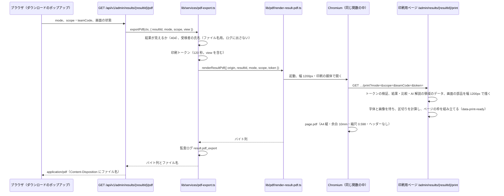

# 11-5 比較・類似分析・PDF（M7 領域別仕様書）

| 項目 | 内容 |
|---|---|
| 文書名 | 適性検査システム M7 領域別仕様書 11-5 比較・類似分析・PDF |
| 版 | 1.0 |
| 作成日 | 2026-11-05 |
| 担当キー | `compare`（テスト ID は `M7-compare-NN`） |
| 対象 | 結果詳細のうち、比較組織との比較の値（母集団・合致度・評価・組織内のポジション・平均）、類似分析（見出しの「類似分析」のボタンから開くポップアップと API）、PDF（「ダウンロード」のポップアップ、作成中と失敗の表示、API、印刷用ページ、改ページ、ファイル名）。これを作る実装担当・レビュー担当と、00・02・03・04・06・07・08・09・付録E の改版担当 |
| 対応する PR | PR-7.4（母集団から再受験の古い結果を除く。§2.1.2・§3.2）、PR-7.12（PDF。§2.4〜§2.6・§3.4〜§3.6）、PR-7.14（類似分析。§2.3・§3.3）。比較に依存する表示は PR-7.8a（11-4） |

## 0. この文書について

### 0.1 位置づけ

- 本書は、参照元の比較・類似分析・PDF の更新（2026-11-04 取得）をアプリに再現するための領域別仕様書で、M7 の総括 `docs/基本設計/11_参照元の更新への追従.md` の下に置く。実装担当が本書だけを見て、比較の母集団の改め、類似分析のポップアップと API、PDF のダウンロードと作成を作れる粒度で書く。
- 結果詳細の画面の部品と、比較に依存する表示（評価の箱・合致度のカード・組織内のポジション・16の特性と組織との相性の平均・比較なしの文言・人数）は 11-4 が定める。本書はその表示に渡す比較の値（母集団と計算）を定め、§2.2 で 11-4 との対応を示す。表示の見た目と文言は 11-4 を、母集団・計算・API・類似分析・PDF は本書を正とする。
- 本書と既存の分冊（00 §1.11・§3.3・§4.2、02 §7・§8.5・§11、03 §7、04 §3.2・§5.5・§5.10・§7.2・§8、06 §1・§3.5.11・§9・§10、07 §9・§10・§12、08 の比較と PDF のテスト、09 の A-08・A-10・V-09、付録E §7）が食い違うときは本書を正とし、4 章のとおり各分冊を改版する。
- 選択肢は書かない。依頼主の決定（10 の K-20〜K-40・K-45〜K-47・K-49・K-50）を当てはめた最終の仕様だけを書く。参照元と変える箇所は「参照元: …／アプリ: …（K-xx）」と書く。
- 推定は「推定」、取得物から分からないものは「未確認」と書き、6 章にまとめる。

### 0.2 前提とする決定

| 決定 | 本書での当てはめ |
|---|---|
| K-20 | 参照元どおりを原則とする。例外は (1) これまでの決定 (2) セキュリティ上の問題 (3) 参照元の明らかな不具合・誤字 (4) 他社の名称・ロゴ・画像 |
| K-34 | 類似分析を実際のデータで作る。画面・類似度の式・「高・中・低」の境目は参照元どおり。比べる相手は同じ組織で、その管理者が見てよい受験者に限る（§2.3.2） |
| K-37 | 類似分析の小見出しは、参照元の製品名「FIRST」ではなく「適性検査」 |
| K-29 | 既存スタッフの受験は責任者（オーナー）だけに見せる。類似分析の相手もこの閲覧範囲の中だけ |
| K-31 ④ | 比較はサーバで計算する（今の比較 API のまま）。類似分析もサーバが相手を選び、組織の全員の点数を画面に渡さない |
| K-39 Q-10 | 再受験した人の古い結果を比較の母集団から除く（§2.1.2。組織内分類の側は 11-3） |
| K-39 Q-03・Q-26・Q-27 | 合致度は色分けしない、見出しは「組織内のポジション」で偏差値を出さない、人数は 3 か所の「（N人）」で注記を出さない。表示は 11-4 |
| K-01 | 母集団に本人と既存スタッフを含める（変わらない） |
| K-23 | グラフは SVG と CSS で自作する。類似分析のレーダーも自作の SVG（参照元も手書きの SVG） |
| K-26 | PDF はサーバで作り、見た目を参照元に合わせる: A4 縦、余白 10mm、ヘッダー・フッター・ページ番号なし、参照元の改ページの規則、画面の状態（たたんだセクション・並び・表示中の AI 解説など）の反映（§2.5） |
| K-24・K-16 | 「評価・組織との合致度・リスクを非表示」の PDF には AI 解説を載せない。全画面の PDF には、画面に出ている AI 解説（表示中のタブの 1 種類）を載せる（§2.5.6） |
| K-15 | 非表示の PDF にも組織内のポジションを載せる（変わらない） |
| K-39 Q-30 | PDF のファイル名に氏名を入れる。氏名はサーバのログと監査ログに残さない（§2.6） |
| K-22 | 類似分析とダウンロードのポップアップも狭い画面幅で使えるようにする（§2.3.12・§2.4.3） |
| K-38 | 操作マニュアルは作らない（compare-24・compare-M2） |
| K-05 | イラストは自作の SVG（PDF にも同じ絵） |
| K-40 | 参照元の文言・画面のデザインを本書にそのまま書いてよい（公開のリポジトリ）。ただし K-31 の対象（参照元のセキュリティ上の問題の詳細）は書かない |
| K-45 | 「集計から除外」した受験者は、類似分析の相手に出さない（比較組織の平均・組織内分類と同じ。§2.3.2） |
| K-46 | PDF で、たたんだセクションの前では改ページしない（例外 (3)）。開いているセクションは参照元どおり新しいページから始める（§2.5.7） |
| K-47 | 非表示の PDF では、概要の前で改ページせず、見出しの塊と概要を 1 ページ目に置く（K-24 でこの PDF には AI 解説の領域が無いため）。全画面の PDF は参照元どおり（§2.5.7） |
| K-49 | 類似分析のポップアップ、ダウンロードのポップアップ、作成中と失敗の表示のすべての文字（マウスを載せたとき・押したとき・焦点のとき・選んだときを含む）を、05 §8 の文字の基準（4.5:1 以上。文字の大きさで分けない）で確かめ、届かない組の文字か地の色を、K-48 と同じ方法で色相を保って濃くする（§1.4 の 16、§2.3.5、§2.4.3）。PDF は画面と同じ色（結果詳細の色は 11-4 §2.2。§2.5.3）。押せない状態の表示は対象外で参照元どおり |
| K-50 | 意味を持つ部品（数の入力の枠、チェックボックス、ダウンロードの選択肢のカードの枠（ラジオの選択肢を押せる範囲）、ラジオの丸、選んだ状態の印、焦点の枠、アイコンだけのボタン（閉じるボタン・「×」））を、05 §8 の基準（隣の色との比 3:1 以上）で確かめ、届かない部品の色を同じ方法で濃くする。濃い地の上の明るい焦点の枠は、地の方を変える（§1.4 の 17、§2.3.5、§2.4.3）。枠は部品の外の地と中の地の両方と比べ、部品の縁に常に接する影（一覧の選んでいる人のボタンの影）は影を地に重ねた色とも比べる（総論 8.3 の配色の取り決め）。焦点の見た目は、参照元が定めている部品（類似分析の操作の部品、ダウンロードの選択肢のカード）は参照元どおり（色は K-50 で直す）、定めていない部品（ダウンロードの「×」「ダウンロードする」、失敗の表示の「閉じる」）は管理画面に共通の焦点の枠（§2.3.13・§2.4.3）。焦点の枠は、どの部品も切れず、隣の部品に重ならない（形を確かめた。§2.3.5・§2.4.3）。飾りの線・区切り線・カードの外形線、文字に添えた印、値を文字でも出す図（類似分析のレーダーの線・塗り・点、輪・ゲージ・チップの線と丸）、レーダーの目盛の線、文字のボタンの枠、押せない状態の表示は対象外で参照元どおり |
| 決定事項 2 | 前回の不具合 10 件は直したまま（比較を保存しない、思考の傾向の参照、母集団の統一、平均の分母） |

### 0.3 根拠の書き方

- 参照元の定義: 「参照元定義（2026-11-04 取得）の …」と書き、再利用要素・HTML アプリ・ポップアップ・要素の名前と、必要なら要素 id で示す。以下、本文では「参照元定義の …」と略す。本書の主な定義は次のとおり。
  - 結果詳細の再利用要素「re: 診断結果」。その中のまとまり Group 回答データ（bUliR。要素の固有の名前は testabc。PDF で写す範囲）、見出しの行の Button J（類似分析のボタン）と Button A（ダウンロードのボタン）、ポップアップ Popup A（類似分析。中身は HTML J だけ）と Popup ダウンロード（中身は HTML ダウンロードだけ）、それぞれを開くワークフロー。
  - HTML アプリ: HTML J（類似分析の画面・計算・データの受け口）、HTML ダウンロード（ダウンロードのポップアップ、作成中と失敗の表示、PDF の作り方、改ページ、ファイル名）、rs-v2（比較の計算と比較に依存する表示）、rs-cmp（比較の値の受け渡し）、rs-style（rs-fx5: 類似分析のボタンの説明）、rs-nav（目次）、rs-data（受験日・職業・タイプ・信頼係数・氏名の受け渡し）。
  - ポップアップの設定: Popup A は最小の幅 960px、Popup ダウンロードは最小の幅 450px で、どちらも幅と高さを中身に合わせる。どちらもスタイルの指定と「Esc で閉じさせない」の指定が無い（Bubble の既定のポップアップ）。暗い背景も Bubble の既定で、描画の指定（styles）は rgba(0,0,0,0.7)・画面全体に固定（暗さの色の指定 greyout_color は無い）。
- 参照元の画面: 「参照元の画面（2026-11-04）」と書く。オーナーでない管理者のアカウントで、在籍の受験者 1 人の結果詳細を比較未選択と比較組織＝組織全体で開いた画面、「類似分析」を押した画面、「ダウンロード」を押した画面（伏せ字済みの文字とスクリーンショット）。類似分析の画面に出ている人は参照元の例のデータの架空の人で、本書には書き写さない。PDF は作成していない（実物は無い）。「実測」は、このスクリーンショット（幅 1440px）の画素の値。
- アプリと前回の仕様: リポジトリのパス（例 `lib/scoring/compare.ts`、`docs/基本設計/07_AI解説とPDF.md` §9.5）。

### 0.4 用語

| 用語 | 本書での意味 |
|---|---|
| 比較組織 | 見出しのプルダウンで選んだ範囲。「組織全体」または「Aチーム」〜「Zチーム」（00 §1.8 の比較範囲） |
| 母集団 | 比較の相手の受験の集合（§2.1.2） |
| 置き換わった結果 | 同じ組織の論理削除されていない結果のどれかの、前回の結果（`results.previousResultId`）になっている結果。再受験の前の古い結果 |
| つながり・代表の受験 | 11-2 §2.2 と同じ。前回の結果でつながった同じ人の受験の並びと、その中でほかの受験から前回として指されていない受験（最新の受験） |
| 本人 | 結果詳細で開いている受験と、その受検者 |
| 本人のつながり | 閲覧範囲の受験を `buildPersonRows()`（11-2 §2.2）でまとめたとき、本人の受験を含む行の受験すべて（同じ人の別の回の受験を含む） |
| 比べる相手 | 類似分析で本人と比べる人（§2.3.2） |
| 類似度 | 16の特性の差から求める 0〜100 の整数（%。§2.3.3） |
| 閲覧範囲 | 閲覧者が見てよい受験。オーナー（`owner`・`super_admin`）は組織の論理削除されていない全件、それ以外の管理者（`admin`）はそのうち受検者区分が `applicant` の受験だけ（11-2 §0.4 と同じ） |
| 全画面の PDF・非表示の PDF | ダウンロードのポップアップの「全画面ダウンロード」（`mode=full`）と「評価・組織との合致度・リスクを非表示にしてダウンロード」（`mode=restricted`） |
| 写す範囲 | PDF にする結果詳細の部分。参照元の Group 回答データにあたり、見出しの塊から接し方の最後までを含む（「回答一覧に戻る」と 1 年経過の帯は含まない） |
| 区切り | PDF のページを切る位置（写す範囲の上端からの縦の位置。px） |
| 1 ページの高さ | 写す範囲の幅を 190mm にしたとき 277mm にあたる高さ（px。§2.5.2） |
| 画面の状態 | 11-4 §2.18 の `ResultViewState`（たたみ方・16の特性の並び・開いている項目の説明・第二候補・接し方のタブ）と、11-6・11-7 がそこに足す AI 解説の領域の状態（表示中のタブなど） |

### 0.5 K-19 の置き換え

本書の範囲の新しい文言（類似分析のポップアップ、ダウンロードのポップアップ、作成中と失敗の表示、ファイル名）に、K-19 の対象（院長（先生）・医院・クリニック、歯科の職種・業務・用語）は無い（参照元定義の HTML J と HTML ダウンロードの全文で確かめた）。比較に依存する表示の置き換え（「医院平均」→「サロン平均」、組織内のポジションの説明の「院長先生」→「責任者」）は 11-4 §0.5 のとおり。操作マニュアルの比較・類似分析の説明（K-19 の対象が多い）は作らない（K-38）。K-19 の言い換えに迷う文言は無い。K-19 ではない言い換え（類似分析の説明文の範囲の語）は 7 章に挙げる。

### 0.6 ほかの領域との分担

| 領域 | 本書との関係 |
|---|---|
| 11-1 受験者側 | 送信のときに `results.previousResultId`（つながり）を書く。本書はそれを読み、母集団から置き換わった結果を除く |
| 11-2 回答一覧 | 同じ人の受験のまとめ方 `buildPersonRows()`・`findPersonRow()`（`lib/services/person-chain.ts`）、閲覧範囲のクエリ（Q3／Q4）、除外・チームをつながりの全件に書くこと、`components/ui/Dialog.tsx` の改修（`closeOnEsc`・`closeOnBackdrop`）。本書は類似分析の「人」と、ポップアップの部品に使う |
| 11-3 在籍・退職と組織内分類 | 組織内分類で置き換わった結果を数えない規則（K-39 Q-10 の組織内分類の側）は 11-3。本書は比較の母集団だけを定める |
| 11-4 結果詳細 | 比較に依存する表示（compare-08〜15）、見出しの 2 つのボタンの見た目と置き場所、画面の状態 `ResultViewState` とそのクエリの形、要素の id、`ResultDetailBody` の `variant="print"`、`resultUiMemory`。本書は比較の値・類似分析・PDF を定め、印刷の形で 11-4 の部品に求めること（§4.4）を書く |
| 11-6 AI 解説 | AI 解説の領域（3 つのタブと中身）と、その印刷の形、`ResultViewState` に足す AI のタブ。AI 解説の先頭の注意書き（compare-M1・ai-10）。本書は全画面の PDF にその領域を載せる・非表示の PDF に載せないことを定める |
| 11-7 再受験と経年比較 | `results.previousResultId` の定義とつながりの不変条件（1 つの結果を前回とする結果は 1 つまで）、手動の組み合わせ、経年比較の領域の印刷の形 |
| 11-8 管理画面の枠 | 管理画面の字体（Inter の読み込み方。本書は同じ方法で Outfit と、類似分析だけが使う書体の名前の Noto Sans JP を足す。§2.3.5）。結果詳細の枠の種類 `frame: "detail"` は 11-4 |

## 1. 範囲

### 1.1 差分 ID と本書での扱い

差分 ID は M7 の差分の一覧（総括 `11_参照元の更新への追従.md`）の番号。比較・類似分析・PDF（`compare-NN`）のほか、ほかの領域の差分のうち本書で作る部分を末尾に挙げる。

| ID | 項目 | 扱い | 当てはめる決定 | 本書の節 |
|---|---|---|---|---|
| compare-01 | 比較の計算場所と保存 | 変えない（サーバで都度計算し、保存しない。組織の全員の値を画面に渡さない） | K-31 ④、決定事項 2 | §2.1.1 |
| compare-02 | 思考の傾向の偏差の参照誤り | 変えない（直したまま） | 決定事項 2 | §2.1.3 |
| compare-03 | 母集団の不統一・平均の分母 | 変えない（1 つの母集団から 16の特性・5 軸・人数を出す） | 決定事項 2 | §2.1.2 |
| compare-04 | 式と閾値（変化なし・実装済み） | 変えない | — | §2.1.3 |
| compare-05 | 母集団の基本の条件（変化なし・実装済み） | 変えない（同じ組織・除外なし・今の採点版・論理削除なし・チーム・本人と既存スタッフを含む） | K-01 | §2.1.2 |
| compare-06 | 再受験の古い回答を母集団から外す | 作る | K-39 Q-10 | §2.1.2、§3.2 |
| compare-07 | 比較組織のプルダウン（変化なし・実装済み） | 変えない（見た目は 11-4 §2.3.2。枠と焦点の枠の色は 11-4 で変える） | K-50 | §2.1.4 |
| compare-08 | 比較が無い・0 人のときの文言 | 表示は 11-4 §2.6。本書は状態と値を渡す | K-39 Q-27、K-31 ④、K-49 | §2.2 |
| compare-09 | 評価の表示 | 表示は 11-4 §2.7.2 | K-20、K-49 | §2.2 |
| compare-10 | 組織との合致度の表示 | 表示は 11-4 §2.7.3 | K-39 Q-03、K-49 | §2.2 |
| compare-11 | 立ち位置の表示 | 表示は 11-4 §2.7.2・§2.11 | K-39 Q-26 | §2.2 |
| compare-12 | ポジションの名称・説明文（変化なし・実装済み） | 変えない | K-19 | §2.2 |
| compare-13 | 16の特性の平均の表示 | 表示は 11-4 §2.8 | K-23、K-19、K-49、K-50 | §2.2 |
| compare-14 | 組織との相性の平均の表示 | 表示は 11-4 §2.11 | K-23、K-50 | §2.2 |
| compare-15 | 母集団の人数の表示 | 表示は 11-4 §2.6 | K-39 Q-27 | §2.2 |
| compare-16 | 類似分析のボタン | 見た目と置き場所は 11-4 §2.3.2（地の色は 11-4 で変える。焦点は 11-4 で管理画面に共通の焦点の枠）、押したときの動きは本書 | K-34、K-49、K-50 | §2.3.1 |
| compare-17 | 類似分析の計算と画面 | 作る（小見出しは「適性検査」。文字のコントラストが基準に届かない配色と、見分けにくい部品の色は変える） | K-34、K-37、K-23、K-49、K-50 | §2.3、§2.3.5 |
| compare-18 | 類似分析は「例のデータ」固定 | 参照元と変える（実際のデータ。相手は同じ組織・閲覧範囲の人で、「集計から除外」した人を除く） | K-34、K-29、K-45 | §2.3.2 |
| compare-19 | PDF の作り方 | 作る（サーバで作り、見た目を参照元に合わせる。色は画面と同じで、K-49・K-50 で変えた色を含む） | K-26、K-49、K-50 | §2.5、§2.5.3 |
| compare-20 | ダウンロードのポップアップと作成中・失敗の表示 | 作る（作成中の進み具合はサーバで作るため変える。文字のコントラストが基準に届かない配色と、見分けにくい部品の色は変える） | K-20、K-26、K-49、K-50 | §2.4、§2.4.3 |
| compare-21 | 「非表示」モードの対象 | 作る（評価・合致度・注意したいリスク・リスクを外す。AI 解説も載せない） | K-15、K-24 | §2.5.5 |
| compare-22 | PDF のファイル名 | 作る（氏名を入れ、ログに残さない） | K-39 Q-30 | §2.6 |
| compare-23 | PDF の改ページ | 作る（参照元と同じ計算で区切る。たたんだセクションの前と、非表示の PDF の概要の前では改ページしない） | K-26、K-46、K-47 | §2.5.7 |
| compare-24 | マニュアルの比較・類似分析・ダウンロードの説明 | 作らない | K-38 | §1.3 |
| compare-M1 | AI 解説の先頭の注意書き | 11-6 が作る（ai-10 と同じもの） | K-20 | §2.8 |
| compare-M2 | マニュアル 18〜20 ページの比較の使い方と FAQ | 作らない | K-38 | §1.3 |
| result-05・keinen-22（母集団の側） | 再受験した人は新しい回答だけを数える | 作る（compare-06 と同じ） | K-39 Q-10 | §2.1.2 |
| ai-27 | PDF に表示中の AI 解説が入る | 作る（全画面の PDF だけ。非表示の PDF には載せない） | K-24 | §2.5.6 |

### 1.2 作るもの

1. 比較の母集団から、再受験で置き換わった古い結果を除く（`fetchPopulation()` の改め）。比較 API の応答の形は変えない。
2. 類似分析: 見出しの「類似分析」のボタンで開くポップアップ（参照元の HTML J の画面と同じ構成・見た目・操作）と、比べる相手を選んで返す API `GET /api/v1/admin/results/{resultId}/similarity`。相手は同じ組織・閲覧範囲の人で、人ごとに最新の受験を使い、本人のつながりと「集計から除外」した人を除き、距離の近い順に最大 10 人。
3. ダウンロードのポップアップ「PDFでダウンロード」（2 つの選択肢のカード、「ダウンロードする」、注記）と、画面全体を覆う作成中の表示「PDFを作成しています」、失敗の表示。
4. PDF: サーバの Chromium で印刷用ページを A4 縦・余白 10mm の PDF にする。写す範囲は画面と同じ部品（11-4）を幅 1200px で描いたもので、ヘッダー・フッター・ページ番号を付けない。画面の状態（比較組織・たたみ方・並び・項目の説明・第二候補・接し方のタブ・AI 解説の表示中のタブ）を反映する。参照元と同じ規則で区切りを計算し、各ページをその区切りで切る（1 ページを少し超えるときは縮めて 1 ページに入れる）。ただし、たたんだセクションの前と、非表示の PDF の概要の前では改ページしない（K-46・K-47）。
5. 非表示の PDF: 評価の箱・合致度のカード・注意したいリスク・リスクのセクション・AI 解説の領域を描かない。
6. PDF のファイル名「{氏名}様_診断結果.pdf」「{氏名}様_診断結果（評価・リスクなし）.pdf」。氏名をログと監査ログに出さない。
7. 配色の直し: 類似分析・ダウンロードのポップアップと作成中・失敗の表示の配色のうち、文字と地の組で 05 §8 の基準（文字 4.5:1 以上）に届かない 8 組と、意味を持つ部品と隣の色の組で基準（3:1 以上）に届かない 7 組を、届く色にする（K-49・K-50。§2.3.5・§2.4.3）。枠は外の地と中の地の両方と、焦点の枠は部品の縁に常に接する影とも比べる。焦点の見た目の定めが無いダウンロードの「×」「ダウンロードする」と失敗の表示の「閉じる」には、管理画面に共通の焦点の枠を当てる。押せない状態の表示・飾りの線・文字に添えた印・値を文字でも出す図（類似分析のレーダーと小さな図）・文字のボタンの枠は参照元どおり。PDF は画面と同じ色で描く（§2.5.3）。

### 1.3 作らないもの・再現しないもの

| 参照元の作り（または今のアプリ） | 理由 |
|---|---|
| 類似分析の例のデータ（コードの中の架空の 30 人、乱数で作る 16 特性の値）と、バッジ「例のデータ」 | K-34（実際のデータで作る） |
| 類似分析の受験者を選ぶ隠しのプルダウン | 参照元でも表示しない（本人は常に先頭） |
| 製品名「FIRST」（類似分析の小見出し） | K-37 |
| 比較と類似分析に組織の全員の値を画面に埋め込み、ブラウザで計算する作り | K-31 ④ |
| 比較用の値を 0.8 秒ごとに読み直して描き直す作り | Bubble の仕組み。アプリは API の応答と React の状態で描く |
| ブラウザで画面を画像にして PDF にする作り（html2canvas 1.4.1・jsPDF 2.5.1 を CDN から読む、SVG を画像にする、字間を 0.01px にする、内側の影を枠線に置き換える、iPad 向けに分けて描く、JPEG 品質 0.92） | K-26（サーバで作る。文字を画像にしない） |
| 今のアプリの PDF のヘッダー（氏名・回答日時）・フッター（出力日時・ページ番号・「評価・合致度・リスク非表示」） | K-26（ヘッダー・フッター・ページ番号なし） |
| 今のアプリの印刷用の 1 段組みのレイアウト（07 §9.5・D-18・D07-17・D07-18 の並べ直し、レーダーの大きさ、第二候補を常に印字） | K-26（画面と同じ見た目。第二候補は画面の状態に従う） |
| 今のアプリのダウンロードのダイアログの「比較対象: 組織全体（12 名）」「比較組織: 未選択」の行、ボタン「ダウンロードを開始する」、ダイアログの中の「PDF を生成しています…」、母集団 0 人の 409 を受けて比較なしで出し直す動き（T-31） | 参照元に無い（K-20）。0 人の比較組織は 0 人の表示のまま写す（§2.5.3） |
| 操作マニュアルの比較・類似分析・ダウンロードの説明（2・8〜11 ページ、18〜20 ページ） | K-38 |

### 1.4 参照元と変えるもの

| # | 事項 | 参照元 | アプリ | 決定 |
|---:|---|---|---|---|
| 1 | 類似分析のデータ | 常に例のデータ（実際の受験者につながっていない） | 実際のデータ（§2.3.2） | K-34 |
| 2 | 類似分析の比べる相手 | 決まっていない（説明文は「テストを受けた人全員」、0 人のときの文は「同じ組織」） | 同じ組織の閲覧範囲の人。人ごとに最新の受験、本人のつながりを除く、「集計から除外」した人を除く、今の採点版（§2.3.2） | K-34、K-29、K-45 |
| 3 | 本人を除く方法 | 名前と 16 の値が本人と同じ行を除く（実データの分岐） | 本人のつながり（同じ人の受験）を結果 ID で除く | K-34 |
| 4 | 類似分析の小見出し | FIRST | 適性検査 | K-37 |
| 5 | 類似分析の説明文 | 「…テストを受けた人全員の中から、似ている順に表示します。」 | 「…同じ組織で結果が出ている人の中から、似ている順に表示します。」（7 章の 1） | K-34（範囲の事実に合わせる） |
| 6 | 類似分析のデータの渡し方 | 本人と全員の「名前\|16 の値」を画面に埋め込む（受け口の形） | サーバが距離の近い 10 人だけを返す（§3.3） | K-31 ④ |
| 7 | 類似分析の読み込み中・失敗 | 無い（例のデータのため待たない） | 「データを読み込んでいます」、失敗の文言（§2.3.11。7 章の 2・3） | K-34（API で取るため） |
| 8 | PDF の作り方 | ブラウザで画面を画像にして JPEG を貼る（文字は画像） | サーバの Chromium で印刷用ページを PDF にする（文字は文字のまま） | K-26 |
| 9 | PDF の幅 | 開いている画面の幅で写す（PC の広い画面では 1200px） | 常に幅 1200px で描いて 190mm に縮める（§2.5.2） | K-26（サーバで作るため画面の幅を使わない） |
| 10 | 作成中の進み具合 | 「準備しています…」→「ページの区切りを計算しています」→「{k} / {n} ページ目を作成中」→「保存しています」と棒 | 応答を待つ間「準備しています…」と棒 0%、応答が届いたら「保存しています」と 100%（§2.4.5。7 章の 4） | K-26（サーバで一度に作るため、ページごとの進み具合を知らない） |
| 11 | 非表示の PDF の AI 解説 | 画面に出ていれば載る（推定） | 載せない（AI 解説の領域ごと描かない） | K-24（K-16 を維持） |
| 12 | 非表示の PDF の 1 ページ目 | AI 解説の領域が残るので、1 ページ目は見出しの塊と AI 解説の領域 | AI 解説の領域が無いので、概要の前では改ページせず、見出しの塊と概要を 1 ページ目に置く（§2.5.7。6 章の 6）。全画面の PDF は参照元どおり | K-47（K-24 の帰結。1 ページ目が見出しの塊と目次だけになるのを防ぐ） |
| 13 | たたんだセクションの改ページ | たたんだセクションも新しいページから始める（見出しの行だけのページができる） | たたんだセクションの前では改ページしない。開いているセクションは参照元どおり新しいページから始める（§2.5.7。6 章の 5） | K-46（K-20 例外 (3)） |
| 14 | PDF の目次 | 写すときの画面の目次をそのまま写す（スクロールの位置によって固定の表示・強調が変わる。推定） | ページの先頭にいるときの表示（固定していない表示）で描く（§2.5.3） | K-26（サーバで作るため、画面のスクロールの位置を使わない） |
| 15 | PDF のファイル名の文字 | `\ / : * ? " < > \|` を除く | 同じ文字に加えて制御文字も除く。応答の見出しは ASCII の代わりの名前と UTF-8 の名前の両方を付ける（§2.6） | K-20 例外 (2)（応答の見出しを壊さない） |
| 16 | 配色（文字のコントラスト） | 文字と地の 8 組が 05 §8 の基準（文字 4.5:1 以上）に届かない。類似分析のヘッダーの説明 #DCE4FB とグラデーションの明るい端 #3C6BFF（3.49:1）、レーダーの目盛の数字 #8A96AE（2.56〜2.98:1）、相手の値 #E0508F（白の上 3.68:1、チップの地の上 2.88〜3.21:1）、チップの「差」（右下のアイコンの上 3.55:1、低の地の上 4.38:1）、段階の札「高」の白い文字と #1F8F5F（4.08:1）、「ダウンロードする」と失敗の「閉じる」の白い文字と #3F8DA5（3.77:1） | 届かない組の文字か地の色を、色相と彩度を保って明度だけを下げ、基準に届く最初の色にする（K-48 と同じ方法）。ヘッダーの 100% の色 #0E48FF、目盛の数字 #5E6C88、白い文字のボタンの地 #397F94 など。8 組は §2.3.5 と §2.4.3 の K-49 の表。押せない状態の表示は参照元どおり | K-49 |
| 17 | 配色（文字でない部品） | 意味を持つ部品の 7 組が 05 §8 の基準（3:1 以上）に届かない。類似分析の焦点の枠 #9CB4F2（白の上 2.05:1、一覧の選んでいる人の影の上 1.58:1、ヘッダーの上 2.16:1）、数の入力の枠 #DBE3F1（外の白と 1.29:1、中の地 #F5F8FD と 1.21:1）、ダウンロードの選択肢のカードの枠 #DCE3EA（1.29:1）とマウスのときの枠 #B7C6D3（1.75:1）、ラジオの丸の枠 #B4C0CC（1.85:1）、カードの焦点の枠 #A9D3E0（1.61:1） | 部品の色を同じ方法で濃くする（焦点の枠 #4F7AE8（白と 3.98:1、影と 3.06:1）など。枠は外の地と中の地の両方と、焦点の枠は部品の縁に常に接する影とも 3:1 以上にする）。ヘッダーの上の閉じるボタンの焦点の枠は、濃い地の上の明るい枠なので、地（グラデーションの 100% の色）の方を変える。7 組は §2.3.5 と §2.4.3 の K-50 の表。飾りの線・カードの外形線、文字に添えた印、値を文字でも出す図（レーダーの線・塗り・点、輪・ゲージ・チップの線）、レーダーの目盛の線、文字のボタンの枠、押せない状態の表示は参照元どおり | K-50 |

見た目と動きを変えない次の追加は「変えるもの」に数えない: ポップアップの焦点の移し方と戻し方、作成中の表示の間ほかの操作をさせないこと（`dialog` 要素の showModal）、ポップアップの狭い幅での最大の幅、類似分析の名前を HTML として解釈しないこと、類似分析の Outfit と Noto Sans JP を Google Fonts から読まずに同梱して読むこと（Noto Sans JP は類似分析だけが使う書体の名前で読む。字形は参照元と同じ。§2.3.5）。

## 2. 仕様

### 2.1 比較の母集団と計算（compare-01〜07・12、result-05、keinen-22）

#### 2.1.1 計算の場所と保存（compare-01。変えない）

- 参照元: 結果画面（参照元定義の rs-v2）が、隠し要素 rs-cmp に埋め込まれた本人の値と組織の全員の値から、比較組織を選ぶたびにブラウザの中で計算する。データベースには書かない。前回の、管理者 User に平均・合致度・偏差値・評価を書き込むワークフロー 3 本は無効になっている。
- アプリ: 今のまま `GET /api/v1/admin/results/{resultId}/comparison` でサーバが呼ぶたびに計算し、保存しない（00 §1.11 の 6、`lib/services/comparison.ts`、`lib/scoring/compare.ts`）。組織の全員の値を画面に渡さない（K-31 ④）。計算の結果は参照元と同じ。
- 参照元: 比較組織を選ぶとすぐに表示が変わる／アプリ: 応答が届くまで読み込み中の状態がある（11-4 §2.6。K-31 ④）。

#### 2.1.2 母集団の条件（compare-03・05・06。K-39 Q-10）

母集団は、比較を求める結果と同じ組織の `results` のうち、次の 5 つをすべて満たす結果の集合とする。16の特性の平均、5 軸の平均、合致度、偏差値、評価、組織内のポジション、人数は、すべてこの 1 つの集合から求める（00 §1.11 の 3・10）。

| # | 条件 | 参照元 | 前回からの変化 |
|---:|---|---|---|
| 1 | 論理削除されていない（`deletedAt == null`） | 削除された受験はデータに無い | 変えない |
| 2 | 置き換わっていない: 同じ組織の論理削除されていない結果のどれの `previousResultId` にも入っていない。判定は 3〜5 で絞る前の、組織の論理削除されていない全件で行う。自分自身を指す `previousResultId`（起きないデータ）は数えない | 組織の全行（除外・チームで絞る前）の「前回の回答」の ID を集め、その ID の回答を外す（説明「再受験した人は、新しい回答だけを数えます。」） | 新しい（K-39 Q-10） |
| 3 | 除外されていない（`isExcluded == false`） | 「除外YesorNo」が yes・はい・true（大文字小文字を問わない）でない | 変えない |
| 4 | 採点の版が今の版（`scoringVersion == SCORING_VERSION`） | 無い（アプリ独自。前回の不具合 9 への対応） | 変えない |
| 5 | 組織全体なら全員、チームなら `teamCode` が選んだチーム | 同じ | 変えない |

- 本人と既存スタッフも、条件を満たせば含める（K-01）。閲覧者の役割では絞らない（オーナー以外の管理者の比較にも既存スタッフの受験が入る。今のまま）。
- 例（A さんの 1 回目 R1 と再受験 R2。R2 の前回が R1）:
  - R1 は母集団に入らない。R2 は条件 1・3〜5 を満たせば入る。
  - R2 が除外されていても、R1 は入らない（条件 2 は除外で絞る前に判定する。参照元どおり）。回答一覧は除外をつながりの全件に書くので（11-2 §2.23）、通常は R1 も除外されている。
  - R2 を論理削除すると、R1 は条件を満たせば入る（つながりが切れる。K-39 Q-35）。
  - R2 がチーム B、R1 がチーム A のとき、チーム A の比較に R1 は入らない（通常は起きない。チームもつながりの全件に書く）。
- 比較を求める本人が置き換わった結果（R1 を開いている）のときは、本人は母集団に入らない（`includesSubject` は偽。画面には出さない。11-4 §2.6）。
- 参照元: 再受験のたびに受験者 User を作り直すため、「同じ受験者 User の 2 件目」は起きない／アプリ: 受検者と受験は 1 対 1 で同じ。
- 実装は §3.2（`fetchPopulation()` を改め、組織の論理削除されていない全件を読んでから絞る）。古い結果に「置き換え済み」の印を書く作りは採らない（送信（11-1）・削除（11-2）・手動の組み合わせ（11-7）の 3 か所で印を保つ必要があり、参照元と同じく全件から判定する方が単純で、印と実際のつながりが食い違うことが無い）。

#### 2.1.3 式と閾値（compare-02・04。変えない）

03 §7.3〜§7.6 のまま（`lib/scoring/compare.ts`）:

```text
平均 A      = 母集団の値の単純平均（16の特性・5 軸とも、合計してから人数で割る）
合致度      = max(0, 100 − 0.5 × Σ(16の特性) |A − 本人|)
各軸の偏差  = (本人 − A) ÷ 2 + 50     （5 軸とも本人の同じ軸を使う）
偏差値      = 5 軸の偏差の平均
評価        = A: 合致度 ≥ 80 かつ 偏差値 ≥ 60 ／ B: 70・50 ／ C: 60・40 ／ D: 60・30 ／ どれも満たさなければ E
              （上から順に、最初に成立したもの。参照元は E から順に上書きする書き方で、結果は同じ）
ポジション  = 偏差値 ≥ 60 個が強いリーダータイプ ／ ≥ 50 協調性を重視するリーダータイプ ／
              ≥ 40 フォロワータイプ ／ ≥ 30 フォロワータイプ（消極的） ／ それ未満 アンフィットネス
```

- 判定は丸める前の値で行う。閾値の許容誤差 1e-9 はアプリ独自（結果は同じ）。参照元の画面（比較組織＝組織全体・59人）の 16 の差のバッジから計算し直した合致度 70.15 は、表示の 70% と評価 B に合う。
- 参照元: 16の特性の値はレーダー用の記録（同じ回答・同じ特性の記録が複数あれば新しい方）、5 軸は回答データの値／アプリ: どちらも `results` の `traits`・`compatibility`（受験ごとに 1 つ）。結果は同じ。
- 参照元: 値が欠けた行は、その項目だけ平均から除き、人数には数える／アプリ: 16の特性と 5 軸は必ずそろう（欠けた文書は mapper が誤りにする。03 §7.1）。

#### 2.1.4 比較組織の選択（compare-07。変えない）

- 選択肢「組織全体」「Aチーム」〜「Zチーム」の 27 個、未選択の表示「比較組織を選択」、回答一覧から開くと未選択（今のまま）。選択は URL のクエリ（`scope`・`teamCode`）に置く（06 D06-28）。見た目（見えるラベルを付けない）は 11-4 §2.3.2。
- 組織にいないチームも選べ、選ぶと 0 人の表示になる（参照元どおり。比較 API の 409 `POPULATION_EMPTY`。11-4 §2.6）。

#### 2.1.5 比較 API（契約は変えない）

- `GET /api/v1/admin/results/{resultId}/comparison?scope=organization`（チームは `scope=team&teamCode=A`）。認可、応答（`ComparisonDto`）、監査ログ `result.comparison`（`details: { scope, teamCode, populationSize }`）、エラー（404 `RESULT_NOT_FOUND`・`NOT_FOUND`、409 `POPULATION_EMPTY`、422 `VALIDATION_ERROR`）は 04 §5.5 のまま。変わるのは母集団の条件（§2.1.2）だけ。
- 読み取り: 比較のたびに、組織の論理削除されていない結果を全件、6 つの項目に射影して読む（チームを選んでも組織の全件を読む。置き換わったかの判定に全件が要るため。参照元も組織の全行から判定する）。今は除外されていない・今の採点版の結果（チームならそのチームだけ）を読んでいる。1 組織あたり数百件の見込み（00 D-30）では、読み取りの件数は増えるが、応答時間は 1 クエリ分のまま（推定。08 PF-05（母集団 500 件で 1 秒以内）で測る。PF-04 の比較 API の「母集団 N 文書の読み取り」は、組織の論理削除されていない全件の読み取りになる）。

### 2.2 比較に依存する表示（compare-08〜15。表示は 11-4）

表示は 11-4 が作る。本書は表示に要る値を、比較 API の 1 つの応答（`ComparisonDto`）で渡す（§2.1.5。応答の項目は変えない）。PDF の印刷用ページは同じ値をサーバで求めて同じ部品に渡す（§3.6）。対応は次のとおり。

| 差分 | 表示 | 11-4 の節 | 使う値 | 値の出し方（本書） |
|---|---|---|---|---|
| compare-08 | 比較なしの文言（3 か所）: 未選択「右上で比較組織を選ぶと表示されます」、0 人「「{比較組織名}」には比べられる回答がありません」、読み込み中「データを読み込んでいます」（アプリだけ） | §2.6 | 比較の状態（`ComparisonState`） | 0 人 = 比較 API の 409 `POPULATION_EMPTY`（§2.1.2 の母集団が 0 件） |
| compare-15 | 人数「（{n}人）」の 3 か所。1 人のとき・本人を含まないときの注記は出さない | §2.6 | `populationSize` | §2.1.2 の件数 |
| compare-09 | 評価の箱（64×64px・地 #14202B・白字。評価による色分けと「評価」のラベルは無い） | §2.7.2 | `grade` | §2.1.3 |
| compare-10 | 組織との合致度（数字と「%」、単色 #3F8DA5 のメーター、「{比較組織名}（{n}人）と比べた近さ」） | §2.7.3 | `matchScore`、`populationSize` | 表示は四捨五入した整数（`toDisplayPercent`） |
| compare-11・12 | 組織内のポジション（名前・説明の 1 行目・絵、組織との相性の下に説明の全行。偏差値は出さない） | §2.7.2・§2.11 | `position` | §2.1.3。名前と説明は付録C §6（置き換え済み。変えない） |
| compare-13 | 16の特性の平均（凡例、説明「0〜30点。線は比較組織の平均」、並び「平均との差」、一覧の平均の線と差のバッジ、レーダーの平均と吹き出しの「サロン平均」） | §2.8 | `traitAverages`、本人の `scores.traits` | 差 = 本人 − 平均（丸めない） |
| compare-14 | 組織との相性の平均（凡例、平均の白い丸、「組織とほぼ同じ」／「組織より「{言葉}」寄り」） | §2.11 | `compatibilityAverages`、本人の `scores.compatibility` | 本人と平均をそれぞれ 0〜100 に収めた値の差の絶対値が 5 以下なら「組織とほぼ同じ」 |

- 応答の `traitDiffs`・`axisDeviations`・`deviationScore`・`includesSubject`・`computedAt`・`scoringVersion` は画面に出さないが、応答から消さない（11-4 §3.2）。

### 2.3 類似分析（compare-16〜18。K-34・K-37・K-29）

#### 2.3.1 開き方と閉じ方（compare-16）

- 見出しの塊の 1 段目の「類似分析」のボタン（文字「類似分析」と「　似た結果の人を探す」。見た目と置き場所は 11-4 §2.3.2）を押すと、類似分析のポップアップを開く（参照元定義の Button J のワークフロー: Popup A を出す）。開くたびに API（§3.3）を 1 回呼ぶ。
- 閉じ方: ヘッダーの右上の「×」（読み上げの名前「閉じる」）、ポップアップの外の暗い背景を押す、Esc。どれでも閉じる（参照元: 「×」は背景を押したのと同じ動きを起こして閉じる。Popup A には「Esc で閉じさせない」の指定が無い）。
- 開いたら「×」に焦点を移し、閉じたら「類似分析」のボタンに戻す（06 §2.4）。
- PDF にはこのボタンを写さない（§2.5.4）。

#### 2.3.2 比べる相手（compare-18。K-34・K-29・K-45）

参照元: データの受け口（本人 1 行と全員）には空の文字が固定で書かれ、値を入れる定義が無い。そのため常に例のデータ（コードの中の架空の 30 人と、乱数で作った 16 特性の値）を出し、バッジ「例のデータ」を出す。実データにしたときの範囲は決まっていない（説明文は「テストを受けた人全員の中から」、0 人のときの文は「同じ組織で、結果が出ている人が増えると」）。実データの分岐では「先頭を本人とし、全員から名前も 16 の値も本人と同じ行を除く」。

アプリ: サーバ（§3.3）が次の手順で比べる相手を選ぶ（K-34）。

| 手順 | 内容 | 理由 |
|---:|---|---|
| 1 | 閲覧範囲の受験を全件読む（回答一覧と同じクエリ Q3／Q4。オーナー以外は受検者区分が `applicant` の受験だけ）。論理削除された受験は入らない。「集計から除外」した受験も読む（除くのは手順 5） | K-34「同じ組織でその管理者が見てよい受験者」、K-29。除外した受験も、同じ人のつながりと本人のつながりを作るのに要る |
| 2 | `buildPersonRows()`（11-2 §2.2）で、同じ人の受験を 1 行にまとめる | 人と比べる。再受験の古い結果を別の人として出さない（K-39 Q-10 と同じ考え方） |
| 3 | 本人の受験を含む行（本人のつながり）を除く（`findPersonRow()`） | 本人の別の回の受験は「似ている人」ではない（参照元が本人と同じ行を除く目的と同じ） |
| 4 | 残りの各行の代表の受験（最新の受験）を候補にする | 人ごとに最新の結果で比べる |
| 5 | 代表の受験が「集計から除外」されている（`isExcluded` が真の）候補を除く | K-45（比較組織の平均・組織内分類と同じく、除外した受験者を相手に出さない）。人の除外は、回答一覧の行の表示と同じく代表の受験の値で見る（11-2 §0.4） |
| 6 | 代表の受験の `scoringVersion` が今の版でない候補を除く | 採点の版が違うと 16の特性の値の意味が変わりうる（00 §2.4。今は全件が 1.0.0） |
| 7 | 16の特性の値がすべて 0 の候補を除く | 参照元どおり（値がすべて 0 の行を捨てる。実際には起きない） |
| 8 | 本人との距離（§2.3.3）の小さい順に並べる。同じ距離は代表の受験の送信日時の新しい順、それも同じなら結果 ID の昇順 | 参照元は距離の順（同じ距離は元の並び）。元の並びが決まっていないので、11-2 の行の順にそろえる |
| 9 | 上から 10 人を返す。受検者の文書が無い・論理削除済みの人は飛ばして、次の人で埋める（通常は起きない） | 画面で出せるのは最大 10 人（§2.3.10）。ほかの人の値は画面に渡さない（K-31 ④） |

- 「集計から除外」した人は相手に出さない（K-45。6 章の 4）。除外は、同じ人のつながりを作った後に代表の受験で見る。代表の受験が除外されている人は、つながりの中の前回の受験を代わりに相手に出すこともしない（比較の母集団で、除外した再受験 R2 の前回 R1 を数えないのと同じ。§2.1.2 の例）。前回の受験だけが除外されている人は、代表の受験で相手に入る。組織内分類（11-3 §2.2）は除外した受験を先に除いてからまとめるため、代表の受験だけが除外されているときはその前回を人として数える。類似分析は、回答一覧で「除外中」と出る人を相手に出さないよう、比較の母集団と同じ扱いにする。回答一覧は除外をつながりの全件に書くので（11-2 §2.23）、通常はつながりの中で値がそろい、この違いは出ない。
- 開いている本人が「集計から除外」されていても、類似分析は開け、同じ手順で相手を選ぶ（本人の値を使う）。除外は相手から除くだけで、本人のつながりを除く手順 3 も、本人の除外にかかわらず行う。
- 既存スタッフの受験は、オーナーには相手に入り、オーナー以外の管理者には入らない（K-29）。オーナー以外の管理者には、既存スタッフの受験でつながりが切れるので、再受験（既存スタッフ扱い。K-39 Q-33）の前の求職者の受験が 1 人として入ることがある（11-2 §2.2・11-3 §2.2 と同じ）。
- 本人が置き換わった結果（古い回）のときも、本人のつながりを除いて同じ手順で選ぶ（本人の値は開いている回の値）。
- 比較組織の選択とは関係しない（チームで絞らない）。

#### 2.3.3 計算（compare-17）

```text
距離 d     = √( Σ(16の特性) (本人 − 相手)² )            （16の特性は項目順。00 §1.2）
基準       = √16 × 22 = 88
類似度 %   = max(0, Math.round((1 − d ÷ 88) × 100))      （0〜100 の整数）

類似の段階（境目は画面で変えられる。既定 高 80・中 65）
  入力は parseFloat で読み、数でなければ 80・65 とする
  高の境目 ok  = min(100, max(2, 入力))
  中の境目 mid = min(ok − 1, max(1, 入力))
  類似度 ≥ ok  → 類似 高（緑）「とても近いタイプです」
  類似度 ≥ mid → 類似 中（黄）「やや近いタイプです」
  それ以外     → 類似 低（赤）「タイプが異なります」

スキル別の一致（特性ごと。境目は画面で変えられる。既定 3・6。入力は parseFloat で読み、数でなければ 3・6。上下の補正はしない）
  差 = |本人 − 相手|
  差 ≤ 一致 高の境目 → 高（緑）、差 ≤ 一致 中の境目 → 中（黄）、それ以外 → 低（赤）
```

- 参照元どおり。最大値は 30（16の特性の値域。K-10）。
- 検算（参照元の画面の例のデータ）: 16 の差 5, 2, 5, 3, 3, 2, 0, 4.5, 2, 4.5, 3.5, 1, 4, 0, 0, 0.5 → 2 乗の和 150 → d = 12.247 → 類似度 86%。差が 3 以下の特性が 10 個、3 より大きく 6 以下が 6 個 →「高 10」「中 6」「低 0」。参照元の画面の表示と一致する。
- 距離と並べ替えはサーバが、類似度・段階・一致はブラウザが（境目を画面で変えるため）、同じ関数（`lib/scoring/similarity.ts`・`lib/presentation/similarity-view.ts`。§3.8）で求める。

#### 2.3.4 ポップアップの構成と文言

```text
ポップアップ（地 #EEF2F9、角丸 22px）
└─ 中身（余白 20px。最大の幅 1080px を左右の中央に置き、縦に並べて間 16px）
   ├─ ヘッダー
   │  ├─ 「×」（右上）
   │  ├─ 小見出し「適性検査」
   │  ├─ 題「類似分析」
   │  └─ 説明
   ├─ 説明の枠「類似分析とは」と箇条書き 4 行
   ├─ 操作の帯「表示する人数」［数］、［□］「一覧の人を全員うすく重ねる」
   ├─ 本体（広い画面は 2 列）
   │  ├─ 左の枠「波形の重ね合わせ」
   │  │  ├─ 2 人の行「● {本人の氏名}　VS　● {相手の氏名}」
   │  │  ├─ 類似度のカード（輪・段階の帯・大きい文・説明）
   │  │  ├─ レーダー
   │  │  ├─ 「類似度ゲージ」と境目の入力 2 つ
   │  │  └─ 「スキル別の一致」と件数、境目の入力 2 つ、チップ 16 個
   │  └─ 右の枠「類似が高い順」と人数、順位の一覧
   └─ 注記「類似度は、16の特性すべての得点の差から計算しています。」
```

| 場所 | 文言 |
|---|---|
| 小見出し | 適性検査（参照元: FIRST。K-37） |
| 題 | 類似分析 |
| 説明 | この人と「検査結果の波形（16の特性のかたち）」が似ている人を、同じ組織で結果が出ている人の中から、似ている順に表示します。（参照元: …が似ている人を、テストを受けた人全員の中から、似ている順に表示します。7 章の 1） |
| 説明の枠の見出し | 類似分析とは |
| 箇条書き 1 | 太字「波形が近いほど、タイプが似ていて、相性も良い傾向があります。」に続けて「類似度（％）が高いほど、2人の16の特性のかたちが重なります。」 |
| 箇条書き 2 | 太字「類似 高（80％以上）」、「はとても近いタイプ、」、太字「中（65〜79％）」、「はやや近いタイプ、」、太字「低」、「はタイプが異なります。」（境目を画面で変えても、この文は変えない。参照元どおり） |
| 箇条書き 3 | 「スキル別の一致」では、どの特性が近く（一致）、どの特性が離れているかが分かります。 |
| 箇条書き 4 | 「採用や配置では、」、太字「似ている人は気が合いやすく、似ていない人は補い合える」、「関係になりやすい、という見方に使えます。」 |
| 操作の帯 | 表示する人数／一覧の人を全員うすく重ねる |
| 左の枠 | 波形の重ね合わせ／VS／類似度／類似 高・類似 中・類似 低／とても近いタイプです・やや近いタイプです・タイプが異なります／{本人の氏名}（太字） さんと {相手の氏名}（太字） さんの、16の特性のかたちの近さです。 |
| ゲージ | 類似度ゲージ／低・中・高／0・{中の境目}・{高の境目}・100／{類似度}%／類似 高：［数］％以上／類似 中：［数］％以上 |
| スキル別の一致 | スキル別の一致／高 {n}・中 {n}・低 {n}／一致 高：差 ［数］点以内／一致 中：差 ［数］点以内／高・中・低／差 {差} |
| 右の枠 | 類似が高い順／{一覧の人数}人／{順位}位／{類似度}%／類似度 |
| 注記 | 類似度は、16の特性すべての得点の差から計算しています。 |
| 0 人 | 比べられる人がまだいません／同じ組織で、結果が出ている人が増えると、ここに表示されます。 |
| 読み込み中・失敗（アプリだけ） | データを読み込んでいます／データを読み込めませんでした／通信状況をご確認のうえ、もう一度お試しください。（7 章の 2・3） |
| 読み上げの名前 | 閉じる／波形の重ね合わせ／類似が高い順の一覧／2人の検査結果をレーダーチャートで重ねた図 |

- 「〜」は波ダッシュ（U+301C）、「％」「：」「（）」は全角、「類似 高」などの間と「差 」の後ろは半角の空白、「{氏名} さん」の間は半角の空白。参照元の文字のまま書く。
- 氏名が空なら「（名前なし）」と出す（参照元どおり。アプリの受検者は氏名が必須で、通常は起きない）。
- 参照元のバッジ「例のデータ」は出さない（K-34）。

#### 2.3.5 見た目（色・字体・大きさ・位置）

- CSS は別表A。参照元定義の HTML J の CSS を写し、セレクタを改めた（`#fxsim` → `.sim-root`、ポップアップの本体 → `.sim-dialog`、背景の層 → `.sim-layer`）。数値・色は別表A を正とする。
- 色（参照元どおり。6 桁の HEX。K-49・K-50 で変えた組は、この節の最後の 2 つの表）: 文字 #101C3A、薄い文字 #5A6885、線 #DBE3F1、地 #EEF2F9、本人 #1F4FD8（塗り #C9D6F7）、相手 #E0508F（塗り #F7CFE1）。段階の色は次のとおり。

| 段階 | 色 | 濃い文字 | 地 1 | 地 2 | 線 | アイコン | 札の文字 |
|---|---|---|---|---|---|---|---|
| 高（緑） | #1F8F5F | #17704A | #DDF0E6 | #F2F9F5 | #A9D5BE | #C3E3D1 | #FFFFFF |
| 中（黄） | #D9A000 | #8A6500 | #FBEFCF | #FEF9EC | #EBCF86 | #F3DEA6 | #2B1F00 |
| 低（赤） | #D6303F | #A8222F | #F9DDE0 | #FDF2F3 | #EDA9AF | #F2C2C7 | #FFFFFF |

- スキルの段階の札（`.lvp`）の地は段階の色だが、高だけは #1D8759（参照元: #1F8F5F。K-49。下の K-49 の表の 6）。
- 字体: 参照元は本文 `"Noto Sans JP","Hiragino Sans","Yu Gothic",sans-serif`、数字 `"Outfit","Noto Sans JP",sans-serif` で、どちらの Web フォントも Google Fonts から読む（Noto Sans JP 400・500・700・900、Outfit 500・600・700・800。`display=swap`）／アプリ: 同じ書体の同じ太さを同梱して読み込み、字形を参照元に合わせる（K-20。総論 8.3 の 8）。実行時に外部へ取りに行かない（CSP の `font-src 'self' data:` のまま）。
  - Outfit: 11-8 §2.2.2 の Inter と同じ方法で同梱する（`@fontsource/outfit` を版を固定して入れ（`pnpm add -E @fontsource/outfit`）、500・600・700・800 の太さごとの CSS（例 `import "@fontsource/outfit/500.css";`）を `app/(admin)/admin/layout.tsx` の先頭で読み込む）。
  - Noto Sans JP: 400・500・700・900 を、類似分析だけが使う書体の名前 `"Sim Noto Sans JP"`（アプリの名前）で同梱して読み込む。`"Noto Sans JP"` の名前では読み込まない（11-8 §2.2.2 の日本語の代わりの書体 `--font-jp` は先頭に `"Noto Sans JP"` を持ち、端末の書体を使う。その名前で読み込むと、管理画面のほかの部分の日本語の字形も変わる）。
    - 同梱の方法は 11-8 §2.2.2 と同じ: Noto Sans JP の書体の npm のパッケージを、実装の時点の最新の版に固定して入れる（`package.json` の `dependencies`。パッケージは実装の時点で選ぶ）。パッケージは、太さごとに字の範囲（`unicode-range`）でファイルが分かれたものを選ぶ（使う字の範囲のファイルだけが読まれる）。PDF 用の `public/fonts/` の書体（1 つの太さが 1 つのファイル。§2.5.9）は使わない。
    - 名前の付け方: パッケージの CSS はそのまま読み込まない。パッケージの 400・500・700・900 の CSS の `@font-face` を、書体の名前だけを `"Sim Noto Sans JP"` に置き換え、ファイルの場所をパッケージの中を指す相対の場所に直して写した CSS（`components/admin/result/similarity-fonts.css`。生成物で、手で直さない）を、`scripts/generate-similarity-fonts.ts`（`pnpm fonts:generate`）で作る。字の範囲と太さはパッケージの CSS のまま、`font-display` は `swap`（参照元の `display=swap` と同じ）。パッケージの版を上げたら作り直す。
    - 読み込み: `similarity-fonts.css` を、Outfit と同じく `app/(admin)/admin/layout.tsx` の先頭で読み込む。ほかの画面は `"Sim Noto Sans JP"` を使わないので、書体のファイルは類似分析の文字を描くときに、使う字の範囲の分だけ読まれる。
  - 字体の並び（別表A の `--font`・`--num`）は、参照元の並びの `"Noto Sans JP"` を `"Sim Noto Sans JP"` に置き換えたもの: 本文 `"Sim Noto Sans JP","Hiragino Sans","Yu Gothic",sans-serif`、数字 `"Outfit","Sim Noto Sans JP",sans-serif`。
- ポップアップの大きさと位置:
  - 幅 1000px（参照元の画面の実測。定義は最小の幅 960px で中身に合わせる）。画面の幅から 32px を引いた幅が 1000px より小さいときは、その幅（K-22）。
  - 上は画面の上端から 50px（実測）。下に 50px あける（推定。参照元の画面の写しはポップアップの下端で切れていて、下の余白を測れない）。ポップアップが画面より高いときは、ポップアップの中ではなく、暗い背景の層ごと縦にスクロールする（参照元どおり）。
  - 背景は rgba(0,0,0,0.7)、ぼかしなし（参照元定義の Popup A の描画の指定。画面の実測でも白の地が #4C4C4C になる）。影 0 24px 60px #0B1530、角丸 22px、中ではみ出しを切る。
- コントラスト（K-49）: 類似分析のポップアップのすべての文字と地の組を、05 §8 の文字の基準（4.5:1 以上。文字の大きさで分けない）で確かめ、届かない組だけを変える。マウスを載せたとき・押したとき・焦点のとき・選んだとき（一覧の選んでいる人）の組も同じに確かめる。計算と書き方は総論 8.3 の配色の取り決めに合わせる。
  - 計算: WCAG 2 の相対輝度とコントラスト比の式で計算する。地がグラデーションのときは、文字や枠との比がいちばん低くなる側の端の色で計算する: ヘッダー（125°、#0B1C52 0%・#1A3FB8 55%・#3C6BFF 100%。文字は明るい色）は明るい側の 100% の色（説明の文は画面の幅で折り返し、右端の近くまで届く）、チップ（地 1 → 地 2。文字は濃い色）は暗い側の地 1。チップの「差 {差}」は右下の特性のアイコン（文字より奥に描く。段階のアイコンの色）に重なるので、アイコンの色でも計算する。半透明の色・不透明度を下の地に重ねた色は、各成分を四捨五入（0.5 は切り上げ。JavaScript の `Math.round` と同じ）して 8 ビットにしてから比を計算する（変え方で HSL から作る色を 8 ビットにするときも同じ丸め方。このポップアップの文字と部品の地に半透明の色は無い）。比は小数第 3 位を四捨五入して書く。
  - 変え方: K-48 と同じ（11-1 §2.1.3）。組の片方の色だけを変える（明るい文字と濃い地なら地、明るい地の上の色の文字なら文字）。HSL の色相と彩度を保ち、明度を参照元の色の値から 0.5% ずつ下げ、基準に届く最初の色（いちばん明るい色）にする。1 つの規則の文字が、位置や状態で違う地に乗るとき（レーダーの目盛の数字、チップの相手の値と「差」。チップの段階は一致の境目の入力と相手の選び方で変わる）は、いちばん暗い地でも届く最初の色にする（11-2 §2.26 と同じ考え方）。
  - 状態で地が変わる文字: 参照元は、このポップアップの文字の色を状態（マウス・押下・選んだとき）で変えていない。そこで、文字の色を状態で変えずに、どの状態の地の上でも 4.5:1 に届く 1 つの色にする（一覧の人のボタンの文字は、ふだんの地 #F5F8FD でも選んだときの白でも届くので参照元のまま。チップの相手の値と「差」は、境目の入力で変わる段階の地のどれの上でも届く色にした。下の表の 4・5）。
  - プレースホルダー: このポップアップの数の入力には、プレースホルダーが無い（参照元定義にも無い）。
  - リンク: このポップアップにリンク（`a` 要素）は無い（操作の部品は、数の入力・チェックボックス・ボタン）。
  - 同じ色を基準に届く用途にも使う箇所は、その用途の色を変えず、届かない用途だけに新しい変数か規則を当てる（`--pair`・`--muted`・`--ok`。下の表の後の注記）。
  - 対象外: 押せない状態の表示（このポップアップには無い）。
  - 届いていて変えない組のうち比が 5:1 未満のもの: 段階の帯・札の中の #8A6500 と地 1 #FBEFCF（4.65:1）、段階の札「低」の白い文字と #D6303F（4.82:1）、注記 #5A6885 とポップアップの地 #EEF2F9（4.98:1）。

K-49 で変えた組（参照元の色・比 → アプリの色・比）:

| # | 文字／地 | 場所 | 参照元 | アプリ | 変数・規則（別表A） |
|---:|---|---|---|---|---|
| 1 | ヘッダーの小見出し・説明の文字 #DCE4FB と題の白い文字／ヘッダーのグラデーションの 100% の色 | §2.3.4 | #3C6BFF。#DCE4FB と 3.49:1、白と 4.43:1 | #0E48FF。#DCE4FB と 4.88:1、白と 6.20:1 | `.hero` の背景 |
| 2 | レーダーの目盛の数字「10」「20」「30」／輪の地（いちばん暗い #E8EEFB） | §2.3.6 | #8A96AE・2.56:1（#F2F6FD の上 2.75:1、白の上 2.98:1） | #5E6C88・4.54:1（#F2F6FD の上 4.87:1、白の上 5.28:1） | `.scale` |
| 3 | レーダーの相手の値／白 | §2.3.6 | #E0508F（`--pair`）・3.68:1 | #DA2D79・4.53:1 | `--pair-tx`（`.aval.b`） |
| 4 | スキル別の一致のチップの相手の値／チップの地 1（いちばん暗い低の #F9DDE0） | §2.3.8 | #E0508F・2.88:1（高の地 1 3.09:1、中の地 1 3.21:1） | #BF2267・4.52:1（高 4.86:1、中 5.04:1） | `--pair-tx-z`（`.sc b.b`） |
| 5 | チップの「差 {差}」／チップの地 1 と右下のアイコン（いちばん暗い低のアイコン #F2C2C7） | §2.3.8 | #5A6885（`--muted`）・3.55:1（高のアイコン #C3E3D1 4.06:1、中のアイコン #F3DEA6 4.21:1、低の地 1 4.38:1） | #4C5770・4.58:1（高のアイコン 5.24:1、中のアイコン 5.44:1、低の地 1 5.66:1） | `--muted-z`（`.sc span`） |
| 6 | スキルの段階の札「高」の白い文字／札の地 | §2.3.8 | #1F8F5F（`--ok`）・4.08:1 | #1D8759・4.50:1 | `--ok-lvp`（`.z-ok .lvp`） |

- 1 は、100% の色だけを、説明の文字（4.5:1）とヘッダーの閉じるボタンの焦点の枠（3:1。下の K-50 の表の 2）の両方が届く最初の色にした（文字だけなら #1850FF で届くが、そのとき焦点の枠は 2.816:1 で届かない）。題・小見出しは左上の暗い側にあり、0% と 55% の色は参照元のまま（55% の色の上で、説明 6.76:1・題 8.58:1・焦点の枠 4.18:1）。ヘッダーの 2 つの輪（飾り）は参照元のまま。
- 2 は、3 つの数字が同じ規則（`.scale`）で、輪の地のどれに重なるかは位置で決まるため、いちばん暗い #E8EEFB でも届く色にした。
- 3・4 は文字の用途だけを変える。`--pair` は、レーダーの相手の線（大きいレーダーと一覧の小さいレーダー）と頂点（値を文字でも出す図）、チップの相手の丸（値を文字でも出す小さな図）、2 人の行の丸（文字に添えた印）では、K-50 の対象外なので参照元のまま（下の K-50 の対象外）。
- 地 2 の上の比は、4 が 5.27〜5.49:1、5 が 6.60〜6.88:1。5 の「差 {差}」は右端にあり、チップの右下の特性のアイコン（文字より奥に描く）に重なるので、アイコンの色（いちばん暗い低の #F2C2C7）の上でも届く色にした。4 の相手の値は左に寄り、アイコンに重ならない。5 の `--muted` は、ほかの薄い文字（白の上で 5.59:1、一覧の行の地の上で 5.26:1）では参照元のまま。
- 6 は高の札の地だけを変える。中・低の札（#2B1F00 と #D9A000 で 6.91:1、白い文字と #D6303F で 4.82:1）は届くので参照元のまま。`--ok` は、類似度の輪・ゲージの帯・チップの線の塗り（値を文字でも出す小さな図）、一覧の左の枠（文字のボタンの枠）、帯の丸（文字に添えた印）では、K-50 の対象外なので参照元のまま（下の K-50 の対象外）。
- HSL の明度（色相と彩度は参照元の色のまま）: 1 は 61.8% → 52.8%（色相 225.5°・彩度 100%）、2 は 61.2% → 45.2%、3 は 59.6% → 51.6%、4 は 59.6% → 44.1%、5 は 43.7% → 36.7%、6 は 34.1% → 32.1%。どれも 1 段手前の色（1 は #114AFF で焦点の枠が 2.965:1、2 は #5F6D8A で 4.467:1、3 は #DA307A で 4.482:1、4 は #C12268 で 4.449:1、5 は #4D5971 で 4.464:1、6 は #1E895B で 4.389:1）では届かない（1 段手前の色の比は、届かないことが分かるように小数第 4 位以下を切り捨てて書く）。

部品の見分けやすさ（K-50）:

- 類似分析のポップアップの、意味を持つ部品の色を、05 §8 の基準（隣の色との比 3:1 以上）で確かめ、届かない組だけを変える。マウスを載せたとき・押したとき・焦点のとき・選んだときの色も同じに確かめる。
  - 隣の色: 枠は、接するすべての色（部品の外の地と、部品の中の地）と比べ、どちらとも 3:1 以上にする（数の入力の枠は、白い枠の地と入力欄の地 #F5F8FD の両方）。焦点の枠（2px 離す）は、枠の内と外に見える地と比べる。
  - 影: 影が地にかかる場所では、影の色を指定の不透明度のまま地に重ねた色（いちばん濃い場合）を隣の色として計算する。計算に入れるのは、部品の縁に常に接する影（部品自身の影と、すぐ隣にいつもある部品・帯の影）だけ（総論 8.3 の配色の取り決め）。一覧の選んでいる人のボタンの影（0 4px 14px #D9E2F8。不透明の色なので、重ねた色は影の色のまま）は、その人と隣の人のボタンの焦点の枠と、その人の枠にかかるので、影の色とも比べる（下の表の 1）。ほかの影（ポップアップの影）のかかる場所に部品は無い。
  - 計算と変え方: K-49 と同じ式と方法（重ねた色の丸め方も同じ）。部品の色の HSL の色相と彩度を保ち、明度を参照元の色の値から 0.5% ずつ下げ、比が 3:1 以上になる最初の色（いちばん明るい色）にする。濃い地の上の明るい焦点の枠（ヘッダーの閉じるボタン）は、枠を濃くすると比が下がるので、隣の色（ヘッダーの 100% の色）の方を変える（下の表の 2。K-49 の表の 1 と同じ変更）。
  - 焦点の枠の形（総論 8.3 の配色の取り決め）: 焦点の枠（線 3px を 2px 離す。部品の縁から外へ 5px）は、どの画面の幅でも、はみ出しを切る枠（ヘッダー `.hero`、ポップアップの本体 `.sim-dialog`、背景の層 `.sim-layer`）で切れず、隣の部品に重ならない。ヘッダーの「×」は、ヘッダーの上と右の縁から 18px の位置にあり、枠は縁から 13px 離れる（ヘッダーの角丸 18px の角にもかからない）。ほかの部品は、ポップアップの中身の余白（20px。560px 以下は 12px）の内側の、白い枠の余白（14px 以上）の中にある。隣の部品との間は、数の入力が折り返したときの縦の間と、一覧の人のボタンの間の 8px がいちばん狭く、枠（5px）は重ならない。一覧の選んでいる人のボタンの影は、隣の人の焦点の枠にかかるので、影の色とも比べる（下の表の 1）。形を直す部品は無い。
  - 対象外（参照元どおり）: 飾りの線・区切り線・カードの外形線（ヘッダーの 2 つの輪、説明の枠の左の線、類似度のカード・チップ・枠の外形線、区切りの線）。文字に添えた印（2 人の行の丸、段階の帯・札・件数の丸、チップのアイコン）。値を文字でも出す小さな図（類似度の輪、ゲージの帯とピン、チップの塗りと本人・相手の丸）。値を文字でも出す図（レーダーの線・塗り・点。下の「レーダー」）。レーダーの輪と軸の線（目盛の線）。文字のボタンの枠と地（一覧の人のボタンの枠と地と左の枠。文字で見分けられるので K-50 の対象外。文字と地の組は K-49 で確かめる。選んだ状態の印は確かめる）。閉じるボタンの地と枠（アイコンだけのボタンはアイコンと地の比で確かめる）。
  - レーダー（§2.3.6）: 同じポップアップの中で値を文字でも読めるので、値を文字でも出す図として、線・塗り・点の色を K-50 の対象外にする（総論 8.3 の配色の取り決め）。値を読める場所は、図ごとに次のとおり。
    - 大きいレーダーの本人と相手の線・塗り・頂点: 同じ図の軸の名前の下に、本人と相手の 16 の値を文字で出す（`.aval.a`・`.aval.b`。§2.3.6）。同じ左の枠のスキル別の一致のチップにも、2 人の値を文字で出す（§2.3.8）。
    - 「一覧の人を全員うすく重ねる」の細い線: 線を引くのは一覧の人のうち相手以外の全員で、どの人も一覧にいる。一覧でその人を押すと相手になり、大きいレーダーの相手の値（`.aval.b`）とチップに、その人の値が文字で出る（§2.3.9・§2.3.10）。
    - 一覧の小さいレーダー（読み上げない）の線と塗り: そのボタンを押すと、大きいレーダーの値の文字で、本人（`.aval.a`）とその人（`.aval.b`）の値を読める。小さいレーダーの輪は目盛の線。
    - 値の文字と軸の名前は K-49 で確かめる。軸の名前と値の文字は、値 30 の輪より外の、左の枠の白の上に描く。相手の値は K-49 の表の 3、目盛の数字は表の 2 で変えた。本人の値 #1F4FD8 は白と 6.63:1、軸の名前 #101C3A は白と 16.81:1 で届く。
  - 基準に届いていて変えない部品: 閉じるボタンのアイコン（白と地 #2A4CC4 で 7.17:1、マウスの地 #3A5FDA で 5.48:1）、チェックボックス（ブラウザが描く。選んだときの色 accent-color #1F4FD8 は白の上で 6.63:1）、一覧の選んでいる人の枠 #1F4FD8（外の白い枠の地・中のボタンの白と 6.63:1、枠の外にかかる影 #D9E2F8 と 5.11:1）。

K-50 で変えた組（参照元の色・比 → アプリの色・比）:

| # | 部品／隣の色 | 場所 | 参照元 | アプリ | 変数・規則（別表A） |
|---:|---|---|---|---|---|
| 1 | 焦点の枠（数の入力・チェックボックス・一覧の人のボタン）／白い枠の地。一覧の選んでいる人のボタンの影 #D9E2F8（その人と隣の人の焦点の枠にかかる） | §2.3.13 | #9CB4F2・2.05:1（影と 1.58:1） | #4F7AE8・3.98:1（影と 3.06:1） | `--focus` |
| 2 | ヘッダーの閉じるボタンの焦点の枠 #9CB4F2／ヘッダーのグラデーションの 100% の色 | §2.3.13 | #3C6BFF・2.16:1 | #0E48FF・3.02:1（地を変える。焦点の枠は #9CB4F2 のまま） | `.hero` の背景、`.close:focus-visible` |
| 3 | 数の入力の枠／白い枠の地（枠の外の地）と入力欄の地 #F5F8FD（枠の中の地） | §2.3.7、§2.3.10 | #DBE3F1（`--line`）・1.29:1（中の地と 1.21:1） | #7190C8・3.22:1（中の地と 3.02:1） | `--line-ctl` |

- 1・2 は、参照元の 1 つの規則（`input:focus-visible, button:focus-visible`）を、白い枠の上の焦点の枠（`--focus`）と、ヘッダーの上の閉じるボタンの焦点の枠（#9CB4F2 のまま）に分ける。一覧の人のボタンの焦点の枠も、ボタンから 2px 離れて枠の地（白）に乗る。
- 1 は、一覧の選んでいる人のボタンの影（0 4px 14px #D9E2F8）が、その人のボタンと隣の人のボタンの焦点の枠にかかるので、影の色とも比べて決めた（白だけと比べると #6F92EC で届くが、影と 2.31:1）。数の入力とチェックボックスの焦点の枠も同じ変数 `--focus` を使う。
- 3 は、入力欄の地 #F5F8FD（`--surface-2`）が枠の中にあるので、外の白と中の #F5F8FD の両方と 3:1 に届く最初の色にした（届きにくい中の地で決まる。外の白だけと比べると #7694CA で届くが、中の地と 2.88:1）。3 の `--line` は、カードと枠の外形線、区切り線、レーダーの輪と軸、一覧のマウスのときの枠、一覧の小さいレーダーの輪（飾り・目盛の線・文字のボタンの枠）では参照元のまま。
- HSL の明度（色相と彩度は参照元の色のまま）: 1 は 78.0% → 61.0%（色相 223.3°・彩度 76.8%）、2 は K-49 の表の 1 と同じ、3 は 90.2% → 61.2%。どれも 1 段手前の色（1 は #527CE8 で影と 2.993:1、3 は #7292C8 で中の地と 2.961:1）では届かない。

#### 2.3.6 レーダー（K-23）

自作の SVG（`components/charts/SimilarityRadarSvg.tsx`）。

| 項目 | 大きいレーダー | 一覧の小さいレーダー |
|---|---|---|
| 座標系 | viewBox `0 0 680 610`、幅 100%・高さは比で決める、上に 6px | 52×52px（viewBox `0 0 52 52`） |
| 中心・半径・最大 | (340, 308)・200・30 | (26, 26)・22・30 |
| 軸 i の角度 | −90° + 360° × i ÷ 16（i は項目順で 0 から。協力性が真上、時計回り） | 同じ |
| 点 | (cx + cos(角度) × 半径 × 値 ÷ 30, cy + sin(角度) × 半径 × 値 ÷ 30)。座標は小数第 1 位（`toFixed(1)`）で書く | 同じ |
| 目盛の輪 | 値 30（地 #F2F6FD）・20（地 #E8EEFB）・10（地 #F2F6FD）の 16 角形を、この順に重ねる。線 #DBE3F1・太さ 1 | 値 30 の輪だけ（地 #F2F6FD・線 #DBE3F1・太さ 1） |
| 軸の線 | 中心から値 30 の点まで。#DBE3F1・太さ 1 | なし |
| 目盛の数字 | 10・20・30。角度 −90° + 180° ÷ 16 の向きで、半径 200 × 値 ÷ 30 の点から右に 3・上に 2 ずらす（10px・#5E6C88・Outfit。参照元: #8A96AE。K-49。§2.3.5 の K-49 の表の 2） | なし |
| ほかの人（「一覧の人を全員うすく重ねる」のとき） | 一覧の人のうち相手以外の全員の多角形を、本人と相手より先に描く（塗りなし、線 #B9C3D6・太さ 1・角は丸） | なし |
| 本人・相手 | 本人（塗り #C9D6F7・線 #1F4FD8・太さ 2.6）、相手（塗り #F7CFE1・線 #E0508F・太さ 2.6）。角は丸、乗算で混ぜる（`mix-blend-mode: multiply`。2 つの多角形を `isolation: isolate` のまとまりに入れる） | 同じ色で線の太さ 1.5 |
| 頂点 | 軸ごとに本人と相手の点に白い丸（半径 4、線の太さ 2、色はそれぞれ） | なし |
| 軸の名前と値 | 半径 216（200 + 16）の点を (lx, ly) とする。横の揃え: \|cos\| < 0.2 は中央、cos > 0 は左揃え、それ以外は右揃え。縦の位置: sin < −0.2 は ly − 18、sin > 0.2 は ly + 6、それ以外は ly − 6。1 行目に特性名（12.5px・太さ 500・#101C3A）、2 行目（x = lx、15 下）に本人の値（#1F4FD8。`.aval.a`）、6 あけて相手の値（#DA2D79。`.aval.b`。参照元: #E0508F。K-49。§2.3.5 の K-49 の表の 3）（Outfit・11.5px・太字） | なし |
| 読み上げ | `role="img"`、`aria-label="2人の検査結果をレーダーチャートで重ねた図"` | 読み上げない（`aria-hidden="true"`） |

- 値は小数第 1 位の表示（11-4 の `formatOneDecimal`）。16の特性は 0.5 刻みなので、参照元の表示（数の文字のまま）と同じになる。
- 描く順: 輪 → 軸の線 → 目盛の数字 → ほかの人 → 本人と相手（まとまり）→ 頂点 → 軸の名前と値。
- 線・塗り・点の色（本人と相手、ほかの人の細い線、一覧の小さいレーダー）は、値を文字でも出す図として K-50 の対象外（§2.3.5）。大きいレーダーの 2 人の値は軸の名前の下の値の文字で読める。一覧の人の値は、その人を押して相手にすると、同じ値の文字で読める。

#### 2.3.7 類似度のカードとゲージ

- カード: 横に並べる（間 28px、縦の中央）。余白 上下 22px・左右 26px、角丸 16px、白の地、枠 1px #DBE3F1、上 14px・下 4px。
  - 輪: 124×124px、viewBox `0 0 130 130`、中心 (65, 65)・半径 56。地の輪 #EDF1F7・太さ 9、値の弧（段階の色・太さ 9・端は丸・中心で −90° 回す）。弧の長さ = 円周（2π × 56）× min(100, 類似度) ÷ 100。`stroke-dasharray` は「{弧の長さ（小数第 1 位）} {円周（小数第 1 位）}」。中央に「{類似度}」（Outfit 40px・太さ 700・字間 −0.03em）と「%」（16px・太さ 600・#5A6885・左 2px）、その下に「類似度」（11px・太さ 500・#5A6885・上 6px・字間 0.08em）。
  - 右の文字（縦に、間 8px）: 段階の帯（高さ 26px、余白 左右 12px、角丸 999px、地は段階の地 1、文字は段階の濃い文字・13px・太字・字間 0.04em、左に 8px の段階の色の丸）、大きい文（22px・太字・行間 1.35・字間 0.01em）、説明（13px・#5A6885・行間 1.6。氏名は #101C3A の太字）。
- ゲージ（見出し「類似度ゲージ」。上に 1px #DBE3F1 の区切り、上 14px、上の余白 16px）:
  - 帯: 高さ 14px・角丸 7px。左から 赤（#D6303F）を幅 mid %、黄（#D9A000）を幅 (ok − mid) %、緑（#1F8F5F）を幅 (100 − ok) %。帯の上に 38px あける。
  - ピン: 左 = min(100, max(0, 類似度)) % の位置を中央にする。「{類似度}%」（Outfit 13px・太字・地 #101C3A・白字・角丸 7px・余白 上下 2px・左右 9px・行間 1.5）と、その下 2px に縦の棒（3×30px・#101C3A・角丸 2px・白 2px の輪）。
  - 帯の下（高さ 40px）: 「低」を mid ÷ 2 %、「中」を (mid + ok) ÷ 2 %、「高」を (ok + 100) ÷ 2 % の位置の中央に（上 6px・12px・太字・段階の濃い文字）。目盛の数字「0」（左端に揃える）、「{mid}」「{ok}」（その位置の中央）、「100」（右端に揃える）（上 22px・11px・#5A6885・Outfit）。mid・ok は §2.3.3 で補正した後の値を数の文字にしたもの。
  - 入力（上 6px、横に並べ、間 縦 8px・横 22px、13px・#5A6885）: 「類似 高：」［数の入力］「％以上」、「類似 中：」［数の入力］「％以上」。数の入力は最小 1・最大 100、初期 80・65、幅 68px・余白 上下 5px・左右 8px。

#### 2.3.8 スキル別の一致

- 見出し「スキル別の一致」（上に 1px #DBE3F1 の区切り、上 16px・上の余白 16px）と、右に件数「高 {n}」「中 {n}」「低 {n}」（間 12px・13px・太字・段階の濃い文字、前に 8px の段階の色の丸）。
- 入力: 「一致 高：差 」［数の入力］「点以内」、「一致 中：差 」［数の入力］「点以内」（最小 0・最大 30・0.5 刻み、初期 3・6。見た目はゲージの入力と同じ）。
- チップ 16 個（項目順）: 幅 220px 以上で入るだけ横に並べる（間 10px、上 12px）。
  - 入れ物: 地は段階の地 1 から地 2 への 135° のグラデーション、枠 1px（段階の線）、角丸 14px、余白 上下 13px・左右 15px、中を縦に（間 10px）、はみ出しを切る。右下に特性のアイコン（92×92px、右 −8px・下 −16px、−8° 回す、段階のアイコンの色。形は別表B）。アイコン以外は手前に描く。
  - 1 段目: 特性名（15px・太字・行間 1.3）と、右端に段階の札「高」「中」「低」（高さ 24px・最小の幅 38px・余白 左右 10px・13px・太字・角丸 999px、地は段階の色（高だけ #1D8759。参照元: #1F8F5F。K-49）、文字は段階の札の文字）。
  - 2 段目: 線（高さ 6px・角丸 3px・地 #E3E8F1・上下 4px・左右 8px あける）。本人の位置 pa = 本人 ÷ 30 × 100 %、相手の位置 pb = 相手 ÷ 30 × 100 %。左 min(pa, pb) % から幅 \|pa − pb\| % を段階の色で塗る。\|pa − pb\| < 3 なら、中間 (pa + pb) ÷ 2 % に左半分 #1F4FD8・右半分 #E0508F の丸を 1 つ、それ以外は pa に #1F4FD8、pb に #E0508F の丸を置く（どちらも 14×14px、白 3px の縁、外に 1px #C8D1E0、中心をその位置に）。
  - 3 段目: 本人の値（#1F4FD8）と相手の値（#BF2267。参照元: #E0508F）（Outfit 17px・太字、間 12px）、右端に「差 {差}」（12px・#4C5770。参照元: #5A6885）。値と差は小数第 1 位の表示。相手の値と「差」の色は、どの段階の地の上でも届く色（「差」は右下のアイコンに重なるので、アイコンの色の上でも届く色。K-49。§2.3.5 の K-49 の表の 4・5）。

#### 2.3.9 類似が高い順の一覧

- 見出し「類似が高い順」（17px・太字）と、右に「{一覧の人数}人」（12px・#5A6885）。下に 12px あける。一覧の人数は一覧に出している人の数で、表示する人数（§2.3.10）と応答の相手の人数の小さい方（「集計から除外」した人は応答に入らないので数えない）。
- 1 位から順にボタンを並べる（間 8px）。ボタン: 3 列（52px・残り・中身の幅、間 12px、縦の中央）、地 #F5F8FD、枠 1.5px #F5F8FD、左の枠 5px（段階の色）、角丸 12px、余白 上 9px・右 12px・下 9px・左 9px、左揃え、0.15 秒で変える。マウスを載せると枠 #DBE3F1（左の枠は段階の色のまま）。選んでいる人は 地 #FFFFFF・枠 #1F4FD8（左の枠は段階の色）・影 0 4px 14px #D9E2F8。`aria-pressed` を付ける。
  1. 小さいレーダー（§2.3.6）。
  2. 縦に（間 3px）: 「{順位}位」（Outfit 12px・#5A6885・字間 0.06em）、氏名（15px・太字・1 行で、はみ出せば「…」）、段階の札（高さ 20px・余白 左右 9px・11.5px・太字・角丸 999px、地は段階の地 1、文字は段階の濃い文字、前に 7px の丸）。
  3. 右揃えで「{類似度}%」（Outfit 28px・太さ 800・段階の濃い文字・字間 −0.02em）と、その下 4px に「類似度」（10px・太さ 500・#5A6885）。
- 押すと、その人を左の比べる相手にする。
- 広い画面では、一覧の枠を、背景の層の上から 16px の位置に留める（`position: sticky`。860px 以下は留めない）。

#### 2.3.10 操作と状態

| 操作 | 動き |
|---|---|
| 開いた直後 | 相手は 1 位（保っている選択があればその人。下の「保つ範囲」） |
| 表示する人数 | 入力するたびに `parseInt` で読み、3〜10 に収める（数でない・0 なら 7）。一覧を上からその人数にし、相手を 1 位に戻す。数の入力は最小 3・最大 10・初期 7 |
| 一覧の人を全員うすく重ねる | オンにすると、一覧の人のうち相手以外の全員の線をレーダーに重ねる。相手は変えない。初期はオフ |
| 類似 高・中の境目 | 入力するたびに、段階・ゲージ・一覧の色を描き直す。相手は変えない |
| 一致 高・中の境目 | 入力するたびに、チップと件数を描き直す |
| 一覧の人を押す | その人を相手にする |
| 保つ範囲 | 入力の値（人数・重ねる・4 つの境目）は、ブラウザのタブでページを読み込んでいる間保ち、別の人の結果を開いても同じ値を使う。相手の選択は結果ごとに保ち、開き直したときにその人がまだ一覧にいればその人、いなければ 1 位にする。どれも保存しない（11-4 の `resultUiMemory` に足す。§3.8）。参照元はポップアップの部品をページを開いている間ずっと使うため、入力が残る（推定） |
| データ | 開くたびに API を呼び直す。相手の値をブラウザに残さない |

- 参照元: 入力を変えるとその場で描き直すだけで、保存しない。アプリも同じ。

#### 2.3.11 読み込み中・失敗・0 人

本体（2 列の場所）を、状態によって次のように置き換える。ヘッダー・説明の枠・操作の帯・注記は、どの状態でも出す（参照元も 0 人のとき本体だけを置き換える）。

| 状態 | 本体の表示 |
|---|---|
| 読み込み中（アプリだけ） | 白い枠（余白 20px・角丸 16px）に「データを読み込んでいます」（12px・#5A6885・左揃え） |
| 失敗（アプリだけ） | 白い枠に見出し「データを読み込めませんでした」（17px・太字）と「通信状況をご確認のうえ、もう一度お試しください。」（12px・#5A6885・左揃え・上 6px）。閉じて開き直すと読み直す。401・403 は今の API の扱い（ログイン画面へ・再読み込み） |
| 0 人（比べる相手がいない。ほかの人がみな「集計から除外」されているときを含む） | 白い枠に見出し「比べられる人がまだいません」（17px・太字）と「同じ組織で、結果が出ている人が増えると、ここに表示されます。」（12px・#5A6885・左揃え・上 6px）。参照元どおり |

#### 2.3.12 狭い幅（K-22）

- 860px 以下: 本体を 1 列にし（一覧は下）、一覧を留めない。
- 560px 以下: 中身の余白 12px、ヘッダーの余白 上 22px・左右 20px・下 24px、題 24px、類似度のカードを縦に並べ（間 18px、左に揃える）、大きい文 19px。
- 画面の幅（ビューポート）で切り替える（参照元の CSS のとおり）。ポップアップの幅は §2.3.5。

#### 2.3.13 アクセシビリティ・個人情報

- ポップアップは `dialog` 要素を showModal で開く（`aria-modal`）。読み上げの名前は題「類似分析」（見出しの要素は `h2`。見た目は別表A の題）。左の枠は `aria-label="波形の重ね合わせ"`、右の枠は `aria-label="類似が高い順の一覧"` の `section`。輪・小さいレーダー・チップのアイコンは読み上げない。
- 焦点の枠は 3px #4F7AE8（2px 離す。参照元: #9CB4F2。K-50。白い枠の地と、一覧の選んでいる人のボタンの影の両方と 3:1 以上）。ヘッダーの閉じるボタンの焦点の枠だけは参照元の #9CB4F2 のまま（ヘッダーの濃い地の上。地の方を変える。§2.3.5 の K-50 の表の 1・2）。このポップアップの操作の部品は、どれも参照元の焦点の規則（`input:focus-visible, button:focus-visible`）に入るので、参照元どおりの形で、色だけを K-50 で直した焦点の見た目を別表A で定める（総論 8.3 の配色の取り決め。管理画面に共通の焦点の枠は使わない。別表A の規則はポップアップの根 `.sim-root` から始まるので、ポップアップを `.admin-root` の外に描いても効く）。数の入力とチェックボックスは文字のラベルで名前を付ける。
- 氏名は API の応答の文字を React の文字として描く（HTML として解釈しない）。ブラウザの console、サーバのログ、監査ログに氏名と 16 の値を出さない。

### 2.4 ダウンロードのポップアップ（compare-20）

#### 2.4.1 開き方と閉じ方

- 見出しの「ダウンロード」のボタン（見た目と置き場所は 11-4 §2.3.2）を押すと、ポップアップ「PDFでダウンロード」を開く（参照元定義の Button A のワークフロー: Popup ダウンロードを出す）。
- 閉じ方: 右上の「×」（読み上げの名前「閉じる」）、暗い背景を押す、Esc（参照元: Popup ダウンロードに「Esc で閉じさせない」の指定が無い）。開いたら「×」に焦点を移し、閉じたら「ダウンロード」のボタンに戻す。
- 選んでいる選択肢は、ブラウザのタブでページを読み込んでいる間保つ（初めは「全画面ダウンロード」。参照元は同じ部品を使い続けるため、前の選択が残る。推定。11-4 の `resultUiMemory` に足す）。

#### 2.4.2 構成と文言

```text
ポップアップ（白、角丸 20px）
└─ 中身（余白 上 26px・左右 26px・下 24px）
   ├─ 見出しの行: アイコン（下向きの矢印）と「PDFでダウンロード」、右端に「×」
   ├─ 説明「ダウンロード設定をご選択ください。」
   ├─ 選択肢のカード 2 枚（ラジオ。読み上げの名前「出力する内容」）
   │  ├─ 「全画面ダウンロード」と「表示されている内容をすべて出力します。」（初めの選択）
   │  └─ 「評価・組織との合致度・リスクを非表示にしてダウンロード」と「この3つを外して出力します。」
   ├─ ボタン（アイコンと「ダウンロードする」）
   └─ 注記「A4サイズのPDFで保存されます。」
```

- 文言は参照元どおり（参照元の画面の文字と一致）。値は `full`（参照元: all）と `restricted`（参照元: hide）。

#### 2.4.3 見た目

- CSS は別表C（参照元定義の HTML ダウンロードの CSS を写し、`#fxdl` → `.dl-root` などにセレクタを改めた）。数値・色は別表C を正とする。
- 色: 主色 #3F8DA5（濃い #32748A、薄い #E6F2F6・#F3F9FB。白い文字のボタンの地は #397F94。K-49）、文字 #15202B、薄い文字 #5F6B7A、線（選択肢のカードの枠）#7C97B1（参照元: #DCE3EA。K-50）。K-49・K-50 で変えた組は、この節の最後の 2 つの表。字体 `"Noto Sans JP","Hiragino Sans","Yu Gothic",sans-serif`、行間 1.6。
- 見出し: 19px・太字。左にアイコンの箱（34×34px・角丸 10px・地 #E6F2F6・#3F8DA5）。アイコンは 19×19px の線（`viewBox="0 0 24 24"`、パス `M12 3v12M7 10l5 5 5-5M5 20h14`、線の太さ 2.2、端と角は丸）。「×」は 34×34px の円（地 #F1F4F7・#5F6B7A。マウスを載せたとき 地 #E4E9EF・#15202B）、中のアイコン 16×16px（パス `M6 6l12 12M18 6L6 18`、線の太さ 2.6、端は丸）。
- 説明: 13.5px・#5F6B7A、上 12px・下 14px。
- カード（縦に並べ、間 10px）: 中の丸と文字を横に並べる（間 12px・上に揃える）、余白 上下 14px・左右 16px、枠 1.5px #7C97B1（参照元: #DCE3EA）、角丸 14px。マウスを載せたとき 枠 #7C98AF（参照元: #B7C6D3）。選んだカードは 枠 #3F8DA5・地 #F3F9FB。丸（20×20px、枠 2px #8397AB（参照元: #B4C0CC）、白の地、上 2px）の中に、選んだときだけ 10×10px の #3F8DA5 の丸（0.15 秒で大きくする）。選んだカードの丸の枠は #3F8DA5。ラジオの入力そのものは見えなくする（焦点は受ける）。焦点のあるとき、カードに 3px #449FBC（参照元: #A9D3E0）の枠（2px 離す）。枠・丸・焦点の枠の色は K-50（この節の K-50 の表）。題 15px・太字・行間 1.4、説明 12.5px・#5F6B7A・上 3px。
- ボタン: 上 18px、幅いっぱい、高さ 50px、角丸 12px、地 #397F94（参照元: #3F8DA5。K-49）、白字 15.5px・太字、アイコン（19×19px、見出しと同じ形、線の太さ 2.4）と文字の間 9px。マウスを載せたとき #32748A、押せないとき #9FBFCB（どちらも参照元どおり）。
- 注記: 上 10px、中央、12px・#5F6B7A。
- 焦点の見た目（総論 8.3 の配色の取り決め）: 選択肢のカードは、上の焦点の枠（3px #449FBC。参照元の焦点の規則 `.opt:has(input:focus-visible)` のまま、色だけを K-50 で直したもの）。「×」「ダウンロードする」と、失敗の表示の「閉じる」（§2.4.6）は、参照元: 定めが無い（ブラウザの既定の輪郭）／アプリ: 管理画面に共通の焦点の枠を使う（06・11-8 の `.admin-root` の指定。主色 #3F8DA5 の 2px の線を 2px 外側に出す。総論 8.3 の配色の取り決め）。どれもポップアップと箱の白の上にあり、共通の焦点の枠は白と 3.77:1 で部品の基準（K-50）に届く（枠と部品の間も白で、影はかからない）。ポップアップと作成中の表示を `.admin-root` の外（`document.body` の直下など）に描くときも、同じ焦点の枠が効くようにする（ポップアップの根の要素から始まる同じ指定を別表C に書く）。
- 大きさと位置: 幅は中身に合わせる（最小 450px。参照元の画面では 522px）。画面の幅から 32px を引いた幅を超えない（K-22。狭い幅ではカードの文字を折り返す）。上は画面の上端から 100px（実測）。影 0 24px 60px #0B1530。背景は rgba(0,0,0,0.7)、ぼかしなし（参照元定義の Popup ダウンロードの描画の指定と、画面の実測）。
- コントラスト（K-49）と部品の見分けやすさ（K-50）: ダウンロードのポップアップと作成中・失敗の表示（§2.4.5・§2.4.6）の文字と地の組を 05 §8 の文字の基準（4.5:1 以上。文字の大きさで分けない）で、意味を持つ部品と隣の色の組を部品の基準（3:1 以上）で確かめ、届かない組だけを変える。マウスを載せたとき・押したとき・焦点のとき・選んだときの組も同じに確かめる。計算と変え方は §2.3.5 と同じ（K-48 の方法。11-1 §2.1.3。重ねた色と HSL から作る色の丸め方も同じ）。計算と書き方は総論 8.3 の配色の取り決めに合わせる。
  - 選択肢のカードは、ラジオの選択肢を押せる範囲を枠で示す部品（05 §8 の「選択肢カード」）なので、枠を部品として確かめる。
  - 隣の色: 枠は、接するすべての色（部品の外の地と、部品の中の地）と比べ、どちらとも 3:1 以上にする（選択肢のカードの枠とラジオの丸の枠は外も中も白。選んだカードの枠は外の白と中の #F3F9FB）。
  - 影: 計算に入れるのは、部品の縁に常に接する影（部品自身の影と、すぐ隣にいつもある部品・帯の影）だけ（総論 8.3 の配色の取り決め）。このポップアップの影（0 24px 60px #0B1530）はポップアップの外にだけあり、作成中の表示の箱に影は無いので、部品の縁に接する影は無い。
  - 焦点の枠の形（総論 8.3 の配色の取り決め）: 焦点の枠は、どの画面の幅でも、はみ出しを切る枠（ポップアップの本体 `.dl-dialog`、背景の層 `.dl-layer`、作成中の表示 `.dl-progress`）で切れず、隣の部品に重ならない。選択肢のカードの枠（3px を 2px 離す。外へ 5px）は、カードの間 10px と、ポップアップの中身の左右の余白 26px の中にある。「×」「ダウンロードする」「閉じる」の管理画面に共通の焦点の枠（外へ 4px）は、中身の余白（上 26px・左右 26px）、「ダウンロードする」の上の 18px と下の注記までの 10px、作成中の表示の箱の余白（上下 28px・左右 34px）の中にある。形を直す部品は無い。
  - 状態で地が変わる文字: 参照元は、選んだカードの地を #F3F9FB にするが、カードの文字の色は変えない。文字の色は状態で変えず、白と #F3F9FB のどちらの上でも届く色にする（参照元の色のままで届く。下の「届いていて変えない組」）。参照元がマウスのときに地とアイコンの色を変える「×」は、状態ごとに確かめる。
  - プレースホルダー: このポップアップに入力欄は無い（選択肢はラジオ）。
  - リンク: このポップアップと作成中・失敗の表示にリンク（`a` 要素）は無い（操作の部品は、ラジオとボタン）。
  - 同じ色を基準に届く用途にも使う箇所は、その用途の色を変えない。`--teal`（#3F8DA5）は、見出しのアイコン（文字に添えた印）、選んだラジオの点と丸の枠、選んだカードの枠、作成中の輪と棒（部品の基準に届く）では参照元のまま。白い文字のボタンの地にだけ `--teal-btn` を当てる。
  - ほかの仕様書と同じ組: 白い文字と #3F8DA5 の組は、11-1 §2.1.3 の K-48 の表の 3 と同じ #397F94。
  - 対象外（参照元どおり）: 押せない状態の表示（押せないときの「ダウンロードする」の地 #9FBFCB）。飾りの線・カードの外形線（ポップアップの外形線と影）。文字に添えた印（見出しのアイコンの箱、作成中の回る輪）。文字のボタンの地（「ダウンロードする」と失敗の表示の「閉じる」。文字で見分けられるので K-50 の対象外。文字と地の組は K-49 で確かめる）。
  - 届いていて変えない組と部品: 文字は、薄い文字 #5F6B7A と白（5.43:1）・選んだカードの地 #F3F9FB（5.10:1）、作成中の見出し #15202B と白（16.49:1）、「ダウンロードする」のマウスのときの白い文字と #32748A（5.25:1）。部品は、管理画面に共通の焦点の枠 #3F8DA5（「×」「ダウンロードする」「閉じる」。白と 3.77:1）、選んだカードの枠 #3F8DA5（外のポップアップの白と 3.77:1、中の地 #F3F9FB と 3.55:1）、選んだラジオの丸の枠 #3F8DA5（外の選んだカードの地と 3.55:1、中の白と 3.77:1）と点 #3F8DA5（丸の中の白と 3.77:1）、「×」のアイコン #5F6B7A（ボタンの地 #F1F4F7 と 4.91:1。マウスのとき #15202B と #E4E9EF で 13.51:1）、作成中の棒の塗り #3F8DA5（棒の地 #E6F2F6 と 3.31:1）。

K-49 で変えた組（参照元の色・比 → アプリの色・比）:

| # | 文字／地 | 場所 | 参照元 | アプリ | 変数・規則（別表C） |
|---:|---|---|---|---|---|
| 1 | 白い文字／「ダウンロードする」の地 | §2.4.3 | #3F8DA5（`--teal`）・3.77:1 | #397F94・4.53:1 | `--teal-btn`（`.go`） |
| 2 | 白い文字／失敗の表示の「閉じる」の地 | §2.4.6 | #3F8DA5・3.77:1 | #397F94・4.53:1 | `.dl-progress .ok` |

- HSL の明度（色相と彩度は参照元の色のまま）: 1・2 は 44.7% → 40.2%。1 段手前の色 #398096 は 4.466:1 で届かない。

K-50 で変えた組（参照元の色・比 → アプリの色・比）:

| # | 部品／隣の色 | 場所 | 参照元 | アプリ | 変数・規則（別表C） |
|---:|---|---|---|---|---|
| 1 | 選択肢のカードの枠／ポップアップの白（枠の外の地。中も白） | §2.4.3 | #DCE3EA（`--line`）・1.29:1 | #7C97B1・3.04:1 | `--line`（値を改める） |
| 2 | 選択肢のカードのマウスのときの枠／ポップアップの白 | §2.4.3 | #B7C6D3・1.75:1 | #7C98AF・3.01:1 | `.opt:hover` |
| 3 | ラジオの丸の枠／カードの白（丸の外の地。中も白） | §2.4.3 | #B4C0CC・1.85:1 | #8397AB・3.01:1 | `.rd` |
| 4 | 選択肢のカードの焦点の枠／ポップアップの白 | §2.4.3 | #A9D3E0・1.61:1 | #449FBC・3.03:1 | `.opt:has(input:focus-visible)` |

- 1 の `--line` は、このポップアップではカードの枠だけに使うので、値を改める。2 のマウスのときの枠は、1 のふだんの枠とほぼ同じ濃さになる（どちらも基準に届く最初の色）。
- HSL の明度（色相と彩度は参照元の色のまま）: 1 は 89.0% → 59.0%、2 は 77.3% → 58.8%、3 は 75.3% → 59.3%、4 は 77.1% → 50.1%。どれも 1 段手前の色（1 は #7E98B2 で 2.990:1、2 は #7E99B0 で 2.970:1、3 は #8598AC で 2.964:1、4 は #46A0BC で 2.993:1）では届かない。

#### 2.4.4 「ダウンロードする」を押したとき

| 手順 | 内容 | 参照元 |
|---:|---|---|
| 1 | ボタンを押せなくし、ポップアップを閉じる | 同じ（閉じてから作る） |
| 2 | 作成中の表示（§2.4.5）を出す | 同じ |
| 3 | `GET /api/v1/admin/results/{resultId}/pdf`（§3.4）を、選んだ `mode`、画面で選んでいる比較組織（URL の `scope`・`teamCode`。比較の状態が読み込み中・失敗でも URL の値）、画面の状態（11-4 §2.18 の `useResultViewState()` で今の状態を読み、`encodeResultViewState` でクエリにする。11-6・11-7 が足す項目を含む）を付けて呼ぶ | 参照元はブラウザで画面を写す |
| 4 | 成功: 作成中の表示を「保存しています」と棒 100% にし、応答の PDF を保存する（ファイル名は応答の見出しから。§2.6）。保存したら作成中の表示を消し、焦点を「ダウンロード」のボタンに戻す | 同じ（「保存しています」で保存） |
| 5 | 失敗: 作成中の表示を失敗の表示（§2.4.6）に替える。401・403 は今の API の扱い（ログイン画面へ・再読み込み） | 同じ（失敗の表示） |

- 比較組織の状態が 0 人でも、`scope` を付けて呼ぶ（PDF は 0 人の表示で写す。§2.5.3）。今のアプリの、`scope` を外して出し直す動きは無くす。
- 同時に 2 つ作らない（作成中の表示がページを覆い、ボタンも押せない）。

#### 2.4.5 作成中の表示

- 画面全体を覆う（`dialog` 要素を showModal で開き、Esc と背景では閉じない）。地 #0F1B26（不透明）。中央に白い箱（角丸 18px、余白 上下 28px・左右 34px、最小の幅 300px、中央揃え、文字 #15202B）。
- 箱の中（上から）: 回る輪（44×44px、枠 4px #E6F2F6、上の辺 #3F8DA5、0.9 秒で 1 回転、下 14px）、「PDFを作成しています」（16px・太字）、進み具合の文（13px・#5F6B7A・上 4px）、棒（高さ 6px・角丸 3px・地 #E6F2F6・上 14px、塗り #3F8DA5、幅が変わるとき 0.25 秒で変える）。
- 進み具合: 応答を待つ間は「準備しています…」と棒 0%、応答が届いたら「保存しています」と棒 100%。
- 参照元: 「準備しています…」→「ページの区切りを計算しています」（3%）→「{k} / {全ページ数} ページ目を作成中」（5% + 95% × 作成済み ÷ 全ページ）→「保存しています」（100%）／アプリ: 上のとおり（サーバで一度に作るため、ページごとの進み具合を知らない。K-26。7 章の 4）。
- 読み上げ: 箱を `role="status"` にせず、`dialog` の名前を「PDFを作成しています」、説明を進み具合の文にする。進み具合の文の変化は `aria-live="polite"` で伝える。

#### 2.4.6 失敗の表示

- 箱の中を、「PDFの作成に失敗しました」（16px・太字）、「通信状況をご確認のうえ、もう一度お試しください。」（13px・#5F6B7A・上 4px）、ボタン「閉じる」（上 16px、高さ 40px、余白 左右 22px、角丸 10px、地 #397F94（参照元: #3F8DA5。K-49。§2.4.3 の K-49 の表の 2）、白字 14px・太字。キーボードの焦点は管理画面に共通の焦点の枠（§2.4.3））に替える。焦点は「閉じる」へ。
- 「閉じる」で表示を消し、焦点を「ダウンロード」のボタンに戻す。もう一度ダウンロードできる。
- 文言は失敗の理由によらず同じ（参照元どおり。404・422・500・通信の失敗のどれでも。7 章の 5）。理由はブラウザの console にも出さない（サーバのログ `pdf.export` に理由が残る）。

### 2.5 PDF の作り方（compare-19・21・23、ai-27。K-26・K-24）

#### 2.5.1 全体の流れ



- 印刷トークン・印刷用ページの認可（管理者 Cookie を要求せず、トークンだけで認可）、Chromium の起動・同じオリジンの決め方・Preview の保護の回避は今のまま（04 §7.2、07 §9.4・§9.8・§9.9・§9.13）。
- PDF を Storage に保存しない（07 D07-21 のまま）。

#### 2.5.2 用紙・余白・縮尺

| 項目 | 値 | 参照元 |
|---|---|---|
| 用紙 | A4 縦（210 × 297mm） | 同じ |
| 余白 | 上下左右 10mm（写す範囲は 190 × 277mm） | 同じ |
| 写す範囲の幅 | 1200px（CSS の px）で描く | 開いている画面の幅（PC の広い画面では、結果詳細の本文の最大の幅 1200px） |
| 縮尺 | 0.598（1200px が 190mm に入る。190mm は 718.11px で、1200px × 0.598 = 717.6px。右に 0.1mm 余る） | 写す範囲の幅を 190mm に合わせて貼る |
| 1 ページの高さ | 1200 × 277 ÷ 190 = 1749.47px（区切りの計算に使う） | 写す範囲の幅 × 277 ÷ 190 |
| ページの枠の高さ | 1749px（1 ページの高さの小数を切り捨てた値。1749px × 0.598 = 276.7mm） | — |
| ヘッダー・フッター・ページ番号 | 付けない | 同じ |
| 文字 | 文字のまま（選べる・検索できる）。グラフとイラストは SVG のまま | 画像（JPEG、品質 0.92、倍率 2） |

- 参照元: 画面の幅が狭いと、狭い幅の表示のまま写す／アプリ: 常に幅 1200px（11-4 の 1180px 以下の切り替えが効かない幅）で描く（§1.4 の 9）。

#### 2.5.3 写す範囲と画面の状態の反映

写す範囲は参照元の Group 回答データにあたる部分で、上から次のとおり（11-4 §2.1 の本文の並び）。

| 順 | 部分 | PDF での描き方 |
|---:|---|---|
| 1 | 見出しの塊（類似分析のボタン、見出しの文字・比較組織・ダウンロードのボタン、受験情報の 1 行） | 2 つのボタンは描かず、その場所も詰める（§2.5.4）。比較組織のプルダウンは、画面と同じ見た目の動かない箱に、選んでいる比較組織の名前（未選択なら「比較組織を選択」を未選択の色で）を描く |
| 2 | 目次 | ページの先頭にいるときの表示で描く: 固定していない（影なし、「目次」の文字あり、氏名の欄と「↑ 先頭へ」なし）。強調するリンクは、先頭での規則（11-4 §2.5）で決める（AI 解説の領域を載せるときは「AI解説」、載せないときは「概要」）。行き先を描かないリンク（非表示の PDF の「AI解説」「リスク」）は描かない（参照元の目次は、表示されていない行き先のリンクを隠す） |
| 3 | AI 解説の領域 | 全画面の PDF だけ、画面と同じ表示で描く（§2.5.6）。非表示の PDF では描かない |
| 4 | 新しいレイアウト（7 セクション） | 画面と同じ部品（11-4）。画面の状態（下の表）と、非表示の PDF の指定（§2.5.5）で描く |

| 画面の状態 | PDF での反映 | 渡し方 |
|---|---|---|
| 比較組織 | 比較あり・0 人の表示をそのまま写す（未選択は未選択の表示）。読み込み中・失敗は写さず、サーバがその時点の比較を求めて、比較あり・0 人・未選択のどれかで描く | `scope`・`teamCode`（トークンにも入る） |
| たたんでいるセクション | たたんだ表示（見出しの行と「ひらく」）で描く | `fold`（11-4 §2.18） |
| 16の特性の並び | 画面と同じ並び（比較が無ければ「平均との差」は項目順） | `sort` |
| 開いている項目の説明 | 開いた説明の枠を描く | `help` |
| 第二候補 | 出していれば描く | `second` |
| 接し方のタブ | 選んでいるタブで描く | `viewer` |
| AI 解説の表示中のタブなど | 全画面の PDF で、そのタブを描く | 11-6・11-7 が `ResultViewState` に足す項目 |

- 画面の状態は、ダウンロードのときにブラウザが API のクエリで渡し（§2.4.4）、サーバが印刷トークンに入れて印刷用ページへ渡す（§3.5）。印刷用ページは、画面の部品の初めの状態にする（11-4 の `initialViewState`）。
- ボタン類（たたむ・ひらく、並び替え、項目の説明、ほかの特性が高い／低い場合を見る、第二候補を見る、接し方のタブ、AI 解説のタブ・生成のボタン）は、画面と同じ位置・見た目で描く（参照元どおり。押しても何も起きない）。
- 吹き出し・目次の固定・クリックの処理は付けない（11-4 §2.18）。動き（`animation`・`transition`）は止める。
- 「回答一覧に戻る」と 1 年経過の帯（11-7）は写す範囲の外（参照元どおり）。
- 色: 画面と同じ色で描く（K-49・K-50 で変えた色を含む。結果詳細は 11-4 §2.2、AI 解説の領域は 11-6、経年比較は 11-7）。印刷用ページは画面の部品の CSS をそのまま使い、印刷のための別の色を作らない（print.css は地を白にするだけ。§3.10）。K-49・K-50 の対象外（押せない状態の表示、値を文字でも出す図など）も画面と同じ（各仕様書の判定のとおり）。類似分析のポップアップ（§2.3.5 で値を文字でも出す図としたレーダーを含む）は写さない（§2.5.4）。
- 値を文字でも出す図の判定（総論 8.3 の配色の取り決め）: PDF には吹き出しが出ない（吹き出しの処理を付けない。11-4 §2.18）ので、図の値を文字でも読めるかは、同じページに写る値の文字で判定する。11-4 の 16の特性のレーダーは、同じカード（`rs-trc`）の一覧に、本人の値（各行の数字）と差の数字（本人 − 平均）が写り、比較組織の平均もこの 2 つの文字から求められる（平均 = 本人の値 − 差。11-4 §2.8.3）。そこで PDF でも、本人と平均の多角形の線・塗り・点は、値を文字でも出すグラフとして K-50 の対象外（画面と同じ判定。色は参照元のまま。平均の線 #16A34A は、平均の塗りを白に重ねた #DCF1E4 と 2.78:1 だが、直さない）。画面の吹き出しの「サロン平均 {o}点」は、値を読むための補い。カード `rs-trc` は、改ページの印 8（ひとまとまり。§2.5.7）で切らないように守る。

#### 2.5.4 写さないもの

- 見出しの「類似分析」と「ダウンロード」のボタン: 描かない（要素を置かず、場所も詰める。見出しの塊の 1 段目（類似分析のボタンの段）は無くなり、比較組織の箱はダウンロードのボタンのあった分だけ右に寄る）。参照元: 文字が「ダウンロード」か「類似分析」で始まるボタンを写さない（html2canvas の `ignoreElements`。html2canvas 1.4.1 は写すための画面の複製にその要素を入れないため、複製の中で周りが詰まった形で写ると推定。PDF の実物が無く未確認。6 章の 14）。11-4 の `ResultHead` の `variant="print"` もこの形で描く（見えなくして場所を残す形は採らない。11-4 §2.18。総論 8.3 の 3）。
- ポップアップ・作成中の表示: 印刷用ページには描かない（参照元はポップアップを閉じてから写し、ポップアップと背景、作成中の表示を写さない）。

#### 2.5.5 非表示の PDF（compare-21。K-15・K-24）

| 描かないもの | 要素（11-4 §2.1 の id） | 参照元 |
|---|---|---|
| 評価の箱 | `rs-hyo`（組織内のポジションのカードは文字と絵だけになる） | 同じ |
| 組織との合致度のカード | `rs-gat`（信頼係数のカードが 2 列の左に入る） | 同じ |
| 注意したいリスクのカード | `rs-risk1`（残る 2 枚が左から並ぶ） | 同じ |
| リスクのセクション | `rs-rk`（目次の「リスク」も描かない） | 同じ |
| AI 解説の領域 | `ai`（タブと中身のすべて。目次の「AI解説」も描かない） | 参照元は隠さない（推定: 画面に出ていれば載る）／アプリ: 描かない（K-24） |

- 残るもの（参照元どおり）: 組織内のポジション（名前・説明・絵。K-15）、16の特性と組織との相性の平均、受験情報の 1 行の信頼係数、信頼係数のカード。
- 描かない要素の場所は詰める（参照元は `display: none`）。
- 非表示の PDF では、AI 解説の文書（`aiAnalyses`）を読まない（今と同じ）。

#### 2.5.6 AI 解説の載せ方（ai-27。K-24）

- 全画面の PDF: AI 解説の領域を、画面に出ているとおりに描く（3 つのタブと、表示中のタブの中身。生成前の案内・生成中・生成済み・失敗のどれでも、そのときのサーバの状態で描く）。表示中のタブ以外の AI 解説は載せない（K-24「表示中のタブの 1 種類」）。領域の部品と印刷の形は 11-6、経年比較のタブの中身は 11-7。
- 非表示の PDF: AI 解説の領域を描かない（§2.5.5。K-16 の理由: AI 解説の本文にはリスクの数値の引用が入る）。

#### 2.5.7 改ページ（compare-23。K-46・K-47）

区切りは参照元と同じ計算で決める（参照元定義の HTML ダウンロードの改ページの処理を移す）。印刷用ページの中で、幅 1200px で描いた写す範囲を測って計算する（§3.6。計算は `lib/pdf/page-breaks.ts`、測るのは `components/pdf/pdf-pagination-dom.ts`）。

(1) 切りたくない位置の印。写す範囲の上端を 0 とし、高さ H（写す範囲の高さの切り上げ）までの 1px ごとに、次の 4 つの印を付ける。要素の範囲は、上端の切り捨て + 1 から下端の切り上げ − 1 まで。

| 印 | 付ける要素 | 守る高さの上限 |
|---|---|---|
| 1 文字・図 | `svg`・`img`・`canvas`・`input`・`button`・`select`・`textarea` と、空白でない文字を直接持つ要素（`script`・`style` と、`svg` の中の要素は除く） | 1 ページの高さの 90% 以下の要素だけ |
| 2 見出しとその直後 | 見出しの要素（下の判定）の範囲と、その下 90px | 1 ページの高さ以下の要素だけ |
| 4 枠のある箱 | 印 1 でない要素のうち、地の色が透明でない・地の画像がある・上か下の枠の太さが 0 より大きい・影がある要素 | 1 ページの高さの 98% 以下の要素だけ |
| 8 ひとまとまり | `rs-hero`・`rs-sw`・`rs-trc`・`rs-det`・`rs-rk`・`rs-fitc`・`rs-prof`・`rs-learn`・`rs-ss1`・`rs-how`・`rs-mine` | 1 ページの高さの 98% 以下で、高さが 0 でないものだけ |

- 4 つの印のどれも、`script`・`style` と、`svg` の中の要素（`svg` 自身は除かない）には付けない。高さが 0 の要素と、写す範囲の左右の外にある要素にも付けない。
- 見出しの判定: `h1`〜`h6`、または次のすべてを満たす要素。直接持つ文字（前後の空白を除く）が 1〜30 文字で、数字・`.`・`,`・`%`・`％`・空白・`/`・`／`・`:`・`：`・`-` だけではない。CSS の `display` に block・flex・grid のどれかを含む。文字の太さが 700 以上。高さが 0 より大きく 48px 未満。文字の大きさが 13px 以上。同じ親の中に、縦の範囲が重なる（上下に 2px を超えて重なる）ほかの要素が無い。

(2) 新しいページから始める位置（強制の区切り）。7 つのセクション `rs-ov`・`rs-tr`・`rs-rk`・`rs-fit`・`rs-pf`・`rs-ln`・`rs-ss` のうち描かれている（高さが 0 でない）ものの上端（写す範囲の上端からの位置の切り捨て）の 16px 上（0 未満は 0）。ただし次は入れない（参照元と変える）。

| 入れないもの | 理由 |
|---|---|
| たたんでいるセクション | 参照元では、たたんだセクションも新しいページから始まり、見出しの行だけのページができる。明らかな不具合として、たたんだセクションの前では改ページしない（K-46。K-20 例外 (3)。6 章の 5）。開いているセクションは参照元どおり新しいページから始める |
| 非表示の PDF の `rs-ov`（概要） | 非表示の PDF には AI 解説の領域が無いため（K-24）、参照元の規則のままでは 1 ページ目が見出しの塊と目次だけになる。概要の前で改ページせず、見出しの塊と概要を 1 ページ目に置く（K-47。6 章の 6）。全画面の PDF は参照元どおり概要の前で改ページする |

(3) 区切りの探し方（参照元どおり）。

```text
cuts = [0]、y = 0
H − y > 4 のあいだ繰り返す:
  next = 強制の区切りのうち y + 40 より大きい最初の位置（無ければ H）
  next − y ≤ 1 ページの高さ × 1.08 なら:
    next < H なら cuts に next を足す。y = next として次へ
  want = floor(y + 1 ページの高さ)、lo = floor(y + 1 ページの高さ × 0.4)
  守る印の組み合わせ 15（1+2+4+8）→ 11（1+2+8）→ 3（1+2）→ 1 の順に:
    want から lo まで 1px ずつ上へ探し、その組み合わせの印が 1 つも無い最初の位置を at とする
    見つかれば終わり
  どれでも見つからなければ at = want
  cuts に at を足す。y = at
cuts の最後が H でなければ H を足す
```

- ページ k は区切り cuts[k] から cuts[k+1] まで。高さが 1 ページの高さを超えるページ（次の強制の区切りまでが 1 ページの高さの 1.08 倍以内のとき）は、1 ページに入るように縮める（§2.5.8）。
- 参照元の「直前の区切りから 40px 以内の強制の区切りは飛ばす」「1 ページの 40% より上では区切らない」「守るものを 15 → 11 → 3 → 1 の順に緩める」は、そのまま移す。

#### 2.5.8 ページの組み立て

印刷用ページの中で、区切りごとに 1 ページ分の枠を作り、その中に写す範囲の写しを、区切りの位置までずらして置く。Chromium はページの枠ごとに 1 ページにする。

```text
div.print-root
├─ div#pdf-src（写す範囲。幅 1200px。測ったあと隠す）
└─ div#pdf-pages
   └─ div.pdf-page（ページの数だけ。幅 1200px・高さ 1749px・はみ出しを切る・後ろで改ページ。最後のページは改ページしない）
      └─ div.pdf-slice（高さ = cuts[k+1] − cuts[k]。はみ出しを切る。縮めるときは上の中央を基準に縮める）
         └─ div.pdf-shift（#pdf-src の中身の写し。上の余白を −cuts[k] px にする）
```

- 縮めるページ: そのページの高さ h が 1749px を超えるとき、`.pdf-slice` を 1749 ÷ h に縮める（`transform: scale(…)`、`transform-origin: 50% 0`）。左右の中央に来る（参照元: 幅 190mm を超えないように縮めて左右の中央に貼る）。
- 写しの中で、そのページの範囲（cuts[k] から cuts[k+1]）に少しもかからない要素は `visibility: hidden` にする（判定は #pdf-src で測った位置で行う。`svg` の中の要素は `svg` ごとに判定する）。PDF の文字に、ほかのページの文字が入らないようにするため。
- 写しを作る前に、`position: sticky` の要素を `position: relative` にする（ページの枠の中に貼り付かないように。`fixed` の要素は印刷用ページに描かない）。
- 区切りの位置の上下にまたがる箱は、両方のページに切れて描かれる（参照元と同じ見え方）。

#### 2.5.9 字体・画像・待ち合わせ

- 日本語は、今と同じく同梱の Noto Sans JP（`public/fonts/` の Regular・Bold。07 §9.7・D07-20）を `@font-face` で読む。Inter（数字）は 11-8 の管理画面と同じものを使う。グラフは SVG（K-23）で、ApexCharts の描画の待ち合わせ（`PrintReadyMarker`）は無くなる。
- 印刷用ページの部品（`PdfPaginator`）は、次の順で待ってから区切りを計算する: (1) `document.fonts.ready` と、Noto Sans JP の 400・700 の読み込み、(2) すべての `img` の読み込み（読み込み済み・失敗を含む）、(3) 写す範囲の高さが 300 ミリ秒ごとの確認で 4 回続けて変わらないこと（参照元の「表示が落ち着くまで待つ」。最長 8 秒）。終わったら `html` に `data-print-ready="true"` を付ける。途中で例外が起きたら `data-print-error="pagination"` を付ける。
- Chromium 側の待ち時間は §3.4 の表のとおり。

### 2.6 PDF のファイル名（compare-22。K-39 Q-30）

```text
本人の名前 = 受検者のお名前（前後の空白を除く。空なら「診断結果」）
もとの名前 = 本人の名前 + "様_診断結果" + （非表示の PDF なら "（評価・リスクなし）"）
ファイル名 = もとの名前から \ / : * ? " < > | と制御文字（U+0000〜U+001F、U+007F）を除き、前後の空白を除いたもの（空なら「診断結果」）+ ".pdf"
```

- 例: 「{氏名}様_診断結果.pdf」、「{氏名}様_診断結果（評価・リスクなし）.pdf」。
- 参照元どおり（参照元の氏名は rs-data の最後の項目。取れないと「診断結果様_診断結果.pdf」になる）。制御文字を除くのはアプリの追加（§1.4 の 15）。
- 応答の見出し: `Content-Disposition: attachment; filename="result.pdf"; filename*=UTF-8''{ファイル名を RFC 5987 の形で符号化したもの}`。符号化は `encodeURIComponent` に加えて `'` `(` `)` `*` も `%27` `%28` `%29` `%2A` にする。`filename="result.pdf"` は UTF-8 の名前を読めない受け手のための ASCII の代わり。
- ブラウザは `filename*` を優先して読み（§3.8 の `filenameFromDisposition`）、読めなければ同じ規則でブラウザの中で作った名前（`pdfFilename`）を使う。
- 氏名とファイル名を、サーバのログ（`pdf.export`・`request.end`）と監査ログ（`result.pdf_export` の details）に出さない。今のファイル名「result-{結果 ID の先頭 8 文字}-{mode}.pdf」（04 §5.10）はやめる。

### 2.7 文言の一覧

§2.3・§2.4 の固定の文言を、次の 2 つのファイルに定数としてまとめる（06 §10.5 の規則。差し込みは関数にする）。

| ファイル | 文言 |
|---|---|
| `lib/presentation/similarity-texts.ts`（新設） | §2.3.4 の表のすべて（小見出し「適性検査」、題、説明、説明の枠、操作の帯、左の枠、ゲージ、スキル別の一致、右の枠、注記、0 人、読み込み中・失敗、読み上げの名前、「（名前なし）」） |
| `lib/presentation/pdf-texts.ts`（新設） | PDFでダウンロード／ダウンロード設定をご選択ください。／出力する内容（読み上げの名前）／全画面ダウンロード／表示されている内容をすべて出力します。／評価・組織との合致度・リスクを非表示にしてダウンロード／この3つを外して出力します。／ダウンロードする／A4サイズのPDFで保存されます。／閉じる（読み上げの名前）／PDFを作成しています／準備しています…／保存しています／PDFの作成に失敗しました／通信状況をご確認のうえ、もう一度お試しください。／閉じる／様_診断結果／（評価・リスクなし）／診断結果 |

- 今の `lib/presentation/admin-texts.ts` のうち、ダウンロードだけで使っていた次の文言は消す: `startDownload`（B-04）、`downloadFull`（T-05）・`downloadRestricted`（T-06。`pdf-texts.ts` へ移す）、`pdfWithoutComparison`（T-31）、`pdfGenerating`、`pdfComparisonNone`、`pdfComparisonEmpty`。`download`（B-03）は 11-4 が新しいファイルへ移す。
- 「…」は 3 点リーダー 1 字（U+2026）。参照元の文字のまま書く。

### 2.8 マニュアルと AI 解説の注意書き（compare-24・compare-M1・compare-M2）

- 操作マニュアルの比較・類似分析・ダウンロードの説明（2・8〜11 ページ、18〜20 ページの使い方のパターンとよくある質問）は作らない（K-38）。
- AI 解説の先頭の注意書き「ご注意：この解説は「個人」だけを見た結果です。採用の判断では、「概要」で比較組織を選んだときに出る「組織との合致度」が高い人ほど、採用しやすい目安になります。」（地 #E6F2F5、左に 5px の線 #2E7A90、文字 #14202B・13px・太字）は、比較の使い方を示す文だが、AI 解説の部品の一部として 11-6 が作る（ai-10 と同じもの）。

## 3. データモデルと API の変更

### 3.1 Firestore

- 文書・項目・セキュリティルールは変えない（本書が新しく持つデータは無い。画面の状態・類似分析の入力・ダウンロードの選択は保存しない）。
- クエリ（02 §7）:

| # | コレクション | クエリ | 用途 | インデックス |
|---|---|---|---|---|
| Q1（改） | `results` | `organizationId ==`、`deletedAt == null`。射影 `traits`・`compatibility`・`isExcluded`・`scoringVersion`・`teamCode`・`previousResultId` | 母集団（組織全体・チームとも。§3.2） | 等価条件だけ（単一フィールドのインデックスで足りる。Emulator の未定義の警告が出ないことで確かめる） |
| Q2 | — | 使わなくなる（チームの母集団も Q1 で読んで絞る） | — | — |
| Q3・Q4 | `results` | 今のまま（回答一覧と同じ）。射影を `respondentId`・`previousResultId`・`submittedAt`・`scoringVersion`・`isExcluded`・`traits` の 6 つにした類似分析用の読み方を加える（`isExcluded` では絞らずに読み、除外は §2.3.2 の手順 5 で除く。§3.3・§3.8） | 類似分析の相手の候補 | 今のまま |

- 今の Q1・Q2 の複合インデックス（`organizationId, isExcluded, scoringVersion, deletedAt` と、それに `teamCode` を足したもの）は使わなくなる。削除は M7 の最後（PR-7.17）で行う（11-2 §3.4 と同じ扱い）。

### 3.2 母集団の取得（02 §8.5 を改める）

```ts
// lib/db/population.ts（新設。純関数。Firestore・Next.js に依存しない）
import type { ComparisonScope, CompatibilityScores, PopulationMember, TeamCode, TraitScores } from "@/lib/scoring/types";

export interface PopulationRow extends PopulationMember {
  readonly resultId: string;
}

/** 母集団を選ぶ前の 1 件（同じ組織の論理削除されていない結果） */
export interface PopulationSourceRow {
  readonly resultId: string;
  readonly isExcluded: boolean;
  readonly scoringVersion: string;
  readonly teamCode: TeamCode | null;
  readonly previousResultId: string | null;
  readonly traits: TraitScores;
  readonly compatibility: CompatibilityScores;
}

/** ほかの結果の前回になっている結果の ID。自分自身を指す値は数えない（§2.1.2 の条件 2） */
export function supersededResultIds(
  rows: ReadonlyArray<Pick<PopulationSourceRow, "resultId" | "previousResultId">>,
): ReadonlySet<string>;

/**
 * §2.1.2 の条件 2〜5 で絞る（条件 1 は呼び出し元のクエリ）。置き換わったかの判定は rows の全件で行う。
 * 戻り値は rows の順のまま。PopulationRow は compareWithPopulation() にそのまま渡せる
 */
export function selectPopulation(
  rows: readonly PopulationSourceRow[],
  scope: ComparisonScope,
  scoringVersion: string,
): readonly PopulationRow[];
```

```ts
// lib/db/repositories/results-repository.ts（fetchPopulation の本体を改める。PopulationRow は lib/db/population.ts から再び export する）
export async function fetchPopulation(input: {
  readonly organizationId: string;
  readonly scope: ComparisonScope;
}): Promise<readonly PopulationRow[]> {
  const snapshot = await rawCollection(COLLECTIONS.results)
    .where("organizationId", "==", input.organizationId)
    .where("deletedAt", "==", null)
    .select("traits", "compatibility", "isExcluded", "scoringVersion", "teamCode", "previousResultId")
    .get();
  const rows = snapshot.docs.map((doc) => toPopulationSourceRow(doc.id, doc.data()));
  return selectPopulation(rows, input.scope, SCORING_VERSION);
}
```

- `toPopulationSourceRow`（`lib/db/mappers/result.ts` に足す）: `traits`・`compatibility` は今の `toPopulationMember` と同じ検証（全キーが number。欠けていれば `Error`）。`isExcluded` は `true` のときだけ真。`teamCode` は A〜Z の 1 文字か `null`（それ以外は `null`）。`previousResultId` は文書 ID の形の文字か `null`（項目が無い M7 より前の文書は `null`。11-1 §3.2.3）。`scoringVersion` は文字。
- 呼び出し元（比較 API の `computeComparison`、印刷用ページ）は変えない。`includesSubject` も今のまま（`fetchPopulation()` の戻り値に本人の結果 ID があるか）。
- 母集団の条件を置くのは `fetchPopulation()` と `selectPopulation()` の 2 つだけ（00 §1.11 の「1 か所」を、この 2 つの組に改める）。

### 3.3 類似分析 API `GET /api/v1/admin/results/{resultId}/similarity`（新設。04 §5 に足す）

| 項目 | 内容 |
|---|---|
| 認可 | admin 以上（本人の結果が見えること。オーナー以外の管理者は既存スタッフの結果を開けない） |
| クエリ | なし |
| 処理 | (1) `loadVisibleResult(ctx, resultId)`（見えなければ 404）。(2) 本人の受検者を `getRespondent({ respondentId, viewer: ctx })` で読む（無ければ 404 `RESULT_NOT_FOUND`）。(3) `listResultsForSimilarity({ viewer: ctx })` で閲覧範囲の受験を読む（「集計から除外」した受験も読む）。(4) `rankSimilarCandidates()`（§2.3.2 の手順 2〜8。除外した人はここで除く。本人の除外は見ない。K-45）。(5) 上から順に 10 人分の受検者を `getRespondentsByIds()` で読み、無い・論理削除済みの人は飛ばして 10 人まで埋める（飛ばしたら `logger.warn("similarity.respondent_missing", { requestId, resultId })`。氏名などは出さない）。(6) 監査ログ。(7) 応答 |
| 監査ログ | `result.similarity`（`targetId` は本人の結果 ID、`details: { candidateCount, returnedCount }`。`candidateCount` は §2.3.2 の手順 2〜8 で残った人数（本人のつながりと「集計から除外」した人を数えない）、`returnedCount` は応答の `candidates` の人数。氏名・相手の結果 ID・値は入れない） |
| エラー | 404 `NOT_FOUND`（ID の形が違う）・`RESULT_NOT_FOUND`。比べる相手が 0 人でもエラーにしない（200 で `candidates` が空） |
| 保存 | しない（呼ぶたびに計算する） |
| 性能 | 閲覧範囲の受験を全件、6 つの項目に射影して読む（数百件の見込みで 1 クエリ分）。受検者は 10 人分の `getAll` 1 回 |

応答（200。値は例）:

```json
{
  "resultId": "ResExample0000000001",
  "subject": {
    "name": "（氏名）",
    "traits": { "cooperativeness": 11.5, "adaptability": 16.5, "deliberateness": 9.5, "humility": 9,
      "reflectiveness": 11.5, "rule_compliance": 9.5, "persistence": 13, "emotionality": 23.5,
      "sensitivity": 15.5, "self_esteem": 17.5, "innovativeness": 17.5, "activeness": 10,
      "positiveness": 15, "leadership": 17.5, "creativity": 21.5, "communication": 17.5 }
  },
  "candidates": [
    {
      "resultId": "ResExample0000000002",
      "name": "（氏名）",
      "traits": { "cooperativeness": 6.5, "adaptability": 18.5, "deliberateness": 4.5, "humility": 6,
        "reflectiveness": 8.5, "rule_compliance": 11.5, "persistence": 13, "emotionality": 19,
        "sensitivity": 17.5, "self_esteem": 22, "innovativeness": 21, "activeness": 9,
        "positiveness": 19, "leadership": 17.5, "creativity": 21.5, "communication": 17 },
      "distance": 12.24744871391589
    }
  ],
  "computedAt": "2026-11-05T02:10:00.000Z"
}
```

- `candidates` は距離の小さい順で最大 10 人。類似度は返さず、ブラウザが `similarityPercent(distance)` で求める（境目と同じくブラウザで使うため。サーバと同じ関数）。
- 例の値は参照元の画面の例のデータの 1 位の相手の値（架空の人。§2.3.3 の検算と同じ組）。

```ts
// lib/services/dto/result.ts に足す
export interface SimilarityDto {
  readonly resultId: string;
  readonly subject: { readonly name: string; readonly traits: TraitScores };
  readonly candidates: ReadonlyArray<{
    readonly resultId: string;
    readonly name: string;
    readonly traits: TraitScores;
    readonly distance: number; // 丸めない
  }>;
  readonly computedAt: string;
}
```

### 3.4 PDF API `GET /api/v1/admin/results/{resultId}/pdf`（04 §5.10 を改める）

| 項目 | 内容 |
|---|---|
| 認可 | admin 以上（結果が見えること）。今のまま |
| クエリ | `mode`（必須。`full`・`restricted`。違えば 422）。`scope`・`teamCode`（任意。比較 API と同じ形。形が違えば 422）。画面の状態（任意。`fold`・`sort`・`help`・`second`・`viewer` と、11-6・11-7 が足す項目。11-4 の `decodeResultViewState` で寛容に読み、知らない値は既定にする。422 にしない） |
| 処理 | (1) `loadVisibleResult`（404）。(2) 受検者を読む（ファイル名の氏名。無ければ 404 `RESULT_NOT_FOUND`）。(3) 印刷トークンを発行する（§3.5。`view` は `encodeResultViewState(view).toString()`）。(4) `renderResultPdf`（全体 90 秒で打ち切り）。(5) 監査ログ。(6) 応答 |
| 母集団 0 人 | エラーにしない（今の 409 `POPULATION_EMPTY`（04 D04-35）をやめる。印刷用ページが 0 人の表示で描く） |
| 応答の見出し | `Content-Type: application/pdf`、`Content-Disposition`（§2.6）、`Content-Length`、`Cache-Control: no-store`、`X-Request-Id` |
| 監査ログ | `result.pdf_export`（`details: { mode, scope, teamCode }`。今のまま。氏名・ファイル名・画面の状態は入れない） |
| ログ | `pdf.export`（今の項目: 結果 ID・組織 ID・mode・scope・状態・ページ数・バイト数・かかった時間。失敗は理由と、URL・トークン・氏名を含まない詳細）。氏名・ファイル名・画面の状態は出さない |
| エラー | 404 `NOT_FOUND`・`RESULT_NOT_FOUND`、422 `VALIDATION_ERROR`、500 `PDF_GENERATION_FAILED`（`details.reason`） |
| `maxDuration` | 120（今のまま） |

待ち時間（`lib/pdf/render-result-pdf.ts`）:

| 段階 | 上限 | 失敗の理由（`reason`） |
|---|---|---|
| Chromium の起動 | 今のまま | `browser_launch_failed` |
| 印刷用ページの取得（`networkidle0`） | 30 秒 | `print_page_unavailable` |
| 区切りの計算とページの組み立て（`data-print-ready` か `data-print-error` が付くまで） | 20 秒 | 時間切れは `page_ready_timeout`（今の `chart_timeout` を改名）、`data-print-error` は `pagination_failed`（新設） |
| `page.pdf` | 20 秒 | `pdf_timeout` |
| 全体 | 90 秒 | `aborted` |

`renderResultPdf` の Chromium の設定:

| 設定 | 値 |
|---|---|
| ビューポート | 幅 1200・高さ 1750・`deviceScaleFactor` 2 |
| 媒体 | `page.emulateMediaType("print")`（開く前に設定する。測るときと PDF にするときの見え方をそろえる） |
| `page.pdf` | `format: "A4"`、`printBackground: true`、`preferCSSPageSize: true`、`margin`（上下左右 10mm）、`scale: 0.598`、`displayHeaderFooter: false`、`timeout: 20000` |

- 印刷用ページの CSS にも `@page { size: A4 portrait; margin: 10mm; }` を書く（§3.10）。

### 3.5 印刷トークン（04 §7.2 を改める）

```ts
// lib/auth/pdf-token.ts（ペイロードに view を足す）
export interface PdfTokenPayload {
  readonly resultId: string;
  readonly organizationId: string;
  readonly adminUid: string;
  readonly role: AdminRole;
  readonly mode: "full" | "restricted";
  readonly scope: ComparisonScope | null;
  /** 画面の状態。encodeResultViewState(view).toString() の文字（既定だけなら ""）。1024 文字まで */
  readonly view: string;
  readonly exp: number; // Unix 秒
}
```

- 検証のスキーマに `view: z.string().max(1024)` を足す。署名（HMAC-SHA256）・有効期限（120 秒）・失敗はすべて 404 の扱いは今のまま。
- 印刷用ページは、画面の状態をトークンの `view` からだけ読む（クエリに画面の状態を載せない。改ざんできない）。`mode`・`scope`・`teamCode` のクエリとトークンの一致の確かめは今のまま（07 §9.4）。
- 印刷用ページの URL（`buildPrintUrl`）は変えない（`mode`・`scope`・`teamCode`・`token`）。

### 3.6 印刷用ページ（07 §9.4 を改める）

| 項目 | 内容 |
|---|---|
| パス・認可・検索避け・キャッシュ | 今のまま（`app/(admin)/admin/results/[resultId]/print/page.tsx`、トークンだけで認可、失敗は 404、`X-Robots-Tag`・`Referrer-Policy`・`Cache-Control: no-store`、ミドルウェアの除外） |
| データ | `loadPrintData()`（`lib/services/print-data.ts`）が次を返す: 結果詳細の表示用データ（11-4 の `buildResultDetailView` に、結果詳細の Server Component と同じ取得関数で作った `ResultDetailDto` を渡したもの。この取得関数は監査ログを書かず、AI 解説の領域（11-6 の `buildAiArea`）を作らない。AI 解説の文書はここでは読まない）、比較の状態（トークンの `scope` があれば `computeComparison()`。409 `POPULATION_EMPTY` は 0 人の状態、無ければ未選択）、`mode`、表示の指定（`visibilityForMode(mode)`）、画面の状態（トークンの `view` を `decodeResultViewState` で読んだもの）、全画面のときだけ AI 解説の領域のデータ（11-6 が定める形。11-7 の経年比較を含む） |
| 描き方 | `PrintResultDocument` が `#pdf-src`（幅 1200px）の中に `ComparisonProvider`（`initialState` で比較の状態を固定。API を呼ばない）と `ResultDetailBody`（11-4。`variant="print"`、`initialViewState`、`visibility`、全画面のときだけ `aiArea`）を描き、`PdfPaginator` を置く |
| 準備の印 | `PdfPaginator` が §2.5.9 の順で待ち、区切りを計算し（§2.5.7）、ページを組み立て（§2.5.8）、`data-print-ready="true"` を付ける。失敗は `data-print-error="pagination"` |
| 監査ログ | 書かない（今のまま） |

```ts
// lib/services/print-data.ts（改める）
export type PrintComparisonState =
  | { readonly kind: "none" }
  | { readonly kind: "ready"; readonly scope: ComparisonScope; readonly comparison: ComparisonDto }
  | { readonly kind: "empty"; readonly scope: ComparisonScope };

export interface PrintData {
  readonly view: ResultDetailView;             // 11-4 §3.5
  readonly comparison: PrintComparisonState;
  readonly mode: PdfMode;
  readonly visibility: PdfSectionVisibility;
  readonly viewState: ResultViewState;         // 11-4 §3.5（11-6・11-7 が足す項目を含む）
  readonly ai: PrintAiArea | null;             // 11-6 が定める。非表示の PDF では null
}

/** 認可に失敗した・見えない場合は null（ページは 404）。今の (1)〜(4) の確かめのまま */
export function loadPrintData(input: { readonly resultId: string; readonly query: PrintQuery; readonly now?: Date }): Promise<PrintData | null>;
```

### 3.7 監査ログ・ログ

| 種類 | 名前 | 内容 |
|---|---|---|
| 監査ログ（新） | `result.similarity` | 類似分析を開いた。`details: { candidateCount, returnedCount }` |
| 監査ログ（今のまま） | `result.comparison`・`result.pdf_export` | §2.1.5・§3.4 |
| ログ（新） | `similarity.respondent_missing`（warn） | 相手の受検者の文書が無い・論理削除済み。`{ requestId, resultId }` だけ |
| ログ（今のまま） | `pdf.export` | §3.4。新しい理由 `page_ready_timeout`・`pagination_failed` |

- `AuditAction`（`lib/services/audit.ts`）と 02 §11 の表に `result.similarity` を足す。
- どのログにも、氏名・電話番号・16 の値・ファイル名・印刷用の URL とトークンを出さない（K-17）。

### 3.8 lib の型と関数

すべて Node の単体テストから確かめる（5 章）。ブラウザでも使うものは Next.js・Firebase に依存しない。

```ts
// lib/scoring/similarity.ts（新設。純関数）
import type { TraitScores } from "./types";

/** √16 × 22（参照元の DREF） */
export const SIMILARITY_REFERENCE_DISTANCE = 88;
/** 16の特性のユークリッド距離（TRAIT_KEYS の順） */
export function traitDistance(a: TraitScores, b: TraitScores): number;
/** max(0, Math.round((1 − d ÷ 88) × 100)) */
export function similarityPercent(distance: number): number;
/** 16 の値がすべて 0 か */
export function isAllZeroTraits(traits: TraitScores): boolean;
```

```ts
// lib/services/similarity-candidates.ts（新設。純関数。Firestore に触れない）
import type { PersonChainNode } from "./person-chain";

export const SIMILARITY_CANDIDATE_LIMIT = 10;

export interface SimilaritySourceRow extends PersonChainNode {
  readonly respondentId: string;
  readonly scoringVersion: string;
  readonly isExcluded: boolean; // 集計から除外（§2.3.2 の手順 5。K-45）
  readonly traits: TraitScores;
}

/** §2.3.2 の手順 2〜8。代表の受験の isExcluded が真の人を除く（本人の行の除外は見ない。K-45）。距離の小さい順の全件（上限で切らない。受検者が欠けた人を飛ばすのは呼び出し元） */
export function rankSimilarCandidates(input: {
  readonly subjectResultId: string;
  readonly subjectTraits: TraitScores;
  readonly rows: readonly SimilaritySourceRow[];
  readonly scoringVersion: string;
}): ReadonlyArray<{ readonly row: SimilaritySourceRow; readonly distance: number }>;
```

```ts
// lib/db/repositories/results-repository.ts に足す
/** 類似分析の相手の候補。visibleResultsQuery(viewer)（Q3／Q4）を select("respondentId", "previousResultId", "submittedAt", "scoringVersion", "isExcluded", "traits") で読む（isExcluded では絞らない） */
export function listResultsForSimilarity(input: { readonly viewer: Viewer }): Promise<readonly SimilaritySourceRow[]>;

// lib/services/similarity.ts（新設）
export function getSimilarity(ctx: AdminContext, resultId: string, now?: Date): Promise<SimilarityDto>;
```

```ts
// lib/presentation/similarity-view.ts（新設。純関数。ポップアップが使う）
export const SIMILARITY_INPUT_DEFAULTS = {
  topN: "7", highMin: "80", midMin: "65", matchHigh: "3", matchMid: "6", showAll: false,
} as const;

/** parseInt で読み 3〜10 に収める。数でない・0 は 7 */
export function clampTopN(raw: string): number;

export interface SimilarityLimits { readonly ok: number; readonly mid: number }
/** parseFloat で読む（数でなければ 80・65）。ok = min(100, max(2, 高))、mid = min(ok − 1, max(1, 中)) */
export function similarityLimits(highRaw: string, midRaw: string): SimilarityLimits;

export type SimilarityZoneKey = "ok" | "yel" | "red";
export interface SimilarityZone {
  readonly key: SimilarityZoneKey;
  readonly label: "類似 高" | "類似 中" | "類似 低";
  readonly heading: "とても近いタイプです" | "やや近いタイプです" | "タイプが異なります";
}
export function similarityZone(percent: number, limits: SimilarityLimits): SimilarityZone;

export interface MatchThresholds { readonly high: number; readonly mid: number }
/** parseFloat で読む（数でなければ 3・6）。補正しない */
export function matchThresholds(highRaw: string, midRaw: string): MatchThresholds;
export function matchLevel(diff: number, t: MatchThresholds): { readonly key: SimilarityZoneKey; readonly label: "高" | "中" | "低" };

export const SIMILARITY_RADAR = { width: 680, height: 610, cx: 340, cy: 308, radius: 200, max: 30, labelOffset: 16 } as const;
export const SIMILARITY_MINI_RADAR = { size: 52, cx: 26, cy: 26, radius: 22, max: 30 } as const;
/** −90° + 360° × index ÷ 16 の向きで、半径 × 値 ÷ max の点 */
export function similarityRadarPoint(index: number, value: number, cx: number, cy: number, radius: number, max?: number): { readonly x: number; readonly y: number };
/** 多角形の points（"x,y x,y …"。toFixed(1)） */
export function similarityPolygon(values: readonly number[], cx: number, cy: number, radius: number, max?: number): string;
/** 大きいレーダーの軸の名前の位置と揃え（§2.3.6） */
export function similarityAxisLabel(index: number): { readonly x: number; readonly y: number; readonly anchor: "start" | "middle" | "end" };
/** 目盛の数字 10・20・30 の位置 */
export function similarityScaleLabels(): ReadonlyArray<{ readonly value: number; readonly x: number; readonly y: number }>;
/** 輪の stroke-dasharray（"{弧} {円周}"。小数第 1 位） */
export function similarityRingDash(percent: number): string;
/** ゲージの帯の幅・名前と目盛の位置・ピンの位置（%） */
export function similarityGauge(percent: number, limits: SimilarityLimits): {
  readonly segments: readonly [number, number, number];
  readonly labels: ReadonlyArray<{ readonly text: "低" | "中" | "高"; readonly left: number; readonly zone: SimilarityZoneKey }>;
  readonly ticks: ReadonlyArray<{ readonly text: string; readonly left: number | null; readonly right: number | null }>;
  readonly pinLeft: number;
};
/** チップの線: 塗りの左と幅、丸（|pa − pb| < 3 なら 1 つ） */
export function similarityChipTrack(subject: number, other: number, max?: number): {
  readonly range: { readonly left: number; readonly width: number };
  readonly markers: ReadonlyArray<{ readonly kind: "subject" | "other" | "both"; readonly left: number }>;
};
```

```ts
// lib/pdf/layout.ts（新設）
export const PDF_LAYOUT_WIDTH_PX = 1200;
export const PDF_CONTENT_WIDTH_MM = 190;
export const PDF_CONTENT_HEIGHT_MM = 277;
export const PDF_MARGIN_MM = 10;
export const PDF_PAGE_HEIGHT_PX = (PDF_LAYOUT_WIDTH_PX * PDF_CONTENT_HEIGHT_MM) / PDF_CONTENT_WIDTH_MM; // 1749.47…
export const PDF_PAGE_BOX_HEIGHT_PX = Math.floor(PDF_PAGE_HEIGHT_PX); // 1749
export const PDF_SCALE = 0.598;
export const PDF_SECTION_IDS = ["rs-ov", "rs-tr", "rs-rk", "rs-fit", "rs-pf", "rs-ln", "rs-ss"] as const;
export const PDF_KEEP_TOGETHER_IDS = [
  "rs-hero", "rs-sw", "rs-trc", "rs-det", "rs-rk", "rs-fitc", "rs-prof", "rs-learn", "rs-ss1", "rs-how", "rs-mine",
] as const;
```

```ts
// lib/pdf/page-breaks.ts（新設。純関数。DOM に触れない）
export const BREAK_BITS = { content: 1, heading: 2, box: 4, block: 8 } as const;
export const BREAK_LEVELS = [15, 11, 3, 1] as const;

export interface BreakMarks {
  readonly height: number;          // H（写す範囲の高さの切り上げ）
  readonly bits: Uint8Array;        // 長さ H + 1。§2.5.7 の (1)
  readonly forced: readonly number[]; // §2.5.7 の (2)。昇順
}
/** §2.5.7 の (2)。描かれていない・たたんでいるセクションと、skipOverview のときの rs-ov を除き、上端 − 16（0 未満は 0）を昇順に */
export function forcedBreakPositions(
  sections: ReadonlyArray<{ readonly id: string; readonly top: number; readonly height: number; readonly folded: boolean }>,
  options: { readonly skipOverview: boolean },
): readonly number[];
/** §2.5.7 の (3)。戻り値は [0, …, H] */
export function computeCutPoints(marks: BreakMarks, pageHeight: number): readonly number[];
/** 区切りからページの切り出し（上端・高さ・縮める比。縮めないときは 1） */
export function pageSlices(cuts: readonly number[], boxHeight: number): ReadonlyArray<{ readonly top: number; readonly height: number; readonly scale: number }>;
```

```ts
// components/pdf/pdf-pagination-dom.ts（新設。印刷用ページの中だけで使う）
/** §2.5.7 の (1) の印を付ける。root は #pdf-src */
export function measureBreakMarks(root: HTMLElement, pageHeight: number, forced: readonly number[]): BreakMarks;
/** §2.5.7 の見出しの判定（参照元の isHeading と同じ） */
export function isHeadingElement(el: Element, win: Window): boolean;
/** §2.5.8 のページの組み立て。sticky を relative にし、写しの範囲外の要素を visibility: hidden にする */
export function buildPdfPages(source: HTMLElement, target: HTMLElement, slices: ReturnType<typeof pageSlices>): void;
```

```ts
// lib/pdf/filename.ts（新設。ブラウザでも使う）
/** §2.6 */
export function pdfFilename(name: string, mode: PdfMode): string;
/** attachment; filename="result.pdf"; filename*=UTF-8''… */
export function contentDispositionFor(filename: string): string;
```

```ts
// lib/pdf/visibility.ts（改める）
export interface PdfSectionVisibility {
  readonly showGrade: boolean;      // rs-hyo
  readonly showMatchScore: boolean; // rs-gat
  readonly showRisks: boolean;      // rs-risk1・rs-rk
  readonly showPosition: boolean;   // 組織内のポジション（K-15。常に true）
  readonly showAiAnalysis: boolean; // AI 解説の領域（全画面のときだけ true。生成済みかどうかは問わない）
}
/** full: すべて true。restricted: showGrade・showMatchScore・showRisks・showAiAnalysis が false、showPosition は true */
export function visibilityForMode(mode: PdfMode): PdfSectionVisibility;
```

```ts
// lib/pdf/errors.ts（理由を改める）
export const PDF_FAILURE_REASONS = [
  "browser_launch_failed", "print_page_unavailable", "page_ready_timeout", "pagination_failed", "pdf_timeout", "aborted",
] as const;
```

```ts
// lib/utils/admin-api.ts（足す・改める）
export function fetchSimilarity(resultId: string, signal?: AbortSignal): Promise<SimilarityDto>;
/** GET …/pdf。view は encodeResultViewState(view) の項目をクエリに足す。ファイル名は filenameFromDisposition(見出し, fallbackFilename) */
export function downloadPdf(
  resultId: string,
  params: {
    readonly mode: PdfMode;
    readonly scope: ComparisonScope | null;
    readonly view: ResultViewState;
    readonly fallbackFilename: string; // pdfFilename(氏名, mode)（§2.6）
  },
  testHooks?: Pick<AdminFetchOptions, "fetchImpl" | "navigate">,
): Promise<PdfDownload>;
/** filename*=UTF-8''… を優先し（%xx を戻す）、次に filename="…"。どちらも無ければ fallback */
export function filenameFromDisposition(header: string | null, fallback: string): string;
```

```ts
// components/admin/result/result-ui-memory.ts（11-4 が新設。本書の項目を足す。保存しない）
export const resultUiMemory: {
  // …11-4 の traitSort・folded
  similarityInputs: { topN: string; highMin: string; midMin: string; matchHigh: string; matchMid: string; showAll: boolean }; // 初め SIMILARITY_INPUT_DEFAULTS
  similarityPick: Map<string, string>; // 本人の結果 ID → 選んだ相手の結果 ID
  pdfMode: PdfMode; // 初め "full"
};
```

### 3.9 画面の部品

| 部品 | ファイル | 種別 | 役割 |
|---|---|---|---|
| `SimilarityAction` | `components/admin/result/SimilarityAction.tsx`（新設） | Client | 「類似分析」のボタン（見た目は 11-4 のボタンのクラス）と `SimilarityDialog`。11-4 の `ResultHead` の `headActions.similarity` に入れる |
| `SimilarityDialog` | `components/admin/result/SimilarityDialog.tsx`（新設） | Client | §2.3 のポップアップ。開いたら `fetchSimilarity`、入力と選択の状態を持つ |
| 類似分析の部分 | `components/admin/result/similarity/{SimilarityHero,SimilarityControls,PairPanel,SimilarityGauge,SkillMatchGrid,SimilarRankList}.tsx`（新設） | Client | §2.3.4〜§2.3.9 |
| `SimilarityRadarSvg`・`SimilarityMiniRadarSvg` | `components/charts/SimilarityRadarSvg.tsx`（新設） | Server 可 | §2.3.6 |
| スキルのアイコン | `components/admin/result/similarity/skill-icons.tsx`（新設） | Server 可 | 別表B |
| `DownloadAction` | `components/admin/result/DownloadAction.tsx`（新設。`DownloadDialog.tsx` を置き換え） | Client | 「ダウンロード」のボタン、`PdfDownloadDialog`、`PdfProgressOverlay`、ダウンロードの手順（§2.4.4）。`headActions.download` に入れる |
| `PdfDownloadDialog` | `components/admin/result/PdfDownloadDialog.tsx`（新設） | Client | §2.4.2・§2.4.3 |
| `PdfProgressOverlay` | `components/admin/result/PdfProgressOverlay.tsx`（新設） | Client | §2.4.5・§2.4.6 |
| `Dialog` | `components/ui/Dialog.tsx`（改修。11-2 §3.12・11-4 §3.6 の改修に足す） | Client | `chrome?: "standard" \| "none"`（既定 `standard`。`none` は見出し・閉じるボタン・本文と足元の枠を描かず、children を `dialog` 要素の直下に置き、今の `dialog`・`dialog--wide` のクラスも付けない）と `labelledBy?: string`（`none` のとき必須）を足す。大きさ・位置・背景の暗さは、11-2・11-4 が足す `className`（`dialog` 要素に付くクラス）で本書の `.sim-layer`・`.dl-layer`・`.dl-progress` を付けて決める。Esc と背景で閉じるかは 11-2 の `closeOnEsc`・`closeOnBackdrop`（2 つのポップアップは既定の `true`、作成中の表示はどちらも `false`）。背景を押したときの判定（`dialog` 要素そのものを押したとき）は今のまま |
| `ComparisonProvider` | `components/admin/result/ComparisonProvider.tsx`（改修） | Client | 印刷用ページの入力を `initialComparison?: ComparisonDto \| null` から `initialState?: PrintComparisonState` に改める（0 人の状態も渡せる）。画面の動きは変えない |
| `PrintResultDocument` | `components/pdf/PrintResultDocument.tsx`（作り直し） | Server | §3.6 |
| `PdfPaginator` | `components/pdf/PdfPaginator.tsx`（新設。`PrintReadyMarker.tsx` を置き換え） | Client | §2.5.7〜§2.5.9 |

### 3.10 CSS

| ファイル | 中身 |
|---|---|
| `components/admin/result/similarity.css`（新設。`SimilarityDialog` から読み込む） | 別表A |
| `components/admin/result/similarity-fonts.css`（新設。生成物。`app/(admin)/admin/layout.tsx` から読み込む） | 類似分析の Noto Sans JP（400・500・700・900）の `@font-face`。書体の名前は `"Sim Noto Sans JP"`（§2.3.5） |
| `components/admin/result/pdf-download.css`（新設。`DownloadAction` から読み込む） | 別表C |
| `app/(admin)/admin/results/[resultId]/print/print.css`（作り直し） | 下のとおり。今の 1 段組みの指定（`.result-grid*`・`.panel`・`.trait-summary`・`.type-card`・`.donut-gauge` ほか）と ApexCharts の字体の指定は消す |

```css
/* app/(admin)/admin/results/[resultId]/print/print.css（全体） */
@font-face { font-family: "Noto Sans JP"; font-style: normal; font-weight: 400; font-display: block; src: url("/fonts/NotoSansJP-Regular.woff2") format("woff2"); }
@font-face { font-family: "Noto Sans JP"; font-style: normal; font-weight: 700; font-display: block; src: url("/fonts/NotoSansJP-Bold.woff2") format("woff2"); }

@page { size: A4 portrait; margin: 10mm; }

html, body { margin: 0; padding: 0; background: #FFFFFF; }
body:has(.print-root), .admin-root:has(.print-root) { min-width: 0; min-height: 0; background: #FFFFFF; }
.print-root { -webkit-print-color-adjust: exact; print-color-adjust: exact; }

/* 写す範囲（幅 1200px。11-4 の結果詳細の本文と同じ部品・同じ CSS） */
#pdf-src { width: 1200px; background: #FFFFFF; }
#pdf-src *, #pdf-src *::before, #pdf-src *::after,
#pdf-pages *, #pdf-pages *::before, #pdf-pages *::after {
  animation: none !important; transition: none !important; scroll-behavior: auto !important;
}

/* ページの枠（区切りごとに 1 つ） */
#pdf-pages .pdf-page { position: relative; width: 1200px; height: 1749px; overflow: hidden; break-after: page; background: #FFFFFF; }
#pdf-pages .pdf-page:last-child { break-after: auto; }
#pdf-pages .pdf-slice { width: 1200px; overflow: hidden; transform-origin: 50% 0; }
#pdf-pages .pdf-shift { width: 1200px; }
```

### 3.11 公開の順

- 母集団の改め（PR-7.4）: `previousResultId` は 11-1 の送信と 11-2 の `backfill-m7` が書く。項目が無い文書は `null` とみなすので、`previousResultId` が入る前にこの変更を公開しても、母集団は今と同じ。新しいインデックスは要らない。
- 類似分析（PR-7.14）と PDF（PR-7.12）: Firestore の変更は無い。PDF は 11-4 の部品（PR-7.8）と 11-6・11-7 の AI 解説の領域の印刷の形が入ってから公開する。
- 今の Q1・Q2 の複合インデックスの削除は PR-7.17（11-2 と同じ）。

## 4. 既存の設計書・実装への影響

### 4.1 改版する分冊と節

| 分冊 | 節 | 改版の内容 |
|---|---|---|
| 00 共通定義 | §1.1 | 用語「置き換わった結果」「類似度」「区切り（PDF の改ページの位置）」を足す。用語「除外」の説明に、類似分析の相手に出さないこと（K-45。§2.3.2）を足す |
| 00 | §1.8 PDF モード | 「`restricted`: 評価・組織との合致度・リスクと AI 解説を非表示」に改める |
| 00 | §1.11 の 3・10 | 母集団の定義に条件 2（置き換わった結果を除く。判定は組織の論理削除されていない全件で）を足し、コピー用のクエリを §3.2 の `fetchPopulation()`（Q1 改）と `selectPopulation()` に置き換える。「実装は `fetchPopulation()` 1 か所」を「`fetchPopulation()` と `selectPopulation()` の組」に |
| 00 | §3.3 | 新しいファイル（§4.2） |
| 00 | §4.2 | `GET /api/v1/admin/results/{resultId}/similarity` を足す |
| 01 システム構成 | §3.2 | 採用ライブラリに `@fontsource/outfit` と、類似分析の Noto Sans JP の書体のパッケージを足す（どちらも版の固定。類似分析だけが使う。§2.3.5）。11-1・11-8 の改版（`@fontsource/inter`・`@fontsource/montserrat`）と同じ表で、先に入った PR の上に足す（11-8 の改版が `@fontsource/outfit` を書いていれば、Noto Sans JP の行だけを足す） |
| 02 データモデル | §5.1 | `lib/db/` の構成に `population.ts` を足し、`mappers/result.ts` の関数に `toPopulationSourceRow` を足す |
| 02 | §7 | Q1 の改め（§3.1）、Q2 の廃止、Q3・Q4 の類似分析用の射影 |
| 02 | §8.5 | `fetchPopulation()` の本体、`PopulationSourceRow`・`selectPopulation()`、`listResultsForSimilarity()` |
| 02 | §11 | 監査ログの `action` に `result.similarity` |
| 03 採点エンジン | §7.1 | 母集団の条件の表に「置き換わっていない」（§2.1.2）を足す |
| 03 | §7 | §7.8 を新設: 類似度の式（§2.3.3。`lib/scoring/similarity.ts`） |
| 04 API | §2.6 | `AuditAction` に `result.similarity` |
| 04 | §3.2 | エンドポイントの一覧に類似分析 |
| 04 | §5.5 | 母集団の条件（§2.1.2）と読み取りの性能（§2.1.5） |
| 04 | §5.x（新設） | 類似分析 API（§3.3） |
| 04 | §5.10 | PDF API（§3.4）。D04-35（`scope` 指定で 0 人なら 409）を取り下げる。ファイル名に氏名を含めない設計を改める |
| 04 | §7.2 | 印刷トークンの `view`（§3.5） |
| 04 | §8.2・§8.3 | `SimilarityDto`、`getSimilarity`、`exportPdf` の入力 |
| 06 管理者画面 | §1.1・§1.2 | P-02 の名前を「PDFでダウンロード」に改め、類似分析のポップアップを足す（番号は 06 の改版で振る）。M-05 から開く 2 つのポップアップの遷移 |
| 06 | §2.2 | 書体に、類似分析のポップアップだけが同梱の Outfit と Noto Sans JP（書体の名前 `"Sim Noto Sans JP"`）を使うことを足す（§2.3.5。11-8 の改版の上に足す）。類似分析・ダウンロードのポップアップと作成中の表示の色は本書の別表A・別表C を正とする（K-49・K-50 で変えた色を含む。§2.3.5・§2.4.3 の表） |
| 06 | §3.5.11 | 本書 §2.4・§2.5.5 の要約と参照に置き換える。D06-16（比較を ready のときだけ引き継ぐ）・D06-26（restricted の PDF の立ち位置・偏差値。K-15 で載せると決まり、偏差値は出さない（K-39 Q-26））を改める |
| 06 | §9 | 本書 §2.5・§3.6 の要約と参照に置き換える（レイアウト・非表示・比較の受け渡し・グラフ・第二候補・AI 解説・フォント） |
| 06 | §10.4・§10.5 | `fetchSimilarity`・`downloadPdf`・`filenameFromDisposition`、文言（§2.7） |
| 07 AI 解説と PDF | §9.1〜§9.6 | 本書 §2.5・§3.4〜§3.6 に置き換える（要件の表、作り方（サーバの Chromium は D07-16 のまま）、流れ、印刷用ページ、レイアウト（A4・余白 10mm・ヘッダーなし・幅 1200px・縮尺）、グラフ（SVG。ApexCharts の待ち合わせをやめる）） |
| 07 | §9.7 | 日本語の字体は今のまま。ヘッダー・フッターのテンプレートの記述を消す |
| 07 | §9.8 | `lib/pdf/` の構成（`templates.ts` を消し、`layout.ts`・`page-breaks.ts`・`filename.ts` を足す）、`render-result-pdf.ts` の設定（§3.4） |
| 07 | §9.9・§9.10 | トークンの `view`、待ち時間と理由（`page_ready_timeout`・`pagination_failed`） |
| 07 | §10・§12 | テスト観点、D07-15（非表示の PDF に AI 解説を載せない。K-24 で維持し、全画面は表示中のタブを載せる）・D07-17（余白 14・12mm）・D07-18（第二候補を常に印字）・D07-19（ApexCharts の SVG を印刷。K-23 で自作の SVG）を改める |
| 08 実装計画とテスト計画 | §2（M7） | PR-7.4・PR-7.12・PR-7.14 の範囲と M7-compare-NN（5 章） |
| 08 | §3.2〜§3.5 | 改めるテスト（§5.5）: U-14・U-17・I-45・I-46・E-13（比較の部分）・E-21・H-04 |
| 08 | §3.9 | PF-04 の比較 API の読み取り（組織の論理削除されていない全件）と PF-05 の読み取りの件数（§2.1.5） |
| 08 | §4.1 | 意図的に異なる箇所（§1.4 の 1〜17） |
| 08 | §10 | D08-18 の直接書き込みの例外に、本書の結合テスト（M7-compare-22 と、多くの人が要る類似分析のテスト）を足す（5 章） |
| 09 要件対応表 | §2.2・§2.5・§3 | A-08（母集団）・A-10（PDF）・V-09 の対応先、類似分析の行を足す |
| 付録E | §7 | 本書 §2.4・§2.5 への参照に置き換える（「ダウンロードを開始する」と SelectPDF 系プラグインの記述を改める） |
| 付録B | §9 | 母集団の定義に置き換わった結果を除く条件を足す（本書 §2.1.2 への参照） |

### 4.2 変更・新設するファイル

| ファイル | 変更 |
|---|---|
| `lib/db/population.ts`（新設） | `PopulationRow`・`PopulationSourceRow`・`supersededResultIds`・`selectPopulation` |
| `lib/db/repositories/results-repository.ts` | `fetchPopulation` の本体（§3.2）、`listResultsForSimilarity`、`PopulationRow` を `population.ts` から再び export |
| `lib/db/mappers/result.ts` | `toPopulationSourceRow`、類似分析の行の変換 |
| `lib/scoring/similarity.ts`（新設） | §3.8 |
| `lib/services/similarity-candidates.ts`・`lib/services/similarity.ts`（新設） | §3.3・§3.8 |
| `lib/services/dto/result.ts` | `SimilarityDto` |
| `lib/services/audit.ts` | `AuditAction` に `result.similarity` |
| `app/api/v1/admin/results/[resultId]/similarity/route.ts`（新設） | `GET`。`requireAdmin` → `getSimilarity` → `json` |
| `app/api/v1/admin/results/[resultId]/pdf/route.ts` | 画面の状態のクエリ、`Content-Disposition`（§3.4） |
| `lib/services/pdf-export.ts` | 母集団の事前の確かめ（409）をやめる、受検者の氏名を読みファイル名を作る（ログに出さない）、トークンに `view`、`pdfFilename` の置き換え |
| `lib/services/print-data.ts` | §3.6（表示用データ、比較の 3 状態、画面の状態、AI 解説の領域のデータ） |
| `lib/services/result-detail.ts` | 結果と受検者を読んで `ResultDetailDto` の AI 解説以外を作る部分を、監査ログを書かず AI 解説の文書も読まない関数として分ける（トークンの役割から作った `Viewer` でも呼べる形にし、印刷用ページと共用）。`getResultDetail` はそれに AI 解説の領域（11-6 の `buildAiArea`）と監査ログ `result.view` を足す |
| `lib/auth/pdf-token.ts` | `view` |
| `lib/pdf/layout.ts`・`lib/pdf/page-breaks.ts`・`lib/pdf/filename.ts`（新設） | §3.8 |
| `lib/pdf/render-result-pdf.ts` | ビューポート・媒体・`page.pdf` の設定・待ち合わせ（§3.4） |
| `lib/pdf/visibility.ts`・`lib/pdf/errors.ts` | §3.8 |
| `lib/presentation/similarity-view.ts`・`lib/presentation/similarity-texts.ts`・`lib/presentation/pdf-texts.ts`（新設） | §3.8・§2.7 |
| `lib/presentation/admin-texts.ts` | ダウンロードの文言を消す（§2.7） |
| `lib/presentation/comparison-view.ts` | `formatPopulationLabel` を消す（11-4 が `PopulationSummary` を消したあとは、今のダウンロードのダイアログだけが使う。ほかは 11-4） |
| `lib/utils/admin-api.ts` | `fetchSimilarity`、`downloadPdf`、`filenameFromDisposition`（§3.8） |
| `components/admin/result/SimilarityAction.tsx`・`SimilarityDialog.tsx`・`similarity/*.tsx`・`similarity.css`（新設） | §2.3・別表A・別表B |
| `components/admin/result/similarity-fonts.css`（新設。生成物）・`scripts/generate-similarity-fonts.ts`（新設） | 類似分析の Noto Sans JP の `@font-face`（書体の名前 `"Sim Noto Sans JP"`）と、それをパッケージの CSS から作るスクリプト（§2.3.5） |
| `components/charts/SimilarityRadarSvg.tsx`（新設） | §2.3.6 |
| `components/admin/result/DownloadAction.tsx`・`PdfDownloadDialog.tsx`・`PdfProgressOverlay.tsx`・`pdf-download.css`（新設） | §2.4・別表C |
| `components/admin/result/ComparisonProvider.tsx` | `initialState` |
| `components/admin/result/result-ui-memory.ts`（11-4 が新設） | §3.8 の 3 項目 |
| `components/ui/Dialog.tsx` | `chrome`・`labelledBy`（`className` は 11-2・11-4 の改修） |
| `package.json`・`pnpm-lock.yaml` | `@fontsource/outfit` と、Noto Sans JP の書体のパッケージ（400・500・700・900 を含み、字の範囲ごとにファイルが分かれたもの。同梱の方法は 11-8 §2.2.2 と同じ）を版を固定して足す。`scripts` に `fonts:generate`（`tsx scripts/generate-similarity-fonts.ts`）を足す（§2.3.5） |
| `app/(admin)/admin/layout.tsx` | Outfit の 500・600・700・800 の CSS と `components/admin/result/similarity-fonts.css` を読み込む（§2.3.5。11-8 §2.2.2 の Inter・Montserrat と同じ場所） |
| `components/pdf/PrintResultDocument.tsx` | 作り直し（§3.6） |
| `components/pdf/PdfPaginator.tsx`・`components/pdf/pdf-pagination-dom.ts`（新設） | §2.5.7〜§2.5.9 |
| `app/(admin)/admin/results/[resultId]/print/page.tsx`・`print.css` | §3.6・§3.10 |
| `firebase/firestore.indexes.json` | Q1・Q2 の複合インデックスを消す（PR-7.17） |
| `tests/**` | 5 章 |

### 4.3 消すファイル・関数

- `components/admin/result/DownloadDialog.tsx`（`DownloadAction` などに置き換え）。
- `components/pdf/PrintReadyMarker.tsx` と `components/charts/print-ready-context.ts`（ApexCharts の描画の待ち合わせ。11-4 が ApexCharts の部品を消すのと同じ PR か、その後）。
- `lib/pdf/templates.ts`（ヘッダー・フッターの `buildPageMarginCss`・`cssString`・`RESTRICTED_FOOTER_NOTE`）。
- `lib/services/pdf-export.ts` の `pdfFilename`（`lib/pdf/filename.ts` に置き換え）。
- 今の `print.css` の 1 段組みの指定と ApexCharts の字体の指定。

### 4.4 ほかの領域への申し送り

| 領域 | 申し送り |
|---|---|
| 11-4 | (1) `ResultHead` の `variant="print"`: 「類似分析」と「ダウンロード」のボタンを描かない（要素を置かず、場所も詰める。1 段目の行も置かない。§2.5.4。11-4 §2.18 の「見えなくして場所を残す」との食い違いは、総論 8.3 の 3 で本書のとおりに決着し、11-4 §2.18 も同じ形にした。PR-7.8a で作る）。比較組織のプルダウンを、画面と同じ見た目の動かない箱に、選んでいる比較組織の名前（未選択なら「比較組織を選択」を未選択の色で）として描く。(2) `ResultToc` の `variant="print"`: 固定しない表示（「目次」あり、氏名の欄と「↑ 先頭へ」なし）、描かない行き先のリンク（非表示の PDF の「AI解説」「リスク」）を描かない、強調は先頭での規則（§2.5.3）。(3) 印刷の形では `position: sticky` を使わない（育て方の左のカードを留めない）。(4) `ComparisonProvider` の印刷用の入力を `initialState` に改めた（§3.9）。(5) `resultUiMemory` に本書の 3 項目を足す（§3.8）。(6) 要素の id（§2.1 の表）と `RESULT_SECTION_IDS` を本書の `PDF_SECTION_IDS`・`PDF_KEEP_TOGETHER_IDS` と同じにする |
| 11-6 | AI 解説の領域の `variant="print"`（表示中のタブと中身を画面と同じに描く、押せない、生成中の動きを止める、ポーリングしない）と、印刷用ページに渡すデータの形（`PrintAiArea`）。`ResultViewState` に足す AI のタブの項目は、`encodeResultViewState`・`decodeResultViewState` で PDF のクエリとトークンにそのまま入る |
| 11-7 | 経年比較のタブの中身の印刷の形（比べる受験回などの状態を `ResultViewState` に足す場合は同じ形で） |
| 11-8 | Outfit（500・600・700・800）は本書が 11-8 §2.2.2 の Inter と同じ方法で `app/(admin)/admin/layout.tsx` に足す（類似分析だけが使う）。類似分析の Noto Sans JP（400・500・700・900）も同じ方法で同梱し、類似分析だけが使う書体の名前 `"Sim Noto Sans JP"` の CSS を同じ場所で読み込む（総論 8.3 の 8。§2.3.5）。`"Noto Sans JP"` の名前の書体は足さないので、11-8 §2.2.2 の `--font-jp`（端末の書体）と管理画面のほかの部分の字形は変わらない。01 §3.2 の採用ライブラリと 06 §2.2 への追記は本書の 4.1（11-8 の改版と同じ表に、先に入った PR の上に足す）。印刷用ページにも管理画面の字体の指定が効くこと（11-8 §2.2.2 のとおり） |
| 11-2 | `components/ui/Dialog.tsx` の改修（`closeOnEsc`・`closeOnBackdrop`・`className`）に本書の 2 つの属性 `chrome`・`labelledBy` を足す（同じ PR に入れてよい）。「集計から除外」の意味（11-2 §2.11）に、類似分析の相手に出さないこと（K-45。§2.3.2）を足した（列の見出しの説明の文言は参照元のまま） |

### 4.5 PR の分け方

| PR | 本書の範囲 | 依存 |
|---|---|---|
| PR-7.4（再受験のつながりと母集団） | §2.1.2・§3.1（Q1 改）・§3.2、結合テスト（M7-compare-21〜24） | PR-7.2（`previousResultId` の項目）。11-1 の送信（PR-7.4 の同じ PR）。つながりが無い間は母集団が今と同じ |
| PR-7.14（類似分析） | §2.3・§3.3・§3.7（`result.similarity`）・§3.8〜§3.10 のうち類似分析、Outfit と Noto Sans JP の同梱と読み込み（§2.3.5。総論 8.3 の 8）、別表A・B（K-49・K-50 の色。§2.3.5）、テスト（色の単体テスト M7-compare-50 を含む） | PR-7.8a（11-4 の見出しの塊と `headActions`）、PR-7.5（11-2 の `buildPersonRows`）、PR-7.4（つながり） |
| PR-7.12（PDF） | §2.4〜§2.6・§3.4〜§3.6・§3.8〜§3.10 のうち PDF、別表C（K-49・K-50 の色。§2.4.3）、テスト（色の単体テスト M7-compare-51 を含む） | PR-7.8（11-4 の部品と `variant="print"`）、PR-7.9〜PR-7.11（AI 解説と経年比較の領域の印刷の形） |

## 5. テスト観点

- ID は `M7-compare-NN`。単体は `tests/unit/`、結合は `tests/integration/`（Emulator）、E2E は `tests/e2e/admin/`（Playwright。既定 1440×900、狭い幅は 390×844）。
- テストのデータに実在の氏名・電話番号を使わない（08 §1.2）。つながりは 11-1 の再受験リンク（`prev`）で登録して作る。PR-7.4 より前や、多くの人が要るテストでは `writeDocForTest()` による直接の書き込みを例外として認める（08 D08-18 の例外に足す）。
- PDF の文字の確かめは `unpdf`（devDependencies にある）でページごとの文字を取り出して行う。
- 部品のテスト（M7-compare-19・20）は、今の単体テストと同じ Vitest の node 環境で行う（DOM のライブラリは足さない）。表示は `renderToStaticMarkup` の HTML で、操作による状態の変わり方は部品が使う状態の更新の関数（純関数）で確かめる。実際のクリック・入力と焦点の移動は E2E（M7-compare-35・36・39・43）で確かめる。

### 5.1 単体

| ID | 対象 | 観点と期待 |
|---|---|---|
| M7-compare-01 | `supersededResultIds`・`selectPopulation` | R2 の前回が R1 なら R1 は入らず R2 は入る。R2 が除外でも R1 は入らない。R2 が rows に無い（論理削除）なら R1 が入る。自分自身を指す前回は無視する。チーム A を選ぶと、チーム B の R2 の前回であるチーム A の R1 は入らない。採点版が違う結果は入らない。戻り値は rows の順 |
| M7-compare-02 | `toPopulationSourceRow` | `previousResultId` が無い文書は `null`、文書 ID の形でない値は `null`。`traits` の欠けは `Error`。`isExcluded` は `true` のときだけ真 |
| M7-compare-03 | `traitDistance`・`similarityPercent` | 参照元の検算（差 5, 2, 5, 3, 3, 2, 0, 4.5, 2, 4.5, 3.5, 1, 4, 0, 0, 0.5 → d = √150 → 86）。d = 0 → 100、d = 88 → 0、d = 100 → 0。(1 − d ÷ 88) × 100 が 79.5 になる d で 80（`Math.round`） |
| M7-compare-04 | `similarityLimits`・`similarityZone` | 既定で 80 → 高、79 → 中、65 → 中、64 → 低。高 "1" → 2、高 "150" → 100、中 "90"（高 80）→ 79、中 "0" → 1、"abc" → 既定、"80.5" → 80.5 |
| M7-compare-05 | `matchThresholds`・`matchLevel` | 差 3 → 高、3.5 → 中、6 → 中、6.5 → 低。"abc" → 既定。中 < 高のときも補正しない（差 4、高 3・中 2 → 低）。検算の例で 高 10・中 6・低 0 |
| M7-compare-06 | `clampTopN` | "" → 7、"0" → 7、"2" → 3、"11" → 10、"5.9" → 5、"abc" → 7、"10" → 10 |
| M7-compare-07 | `rankSimilarCandidates` | 本人のつながり（本人の前回・次の受験）を除く。各人は代表の受験だけ。代表の受験が除外されている人を除き、その前回の受験も出さない。前回の受験だけが除外されている人は代表の受験で入る（K-45）。本人の受験が除外されていても、本人のつながりを除いて同じ相手を選ぶ。採点版が違う代表とすべて 0 の代表を除く。距離の小さい順、同じ距離は送信日時の新しい順、同じなら結果 ID の昇順。上限で切らない |
| M7-compare-08 | 類似分析の図の関数 | `similarityRadarPoint` の向き（0 番が真上、4 番が右）と `toFixed(1)`。`similarityAxisLabel` の揃え（\|cos\| < 0.2 → 中央）と縦の位置の 3 通り。`similarityScaleLabels` の 3 点。`similarityRingDash(86)` が「302.6 351.9」。`similarityGauge` の帯の幅（65・15・20）と名前の位置（32.5・72.5・90）。`similarityChipTrack` で \|pa − pb\| < 3 なら丸 1 つ（中間） |
| M7-compare-09 | `forcedBreakPositions` | 上端 − 16、0 未満は 0、昇順。高さ 0 とたたんでいるセクションは入らない（K-46）。`skipOverview` で `rs-ov` が入らない（K-47） |
| M7-compare-10 | `computeCutPoints`（強制の区切り） | 強制の区切りまでが 1 ページの高さの 1.08 倍以内ならそこで切る（1.05 倍のページができる）。直前の区切りから 40px 以内の強制の区切りは飛ばす。最後は H。H − y ≤ 4 で終わる |
| M7-compare-11 | `computeCutPoints`（探し方） | 印の無い位置が 1 ページの 40〜100% にあればその中のいちばん下。15 で見つからず 11 で見つかる（箱だけをまたぐ）、11 で見つからず 3、3 で見つからず 1。どれも無ければ want。結果の各ページの高さは 1 ページの高さ以下（縮めるページを除く） |
| M7-compare-12 | `pageSlices` | 高さ ≤ 1749 は縮めない（1）。1800 は 1749 ÷ 1800。上端と高さが区切りどおり |
| M7-compare-13 | `pdfFilename` | 全画面・非表示の名前。`\ / : * ? " < > \|` と改行・タブ・U+007F を除く。前後の空白を除く。空の氏名は「診断結果様_診断結果.pdf」。氏名が除く文字だけ（例 `***`）なら「様_診断結果.pdf」（参照元どおり） |
| M7-compare-14 | `contentDispositionFor`・`filenameFromDisposition` | 見出しが ASCII だけで、`filename*` を戻すと元のファイル名（日本語・空白・`'`・`(`・`)`・`*` を含む）。`filename*` が無ければ `filename`、どちらも無ければ代わりの名前 |
| M7-compare-15 | `visibilityForMode` | full はすべて真。restricted は評価・合致度・リスク・AI 解説が偽、ポジションは真（U-14 の改め） |
| M7-compare-16 | `issuePdfToken`・`verifyPdfToken` | `view` を含めて往復できる。`view` を書き換えると署名が合わず 404。1025 文字の `view` は検証で 404（U-02 に足す） |
| M7-compare-17 | `renderResultPdf`（`launchBrowser` を差し替え） | ビューポート 1200、`emulateMediaType("print")` を開く前に呼ぶ、`page.pdf` の引数（A4・余白 10mm・`printBackground`・`preferCSSPageSize`・`scale: 0.598`・`displayHeaderFooter: false`）。`data-print-error` → `pagination_failed`、どちらも付かない → `page_ready_timeout`。どの場合も `browser.close()` が 1 回。URL をログに出さない（U-17 の改め） |
| M7-compare-18 | PDF のクエリの読み方（ルートの関数） | `mode` の誤り・`scope` の形の誤りは 422。画面の状態の知らない値は既定になり 422 にならない。トークンの `view` が `encodeResultViewState` の形 |
| M7-compare-19 | `PdfDownloadDialog`・`PdfProgressOverlay`（部品のテスト） | 文言・初めの選択・選んだカードの見た目のクラス、「ダウンロードする」で閉じて作成中の表示、成功で「保存しています」と棒 100%、失敗で失敗の表示（輪と棒が無く「閉じる」がある。焦点の移動は M7-compare-43） |
| M7-compare-20 | `SimilarityDialog`（部品のテスト。API を差し替え） | 読み込み中・失敗・0 人の本体、人数を変えると相手が 1 位に戻る、境目を変えても相手は変わらない、一覧を押すと相手が変わる、`aria-pressed`、入力の値が `resultUiMemory` に残る |
| M7-compare-50 | `components/admin/result/similarity.css` の色（K-49・K-50。`tests/unit/presentation/similarity-css.test.ts`） | §2.3.5 の K-49 の表の 6 組を、CSS の値から WCAG 2 の式で計算して 4.5:1 以上（ヘッダーは `.hero` のグラデーションの 100% の色、チップは 3 つの段階の地 1 と地 2 のすべてと比べ、「差」は 3 つの段階のアイコンの色とも比べる）。K-50 の表の 3 組を同じに計算して 3:1 以上（枠は外の地と中の地の両方と、影は影の色を地に重ねた色と比べる: 焦点の枠は白と一覧の選んでいる人の影 #D9E2F8 と、数の入力の枠は白と入力欄の地 #F5F8FD と、閉じるボタンの焦点の枠 #9CB4F2 はヘッダーの 100% の色と比べる）。変数と規則の値（`.hero` の 100% の色 #0E48FF、`--line-ctl` #7190C8、`--focus` #4F7AE8、`.close:focus-visible` の #9CB4F2、`.scale` #5E6C88、`.aval.b` の `--pair-tx` #DA2D79、`--pair-tx-z` #BF2267、`--muted-z` #4C5770、`--ok-lvp` #1D8759）がある。参照元の色のまま使う用途が新しい色に置き換わっていない（`--line` #DBE3F1 の外形線・区切り線・輪と軸、`--pair` #E0508F の線と丸、`--muted` #5A6885 のほかの薄い文字、`--ok` #1F8F5F の輪・ゲージ・チップの線）。§2.3.5 の基準に届いていて変えない組と部品（閉じるボタンのアイコン、一覧の選んでいる人の枠（白と影 #D9E2F8 の両方）、段階の帯と札の文字）も同じに計算して基準以上。レーダーの線・塗り・点（大きいレーダー・ほかの人の細い線・一覧の小さいレーダー）は、値を文字でも出す図として K-50 の対象外なので、部品の比を確かめない（§2.3.5。相手の値の文字は、上の K-49 の表の 3 で確かめる）。axe が見ないマウス・押下・選んだときの色と、axe が調べない部品の 3:1 を、この単体テストで確かめる |
| M7-compare-51 | `components/admin/result/pdf-download.css` の色（K-49・K-50。`tests/unit/presentation/pdf-download-css.test.ts`） | §2.4.3 の K-49 の表の 2 組（`--teal-btn` #397F94、`.dl-progress .ok` の地 #397F94）を、CSS の値から計算して 4.5:1 以上。K-50 の表の 4 組（`--line` #7C97B1、`.opt:hover` の枠 #7C98AF、`.rd` の枠 #8397AB、`.opt:has(input:focus-visible)` の枠 #449FBC）を白と比べて 3:1 以上（枠の中の地も白）。`.dl-root .x:focus-visible`・`.dl-root .go:focus-visible`・`.dl-progress .ok:focus-visible` が管理画面に共通の焦点の枠（2px #3F8DA5、2px 外）で、白と 3:1 以上。`--teal` #3F8DA5 が見出しのアイコン・選んだラジオの点と丸の枠・選んだカードの枠・作成中の輪と棒に残り、押せないときの地 #9FBFCB とマウスのときの地 #32748A が参照元どおり。§2.4.3 の基準に届いていて変えない組と部品（薄い文字、選んだカードとラジオ、「×」のアイコン、作成中の棒）も同じに計算して基準以上 |

### 5.2 結合（Emulator）

| ID | 観点 | 期待 |
|---|---|---|
| M7-compare-21 | 比較の母集団（再受験） | R1 を前回とする再受験 R2 を作ると、組織全体の比較の `populationSize` が 1 減り、平均が R2 の値で計算される（R1 を開いた比較の `includesSubject` は偽）。R2 を論理削除すると R1 が戻る |
| M7-compare-22 | 比較の母集団（除外とチーム） | R2 を `writeDocForTest` で除外にしても R1 は入らない。R2 をチーム B・R1 をチーム A にするとチーム A の比較に R1 が入らない（直接の書き込みの例外） |
| M7-compare-23 | 比較の母集団（今の条件） | I-23〜I-28 が同じ結果（除外・幹部・他組織・採点版・チーム）。オーナー以外の比較にも既存スタッフの受験が入る（K-01） |
| M7-compare-24 | インデックス | Q1 改と類似分析の読み方で Emulator の未定義インデックスの警告が出ない |
| M7-compare-25 | 類似分析 API（オーナー） | 求職者 3 人・既存スタッフ 1 人・再受験 1 組・除外 1 人・論理削除 1 人・他組織 1 人の組織で、相手は求職者 2 人（本人以外）・既存スタッフ 1 人・再受験の組は新しい回だけで、除外の人（K-45）・論理削除・他組織を含まない。距離の小さい順。氏名と 16 の値が応答の文書と一致。本人を除外にしても 200 で、相手は除外にする前と同じ |
| M7-compare-26 | 類似分析 API（オーナー以外） | 既存スタッフの受験が相手に入らない。既存スタッフの結果を本人にすると 404。再受験（既存スタッフ扱い）の前の求職者の受験が 1 人として入る |
| M7-compare-27 | 類似分析 API（本人のつながり・上限・0 人） | 本人の前回の受験が相手に入らない。11 人以上いると 10 人。本人しかいない組織と、本人のほかがみな除外されている組織で 200 と空の `candidates`。受検者の文書を消した人は飛ばして埋まる（`similarity.respondent_missing` に結果 ID だけ） |
| M7-compare-28 | 類似分析の監査ログ | `result.similarity` が 1 件で、`details` が `{ candidateCount, returnedCount }` だけ（氏名・相手の結果 ID が無い）。`candidateCount` に除外した人と本人のつながりが入らない |
| M7-compare-29 | PDF API の契約（`renderResultPdf` を差し替え） | `Content-Disposition` に `filename="result.pdf"` と `filename*`（戻すと「{氏名}様_診断結果.pdf」、非表示は「（評価・リスクなし）」）。監査ログ `result.pdf_export` の details と、すべてのログの呼び出しの引数に氏名とファイル名が無い（`logger` を見張る）。`mode=x` は 422（I-45 の改め） |
| M7-compare-30 | PDF API と 0 人 | `scope=team&teamCode=C`（0 人）で 409 にならず、`renderResultPdf` が呼ばれ、トークンの `scope` がチーム C（I-46 の改め） |
| M7-compare-31 | PDF のトークンと画面の状態 | クエリの `fold=rs-tr,rs-rk&sort=diff&viewer=amiable` がトークンの `view` に入り、`loadPrintData` の `viewState` で戻る。知らない値は既定 |
| M7-compare-32 | `loadPrintData` | 比較の 3 状態（未選択・比較あり・0 人）。restricted では AI 解説の文書を読まず `ai` が null、`visibility` が §2.5.5。full では `ai` がある（11-6 の項目が入ってから） |
| M7-compare-33 | 印刷用ページの認可 | I-47 の (a)〜(h) がすべて 404 のまま。(i) トークンの `view` を書き換えると 404 |
| M7-compare-34 | PDF の生成の失敗 | `PDF_CHROMIUM_EXECUTABLE_PATH` が無いと 500 `browser_launch_failed`（I-49 のまま） |

### 5.3 E2E

| ID | 観点 | 期待 |
|---|---|---|
| M7-compare-35 | 類似分析の表示 | 「類似分析」で開く。小見出し「適性検査」・題・説明・「類似分析とは」の 4 行・人数 7・チェックなし。一覧が類似度の高い順で、1 位が相手。類似度と段階が API の値から §2.3.3 で計算した値と一致。「×」・Esc・背景で閉じ、ボタンに焦点が戻る。書体: 開いたあと `document.fonts` に `"Sim Noto Sans JP"` の 400・500・700・900 と Outfit の読み込み済みの書体があり、書体のファイルは同じオリジンから読まれ、外部（Google Fonts）への要求が無い。結果詳細のページの `document.fonts` に `"Noto Sans JP"` の名前の書体が無い（管理画面のほかの部分の字形は変わらない。§2.3.5） |
| M7-compare-36 | 類似分析の操作 | 人数を 3 にすると 3 人で相手が 1 位。一覧の 2 位を押すと相手と 2 人の行・レーダー・チップが変わる。重ねるをオンにするとレーダーの細い線が（一覧の人数 − 1）本。高の境目を 90 にすると段階とゲージの目盛が変わる。閉じて開き直すと入力が残る |
| M7-compare-37 | 類似分析の閲覧範囲 | オーナー以外の管理者の一覧に既存スタッフの氏名が無い。オーナーにはある |
| M7-compare-38 | 類似分析の 0 人 | 本人だけの組織で「比べられる人がまだいません」と 0 人の文 |
| M7-compare-39 | ダウンロードのポップアップ | 文言、初めは全画面、カードを押すと選び替わる、「×」・Esc・背景で閉じる。「ダウンロードする」でポップアップが閉じ、「PDFを作成しています」「準備しています…」が出て、ファイル「{氏名}様_診断結果.pdf」が保存される。非表示では「{氏名}様_診断結果（評価・リスクなし）.pdf」（E-21 の改め） |
| M7-compare-40 | PDF の中身（全画面・比較あり） | すべてのページが A4（595×842pt）。ヘッダー・フッター・ページ番号（「出力日時」「回答日時」「/」の数字）が無い。「{氏名}様の診断結果」が全体で 1 回だけ（写しの文字が重ならない）。1 ページ目に見出しと AI 解説のタブ、概要・16の特性・リスク・組織との相性・人物像・育て方・接し方の各見出しがページの先頭に来る。「組織との合致度」「起こりやすさ。高い順に表示」がある。「ダウンロード」「似た結果の人を探す」の文字が無い |
| M7-compare-41 | PDF の中身（非表示） | 「組織との合致度」「注意したいリスク」「起こりやすさ。高い順に表示」と AI 解説のタブの文字が無い。組織内のポジションの名前がある。1 ページ目に見出しと概要がある（K-47） |
| M7-compare-42 | PDF の画面の状態 | 16の特性とリスクをたたむと、その中身の文字が無く、見出しの行だけのページが無い（K-46）。並びを「平均との差」にすると一覧の特性名の順がその順。接し方のタブを替えるとそのタブの文。第二候補を開くと第二候補の文がある。比較組織を 0 人のチームにすると「「{チーム}」には比べられる回答がありません」がある |
| M7-compare-43 | PDF の失敗 | PDF の API を 500 にすると（ルートの差し替え）、「PDFの作成に失敗しました」と「閉じる」、閉じるとダウンロードのボタンに焦点 |
| M7-compare-44 | 狭い幅 | 390px で、類似分析のポップアップが画面の幅 − 32px、本体が 1 列、ページが横に動かない。ダウンロードのポップアップも画面に収まる |
| M7-compare-45 | アクセシビリティ | 2 つのポップアップと作成中・失敗の表示で axe の重大な違反が無い（既定の大きさと 390×844。類似分析は読み込み後と 0 人の本体）。文字のコントラスト（`color-contrast`）も検査する（K-49）。`color-contrast` の対象から外すのは、押せない状態の表示（押せないときの「ダウンロードする」）と、管理画面の枠の文字のロゴ「適性検査」（11-8 の `.adm-logo`。K-49 の対象外）だけ。結果詳細の枠にロゴは出ないが、ほかの画面と同じく、ロゴはどの画面の幅でも外す（幅 700〜1100px で axe を回す E2E を足すときも同じ）。部品の 3:1（K-50）は axe が調べないため、M7-compare-50・51 で確かめる。ダウンロードの「×」「ダウンロードする」と失敗の表示の「閉じる」にキーボードで焦点を当てると、管理画面に共通の焦点の枠が出る（ブラウザの既定の輪郭でない。§2.4.3） |

### 5.4 手動確認

| ID | 観点 | 期待 |
|---|---|---|
| M7-compare-46 | PDF の見た目 | Vercel Preview で全画面・非表示・比較あり・たたみありの PDF を作り、結果詳細の画面（幅 1440px）と並べて、色（K-49・K-50 で変えた色を含む）・文字・グラフ・イラスト・カードの影が画面と同じ（16の特性のレーダーの線・塗り・点は参照元の色のまま。PDF でも値を文字でも出すグラフで、同じカードの一覧に本人の値と差の数字が写る。§2.5.3）。見出しの塊は「類似分析」「ダウンロード」のボタンが無く、その分が詰まっている（§2.5.4）。文字を選べる・検索できる。日本語が豆腐にならない。右端が切れない |
| M7-compare-47 | 改ページ | 開いている各セクションが新しいページから始まる（たたんだセクションの前では改ページしない: K-46。非表示の PDF の概要は 1 ページ目の見出しの塊の下: K-47）、カード・見出しが途中で切れていない（1 ページを超えるものを除く）、1 ページを少し超えるセクションが縮んで 1 ページに入る |
| M7-compare-48 | 時間と大きさ | AI 解説を生成した結果の PDF が 120 秒以内にでき、ファイルが 10MB 以下（目安。参照元の画像の PDF より小さい） |
| M7-compare-49 | 類似分析の見た目 | 参照元の画面（類似分析を開いた画面）と並べて、構成・色・大きさが同じ（色は K-49・K-50 で変えた組（§2.3.5 の 2 つの表）を除いて参照元と同じ）。日本語の字形（Noto Sans JP。題の太さ 900 を含む）と数字の字形（Outfit）も同じ。チェックボックス「一覧の人を全員うすく重ねる」の選んでいないときの枠（ブラウザが描く。6 章の 15）が、白の地と見分けられる |

### 5.5 改める既存のテスト

| テスト | 改め |
|---|---|
| `tests/unit/pdf/pdf-parts.test.ts` | `visibilityForMode` を M7-compare-15 に。`buildPageMarginCss`・`cssString` のテストを消す。`buildPrintUrl`・`protectionBypassHeaders` は今のまま |
| `tests/unit/pdf/render-result-pdf.test.ts` | M7-compare-17 |
| `tests/integration/admin/pdf.test.ts` | I-45（ファイル名）、I-46（409 をやめる）、`loadPrintData` の期待（比較の 3 状態・画面の状態・`visibility`）。I-47・I-49 は今のまま |
| `tests/integration/admin/comparison.test.ts` | M7-compare-21〜23 を足す。今の 12 件（I-23〜I-30）は同じ結果 |
| `tests/unit/presentation/result-texts.test.ts` | `formatPopulationLabel` のテストを消す（`formatScopeLabel` は残す。11-4 §5.5 の改めの後） |
| `tests/e2e/admin/ai-and-pdf.spec.ts` | E-21 を M7-compare-39〜43 に。印刷用ページのトークンなしの 404 は今のまま |
| `tests/e2e/admin/e12-e15-detail.spec.ts` | 比較の表示は 11-4 が改める。類似分析のボタンが開くことは M7-compare-35 |

## 6. 未確認事項

| # | 事項 | 本書の扱い |
|---|---|---|
| 1 | 2 つのポップアップの位置と幅（Bubble の既定のポップアップで、定義には最小の幅だけがあり、上の位置の値が無い） | 実測（上 100px・50px、幅 522px・1000px）。高さが画面を超えるときの上の位置は 50px（推定）、下の余白 50px（推定。画面の写しがポップアップの下端で切れていて測れない）。背景 rgba(0,0,0,0.7)・ぼかしなしは、定義の描画の指定と実測で確かめた |
| 2 | PDF の実物（参照元の PDF は作成していない） | 改ページ・目次・AI 解説・たたんだセクションの写り方は、定義からの推定で書いた（§2.5）。M7-compare-46・47 で目で確かめる |
| 3 | 類似分析を実データにしたときの範囲（参照元で決まっていない） | 同じ組織の閲覧範囲の人、人ごとに最新の受験、本人のつながりを除く、「集計から除外」した人を除く（K-45）、今の採点版（§2.3.2） |
| 4 | 除外した人を類似分析の相手に入れるか（参照元で決まっていない） | 決まった（K-45）: 入れない。比較組織の平均・組織内分類と同じく、「集計から除外」した人は相手に出さない。開いている本人が除外されていても、本人の類似分析は出す（§2.3.2 の手順 5） |
| 5 | たたんだセクションの改ページ（参照元の定義どおりなら、たたんだセクションごとに見出しの行だけのページができる） | 決まった（K-46）: たたんだセクションの前では改ページしない（K-20 例外 (3)）。開いているセクションは参照元どおり新しいページから始める（§1.4 の 13、§2.5.7） |
| 6 | 非表示の PDF の 1 ページ目 | 決まった（K-47）: 概要の前で改ページせず、見出しの塊と概要を 1 ページ目に置く（K-24 でこの PDF には AI 解説の領域が無いため）。全画面の PDF は参照元どおり（§1.4 の 12、§2.5.7） |
| 7 | 参照元の PDF の目次の写り方（写すときの画面のスクロールの位置で、固定の表示と強調が変わると推定） | ページの先頭の表示で描く（§2.5.3） |
| 8 | ダウンロードの選択と類似分析の入力が、開き直したときに残るか（参照元は部品を作り直さないため残ると推定） | 残す（ブラウザのタブでページを読み込んでいる間。§2.3.10・§2.4.1） |
| 9 | Chromium の印刷で、写しのうち `visibility: hidden` にした要素と、ページの枠の外の要素が、PDF の文字に入らないこと | 入らない前提で作り、M7-compare-40 で確かめる（「{氏名}様の診断結果」が 1 回だけ）。入る場合は、写しから範囲外の要素の文字を消す（要素は残して文字だけ空にする）形に改める |
| 10 | 縮尺 0.598 で、幅 1200px が右に切れずに入ること（Chromium の縮尺の丸め） | 入る前提（右に 0.1mm 余る）。M7-compare-46 で確かめる |
| 11 | 「表示する人数」の入力が空のとき・小数のときの参照元の見え方（入力欄は空のまま、一覧は 7 人） | 参照元の式（`parseInt`）のとおり |
| 12 | 比較組織＝組織全体の画面の「59人」が条件どおりの人数か（元のデータが無い） | 確かめられない。母集団の条件は定義どおり（§2.1.2） |
| 13 | 類似分析の日本語の字体（参照元は Google Fonts の Noto Sans JP の 400・500・700・900 を読み込む） | 決着（総論 8.3 の 8）: K-20 の原則により参照元どおりにする。4 つの太さを、類似分析だけが使う書体の名前 `"Sim Noto Sans JP"` で同梱して読み込む（同梱の方法は 11-8 §2.2.2 と同じ。§2.3.5）。`"Noto Sans JP"` の名前では読み込まないので、管理画面のほかの部分の字形は変わらない。§1.4 の「参照元と変えるもの」からは外した |
| 14 | 参照元の PDF で、見出しの「類似分析」「ダウンロード」のボタンの場所（PDF の実物が無い） | 詰まると推定し、描かずに詰める（§2.5.4）。根拠は html2canvas 1.4.1 の `ignoreElements` の働き（写すための画面の複製にその要素を入れない）と、見出しの塊が縦と横の並べ方（間の指定あり）で組まれていること。M7-compare-46 で見出しの塊の見え方を確かめる。11-4 §2.18（見えなくして場所を残す）との食い違いは総論 8.3 の 3 で本書のとおりに決着し、11-4 も描かずに詰める形にした（PR-7.8a） |
| 15 | 類似分析のチェックボックス「一覧の人を全員うすく重ねる」の選んでいないときの枠の色（参照元・アプリとも色を指定せず、ブラウザが描く。`accent-color` は選んだときの色だけを決める） | 色を指定しない（K-50 で変える参照元の色が無い。総論 8.3 の配色の取り決め）。地と見分けられることを手動確認 M7-compare-49 で確かめる。選んだときの色 #1F4FD8 は白の上で 6.63:1 で K-50 の基準に届く（§2.3.5） |

## 7. 依頼主の確認が必要な文言

本書の範囲に K-19 の言い換えに迷う文言は無い（§0.5）。参照元から変える文言と、参照元に無いアプリの文言を次に挙げる。確認までは本書の文言で作り、変える場合は `lib/presentation/similarity-texts.ts`・`lib/presentation/pdf-texts.ts` と §2.3.4・§2.4・§2.7 を直す。

| # | 場所 | 本書の文言 | 参照元 | 確認したいこと |
|---:|---|---|---|---|
| 1 | 類似分析のヘッダーの説明 | この人と「検査結果の波形（16の特性のかたち）」が似ている人を、同じ組織で結果が出ている人の中から、似ている順に表示します。 | この人と「検査結果の波形（16の特性のかたち）」が似ている人を、テストを受けた人全員の中から、似ている順に表示します。 | K-34 の範囲（同じ組織）に合わせた言い換えでよいか。オーナー以外の管理者には既存スタッフが入らないこと、「集計から除外」した人が入らないこと（K-45）まで書くか |
| 2 | 類似分析の読み込み中 | データを読み込んでいます | 無い（例のデータのため待たない）。参照元の結果画面の読み込み中の文と同じ | この文でよいか |
| 3 | 類似分析の失敗 | データを読み込めませんでした／通信状況をご確認のうえ、もう一度お試しください。 | 無い（後半は参照元の PDF の失敗の文） | この文でよいか |
| 4 | PDF の作成中の進み具合 | 応答を待つ間「準備しています…」、届いたら「保存しています」 | 「準備しています…」→「ページの区切りを計算しています」→「{k} / {n} ページ目を作成中」→「保存しています」 | サーバで作るため、途中の 2 つの文を出さないことでよいか |
| 5 | PDF の失敗 | PDFの作成に失敗しました／通信状況をご確認のうえ、もう一度お試しください。（結果が削除された・サーバの失敗のときも同じ） | 失敗はすべて同じ文 | 通信以外の失敗にも同じ文を出すことでよいか |

## 別表A 類似分析の CSS（`components/admin/result/similarity.css`）

参照元定義の HTML J の CSS を写し、セレクタを改めたもの（`#fxsim` → `.sim-root`、ポップアップの本体 → `.sim-dialog`、背景の層を足した）。字体の並び（`--font`・`--num`）の `"Noto Sans JP"` は、同梱した類似分析だけの書体の名前 `"Sim Noto Sans JP"` に改めた（§2.3.5）。使わない指定（例のデータのバッジ `.sample`、隠しのプルダウン `select`）は除いた。参照元が要素の `style` に書いていた値は、同じ値のクラスに移した（`.glab .nm` の文字色、`.glab .tk.first`・`.tk.last`、`.sc b.a`・`.sc b.b`、`.panel .note.left`）。見出しの要素を変えた分（`h1` → `h2.title`、`.howto` の `h2` → `h3`）は、`.howto h3` に字間と色を足して参照元と同じ見た目にした。K-49・K-50 で変えた色（§2.3.5 の 2 つの表）は、その指定の注記に参照元の値を残した。レーダーの値の文字の色（参照元は要素の属性）は、`.aval.a`・`.aval.b` のクラスに移した。数値・色はこの CSS を正とする。

```css
/* 背景の層（dialog 要素。画面全体を覆い、ポップアップごと縦にスクロールする） */
.sim-layer {
  position: fixed; inset: 0; width: 100%; height: 100%; max-width: none; max-height: none;
  margin: 0; padding: 50px 16px; border: none; background: transparent; overflow: auto; box-sizing: border-box;
}
.sim-layer::backdrop { background: rgba(0, 0, 0, 0.7); }
.sim-dialog {
  width: min(1000px, 100%); margin: 0 auto; border-radius: 22px; overflow: clip; padding: 0;
  background: #EEF2F9; box-shadow: 0 24px 60px #0B1530; border: none;
}

.sim-root {
  --surface: #FFFFFF; --surface-2: #F5F8FD; --fg: #101C3A; --muted: #5A6885; --line: #DBE3F1;
  --accent: #1F4FD8; --accent-soft: #C9D6F7; --pair: #E0508F; --pair-soft: #F7CFE1;
  --band-a: #F2F6FD; --band-b: #E8EEFB;
  --ok: #1F8F5F; --ok-ink: #17704A; --ok-1: #DDF0E6; --ok-2: #F2F9F5; --ok-line: #A9D5BE; --ok-icon: #C3E3D1;
  --yel: #D9A000; --yel-ink: #8A6500; --yel-1: #FBEFCF; --yel-2: #FEF9EC; --yel-line: #EBCF86; --yel-icon: #F3DEA6;
  --red: #D6303F; --red-ink: #A8222F; --red-1: #F9DDE0; --red-2: #FDF2F3; --red-line: #EDA9AF; --red-icon: #F2C2C7;
  --line-ctl: #7190C8; /* K-50（数の入力の枠。外の白と中の --surface-2 の両方と 3:1 以上。参照元は --line） */
  --focus: #4F7AE8; /* K-50（焦点の枠。白と、一覧の選んでいる人の影 #D9E2F8 の両方と 3:1 以上。参照元は #9CB4F2。ヘッダーの閉じるボタンは #9CB4F2 のまま） */
  --pair-tx: #DA2D79; /* K-49（レーダーの相手の値。参照元は --pair） */
  --pair-tx-z: #BF2267; /* K-49（チップの相手の値。参照元は #E0508F） */
  --muted-z: #4C5770; /* K-49（チップの「差」。右下のアイコンの上でも届く色。参照元は --muted） */
  --ok-lvp: #1D8759; /* K-49（高の札の地。参照元は --ok） */
  --font: "Sim Noto Sans JP", "Hiragino Sans", "Yu Gothic", sans-serif; /* 参照元は "Noto Sans JP"（§2.3.5） */
  --num: "Outfit", "Sim Noto Sans JP", sans-serif;
  color: var(--fg); font-family: var(--font); line-height: 1.6;
  padding: 20px; background: #EEF2F9; -webkit-font-smoothing: antialiased;
}
.sim-root, .sim-root * { box-sizing: border-box; }
.sim-root .z-ok { --zc: var(--ok); --zink: var(--ok-ink); --z1: var(--ok-1); --z2: var(--ok-2); --zline: var(--ok-line); --zicon: var(--ok-icon); --on-z: #FFFFFF; }
.sim-root .z-yel { --zc: var(--yel); --zink: var(--yel-ink); --z1: var(--yel-1); --z2: var(--yel-2); --zline: var(--yel-line); --zicon: var(--yel-icon); --on-z: #2B1F00; }
.sim-root .z-red { --zc: var(--red); --zink: var(--red-ink); --z1: var(--red-1); --z2: var(--red-2); --zline: var(--red-line); --zicon: var(--red-icon); --on-z: #FFFFFF; }
.sim-root .wrap { max-width: 1080px; margin: 0 auto; display: grid; gap: 16px; }

/* ヘッダー */
.sim-root .hero { position: relative; overflow: hidden; border-radius: 18px; padding: 28px 32px 30px;
  background: linear-gradient(125deg, #0B1C52 0%, #1A3FB8 55%, #0E48FF 100%); /* K-49・K-50（100% の色。参照元は #3C6BFF） */ color: #FFFFFF; }
.sim-root .hero .ring1, .sim-root .hero .ring2 { position: absolute; border-radius: 50%; pointer-events: none; }
.sim-root .hero .ring1 { right: -70px; top: -90px; width: 300px; height: 300px; border: 1px solid #5F86F5; }
.sim-root .hero .ring2 { right: -20px; top: -40px; width: 200px; height: 200px; border: 1px solid #4F78F0; }
.sim-root .eyebrow { font-family: var(--num); letter-spacing: .32em; font-size: 12px; font-weight: 600; color: #C6D4FA; margin: 0; }
.sim-root .hero .title { display: flex; align-items: center; flex-wrap: wrap; gap: 12px; font-weight: 900; font-size: 30px; line-height: 1.2; margin: 8px 0 0; position: relative; z-index: 1; }
.sim-root .hero p { margin: 10px 0 0; font-size: 14.5px; color: #DCE4FB; max-width: 34em; position: relative; z-index: 1; }
.sim-root .close { position: absolute; top: 18px; right: 18px; z-index: 2; width: 38px; height: 38px; border-radius: 50%; border: 1px solid #6F8FEF;
  background: #2A4CC4; color: #FFFFFF; display: flex; align-items: center; justify-content: center; cursor: pointer; transition: background .15s; }
.sim-root .close:hover { background: #3A5FDA; }
.sim-root .close svg { width: 18px; height: 18px; }

/* 説明 */
.sim-root .howto { padding: 16px 20px; border-radius: 14px; background: #FFFFFF; border-left: 5px solid var(--accent); }
.sim-root .howto h3 { font-size: 15px; font-weight: 700; margin: 0 0 6px; letter-spacing: 0; color: var(--fg); }
.sim-root .howto ul { margin: 0; padding-left: 1.2em; display: grid; gap: 3px; font-size: 13px; line-height: 1.75; color: #334150; }

/* 操作 */
.sim-root .controls { display: flex; flex-wrap: wrap; align-items: center; gap: 12px 24px; background: #FFFFFF; border-radius: 14px; padding: 14px 20px; }
.sim-root .ctl { display: flex; align-items: center; gap: 10px; font-size: 13px; color: var(--muted); font-weight: 500; }
.sim-root .chk { display: flex; align-items: center; gap: 8px; font-size: 14px; color: var(--fg); cursor: pointer; }
.sim-root input[type="number"] { font-family: var(--num); font-size: 15px; color: var(--fg); background: var(--surface-2); border: 1px solid var(--line-ctl); /* K-50（参照元は --line） */ border-radius: 10px; padding: 7px 10px; width: 76px; }
.sim-root input[type="checkbox"] { width: 18px; height: 18px; accent-color: var(--accent); margin: 0; }
.sim-root input:focus-visible, .sim-root button:focus-visible { outline: 3px solid var(--focus); /* K-50（参照元は #9CB4F2） */ outline-offset: 2px; }
.sim-root .close:focus-visible { outline-color: #9CB4F2; } /* ヘッダーの濃い地の上は参照元の色のまま（K-50。地を .hero の 100% の色で届かせる） */

/* 本体 */
.sim-root .main { display: grid; grid-template-columns: minmax(0, 1fr) 320px; gap: 16px; align-items: start; }
.sim-root .panel { background: #FFFFFF; border-radius: 16px; padding: 20px; min-width: 0; }
.sim-root .side { position: sticky; top: 16px; }
.sim-root .ttl { font-size: 17px; font-weight: 700; margin: 0; }
.sim-root h3 { font-size: 13px; font-weight: 700; letter-spacing: .04em; color: var(--muted); margin: 0; }
.sim-root .pairline { display: flex; flex-wrap: wrap; align-items: center; gap: 8px 16px; margin: 10px 0 0; font-size: 15px; }
.sim-root .who { display: inline-flex; align-items: center; gap: 8px; font-weight: 700; }
.sim-root .who i { width: 12px; height: 12px; border-radius: 50%; display: inline-block; }
.sim-root .vs { color: var(--muted); font-family: var(--num); font-size: 13px; font-weight: 600; }

/* 類似度のカード */
.sim-root .simcard { display: flex; align-items: center; gap: 28px; margin: 14px 0 4px; padding: 22px 26px; border-radius: 16px; background: #FFFFFF; border: 1px solid var(--line); }
.sim-root .ringwrap { position: relative; width: 124px; height: 124px; flex: none; }
.sim-root .ringwrap svg { display: block; width: 100%; height: 100%; }
.sim-root .rtrack { fill: none; stroke: #EDF1F7; stroke-width: 9; }
.sim-root .rval { fill: none; stroke: var(--zc); stroke-width: 9; stroke-linecap: round; }
.sim-root .rnum { position: absolute; inset: 0; display: flex; flex-direction: column; align-items: center; justify-content: center; font-family: var(--num); color: var(--fg); }
.sim-root .rnum .v { display: flex; align-items: baseline; line-height: 1; }
.sim-root .rnum b { font-size: 40px; font-weight: 700; letter-spacing: -.03em; }
.sim-root .rnum em { font-style: normal; font-size: 16px; font-weight: 600; margin-left: 2px; color: var(--muted); }
.sim-root .rnum small { font-family: var(--font); font-size: 11px; font-weight: 500; color: var(--muted); margin-top: 6px; letter-spacing: .08em; }
.sim-root .stxt { display: flex; flex-direction: column; align-items: flex-start; gap: 8px; min-width: 0; }
.sim-root .slv { display: inline-flex; align-items: center; gap: 7px; height: 26px; padding: 0 12px; border-radius: 999px; background: var(--z1); color: var(--zink); font-size: 13px; font-weight: 700; line-height: 1; letter-spacing: .04em; }
.sim-root .slv::before { content: ""; width: 8px; height: 8px; border-radius: 50%; background: var(--zc); }
.sim-root .shead { font-size: 22px; font-weight: 700; line-height: 1.35; color: var(--fg); letter-spacing: .01em; }
.sim-root .sdesc { font-size: 13px; color: var(--muted); line-height: 1.6; }
.sim-root .sdesc b { color: var(--fg); font-weight: 700; }

/* レーダー */
.sim-root svg.radar { display: block; width: 100%; height: auto; margin-top: 6px; }
.sim-root .bandA { fill: var(--band-a); stroke: var(--line); stroke-width: 1; }
.sim-root .bandB { fill: var(--band-b); stroke: var(--line); stroke-width: 1; }
.sim-root .axis { stroke: var(--line); stroke-width: 1; }
.sim-root .scale { fill: #5E6C88; /* K-49（参照元は #8A96AE） */ font-size: 10px; font-family: var(--num); }
.sim-root .alab { fill: var(--fg); font-size: 12.5px; font-weight: 500; }
.sim-root .aval { font-family: var(--num); font-size: 11.5px; font-weight: 700; }
.sim-root .aval.a { fill: #1F4FD8; }
.sim-root .aval.b { fill: var(--pair-tx); } /* K-49（参照元は #E0508F） */
.sim-root .shape-a { fill: var(--accent-soft); stroke: var(--accent); stroke-width: 2.6; stroke-linejoin: round; mix-blend-mode: multiply; }
.sim-root .shape-b { fill: var(--pair-soft); stroke: var(--pair); stroke-width: 2.6; stroke-linejoin: round; mix-blend-mode: multiply; }
.sim-root .shape-bg { fill: none; stroke: #B9C3D6; stroke-width: 1; stroke-linejoin: round; }
.sim-root .vx-a { fill: #FFFFFF; stroke: var(--accent); stroke-width: 2; }
.sim-root .vx-b { fill: #FFFFFF; stroke: var(--pair); stroke-width: 2; }

/* ゲージ */
.sim-root .zone { margin-top: 14px; border-top: 1px solid var(--line); padding-top: 16px; }
.sim-root .gwrap { position: relative; padding: 38px 0 0; margin-top: 2px; }
.sim-root .gauge { display: flex; height: 14px; border-radius: 7px; overflow: hidden; }
.sim-root .seg.l { background: var(--red); }
.sim-root .seg.m { background: var(--yel); }
.sim-root .seg.h { background: var(--ok); }
.sim-root .glab { position: relative; height: 40px; }
.sim-root .glab .nm { position: absolute; top: 6px; transform: translateX(-50%); font-size: 12px; font-weight: 700; white-space: nowrap; color: var(--zink); }
.sim-root .glab .tk { position: absolute; top: 22px; transform: translateX(-50%); font-size: 11px; color: var(--muted); font-family: var(--num); }
.sim-root .glab .tk.first { left: 0; transform: none; }
.sim-root .glab .tk.last { left: auto; right: 0; transform: none; }
.sim-root .pin { position: absolute; top: 0; transform: translateX(-50%); display: flex; flex-direction: column; align-items: center; }
.sim-root .pin b { font-family: var(--num); font-weight: 700; font-size: 13px; background: var(--fg); color: #FFFFFF; border-radius: 7px; padding: 2px 9px; line-height: 1.5; }
.sim-root .pin i { width: 3px; height: 30px; background: var(--fg); border-radius: 2px; margin-top: 2px; box-shadow: 0 0 0 2px #FFFFFF; }
.sim-root .zin { display: flex; flex-wrap: wrap; gap: 8px 22px; font-size: 13px; color: var(--muted); margin-top: 6px; }
.sim-root .zin label { display: inline-flex; align-items: center; gap: 8px; }
.sim-root .zin input[type="number"] { width: 68px; padding: 5px 8px; }

/* スキル別の一致 */
.sim-root .skills { margin-top: 16px; border-top: 1px solid var(--line); padding-top: 16px; }
.sim-root .sk-head { display: flex; flex-wrap: wrap; justify-content: space-between; gap: 6px 14px; align-items: center; }
.sim-root .sk-sum { display: flex; gap: 12px; font-size: 13px; font-weight: 700; }
.sim-root .sk-sum span { display: inline-flex; align-items: center; gap: 5px; color: var(--zink); }
.sim-root .sk-sum span::before { content: ""; width: 8px; height: 8px; border-radius: 50%; background: var(--zc); }
.sim-root .sk-grid { display: grid; grid-template-columns: repeat(auto-fill, minmax(220px, 1fr)); gap: 10px; margin-top: 12px; }
.sim-root .chip { position: relative; overflow: hidden; display: grid; gap: 10px; padding: 13px 15px; border-radius: 14px; background: linear-gradient(135deg, var(--z1), var(--z2)); border: 1px solid var(--zline); }
.sim-root .chip > *:not(.bgi) { position: relative; z-index: 1; }
.sim-root .bgi { position: absolute; right: -8px; bottom: -16px; width: 92px; height: 92px; color: var(--zicon); pointer-events: none; transform: rotate(-8deg); }
.sim-root .ct { display: flex; justify-content: space-between; align-items: center; gap: 8px; }
.sim-root .tn { font-weight: 700; font-size: 15px; line-height: 1.3; }
.sim-root .lvp { display: inline-flex; align-items: center; justify-content: center; height: 24px; min-width: 38px; font-weight: 700; font-size: 13px; padding: 0 10px; border-radius: 999px; background: var(--zc); color: var(--on-z); flex: none; line-height: 1; }
.sim-root .z-ok .lvp { background: var(--ok-lvp); } /* K-49（高の札の地。参照元は --zc） */
.sim-root .trk { position: relative; height: 6px; border-radius: 3px; background: #E3E8F1; margin: 4px 8px; }
.sim-root .rng { position: absolute; top: 0; height: 100%; border-radius: 3px; background: var(--zc); }
.sim-root .mk { position: absolute; top: 50%; width: 14px; height: 14px; margin: -7px 0 0 -7px; border-radius: 50%; border: 3px solid #FFFFFF; box-shadow: 0 0 0 1px #C8D1E0; }
.sim-root .mk.a { background: var(--accent); }
.sim-root .mk.b { background: var(--pair); }
.sim-root .mk.ab { background: linear-gradient(90deg, var(--accent) 50%, var(--pair) 50%); }
.sim-root .sc { display: flex; align-items: baseline; gap: 12px; font-family: var(--num); }
.sim-root .sc b { font-weight: 700; font-size: 17px; }
.sim-root .sc b.a { color: #1F4FD8; }
.sim-root .sc b.b { color: var(--pair-tx-z); } /* K-49（参照元は #E0508F） */
.sim-root .sc span { color: var(--muted-z); /* K-49（参照元は --muted） */ margin-left: auto; font-family: var(--font); font-size: 12px; }

/* 一覧 */
.sim-root .listhead { display: flex; justify-content: space-between; align-items: center; margin-bottom: 12px; }
.sim-root .listhead span { color: var(--muted); font-size: 12px; }
.sim-root ol.rank { list-style: none; margin: 0; padding: 0; display: grid; gap: 8px; }
.sim-root ol.rank li button { width: 100%; display: grid; grid-template-columns: 52px minmax(0, 1fr) auto; gap: 12px; align-items: center; font: inherit; text-align: left; color: var(--fg);
  background: var(--surface-2); border: 1.5px solid var(--surface-2); border-left: 5px solid var(--zc); border-radius: 12px; padding: 9px 12px 9px 9px; cursor: pointer; transition: border-color .15s, background .15s; }
.sim-root ol.rank li button:hover { border-color: var(--line); border-left-color: var(--zc); }
.sim-root ol.rank li button[aria-pressed="true"] { background: #FFFFFF; border-color: var(--accent); border-left-color: var(--zc); box-shadow: 0 4px 14px #D9E2F8; }
.sim-root ol.rank svg { display: block; width: 52px; height: 52px; }
.sim-root .nm2 { display: grid; gap: 3px; min-width: 0; }
.sim-root .nm2 .n { font-weight: 700; line-height: 1.3; font-size: 15px; overflow: hidden; text-overflow: ellipsis; white-space: nowrap; }
.sim-root .rk { font-family: var(--num); font-size: 12px; color: var(--muted); letter-spacing: .06em; line-height: 1; }
.sim-root .pc { font-family: var(--num); font-weight: 800; font-size: 28px; line-height: 1; text-align: right; color: var(--zink); letter-spacing: -.02em; }
.sim-root .pc small { display: block; font-family: var(--font); font-size: 10px; color: var(--muted); font-weight: 500; margin-top: 4px; letter-spacing: 0; }
.sim-root .zbadge { display: inline-flex; align-items: center; gap: 5px; height: 20px; font-size: 11.5px; font-weight: 700; border-radius: 999px; padding: 0 9px; line-height: 1; background: var(--z1); color: var(--zink); width: fit-content; }
.sim-root .zbadge::before { content: ""; width: 7px; height: 7px; border-radius: 50%; background: var(--zc); }
.sim-root .mini .miniweb { fill: var(--band-a); stroke: var(--line); stroke-width: 1; }
.sim-root .mini .shape-a, .sim-root .mini .shape-b { stroke-width: 1.5; }
.sim-root .note { color: var(--muted); font-size: 12px; margin: 0; text-align: center; }
.sim-root .panel .note.left { text-align: left; margin-top: 6px; }

@media (max-width: 860px) {
  .sim-root .main { grid-template-columns: minmax(0, 1fr); }
  .sim-root .side { position: static; }
}
@media (max-width: 560px) {
  .sim-root { padding: 12px; }
  .sim-root .hero { padding: 22px 20px 24px; }
  .sim-root .hero .title { font-size: 24px; }
  .sim-root .simcard { flex-direction: column; align-items: flex-start; gap: 18px; }
  .sim-root .shead { font-size: 19px; }
}
@media (prefers-reduced-motion: reduce) { .sim-root, .sim-root * { transition: none !important; } }
```

- 題は `h2.title`、説明の枠の見出しは `h3`（参照元はそれぞれ `h1`・`h2`。ページの見出しの階層に合わせて要素だけを変え、見た目はこの CSS で参照元と同じにする）。左右の枠の見出しは `h2.ttl`、ゲージとスキル別の一致の見出しは `h3`。
- 小見出しは `p.eyebrow`、説明は `p`（参照元どおり）。`.hero p` は `.eyebrow` より詳細度が高いため、小見出しの大きさ・色・上の余白は `.hero p` の値（14.5px・#DCE4FB・上 10px）になり、`.eyebrow` からは字体（Outfit）・字間 0.32em・太さ 600 だけが効く（参照元の画面の「FIRST」も同じ形で描かれている）。
- 閉じるアイコン: `viewBox="0 0 24 24"`、塗りなし、線は文字の色・太さ 2.6・端は丸、パス `M6 6l12 12M18 6L6 18`。

## 別表B スキル別の一致のアイコン（`components/admin/result/similarity/skill-icons.tsx`）

参照元定義の HTML J のアイコンと同じ形（`viewBox="0 0 24 24"`、塗りは文字の色、読み上げない）。特に書いたものは塗りなしの線。

| 特性 | 形（SVG の要素） |
|---|---|
| 協力性 | 円 (8.5, 12) 半径 6.5、円 (15.5, 12) 半径 6.5 |
| 適応力 | パス `M12 2C12 2 5 10 5 15a7 7 0 0 0 14 0C19 10 12 2 12 2Z` |
| 優劣性 | 四角 x 3・y 13・幅 5・高さ 9・角丸 1、x 9.5・y 8・幅 5・高さ 14・角丸 1、x 16・y 2・幅 5・高さ 20・角丸 1 |
| 謙虚さ | パス `M12 22C12 14 6 12 3 5c7 0 9 4 9 8 0-4 2-8 9-8-3 7-9 9-9 17Z` |
| 反省力 | パス `M12 4a8 8 0 1 0 8 8`（塗りなし、線の太さ 3、端は丸）と、パス `M11 0l6 4-6 4Z` |
| 規則遵守力 | パス `M12 2l8 3v6c0 5-3.5 9-8 11-4.5-2-8-6-8-11V5Z` |
| こだわり | 円 (12, 12) 半径 9（塗りなし、線の太さ 3）、円 (12, 12) 半径 4 |
| 感情の豊かさ | パス `M12 21C-1 12 3 2 9.5 5.5 11 6.3 12 8 12 8s1-1.7 2.5-2.5C21 2 25 12 12 21Z` |
| 敏感さ | パス `M1 12C5 5 19 5 23 12 19 19 5 19 1 12ZM12 8.5a3.5 3.5 0 1 0 0 7 3.5 3.5 0 1 0 0-7Z`（`fill-rule="evenodd"`） |
| 自己肯定感 | パス `M12 2l3 7 7 .6-5.3 4.7 1.7 7.2L12 17.8 5.6 21.5l1.7-7.2L2 9.6 9 9Z` |
| 革新的思考 | パス `M12 2a7 7 0 0 0-4 12.7V18h8v-3.3A7 7 0 0 0 12 2ZM9 20h6v2H9Z` |
| 行動力 | パス `M13 2L4 14h6l-1 8 9-12h-6Z` |
| 前向きさ | パス `M5 19L18 6M9 5.5h9.5V15`（塗りなし、線の太さ 3、端と角は丸） |
| リーダーシップ | パス `M5 2h2v20H5ZM7 3h13l-3.5 4.5L20 12H7Z` |
| 発想力 | パス `M12 1l2.5 8.5L23 12l-8.5 2.5L12 23l-2.5-8.5L1 12l8.5-2.5Z` |
| コミュニケーション力 | パス `M4 4h16a2 2 0 0 1 2 2v9a2 2 0 0 1-2 2h-8l-6 5v-5H4a2 2 0 0 1-2-2V6a2 2 0 0 1 2-2Z` |

## 別表C ダウンロードのポップアップと作成中の表示の CSS（`components/admin/result/pdf-download.css`）

参照元定義の HTML ダウンロードの CSS を写し、セレクタを改めたもの（`#fxdl` → `.dl-root`、ポップアップの本体 → `.dl-dialog`、`#fxdl-ov` → `.dl-progress`、背景の層を足した）。参照元が要素の `style` に書いていた `.od` の `display: block` はクラスに移した。足したのは、`.opt` の `position: relative`（見えなくしたラジオの入力をカードの中に置く。見た目は変わらない）と、`.dl-progress` を `dialog` 要素で画面全体に出すための指定と、焦点の見た目の定めが無い「×」「ダウンロードする」「閉じる」に管理画面に共通の焦点の枠を当てる指定（§2.4.3。ポップアップの根の要素から始まる規則にし、`.admin-root` の外に描いても効くようにする）だけ。カードの題 `.ot` は参照元どおり行の中の要素のまま（`.od` だけが block。題の行の高さは、文字を包む要素の行間 1.6 で決まる）。K-49・K-50 で変えた色（§2.4.3 の 2 つの表）は、その指定の注記に参照元の値を残した。数値・色はこの CSS を正とする。

```css
/* 背景の層（dialog 要素） */
.dl-layer {
  position: fixed; inset: 0; width: 100%; height: 100%; max-width: none; max-height: none;
  margin: 0; padding: 100px 16px 50px; border: none; background: transparent; overflow: auto; box-sizing: border-box;
}
.dl-layer::backdrop { background: rgba(0, 0, 0, 0.7); }
.dl-dialog {
  width: max-content; min-width: min(450px, 100%); max-width: 100%; margin: 0 auto;
  border-radius: 20px; overflow: clip; padding: 0; background: #FFFFFF; box-shadow: 0 24px 60px #0B1530; border: none;
}

.dl-root { --teal: #3F8DA5; --teal-d: #32748A; --teal-1: #E6F2F6; --teal-2: #F3F9FB; --ink: #15202B; --muted: #5F6B7A; --line: #7C97B1; /* K-50（選択肢のカードの枠。参照元は #DCE3EA） */ --teal-btn: #397F94; /* K-49（白い文字のボタンの地。参照元は --teal） */
  font-family: "Noto Sans JP", "Hiragino Sans", "Yu Gothic", sans-serif; color: var(--ink); line-height: 1.6; padding: 26px 26px 24px; width: 100%; box-sizing: border-box; -webkit-font-smoothing: antialiased; }
.dl-root * { box-sizing: border-box; }
.dl-root .hd { display: flex; align-items: center; justify-content: space-between; gap: 12px; }
.dl-root h2 { display: flex; align-items: center; gap: 10px; margin: 0; font-size: 19px; font-weight: 700; }
.dl-root h2 .ic { width: 34px; height: 34px; border-radius: 10px; background: var(--teal-1); color: var(--teal); display: flex; align-items: center; justify-content: center; }
.dl-root h2 .ic svg { width: 19px; height: 19px; }
.dl-root .x { width: 34px; height: 34px; border-radius: 50%; border: none; background: #F1F4F7; color: var(--muted); display: flex; align-items: center; justify-content: center; cursor: pointer; flex: none; }
.dl-root .x:hover { background: #E4E9EF; color: var(--ink); }
.dl-root .x svg { width: 16px; height: 16px; }
.dl-root .lead { margin: 12px 0 14px; font-size: 13.5px; color: var(--muted); }
.dl-root .opts { display: grid; gap: 10px; }
.dl-root .opt { position: relative; display: flex; align-items: flex-start; gap: 12px; padding: 14px 16px; border: 1.5px solid var(--line); border-radius: 14px; cursor: pointer; transition: border-color .15s, background .15s; }
.dl-root .opt:hover { border-color: #7C98AF; } /* K-50（参照元は #B7C6D3） */
.dl-root .opt input { position: absolute; opacity: 0; pointer-events: none; }
.dl-root .rd { flex: none; width: 20px; height: 20px; border-radius: 50%; border: 2px solid #8397AB; /* K-50（参照元は #B4C0CC） */ margin-top: 2px; display: flex; align-items: center; justify-content: center; background: #FFFFFF; }
.dl-root .rd::after { content: ""; width: 10px; height: 10px; border-radius: 50%; background: var(--teal); transform: scale(0); transition: transform .15s; }
.dl-root .opt:has(input:checked) { border-color: var(--teal); background: var(--teal-2); }
.dl-root .opt:has(input:checked) .rd { border-color: var(--teal); }
.dl-root .opt:has(input:checked) .rd::after { transform: scale(1); }
.dl-root .opt:has(input:focus-visible) { outline: 3px solid #449FBC; /* K-50（参照元は #A9D3E0） */ outline-offset: 2px; }
.dl-root .ot { font-size: 15px; font-weight: 700; line-height: 1.4; }
.dl-root .od { display: block; font-size: 12.5px; color: var(--muted); margin-top: 3px; line-height: 1.6; }
.dl-root .go { margin-top: 18px; width: 100%; height: 50px; border: none; border-radius: 12px; background: var(--teal-btn); /* K-49（参照元は --teal） */ color: #FFFFFF; font: inherit; font-size: 15.5px; font-weight: 700; display: flex; align-items: center; justify-content: center; gap: 9px; cursor: pointer; transition: background .15s; }
.dl-root .go:hover { background: var(--teal-d); }
.dl-root .go:disabled { background: #9FBFCB; cursor: default; }
.dl-root .go svg { width: 19px; height: 19px; }
.dl-root .ft { margin: 10px 0 0; text-align: center; font-size: 12px; color: var(--muted); }
.dl-root .x:focus-visible, .dl-root .go:focus-visible { outline: 2px solid #3F8DA5; outline-offset: 2px; } /* アプリ（管理画面に共通の焦点の枠。参照元は定めが無い。§2.4.3） */

/* 作成中の表示（dialog 要素。画面全体を覆う） */
.dl-progress { position: fixed; inset: 0; width: 100%; height: 100%; max-width: none; max-height: none; margin: 0; padding: 0; border: none;
  z-index: 2147483000; background: #0F1B26; display: flex; align-items: center; justify-content: center; font-family: "Noto Sans JP", "Hiragino Sans", sans-serif; }
.dl-progress:not([open]) { display: none; }
.dl-progress::backdrop { background: #0F1B26; }
.dl-progress .bx { background: #FFFFFF; border-radius: 18px; padding: 28px 34px; min-width: 300px; text-align: center; color: #15202B; }
.dl-progress .sp { width: 44px; height: 44px; margin: 0 auto 14px; border-radius: 50%; border: 4px solid #E6F2F6; border-top-color: #3F8DA5; animation: dlspin .9s linear infinite; }
.dl-progress .t1 { font-size: 16px; font-weight: 700; }
.dl-progress .t2 { font-size: 13px; color: #5F6B7A; margin-top: 4px; }
.dl-progress .bar { height: 6px; border-radius: 3px; background: #E6F2F6; margin-top: 14px; overflow: hidden; }
.dl-progress .bar i { display: block; height: 100%; width: 0; background: #3F8DA5; transition: width .25s; }
.dl-progress .ok { margin-top: 16px; height: 40px; padding: 0 22px; border: none; border-radius: 10px; background: #397F94; /* K-49（参照元は #3F8DA5） */ color: #FFFFFF; font: inherit; font-size: 14px; font-weight: 700; cursor: pointer; }
.dl-progress .ok:focus-visible { outline: 2px solid #3F8DA5; outline-offset: 2px; } /* アプリ（管理画面に共通の焦点の枠。参照元は定めが無い。§2.4.3） */
@keyframes dlspin { to { transform: rotate(360deg); } }
```

- アイコン（`viewBox="0 0 24 24"`、塗りなし、線は文字の色、端と角は丸）: 見出しとボタンの下向きの矢印はパス `M12 3v12M7 10l5 5 5-5M5 20h14`（線の太さ 見出し 2.2・ボタン 2.4）、「×」はパス `M6 6l12 12M18 6L6 18`（線の太さ 2.6）。
- 作成中の表示の失敗の状態では `.sp` と `.bar` を出さず、`.t1`・`.t2`・`.ok` を出す。
