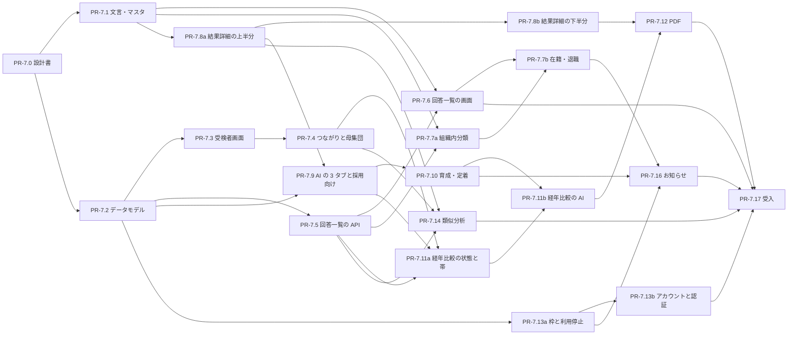

# 11 参照元の更新への追従（M7 総論）

| 項目 | 内容 |
|---|---|
| 文書名 | 適性検査システム 基本設計 11 参照元の更新への追従（M7 総論） |
| 版 | 1.0 |
| 作成日 | 2026-11-05 |
| 対象 | マイルストーン M7「参照元の更新への追従」の全体。依頼主（2 章の決定、7 章の文言、8 章の報告と判断）、実装担当とレビュー担当（4 章の差分の一覧、5 章の PR 計画）、00〜09・付録の改版担当（6 章） |
| 対応する PR | PR-7.0（本書・領域別仕様書 8 本・10 決定記録） |

## 0. この文書について

### 0.1 目的

- 参照元（first-inspection.jp。Bubble 製の適性検査サービス。以下「参照元」）は、前回の取得（要件定義書 1.0 版、2026-09-17）の後に大きく更新された。M7 は、その更新をアプリ（このリポジトリ）に取り込むマイルストーンで、本書はその総論である。
- 本書の役割は次のとおり。
  1. 参照元の取得の方法と、根拠の扱いを示す（1 章）。
  2. 依頼主の方針と決定（K-20〜K-50）と、確認事項 Q-01〜Q-51 との対応を示す（2 章）。
  3. 変わっていないもの（3 章）と、差分 232 件の最終の扱い・担当の PR・仕様の節を示す（4 章）。
  4. M7 の PR 計画（5 章）と、既存の設計書・実装への影響（6 章）をまとめる。
  5. 依頼主の確認が要る文言（7 章）と、未確認事項・仕様書どうしの食い違いの決着（8 章）をまとめる。
- 差分の仕様の中身は領域別仕様書（0.2）に書く。本書は仕様の中身を繰り返さず、領域別仕様書の節を指す。

### 0.2 領域別仕様書

8 つの領域ごとに 1 本ずつ書いた。どれも版 1.0（2026-11-05）で、依頼主の決定を当てはめた最終の仕様だけを書いている（選択肢は書かない）。

| 番号 | 仕様書 | 担当キー | テスト ID | 主な範囲 | 対応する PR |
|---|---|---|---|---|---|
| 11-1 | [受験者側と採点](11_参照元の更新/11-1_受験者側と採点.md) | `exam` | M7-exam-01〜62 | 受験者登録・診断開始・受験画面・完了・続けられないとき、既存スタッフ用リンク、再受験リンクの受け取り、送信のときの採点と保存 | PR-7.2・PR-7.3・PR-7.4 |
| 11-2 | [回答一覧](11_参照元の更新/11-2_回答一覧.md) | `list` | M7-list-01〜52 | 回答一覧と利用履歴、区分・入社日・退職日・役職、同じ人の受験のまとめ方、受検者の更新 API、`backfill-m7` | PR-7.2・PR-7.5・PR-7.6 |
| 11-3 | [在籍・退職と組織内分類](11_参照元の更新/11-3_在籍・退職と組織内分類.md) | `zaiseki` | M7-zaiseki-01〜48 | 組織内分類の作り直し、在籍・退職の画面の新設、キャラクターの文言（付録C §1・§8） | PR-7.1・PR-7.7a・PR-7.7b |
| 11-4 | [結果詳細](11_参照元の更新/11-4_結果詳細.md) | `result` | M7-result-01〜39 | 結果詳細の新しいレイアウト（AI 解説・類似分析・PDF・経年比較の中身を除く）、グラフの自作、文言マスタ（付録C §2・§3・§5〜§7・§9） | PR-7.1・PR-7.8a・PR-7.8b |
| 11-5 | [比較・類似分析・PDF](11_参照元の更新/11-5_比較・類似分析・PDF.md) | `compare` | M7-compare-01〜51 | 比較の母集団、類似分析のポップアップと API、ダウンロードのポップアップと PDF | PR-7.4・PR-7.12・PR-7.14 |
| 11-6 | [AI 解説](11_参照元の更新/11-6_AI解説.md) | `ai` | M7-ai-01〜50 | AI 解説の 3 つのタブ、3 種類のプロンプトと Claude API、経年比較の計算・入力文・生成・作成中・表示制限・レポート、PDF に載せる形 | PR-7.2・PR-7.9・PR-7.10・PR-7.11a・PR-7.11b・PR-7.12 |
| 11-7 | [再受験と経年比較](11_参照元の更新/11-7_再受験と経年比較.md) | `keinen` | M7-keinen-01〜53 | 前回の結果のつながりの意味と規則、再受験リンクの発行、1 年経過の帯、経年比較のタブのうち 11-6 以外の状態、組み合わせの API | PR-7.2・PR-7.4・PR-7.11a・PR-7.11b・PR-7.12 |
| 11-8 | [管理画面の枠・アカウント・お知らせ](11_参照元の更新/11-8_管理画面の枠・アカウント・お知らせ.md) | `misc` | M7-misc-01〜46 | サイドメニュー・文字のロゴ・狭い幅・書体・読み込み中、利用停止、新機能のお知らせ、アカウント画面、認証の画面、M7 のデータモデルの全体像（11-8 §3.1） | PR-7.2・PR-7.13a・PR-7.13b・PR-7.16 |

### 0.3 既存の分冊との関係

- M7 で変わる箇所は、11 系（本書と 0.2 の領域別仕様書）を正とする。既存の分冊（[00 共通定義](00_共通定義.md)〜[09 要件対応表](09_要件対応表.md)、付録A〜E）と食い違うときは 11 系を優先する。
- 既存の分冊は、各実装 PR で、その PR の範囲の節を改版する（どの分冊のどの節をどの PR で改めるかは 6 章）。改版した節は、11 系の要約と参照に置き換えてよい。PR-7.0 では既存の分冊を改版しない（00 §0.2 の決定事項 1・6 に、K-23・K-22 で改めたことを注記しただけ）。
- [10 決定記録](10_決定記録.md)には K-20〜K-50 を記録する（PR-7.0。K-41〜K-48 は 8.1 の 8 件への回答、K-49・K-50 は 8.1 の 8 の範囲を広げた依頼主の判断）。7 章の文言・プロンプトを依頼主が確認したときは、K-51 以降として記録する。
- 要件定義書（1.0 版）は改版しない。M7 の要件は 11 系で定め、09 要件対応表に対応を足す。
- 11 系の中の分担: 差分 ID の担当・PR の割り当て・仕様書どうしの食い違いの決着（8.3）は本書を、仕様の中身は領域別仕様書を正とする。

### 0.4 用語と書き方

| 用語 | 本書での意味 |
|---|---|
| 参照元 | first-inspection.jp の 2026-11-04 時点の定義と画面 |
| 前回 | 前回の取得に基づく仕様（要件定義書 1.0 版・付録A〜E・基本設計 00〜10） |
| アプリ | このリポジトリの実装（2026-11-04 時点）と、M7 の後の姿 |
| 差分 ID | 参照元の変化の番号 `{領域}-{番号}`（例 exam-01）。末尾が M の ID は検証で見落としとして足したもの。4 章と 3.4 が正 |
| 確認事項 | 依頼主に伺った事項 Q-01〜Q-51（2.3）。文言の ID（11-1 の Q-02「回答してください」など）とは別 |
| K-xx | 10 決定記録の決定。M7 の決定は K-20〜K-50 |
| 例外 (1)〜(4) | K-20 の例外。(1) これまでの決定 (2) セキュリティ上の問題 (3) 参照元の明らかな不具合・誤字 (4) 他社の名称・ロゴ・画像 |
| 責任者 | 役割 `owner` の管理者。参照元の文言の「院長」、参照元の「オーナー」にあたる。`super_admin` も同じ権限（D-14） |
| 既存スタッフの受験 | 受検者区分（`kind`）が `executive` の受験。閲覧範囲は責任者だけ（K-29） |
| 区分 | 求職者・在籍・退職（`results.employmentStatus`）。受検者区分とは別の項目 |
| 推定・未確認 | 推し量ったものは「推定」、取得物から分からないものは「未確認」。各仕様書の 6 章にまとめ、本書の 8 章に集めた |

## 1. 取得の方法と根拠の扱い

### 1.1 取得の方法

- 取得日は 2026-11-04。本書と領域別仕様書は取得済みのファイルだけから作り、作成のために参照元へは接続していない。
- 取得は次の 3 つの方法で行った。
  1. 閲覧のみ: 管理画面に、オーナーではない管理者のアカウントでログインし、各画面を開いて記録した。画面の文字は伏せ字にして保存し、スクリーンショットを撮った。
  2. 定義の解析: Bubble のアプリ定義（ページ・再利用要素・データ型・オプションセット・ワークフロー・スタイル・色）、埋め込みの HTML・JavaScript のアプリ、生成 AI の呼び出し定義を、読みやすい形に変換して読んだ。受験者登録と受験画面は、ブラウザが受け取った実行時の CSS も記録した。
  3. テスト受験者 1 名を登録して受験画面まで進み、受験画面の定義を取得した。回答の送信はしていない。
- 各仕様書は、取得物とリポジトリに照らして検証し、直してから確定した。検証で残った事項は 8.5 に集めた。

### 1.2 取得物の扱いと個人情報

- 取得物（画面の文字・スクリーンショット・定義と、それを変換したファイル）と、取得物から作った作業用の文書（差分の洗い出し、確認事項の一覧、方針の当てはめ）は、リポジトリに含めない。リポジトリに置くのは、本書・領域別仕様書・10 の決定だけである。
- 差分 ID と確認事項の番号は、作業用の文書の番号をそのまま使う。正は本書の 4 章・3.4（差分 ID）と 2.3（確認事項）。
- 本書と領域別仕様書には、受験者・管理者の氏名、電話番号、メールアドレス、組織 ID・回答 ID などの ID の値、AI 解説の本文（実在の人について書かれている）を書いていない。画面の文字は伏せ字にしたものだけを読み、スクリーンショットは配置と見た目の確認に使い、写っている氏名などは書き写していない。類似分析の画面に出ていた人は参照元の例のデータの架空の人で、これも書き写していない。定義の中のメールアドレス・ID・秘密の値も書いていない。
- 参照元の文言・AI のプロンプト・画面のデザインは、公開のリポジトリに書いてよい（K-40）。ただし、参照元のセキュリティ上の問題の詳細は書かない（K-30・K-31。範囲は 8.3 の 11）。

### 1.3 根拠の書き方

- 領域別仕様書は、根拠を次の形で書く。取得物はリポジトリに無いので、ファイルの場所ではなく、定義の中の名前で示す。
  - 参照元定義（2026-11-04 取得）の …: ページ・再利用要素・HTML アプリ・ポップアップ・ワークフロー・スタイルの名前と、必要なら要素 id。
  - 参照元の画面（2026-11-04）: 伏せ字済みの画面の文字とスクリーンショット。「実測」はスクリーンショットの画素の値。
  - 参照元の実行時 CSS（2026-11-04 取得）: ブラウザが受け取った要素ごとの CSS と、プラグインの CSS。
  - アプリと前回の仕様: リポジトリのパスと分冊の節（例 `lib/services/result-list.ts`、06 §3.4）。
- 参照元と変える箇所は「参照元: …／アプリ: …（K-xx）」と書き、各仕様書の 1.4 にまとめる。

### 1.4 取得の制約

- 取得したアカウントがオーナーでないため、既存スタッフの受験と、オーナーだけに出る表示（既存スタッフを含む回答一覧、経年比較のレポートなど）は画面で確かめられず、定義から書いた。
- 画面が無く定義だけから書いたものがある。主なもの: 経年比較のロック画面以外の状態と 1 年経過の帯、ログイン・登録・パスワード再設定・お知らせ・利用停止、設問の画面と完了ページ、組織内分類の「在籍」「退職」の切り替えと詳細パネル、回答一覧の ⋮メニュー・区分メニュー・ダイアログ。参照元の PDF の実物も作っていない。
- データの閲覧ルール（Bubble のプライバシールール）、アプリ設定の一部（Mobile Breakpoint など）、サーバ側の設定は取得物に無い。

## 2. 方針と決定

### 2.1 方針（K-20）

依頼主の方針（2026-11-05）は「参照元どおりを原則とする」。参照元と同じ動きと見た目を優先し、参照元と変えるのは次の 4 つの例外に限る。

1. これまでの決定（K-01〜K-19・決定事項 1〜6。M7 の決定で改めたものを除く）
2. セキュリティ上の問題
3. 参照元の明らかな不具合・誤字
4. 他社の名称・ロゴ・画像

確認事項 51 件は、この方針で「参照元どおり」の 27 件（K-39）と「確認する」の 24 件に分けた。24 件は問いにまとめて 1 問ずつ回答を得た（問 1〜18 の回答が K-21〜K-38）。

### 2.2 決定の一覧（K-20〜K-50）

| K | 事項（確認事項） | 決定の要約 | 主な仕様書 |
|---|---|---|---|
| K-20 | 方針 | 参照元どおりを原則とし、例外は (1)〜(4) に限る。差分と確認事項の扱いは 11 系を正とする | 全体 |
| K-21 | 職業に「責任者」（Q-01） | 職業の末尾に「責任者」（職業コード 10）。参照元の「院長」を K-19 で読み替えたもの。コード 9 は欠番のまま。役職が未設定で職業が責任者の人には回答一覧で「責任者」の札を付け、採用向けと育成・定着の AI 解説を出さない。K-19 (2) の 8 項目を 9 項目に改める | 11-1・11-2・11-6 |
| K-22 | 管理画面の狭い幅（Q-06） | 管理画面も参照元の CSS の幅で狭い画面に対応する。決定事項 6 を改める（受験者画面は変わらない） | 11-2〜11-8 |
| K-23 | グラフの作り方（Q-07） | SVG と CSS で自作する。決定事項 1 の ApexCharts を改め、置き換えが済んだら依存から外す | 11-3〜11-6 |
| K-24 | 非表示の PDF の AI 解説（Q-05） | 「評価・組織との合致度・リスクを非表示」の PDF には載せない（K-16 を維持）。全画面の PDF には画面に出ている AI 解説（表示中のタブ）を載せる | 11-5・11-6 |
| K-25 | AI の上限（Q-09） | 日次上限をなくす（K-03 の 200 回を改める）。費用は Anthropic Console の上限で管理する。出力の上限は種類ごとに決め、経年比較をほかより大きくする（値は 11-6: 採用向け 16000、育成・定着 16000、経年比較 32000） | 11-6 |
| K-26 | PDF の作り方（Q-29） | サーバで作り、見た目を参照元に合わせる（A4 縦・余白 10mm・ヘッダーとフッターとページ番号なし・参照元の改ページの規則・画面の状態の反映） | 11-5 |
| K-27 | 未回答（Q-13） | 全問必須のまま（D05-03 を維持）。必須の示し方と見た目は参照元に合わせる | 11-1 |
| K-28 | 区分の既定（Q-38） | 受験のときに区分を保存する（求職者用リンクは「求職者」、既存スタッフ用リンクと再受験は「在籍」）。今ある結果にも同じ規則で付ける | 11-1・11-2・11-3・11-7・11-8 |
| K-29 | 既存スタッフの情報（Q-18・Q-25） | 責任者だけに見せる。利用履歴と組織内分類でも、既存スタッフの氏名・電話番号・タイプを責任者以外に見せない。仕様書は在籍・退職・類似分析・経年比較にも同じ閲覧範囲を当てる | 11-2・11-3・11-5・11-6・11-7 |
| K-30 | 管理者を追加するリンク（Q-20） | 推測できない秘密のリンク（招待トークン）にし、全管理者のアカウント画面に常に表示する。責任者が作り直すと古いリンクは無効になる。D-35 を改める | 11-8 |
| K-31 | 安全な作り（Q-32・Q-43・Q-51 ほか） | 次の 5 点は参照元を再現せず安全な作りにする。① 再受験リンクの前回の結果は、同じ組織の削除されていない、まだほかの結果の前回になっていない結果だけをつなぐ（合わなければ通常の受験） ② 組織とスーパーアドミンを画面から登録する機能は作らない ③ パスワード再設定で登録の有無を区別しない ④ 比較はサーバで計算する ⑤ AI 解説を HTML として解釈しない | 11-1・11-5・11-6・11-7・11-8 |
| K-32 | 参照元の不具合・誤字（Q-45〜Q-47・Q-49・Q-50 ほか） | 次の 11 点は直して作る。① Step 1 の見出しを「Step 1」に ② 送信は 1 回だけ ③「ログインはこちら」の行き先は管理者のログイン画面 ④ 絞り込みの解除で「すべて」に戻す ⑤「現在の役職」の印 ⑥ 区分のタブが 0 件のときの文言 ⑦ チームを「チーム未設定」に戻せる ⑧ キャラクターの文言の重複と誤字を付録C で全画面に ⑨ 第二候補の「話し方」を入れ替えない ⑩「個性が弱い」の欠字を再現しない ⑪ AI の基準の語と「コンダクター」の表記 | 11-1・11-2・11-3・11-4・11-6 |
| K-33 | 優劣性の説明文（Q-48） | 「物事を決める前に、どれだけじっくり考えるかを表します。」「高いと冷静で思慮深く、低いと判断が早い反面、早とちりしやすくなります。」。ほかの 15 項目は参照元の文 | 11-4・付録C |
| K-34 | 類似分析（Q-39） | 実際のデータで作る。画面・類似度の式・「高・中・低」の境目は参照元どおり。比べる相手は同じ組織で、その管理者が見てよい受験者に限る | 11-5 |
| K-35 | 新機能のお知らせ（Q-41） | 参照元の 3 つを管理者ごとに 1 回出す。在籍・退職のお知らせの注記は K-28 に合う事実の文にする。文言には K-19 を当てる | 11-8 |
| K-36 | 再受験の費用の文言（Q-37） | 「再受験には、受験1回分の費用がかかります」は出さない | 11-7 |
| K-37 | サービス名とロゴ（Q-42） | 「適性検査」のまま、参照元のロゴの位置に文字のロゴとして出す。メールの件名・類似分析の小見出し・ページのタブの名前も「適性検査」。画像のロゴに差し替えられる作りにする | 11-1・11-5・11-8 |
| K-38 | 操作マニュアルと活用ガイド（Q-40） | 作らない。サイドメニューは 回答一覧・組織内分類・在籍・退職・アカウント の 4 項目 | 11-3・11-5・11-8 |
| K-39 | 参照元どおりとした 27 件 | 2.3 の表で K-39 と書いた 27 件。Q-16（受験者登録の見た目）のうち、配色のコントラストを了承した点は K-48 で改めた | 全体 |
| K-40 | 公開のリポジトリ | 公開のリポジトリのまま進める。参照元由来の文言・プロンプト・デザインが公開されることを依頼主が了承した | 全体 |
| K-41 | 開き直したときのステップ（8.1 の 1） | 受験画面を開き直したときは、未回答の設問がある最初のステップから表示する。途中までの回答は保存したまま。前のステップに戻らないこと（K-39 Q-12）は変わらない | 11-1 |
| K-42 | お名前・電話番号の上限（8.1 の 2） | 上限を設ける（例外 (2)）。お名前は 100 文字、電話番号は 30 文字まで。前後の空白を除いて保存し、空白だけの入力は未入力とみなす。電話番号の書式・桁数を検査しないこと（K-39 Q-17）は変わらない。上限を超えたときの通知の文言は 7 章の 3・4 | 11-1 |
| K-43 | 区分メニューのはみ出し（8.1 の 3） | 画面の下に入りきらないときは、回答一覧の区分メニューを上向きに開く（例外 (3)）。ほかの見た目と動きは参照元どおり | 11-2 |
| K-44 | 差のバッジの「+0.0」「-0.0」（8.1 の 4） | 小数第 1 位で 0 になる差は、符号を付けずに「0.0」と出す（例外 (3)）。ほかの差の書き方と色の規則は参照元どおり | 11-4 |
| K-45 | 類似分析の相手と「集計から除外」（8.1 の 5） | 入れない。比較組織の平均・組織内分類と同じく、「集計から除外」した受験者は類似分析の相手に出さない | 11-5 |
| K-46 | PDF のたたんだセクション（8.1 の 6） | たたんだセクションの前では改ページしない（例外 (3)）。開いているセクションは参照元どおり新しいページから始める | 11-5 |
| K-47 | 非表示の PDF の 1 ページ目（8.1 の 7） | 概要の前で改ページせず、見出しの塊と概要を 1 ページ目に置く（K-24 でこの PDF には AI 解説の領域が無いため）。全画面の PDF は参照元どおり | 11-5 |
| K-48 | 配色のコントラスト（8.1 の 8） | 文字のコントラストが 05 §8 の基準（4.5:1 以上。文字の大きさで分けない）に届かない組を、文字か地の色を色相を保って濃くし、読みやすい色にする。対象は受験者側の画面（受験者登録・診断開始・受験・完了など）と、経年比較の 1 年経過の帯・補足の文字。押せない状態の表示は参照元どおり。文字でない部分（入力欄の枠・線・アイコンなど）はこの決定の対象外で、参照元どおりとしていた扱いを K-50 で改めた。K-39 Q-16 のうち配色のコントラストを了承した点を改める（ほかの見た目は参照元どおり） | 11-1・11-7 |
| K-49 | 管理画面の文字のコントラスト（K-48 の対象のほか） | 管理画面も読みやすい色に変える。回答一覧・組織内分類・在籍・退職・結果詳細（PDF を含む）・AI 解説・アカウント・ログインなどの管理者の画面で、文字のコントラストが 05 §8 の文字の基準（4.5:1 以上。文字の大きさで分けない）に届かない参照元の配色を、K-48 と同じ方法で直す（届かない組の文字か地の色を、色相を保って濃くする）。押せない状態の表示と、文字のロゴ「適性検査」は参照元どおり | 11-2〜11-8 |
| K-50 | 文字でない部品の見分けやすさ（受験者側・管理画面） | 部品も見分けやすい色に変える。意味を持つ部品（入力欄・選択欄の枠、ラジオボタンの円、チェックボックス、スイッチ、選んだ状態の印、焦点の枠、アイコンだけのボタンなど）の色が 05 §8 の基準（隣の色との比 3:1 以上）に届かないときは、K-48 と同じ方法で、色相を保って濃くする。飾りの線・区切り線・カードの外形線、文字に添えた印、値を文字でも出す棒・メーター、押せない状態の表示は参照元どおり | 11-1〜11-8 |

- K-31 の ④⑤ と、K-32 の ①②③⑪ は、事項の欄に挙げた確認事項のほかに、差分から直接決めたもの（K-32 ② は Q-14 の二重送信の防止、③ は Q-44 の行き先にも当たる。2.3）。関係する差分: K-31 ① exam-03・exam-M2・keinen-01・keinen-07・keinen-M3、② misc-16・misc-19・misc-20、③ misc-18、④ compare-01・compare-18・keinen-07、⑤ ai-10・ai-16。K-32 ① exam-13、② exam-21、③ exam-02・keinen-23、④ list-14、⑤ list-07、⑥ list-21、⑦ list-09、⑧ zaiseki-26、⑨ result-26、⑩ result-34、⑪ ai-14・ai-M1。
- K-41〜K-48 は、確認事項 Q-01〜Q-51 とは別に、仕様書の作成と検証で見つかった 8.1 の 8 件への回答（2026-11-05）。2.3 の表には入れていない（K-48 で改めた Q-16 の行を除く）。関係する差分: K-41 exam-16、K-42 exam-08、K-43 list-04、K-44 result-14・compare-13、K-45 compare-18、K-46・K-47 compare-23、K-48 exam-02・exam-07・exam-14・exam-21・keinen-03・keinen-07・keinen-09・keinen-23（ほかに 3.4 の exam-11）。
- K-49・K-50 は、8.1 の 8 の回答（K-48）の範囲を、管理画面の文字と、文字でない部品（受験者側と管理画面）に広げた依頼主の判断（2026-11-06）。2.3 の表には入れていない（文字でない部品の色を K-50 で決めた Q-16 の行を除く）。関係する差分は多いため、4 章で最終の扱いに「配色は K-48〜K-50」と書いた行（上の K-48 の差分を含む）と、3.4 の冒頭に挙げた 4 件とする（4.1）。K-48〜K-50 を当てはめるときの計算と書き方は、8.3 の配色の取り決め（14〜24）でそろえた（決定の中身は変えない）。

### 2.3 確認事項と決定の対応

| Q | 事項 | 決定 | 決定の中身 | 関係する差分 |
|---|---|---|---|---|
| Q-01 | 職業に「責任者」を加えるか | K-21 | 末尾に「責任者」（コード 10）を加える | exam-01・list-29・misc-29 |
| Q-02 | 役職（責任者・幹部・スタッフ）と閲覧範囲 | K-39 | 参照元どおり。変えると閲覧範囲も変わる。責任者の受験では採用向けと育成・定着の AI 解説を出さない | exam-01・exam-M1・list-06・list-M1（ai-11・keinen-20） |
| Q-03 | 組織との合致度の色 | K-39 | 参照元どおり色分けをやめる（K-02 を改める） | result-09・compare-10 |
| Q-04 | 信頼係数の色と文言 | K-39 | 参照元どおり 3 段階と文言（K-02 の後半と D06-04 を改める） | result-10 |
| Q-05 | 非表示の PDF に AI 解説を載せるか | K-24 | 載せない。全画面の PDF は表示中の AI 解説を載せる | compare-21・ai-27 |
| Q-06 | 狭い画面幅への対応 | K-22 | 管理画面も対応する | list-25・result-33 |
| Q-07 | グラフの描き方 | K-23 | SVG と CSS で自作する | result-13（keinen-16） |
| Q-08 | 新しい AI プロンプトの K-19 の置き換え | K-39 | 参照元どおりのプロンプトに K-19 を当て、依頼主の確認まで本番で使わない | ai-14・ai-18・ai-M1・keinen-12 |
| Q-09 | 生成パラメータと日次上限 | K-25 | 日次上限をなくし、出力の上限は種類ごと | ai-24・keinen-12 |
| Q-10 | 再受験の古い結果を母集団・組織内分類から除くか | K-39 | 参照元どおり除く | zaiseki-08・zaiseki-M1・result-05・compare-06・keinen-22 |
| Q-11 | 受験画面のページ構成 | K-39 | 参照元どおり 4 ステップ・各 1 画面（D05-01 を改める） | exam-12（exam-13・exam-16） |
| Q-12 | 「戻る」ボタン | K-39 | 参照元どおり出さない | exam-17 |
| Q-13 | 未回答のまま進める・送信できるか | K-27 | 全問必須のまま | exam-18 |
| Q-14 | 送信の確認 | K-39 | 参照元どおり確認なし（D05-12 を改める。二重送信の防止は K-32 ②） | exam-21 |
| Q-15 | 無効な受験リンク | K-39 | 参照元どおり「診断に進む」で知らせる（D05-21 を改める） | exam-05 |
| Q-16 | 受験者登録の見た目 | K-39・K-48・K-50 | 参照元どおり（D05-22 を改める）。文字のコントラストが 05 §8 の基準に届かないことを了承した点は K-48 で改め、届く色にする。入力欄の枠などの文字でない部品の色は K-50 で決め、基準に届く色にする | exam-07・exam-M3 |
| Q-17 | 電話番号の書式の検査 | K-39 | 参照元どおり必須の検査だけ（D05-16 を改める） | exam-08 |
| Q-18 | 利用履歴の記録の時点と表示 | K-39・K-29 | 参照元どおり送信のときに記録し、回答一覧から開く（D02-30 を改める）。既存スタッフの履歴は責任者だけ（K-29） | exam-23・list-20 |
| Q-19 | 共通ヘッダー | K-39 | 参照元どおりなくす。ログアウトはアカウント画面だけ | list-20・misc-03（zaiseki-25） |
| Q-20 | 管理者を追加するリンクの出し方 | K-30 | 推測できない秘密のリンクを全管理者に常に表示し、責任者が作り直せる | misc-11 |
| Q-21 | メールアドレス・パスワードの変更方式 | K-39 | 参照元どおりメールアドレスは画面の欄、パスワードは再設定のメール（D-36 を改める） | misc-13・misc-14 |
| Q-22 | 管理者追加の登録でパスワードを入力するか | K-39 | 参照元どおり入力し、そのまま管理画面へ（D06-30 を改める） | misc-17 |
| Q-23 | 組織単位の利用停止 | K-39 | 参照元どおり責任者の停止で組織の全員が止まる（D02-27 を改める） | misc-08 |
| Q-24 | 組織内分類で除外した受験を数えるか | K-39 | 参照元どおり数えない（D06-18・D04-32 を改める） | zaiseki-09（list-10） |
| Q-25 | 組織内分類で既存スタッフを責任者以外に見せるか | K-29 | 責任者だけに見せる | zaiseki-10 |
| Q-26 | 立ち位置の見出しと偏差値 | K-39 | 参照元どおり「組織内のポジション」、偏差値は出さない（D06-10 を改める） | result-08・compare-11 |
| Q-27 | 母集団の人数と注記 | K-39 | 参照元どおり 3 か所に「（N人）」、補足行と注記は出さない | result-06・compare-15 |
| Q-28 | 判定チップの色 | K-39 | 参照元どおり 4 色（D06-15 を改める） | ai-09 |
| Q-29 | PDF の作り方 | K-26 | サーバで作り、見た目を参照元に合わせる | compare-19 |
| Q-30 | PDF のファイル名 | K-39 | 参照元どおり氏名を入れる。サーバのログと監査ログには残さない | compare-22 |
| Q-31 | 再受験と経年比較を作るか | K-39 | 参照元どおり全部作る | exam-03・keinen-01 ほか keinen の全項目・ai-18〜ai-24・list-01・list-02・list-07・list-18・compare-06・misc-27 |
| Q-32 | 再受験リンクの前回の結果のつなぎ方 | K-31 ① | 同じ組織の削除されていない、まだほかの前回になっていない結果だけをつなぐ。合わなければ通常の受験として登録する | exam-03・keinen-01・keinen-M3（exam-M2） |
| Q-33 | 再受験した人を既存スタッフ扱いにするか | K-39 | 参照元どおり既存スタッフ扱い | ai-M3 |
| Q-34 | 再受験で前回の値を引き継ぐか | K-39 | 参照元どおり引き継がない | list-M2・keinen-M1 |
| Q-35 | 前回の結果が論理削除されたとき | K-39 | 参照元どおりつながりを切る | keinen-01 |
| Q-36 | 2 回目以降の再受験の依頼の入口 | K-39 | 参照元どおり 1 年経過の帯だけ | keinen-M2 |
| Q-37 | 再受験の費用の文言 | K-36 | 出さない | keinen-02 |
| Q-38 | 区分が未設定の受験の扱い | K-28 | 受験のときに保存し、今ある結果にも付ける | list-M1・zaiseki-16（list-03） |
| Q-39 | 類似分析を作るか | K-34 | 実際のデータで作る | compare-17・compare-18（compare-16） |
| Q-40 | 操作マニュアルと活用ガイド | K-38 | 作らない | misc-22・misc-23（compare-24・compare-M2・misc-M1） |
| Q-41 | 新機能のお知らせ | K-35 | 3 つを管理者ごとに 1 回出し、注記を事実に合わせる | zaiseki-27・ai-25・misc-05〜misc-07（misc-24） |
| Q-42 | サービス名とロゴ | K-37 | 「適性検査」を文字のロゴに | compare-17・misc-02・misc-18 |
| Q-43 | 組織とスーパーアドミンの画面からの登録 | K-31 ② | 作らない（運用のスクリプトのまま。K-12） | misc-19・misc-20 |
| Q-44 | 「すでに受験された方・ログインはこちら」 | K-39・K-32 ③ | 参照元どおり受験者登録に置く。行き先は管理者のログイン画面 | exam-02・keinen-23 |
| Q-45 | チームを「チーム未設定」に戻せるか | K-32 ⑦ | 戻せる | list-09・list-31 |
| Q-46 | 回答一覧の不具合と思われる挙動 | K-32 ④⑤⑥ | 直す（枝分かれは K-31 ①、役職による区分の変化は K-28 で起きない） | list-31（list-21） |
| Q-47 | キャラクターの文言の修正 | K-32 ⑧ | 付録C を直し、全画面で同じ文にする（K-11 は設問文だけが対象） | zaiseki-26 |
| Q-48 | 優劣性の説明文 | K-33 | 項目の詳細と合う文に直す | result-16 |
| Q-49 | 第二候補の「話し方」 | K-32 ⑨ | 入れ替えない | result-26 |
| Q-50 | 「個性が弱い、主体性がない」の欠字 | K-32 ⑩ | 再現しない | result-34 |
| Q-51 | パスワード再設定での登録の有無の扱い | K-31 ③ | 区別しない | misc-18 |

- K-39 の 27 件: Q-02・Q-03・Q-04・Q-08・Q-10・Q-11・Q-12・Q-14・Q-15・Q-16・Q-17・Q-18・Q-19・Q-21・Q-22・Q-23・Q-24・Q-26・Q-27・Q-28・Q-30・Q-31・Q-33・Q-34・Q-35・Q-36・Q-44。このうち Q-16 は、配色のコントラストを了承した点だけを K-48 で改め、文字でない部品の色は K-50 で決めた（2.5）。

### 2.4 変わらない決定

M7 でも次の決定はそのまま当てる。

- K-19: 参照元の文言の「院長（先生）」→「責任者」、「医院」「クリニック」→「サロン」の置き換えと、歯科の職種・業務の文の言い換えを、新しい画面・お知らせ・AI プロンプトのすべてに当てる。新しい画面で言い換えに迷う文言は、AI のプロンプトのルール 4 だけ（7 章の 19）。
- K-05: イラストは自作の SVG。参照元の画像は使わない。参照元が絵文字・他社のアイコンの字体で描く記号も、同じ形の自作の SVG にする（11-6 §2.14、11-7 §1.4 の 10、11-8 §1.4 の 12。他社のアイコンの字体には K-20 例外 (4) も当たる。8.2）。
- 決定事項 1・K-06: Firestore にはサーバの Admin SDK からだけアクセスする。参照元のデータの読み直し（0.7〜1 秒ごと）は、サーバで描いて操作のあとに読み直す形に置き換える。
- 決定事項 2: 前回の不具合 10 件は直したまま（優劣性を 12 に上書きしない、など）。
- 決定事項 3: 出題は Q1〜Q144（参照元も同じ範囲になった）。
- 決定事項 4: 既存システムのデータは移行しない（参照元の受験とアプリの受験をつながない）。
- 決定事項 5・K-18: AI 解説は Claude API（本番は `claude-opus-5-5`）。参照元は Gemini。
- K-01（母集団に本人と既存スタッフを含める）、K-04（論理削除。データは削除しない）、K-15（非表示の PDF にも組織内のポジションを載せる）、K-17（ログに個人情報と秘密の値を出さない）。

### 2.5 M7 で改めた既存の決定・設計判断

| 改めたもの | 改めた後 | 決定 |
|---|---|---|
| 決定事項 1（グラフは ApexCharts） | SVG と CSS で自作 | K-23 |
| 決定事項 6（管理画面は PC 幅） | 管理画面も狭い幅に対応 | K-22 |
| K-02（合致度の色、信頼係数の色） | 合致度は色分けなし、信頼係数は 3 段階 | K-39（Q-03・Q-04） |
| K-03 の日次上限 200 回 | 日次上限なし | K-25 |
| K-19 (2) の職業 8 項目 | 9 項目（責任者を末尾に） | K-21 |
| D-35（管理者追加のリンクは発行のときだけ表示） | 招待のリンクを全管理者に常に表示、責任者が作り直せる | K-30 |
| D-36（メールアドレス・パスワードの変更方式） | メールアドレスは画面の欄、パスワードは再設定のメール | K-39（Q-21） |
| D02-27（停止は管理者ごと） | 責任者の停止で組織の全員を止める | K-39（Q-23） |
| D02-30（利用履歴は登録のときに作る） | 送信のときに作る | K-39（Q-18） |
| D04-32（組織内分類の集計に除外者を含める） | 参照元どおり（除外した受験を数えない） | K-39（Q-24） |
| D05-01・D05-12・D05-16・D05-21・D05-22（受験画面のページ分割・送信の確認・電話番号の書式・無効なリンク・登録画面の見た目） | 参照元どおり（登録画面の配色のコントラストは K-48・K-50 の行） | K-39（Q-11・Q-14・Q-17・Q-15・Q-16） |
| K-39 Q-16 のうち、参照元の配色のコントラストを了承した点（受験者側の画面は、文字のコントラストが 05 §8 の基準に届かない配色のまま） | 文字のコントラストが基準に届かない組を、届く色にする（受験者側の画面と、経年比較の 1 年経過の帯・補足の文字。押せない状態の表示とほかの見た目は参照元どおり。文字でない部分は K-50 の行） | K-48 |
| K-20 の原則で参照元どおりとしていた管理画面の配色（K-48 の対象のほか。文字のコントラストが 05 §8 の基準に届かない組を含む） | 文字のコントラストが基準に届かない組を、K-48 と同じ方法で届く色にする（回答一覧・組織内分類・在籍・退職・結果詳細（PDF を含む）・AI 解説・アカウント・ログインなど。押せない状態の表示と文字のロゴ「適性検査」は参照元どおり） | K-49 |
| 文字でない部分（入力欄の枠・線・アイコンなど）の参照元の配色（K-48 の対象の画面では対象外とし、ほかの管理画面は K-20 の原則で、参照元どおりとしていた） | 意味を持つ部品の色が 05 §8 の基準（隣の色との比 3:1 以上）に届かない組を、K-48 と同じ方法で届く色にする（受験者側と管理画面。飾りの線・区切り線・カードの外形線、文字に添えた印、値を文字でも出す棒・メーター、押せない状態の表示は参照元どおり） | K-50 |
| D06-04・D06-10・D06-15・D06-18・D06-30（信頼係数の色・偏差値・判定チップの色・除外者・管理者追加の登録） | 参照元どおり | K-39（Q-04・Q-26・Q-28・Q-24・Q-22） |
| 維持したもの: K-16（非表示の PDF に AI 解説を載せない）、D05-03（全問必須）、D07-16（PDF はサーバで作る） | 維持 | K-24・K-27・K-26 |

## 3. 変わっていないもの

### 3.1 採点式と設問

- 16 尺度・組織との相性 5 軸・資質 4 型・リスク 7 項目・適性タイプ 16 種・信頼係数の式は、項（設問・配点属性・符号）と定数（+14、×5、÷2、×0.49+100、−144、0 未満は 0）まで付録B と一致した。自己実現型の式で Q13 を 2 回数える点も残っている（K-09 のとおり）。
- 設問 204 問の文面は付録A と一致した。参照元で実際に出題されるのは 4 ステップの Q1〜Q144 で、決定事項 3 と同じ範囲になった。
- このため採点エンジン（03・付録B）の式は M7 で変えない。変わるのは設問の区切り（今の 1 ステップ 36 問・5 ページ → 4 ステップ・各 1 画面の 41／41／41／21 問。11-1 §2.4、03 §2.3・§4.3）と、比較の母集団の条件（再受験で置き換わった結果を除く。11-5 §2.1.2）だけである。

### 3.2 送信のときの流れ

- 送信のときの採点と保存の流れ（回答データ → 16 尺度 → 相性 → 資質 → リスク → チャート用のレコード → 資質の候補 → タイプ → ソーシャルスタイル → 信頼係数 → 利用回数管理）は前回と同じで、加わったのは前回の結果（再受験のつながり）の保存だけである。
- アプリは結果を 1 文書に保存する作りのまま、送信のトランザクションで、区分（K-28）・前回の結果（K-31 ①）・利用履歴（K-39 Q-18）と、AI 解説の 3 系統の状態の初期値を書く（11-1 §2.7、11-6 §3.1）。

### 3.3 前回の不具合

- 前回の不具合 10 件（要件定義書 §11）のうち、2（思考の傾向の偏差の参照誤り）・3（母集団の不統一）・6（同じアカウントの同時利用で表示が混ざる）・10（平均の分母）は参照元でも解消した。5（信頼係数の色）は新しい画面で高いほど緑になり、7（Q145 以降を採点に使わない）は参照元が Q145 以降を出題しなくなった。1（「次へ」で優劣性を 12 に上書き）は参照元に残っている。
- アプリは 10 件とも直したまま（決定事項 2）で、参照元に残る 1 は再現しない（exam-19）。

### 3.4 変化なし（実装済み）の 24 件

前回と同じで、アプリも実装済みの項目。4 章の表には入れていない。作り直す画面の中にあるものは、作り直しても同じ働きを保つ。配色は、その画面を作り直す PR で 4 章と同じく K-48〜K-50 を当てる（exam-11 の「開始する」、result-02 の見出しのボタンと比較組織のプルダウン、compare-07 のプルダウン、misc-13 の「メールアドレスを変更」）。

| ID | 領域 | 項目 | 本書での扱い | 領域別仕様書の節 |
|---|---|---|---|---|
| exam-10 | 受験者 | 受験者の登録内容（お名前・電話番号・職業・過去の診断経験、リンクの q から組織） | 変えない（保存する項目を足すだけ） | 11-1 §2.2.6 |
| exam-11 | 受験者 | 診断開始の画面と下書き | 変えない（アプリが足した補足 3 行は消す: K-20） | 11-1 §2.3 |
| exam-19 | 受験者 | 「次へ」で優劣性を 12 に上書きする（参照元に残る前回の不具合 1） | 再現しない（決定事項 2） | 11-1 §1.3 |
| exam-20 | 受験者 | 最終ステップ用の「次へ」の旧式（参照元でも到達しない） | 作らない | 11-1 §1.3 |
| exam-22 | 受験者 | 送信のときに保存するデータの構成 | 変えない（項目を足す） | 11-1 §2.7 |
| exam-27 | 受験者 | 採点式 | 変えない | 11-1 §2.7.1 |
| list-28 | 回答一覧 | 結果を開く（比較を未選択で開く） | 変えない | 11-2 §2.8 |
| list-33 | 回答一覧 | 一覧の母体（自組織の送信済みの受験を新しい順に全件） | 変えない | 11-2 §2.25 |
| zaiseki-29 | 在籍・組織内分類 | 象限・軸・4 分類の主色・ひらがな名 | 変えない | 11-3 §2.4 |
| result-02 | 結果詳細 | 見出し行（「{氏名}様の診断結果」・比較組織・ダウンロード） | 細部を参照元に合わせる（「様」の前の空白、プルダウンのラベル、「AI解説を表示」の削除） | 11-4 §2.3 |
| result-37 | 結果詳細 | 変わっていない文言（タイプ別・項目詳細・特性詳細・育成方法・立ち位置） | 変えない | 11-4 §3.3 |
| result-38 | 結果詳細 | 比較の式と、保存しないこと | 変えない | 11-4 §2.6、11-5 §2.1 |
| compare-04 | 比較・類似・PDF | 合致度・偏差値・評価・立ち位置の式と閾値 | 変えない | 11-5 §2.1.3 |
| compare-05 | 比較・類似・PDF | 母集団の基本の条件（K-01） | 変えない（置き換わった結果を除く条件を足す: compare-06） | 11-5 §2.1.2 |
| compare-07 | 比較・類似・PDF | 比較組織のプルダウン | 変えない（選択は今のまま URL に置く。8.2） | 11-5 §2.1.4、11-4 §2.3 |
| compare-12 | 比較・類似・PDF | ポジションの名称・説明文 | 変えない（K-19 の置き換えは済み） | 11-5 §2.2 |
| ai-01 | AI 解説 | 採用向けのプロンプト | 変えない（本番は recruitment-v2） | 11-6 §2.7.1 |
| ai-28 | AI 解説 | AI への入力値の差し込み方（D07-05 の整形） | 変えない（育成・定着と経年比較にも当てる） | 11-6 §2.7.5 |
| keinen-24 | 再受験・経年 | 既存スタッフ用リンク（p=executives）での登録 | 変えない | 11-1 §2.2.1 |
| keinen-25 | 再受験・経年 | 既存スタッフの受験は責任者だけが見る | 変えない（経年比較でも同じ閲覧範囲） | 11-2 §2.25、11-7 §2.3 |
| misc-04 | 管理画面ほか | 画面の切り替え（参照元は URL の section、アプリはルート） | 変えない | 11-8 §2.1 |
| misc-13 | 管理画面ほか | メールアドレスの変更 | 方式を参照元に合わせる（画面の欄で変える: K-39 Q-21） | 11-8 §2.9.7 |
| misc-14 | 管理画面ほか | パスワードの変更 | 方式を参照元に合わせる（再設定のメールで変える: K-39 Q-21） | 11-8 §2.9.8 |
| misc-15 | 管理画面ほか | ログアウト | 見た目を参照元に合わせる（行き先は /admin/login: K-20 例外 (3)） | 11-8 §2.9.9 |

## 4. 変更点の一覧

参照元の変化 232 件（3.4 の 24 件を除く）の最終の扱い。仕様の中身は「領域別仕様書の節」が正。

### 4.1 表の見方

- 種別: 新規 = 前回の仕様に記載が無い（参照元で加わった、または前回は把握していなかった）／変更 = 前回の仕様と参照元の今が違う／削除 = 参照元で表示されなくなった／変化なし（未実装） = 参照元は前回と同じだが、今のアプリが未実装か参照元と違う作り。
- 最終の扱い:
  - 参照元どおり: 参照元の動き・見た目・文言のとおりに作る。K-19 の語の置き換え、K-05 の自作の絵と、見え方が同じで作りだけが違うもの（サーバで描く・サーバで計算する・操作のあとに読み直す・文字として安全に出す）はこれに含め、括弧に書く。K-48〜K-50 の配色の直し（文字と部品のコントラストが 05 §8 の基準に届かない組を、届く色にすること）も、K-19 の語の置き換えと同じく全体に当てる規則としてこれに含め、括弧に「配色は K-48〜K-50」と書く（変えた組は各仕様書の 1.4 と色の表）。どの行に書くかは、各仕様書の §1.1 の「当てはめる決定」の列に合わせる（8.3 の 22）。行の項目に当たらない部品の配色は、その部品を含む画面の行に書く（受験画面のラジオボタンの円は exam-12）。今のアプリがすでに同じで作業が要らないものは「対応不要」と書く。
  - 参照元と変える（K-xx）: 参照元と違う動き・見た目・文言にする。括弧に根拠の決定と変える点を書く。一部だけ変えるものも含める。配色の直し（K-48〜K-50）だけでは参照元と変えるにしない。ほかの理由で参照元と変える行も、行の項目が画面の部分（画面・ポップアップ・メニュー・ボタン・表示など）でその配色を直すときは、括弧に「配色は K-48〜K-50」を足した。
  - 作らない: 作らない・再現しない。括弧に理由を書く。
- 担当 PR: 5 章の PR。「—」は作業が無い（作らない・対応不要）。作らないもののうち、代わりの作りが要るもの（list-31・list-32 など）は、その作りの PR を書いた。
- 領域別仕様書の節: 「11-1 §2.2.4」は 11-1 の 2.2.4 節。ほかの仕様書の節も正とするものは「、」で続けた。
- 「7 章の n」「8.3 の n」は、本書の該当の行。

### 4.2 件数

| 領域 | 件数 | 参照元どおり | 参照元と変える | 作らない | 新規 | 変更 | 変化なし（未実装） | 削除 |
|---|---:|---:|---:|---:|---:|---:|---:|---:|
| exam 受験者 | 24 | 12 | 9 | 3 | 18 | 4 | 2 | 0 |
| list 回答一覧 | 34 | 21 | 10 | 3 | 19 | 13 | 1 | 1 |
| zaiseki 在籍・組織内分類 | 29 | 22 | 6 | 1 | 18 | 8 | 3 | 0 |
| result 結果詳細 | 37 | 32 | 5 | 0 | 11 | 25 | 0 | 1 |
| compare 比較・類似・PDF | 22 | 12 | 8 | 2 | 9 | 13 | 0 | 0 |
| ai AI 解説 | 29 | 19 | 10 | 0 | 24 | 5 | 0 | 0 |
| keinen 再受験・経年 | 26 | 16 | 10 | 0 | 26 | 0 | 0 | 0 |
| misc 管理画面ほか | 31 | 9 | 12 | 10 | 22 | 9 | 0 | 0 |
| 計 | 232 | 143 | 70 | 19 | 147 | 77 | 6 | 2 |

- 作業が無いもの（担当 PR が「—」）は 22 件（作らない 17 件と、今のアプリのままでよい「対応不要」の 5 件）。
- 参照元と変える 70 件の根拠: K-31・K-32・K-41〜K-47 などの M7 の決定が大半で、K-32 の 11 点のほかに各仕様書が例外 (2)(3)(4) を当てた箇所は 8.2 にまとめた。K-48〜K-50 の配色の直しは参照元どおりに含め、参照元と変える根拠には数えない（4.1）。
- 8.1 の回答（K-41〜K-48）で、参照元どおりから参照元と変えるに移ったのは 3 件（list-04・result-14・compare-13。K-43・K-44）。compare-13 は差のバッジ（K-44）を含むため、result-06 と compare-08 のように result-14 と同じ扱いで数えた。K-48 だけを理由に参照元と変えるに移していた 5 件（exam-07・exam-14・keinen-03・keinen-06・keinen-09）は、配色の直しを参照元どおりに含める 4.1 の規則で、参照元どおりに戻した。

### 4.3 受験者（exam。24 件）

| ID | 領域 | 項目 | 種別 | 最終の扱い | 担当 PR | 領域別仕様書の節 |
|---|---|---|---|---|---|---|
| exam-01 | 受験者 | 職業の末尾に「責任者」（参照元: 院長）。職業コード 10 | 変更 | 参照元どおり（名前は K-19 で「責任者」。K-21） | PR-7.2・PR-7.3 | 11-1 §2.2.4 |
| exam-02 | 受験者 | 受験者登録の「すでに受験された方・ログインはこちら」 | 新規 | 参照元と変える（K-32 ③: 行き先を管理者のログイン画面に。配色は K-48〜K-50） | PR-7.3 | 11-1 §2.2.7・§2.2.2・§2.1.3 |
| exam-03 | 受験者 | 再受験の入口（URL の prev から前回の結果へつなぐ） | 新規 | 参照元と変える（K-31 ①: 条件を満たす前回の結果だけをつなぐ） | PR-7.4 | 11-1 §2.2.8・§2.7.3 |
| exam-04 | 受験者 | 既存スタッフ用リンクの見出し「受験者登録(幹部用)」と p の判定 | 新規 | 参照元どおり | PR-7.3 | 11-1 §2.2.1・§2.2.2 |
| exam-05 | 受験者 | 無効な受験リンクでもフォームを出し、「診断に進む」で知らせる | 新規 | 参照元どおり（K-39 Q-15） | PR-7.3 | 11-1 §2.2.6・§2.1.5 |
| exam-06 | 受験者 | URL の「amp;」を除いて開き直す | 新規 | 参照元どおり | PR-7.3 | 11-1 §2.2.1 |
| exam-07 | 受験者 | 登録画面の見た目（ラベルなし・アイコン・プルダウン・配色・ヘッダーなし） | 新規 | 参照元どおり（K-39 Q-16。配色は K-48〜K-50。ボタンの配色は R-02・R-03 も同じ） | PR-7.3 | 11-1 §2.2.2・§2.2.3・§2.1.3 |
| exam-08 | 受験者 | 登録の入力チェック（4 項目は必須、電話番号の書式は見ない） | 新規 | 参照元と変える（K-42: お名前 100 文字・電話番号 30 文字の上限と、前後の空白の除去（空白だけは未入力）。必須の検査だけは K-39 Q-17 で参照元どおり。通知の文言は 7 章の 3・4） | PR-7.3 | 11-1 §2.2.5 |
| exam-09 | 受験者 | ログイン中の管理者を管理画面へ転送する | 新規 | 作らない（管理者と受験者の認証が別で、転送しなくても同じ結果になる） | — | 11-1 §1.3 |
| exam-12 | 受験者 | 4 ステップ・各ステップを 1 画面（Q1〜41／42〜82／83〜123／124〜144） | 変更 | 参照元どおり（K-39 Q-11。配色は K-48〜K-50。設問のラジオボタンの円を含む） | PR-7.3 | 11-1 §2.4.1・§2.4.2・§2.4.4・§2.1.3 |
| exam-13 | 受験者 | ステップごとの見出しと案内文 | 新規 | 参照元と変える（K-32 ①: Step 1 の見出しを「Step 1」に） | PR-7.3 | 11-1 §2.4.1 |
| exam-14 | 受験者 | ステップ表示（番号の丸・ラベル・線・色） | 新規 | 参照元どおり（配色は K-48〜K-50） | PR-7.3 | 11-1 §2.4.3・§2.1.3 |
| exam-15 | 受験者 | 設問の番号表記「1.」「2. 」 | 新規 | 参照元と変える（K-20 例外 (3): 全問「{番号}. 」。7 章の 1） | PR-7.3 | 11-1 §2.4.4 |
| exam-16 | 受験者 | 回答は選んだ時点で保存し、開き直すと続きから | 新規 | 参照元と変える（保存は参照元どおり。開き直したときは未回答の設問がある最初のステップから: K-41） | PR-7.3 | 11-1 §2.4.5・§2.4.8 |
| exam-17 | 受験者 | 「戻る」ボタンが無い | 変更 | 参照元どおり（K-39 Q-12） | PR-7.3 | 11-1 §2.4.6・§2.4.9 |
| exam-18 | 受験者 | 未回答のまま「次へ」「送信する」を押せる | 新規 | 参照元と変える（K-27: 全問必須。示し方と見た目は参照元に合わせる。7 章の 2） | PR-7.3 | 11-1 §2.4.6 |
| exam-21 | 受験者 | 送信（確認なし・「ロード中」・2 秒待つ） | 変更 | 参照元と変える（K-32 ②: 送信は 1 回だけ。確認なし・ロード中・2 秒は K-39 Q-14 で参照元どおり。配色は K-48〜K-50） | PR-7.3 | 11-1 §2.4.7・§2.1.6 |
| exam-23 | 受験者 | 利用履歴（参照元の利用回数管理）は送信のときに作る | 変化なし（未実装） | 参照元どおり（K-39 Q-18） | PR-7.3 | 11-1 §2.7.4 |
| exam-24 | 受験者 | 完了ページ「回答完了」 | 新規 | 参照元どおり | PR-7.3 | 11-1 §2.5 |
| exam-25 | 受験者 | 使われていない「送信完了！」ポップアップ | 新規 | 作らない（参照元でも出ない） | — | 11-1 §1.3 |
| exam-26 | 受験者 | 一括再採点と test ページの保守用ボタン | 新規 | 作らない（決定事項 4。保守用） | — | 11-1 §1.3 |
| exam-M1 | 受験者 | 職業「責任者」（参照元: 院長）が回答一覧の役職の既定になり、後から役職を変えられる | 新規 | 参照元どおり（K-21・K-39 Q-02） | PR-7.2・PR-7.5・PR-7.6 | 11-1 §2.2.4、11-2 §2.3・§2.15 |
| exam-M2 | 受験者 | 再受験リンクの形（q） | 新規 | 参照元と変える（K-31 ①: q は受験リンクと同じ組織 ID） | PR-7.4・PR-7.11a | 11-1 §2.2.8 |
| exam-M3 | 受験者 | 入力欄のスタイル（不正のときの赤枠、フォーカスの枠の色） | 変化なし（未実装） | 参照元どおり（K-39 Q-16。配色は K-48〜K-50） | PR-7.3 | 11-1 §2.2.3・§2.1.3 |

### 4.4 回答一覧（list。34 件）

| ID | 領域 | 項目 | 種別 | 最終の扱い | 担当 PR | 領域別仕様書の節 |
|---|---|---|---|---|---|---|
| list-01 | 回答一覧 | 同じ人の受験を 1 行にまとめる | 新規 | 参照元どおり（枝分かれは作らない: K-31 ①） | PR-7.5・PR-7.6 | 11-2 §2.2 |
| list-02 | 回答一覧 | 集計カード 4 枚（受験した人・今月の受験・受験から1年以上たった人・経年比較レポート） | 新規 | 参照元と変える（K-29・K-39 Q-35: 「経年比較レポート」は閲覧者が見られるレポートだけ数える。ほかの 3 枚は参照元どおり。keinen-19 と同じ） | PR-7.5・PR-7.6 | 11-2 §2.5 |
| list-03 | 回答一覧 | 区分（求職者・在籍・退職）の既定と区分タブ | 新規 | 参照元と変える（K-28: 区分を受験のときに保存し、今ある結果にも付ける。配色は K-48〜K-50） | PR-7.2・PR-7.3・PR-7.6 | 11-2 §2.3・§2.6、11-1 §2.7.2 |
| list-04 | 回答一覧 | 区分チップと区分メニュー | 新規 | 参照元と変える（K-43: 画面の下に入りきらないときは、区分メニューを上向きに開く（⋮メニューと同じ補正）。ほかの見た目と動きは参照元どおり。配色は K-48〜K-50） | PR-7.5・PR-7.6 | 11-2 §2.9・§2.12・§2.13 |
| list-05 | 回答一覧 | 入社日・退職日のダイアログと日付チップ | 新規 | 参照元どおり（配色は K-48〜K-50） | PR-7.5・PR-7.6 | 11-2 §2.9・§2.14 |
| list-06 | 回答一覧 | 役職（責任者・幹部・スタッフ。参照元: 院長）と「役職を変える」 | 新規 | 参照元どおり（K-39 Q-02。役職で閲覧範囲も変わる） | PR-7.5・PR-7.6 | 11-2 §2.15 |
| list-07 | 回答一覧 | ⋮メニュー（以前の受験・日付・区分・役職・削除） | 新規 | 参照元と変える（K-32 ⑤: 「現在の役職」の印を正しく付ける。配色は K-48〜K-50） | PR-7.6 | 11-2 §2.12 |
| list-08 | 回答一覧 | 削除の確認文言と範囲（その回の受験 1 件） | 変更 | 参照元と変える（K-04: 論理削除のまま。配色は K-48〜K-50） | PR-7.5・PR-7.6 | 11-2 §2.16 |
| list-09 | 回答一覧 | チームの選択（つながった全受験に保存） | 変更 | 参照元と変える（K-32 ⑦: 「チーム未設定」に戻せる。7 章の 10。配色は K-48〜K-50） | PR-7.5・PR-7.6 | 11-2 §2.10 |
| list-10 | 回答一覧 | 集計から除外（スイッチ） | 変更 | 参照元どおり（K-39 Q-24。配色は K-48〜K-50） | PR-7.5・PR-7.6 | 11-2 §2.11 |
| list-11 | 回答一覧 | 検索（入力のたびに、空白・ハイフン類を除いて部分一致） | 変更 | 参照元どおり（配色は K-48〜K-50） | PR-7.6 | 11-2 §2.7 |
| list-12 | 回答一覧 | チームで絞り込む（使われているチームだけ） | 変更 | 参照元どおり（配色は K-48〜K-50） | PR-7.6 | 11-2 §2.7 |
| list-13 | 回答一覧 | 並び順 4 種 | 変更 | 参照元どおり（配色は K-48〜K-50） | PR-7.6 | 11-2 §2.7 |
| list-14 | 回答一覧 | 件数表示・100 行ずつ「さらに表示」・絞り込みを解除 | 変更 | 参照元と変える（K-32 ④: 解除で「すべて」に戻す。配色は K-48〜K-50） | PR-7.6 | 11-2 §2.7・§2.8 |
| list-15 | 回答一覧 | 表の列と行の操作 | 変更 | 参照元どおり（配色は K-48〜K-50） | PR-7.6 | 11-2 §2.8 |
| list-16 | 回答一覧 | タイプ列 | 新規 | 参照元どおり（配色は K-48〜K-50） | PR-7.6 | 11-2 §2.8 |
| list-17 | 回答一覧 | 最新の受験の表示 | 変更 | 参照元どおり（配色は K-48〜K-50） | PR-7.6 | 11-2 §2.8 |
| list-18 | 回答一覧 | チップ「n回目」「経年比較あり」「受験から1年以上」 | 新規 | 参照元と変える（K-29・K-39 Q-35: 「経年比較あり」は閲覧者が見られるレポートだけ。配色は K-48〜K-50） | PR-7.5・PR-7.6 | 11-2 §2.9 |
| list-19 | 回答一覧 | 回答リンクのコピー | 新規 | 参照元どおり（K-19。配色は K-48〜K-50） | PR-7.6 | 11-2 §2.17 |
| list-20 | 回答一覧 | 利用履歴（一覧の見出しの横のボタン・列・全件） | 変化なし（未実装） | 参照元と変える（K-29: 既存スタッフの履歴は責任者だけ。記録の時点と表示は K-39 Q-18・Q-19 で参照元どおり。配色は K-48〜K-50） | PR-7.3・PR-7.5・PR-7.6 | 11-2 §2.18 |
| list-21 | 回答一覧 | 0 件のときの表示 3 種 | 変更 | 参照元と変える（K-32 ⑥: タブに合わせた文言。7 章の 8・9） | PR-7.6 | 11-2 §2.19 |
| list-22 | 回答一覧 | 既存スタッフの行を同じ表に混ぜる（責任者だけ） | 変更 | 参照元どおり | PR-7.5・PR-7.6 | 11-2 §2.25 |
| list-23 | 回答一覧 | 責任者以外の見え方 | 新規 | 参照元どおり | PR-7.6 | 11-2 §2.25 |
| list-24 | 回答一覧 | 絞り込みの状態の保持（sessionStorage） | 変更 | 参照元どおり | PR-7.6 | 11-2 §2.21 |
| list-25 | 回答一覧 | 狭い幅・中くらいの幅（カード型の行） | 新規 | 参照元どおり（K-22） | PR-7.6 | 11-2 §2.22 |
| list-26 | 回答一覧 | 操作ごとの通知 | 新規 | 参照元どおり | PR-7.6 | 11-2 §2.20 |
| list-27 | 回答一覧 | 見出し・説明文・表の下の注記 | 新規 | 参照元どおり | PR-7.6 | 11-2 §2.4・§2.8 |
| list-29 | 回答一覧 | 職業「責任者」（参照元: 院長）と一覧の職業の表示 | 変更 | 参照元どおり（K-19・K-21） | PR-7.2・PR-7.6 | 11-2 §2.3・§2.8 |
| list-30 | 回答一覧 | 旧一覧の廃止 | 削除 | 参照元どおり（今の表を置き換える） | PR-7.6 | 11-2 §2.8 |
| list-31 | 回答一覧 | 参照元の不具合と思われる挙動 (a)〜(f) | 新規 | 作らない（再現しない。K-32 ④⑤⑥⑦・K-31 ①・K-28） | PR-7.6 | 11-2 §1.3・§1.4 |
| list-32 | 回答一覧 | 一覧の自動更新（700 ミリ秒ごと） | 新規 | 作らない（決定事項 1。操作のあとに読み直す） | PR-7.6 | 11-2 §2.23 |
| list-34 | 回答一覧 | 変更はつながった全受験に書く | 新規 | 参照元どおり（1 回のバッチで書く） | PR-7.5 | 11-2 §2.23・§3.6 |
| list-M1 | 回答一覧 | 役職の変更で、区分が未設定の受験の区分の既定も変わる | 新規 | 作らない（K-28 で区分を保存するため起きない） | — | 11-2 §2.3 |
| list-M2 | 回答一覧 | 再受験で前回の値（チーム・除外・区分・日付・役職）を引き継がない | 新規 | 参照元どおり（K-39 Q-34） | PR-7.3・PR-7.5 | 11-2 §2.24、11-1 §2.7.2 |

### 4.5 在籍・組織内分類（zaiseki。29 件）

| ID | 領域 | 項目 | 種別 | 最終の扱い | 担当 PR | 領域別仕様書の節 |
|---|---|---|---|---|---|---|
| zaiseki-01 | 在籍・組織内分類 | 組織内分類の集計カード（人数・割合の棒・凡例） | 新規 | 参照元どおり（配色は K-48〜K-50） | PR-7.7a | 11-3 §2.6 |
| zaiseki-02 | 在籍・組織内分類 | チームで絞り込む（チームが 2 種類以上のとき） | 新規 | 参照元と変える（K-20 例外 (3): 選んでいたチームの人がいなくなったら「すべて」に戻す。配色は K-48〜K-50） | PR-7.7a | 11-3 §2.7 |
| zaiseki-03 | 在籍・組織内分類 | 全員／在籍／退職の切り替え | 新規 | 参照元どおり（配色は K-48〜K-50） | PR-7.7a | 11-3 §2.8 |
| zaiseki-04 | 在籍・組織内分類 | 象限の見出し・配置・軸 | 変更 | 参照元どおり（K-22。配色は K-48〜K-50） | PR-7.7a | 11-3 §2.9・§2.10 |
| zaiseki-05 | 在籍・組織内分類 | 16 キャラクターの配置と印（典型／寄り／中央寄り） | 変更 | 参照元どおり（配色は K-48〜K-50） | PR-7.1・PR-7.7a | 11-3 §2.4・§2.11 |
| zaiseki-06 | 在籍・組織内分類 | キャラクターの枠の濃淡と 0 人の灰色 | 変更 | 参照元どおり（絵は K-05。配色は K-48〜K-50） | PR-7.7a | 11-3 §2.11 |
| zaiseki-07 | 在籍・組織内分類 | 組織内分類の説明文 | 新規 | 参照元どおり | PR-7.7a | 11-3 §2.9 |
| zaiseki-08 | 在籍・組織内分類 | 同じ人は最新の受験だけを数える | 変更 | 参照元どおり（K-39 Q-10） | PR-7.7a | 11-3 §2.2 |
| zaiseki-09 | 在籍・組織内分類 | 除外された受験を組織内分類・在籍・退職に出さない | 変化なし（未実装） | 参照元どおり（K-39 Q-24） | PR-7.7a | 11-3 §2.2 |
| zaiseki-10 | 在籍・組織内分類 | 組織内分類・在籍・退職の既存スタッフの扱い | 変化なし（未実装） | 参照元と変える（K-29: 責任者以外には数えず、出さない） | PR-7.7a | 11-3 §2.2 |
| zaiseki-11 | 在籍・組織内分類 | 分類の詳細パネル（右側の引き出し） | 変更 | 参照元どおり（配色は K-48〜K-50） | PR-7.7a | 11-3 §2.12 |
| zaiseki-12 | 在籍・組織内分類 | キャラクターの詳細パネル（位置の説明・特徴・適性・回答者） | 変更 | 参照元どおり（文言は zaiseki-26 の修正の後の文。配色は K-48〜K-50） | PR-7.7a | 11-3 §2.12 |
| zaiseki-13 | 在籍・組織内分類 | 詳細パネルの回答者一覧 | 変更 | 参照元どおり | PR-7.7a | 11-3 §2.12 |
| zaiseki-14 | 在籍・組織内分類 | 「組織内分類とは？」のボタンと説明のポップアップ | 新規 | 参照元どおり（狭い画面では幅を画面に収める: K-22） | PR-7.7a | 11-3 §2.5 |
| zaiseki-15 | 在籍・組織内分類 | 在籍区分・入社日・退職日（つながった全受験に書く） | 新規 | 参照元どおり | PR-7.2・PR-7.7b | 11-3 §2.3・§3.4、11-2 §3.1 |
| zaiseki-16 | 在籍・組織内分類 | 区分の値と、区分が未設定の人の扱い | 新規 | 参照元と変える（K-28: 未設定の人はいない） | PR-7.2・PR-7.3 | 11-3 §2.3、11-1 §2.7.2 |
| zaiseki-17 | 在籍・組織内分類 | 在籍・退職の画面（サイドメニュー・見出し・タブ） | 新規 | 参照元どおり（サイドメニューは K-38 の 4 項目） | PR-7.7b | 11-3 §2.1・§2.13 |
| zaiseki-18 | 在籍・組織内分類 | 在籍者・退職者・求職者の一覧 | 新規 | 参照元どおり（配色は K-48〜K-50） | PR-7.7b | 11-3 §2.14 |
| zaiseki-19 | 在籍・組織内分類 | 「変更」ダイアログ（区分・入社日・退職日） | 新規 | 参照元と変える（日付の範囲の検査を足す。サーバの検査に合わせる。11-3 §1.4 の 14。7 章の 11。配色は K-48〜K-50） | PR-7.7b | 11-3 §2.15 |
| zaiseki-20 | 在籍・組織内分類 | 分析「辞めやすいタイプと勤続年数」 | 新規 | 参照元どおり（割合の棒は CSS: K-23。配色は K-48〜K-50） | PR-7.7b | 11-3 §2.16 |
| zaiseki-21 | 在籍・組織内分類 | 勤続の計算（満了月数・年か月の表示・平均の丸め） | 新規 | 参照元どおり（「今日」は Asia/Tokyo） | PR-7.7b | 11-3 §2.17 |
| zaiseki-22 | 在籍・組織内分類 | 退職の割合の分母・「参考」・並び順 | 新規 | 参照元どおり（配色は K-48〜K-50） | PR-7.7b | 11-3 §2.16 |
| zaiseki-23 | 在籍・組織内分類 | 勤続未入力者の数え方 | 新規 | 参照元どおり（配色は K-48〜K-50） | PR-7.7b | 11-3 §2.16 |
| zaiseki-24 | 在籍・組織内分類 | 在籍・退職の画面のチーム（組織内分類から引き継ぐ） | 新規 | 参照元どおり（推定） | PR-7.7b | 11-3 §2.18 |
| zaiseki-25 | 在籍・組織内分類 | 組織内分類・在籍・退職に「利用履歴」ボタンを出さない | 変化なし（未実装） | 参照元どおり（K-39 Q-19） | PR-7.7a | 11-3 §2.5 |
| zaiseki-26 | 在籍・組織内分類 | キャラクターの文言 2 か所の修正（コントローラーの重複、アーティストの誤字） | 変更 | 参照元と変える（K-32 ⑧: 付録C を直し、結果詳細・PDF も同じ文に） | PR-7.1 | 11-3 §2.21 |
| zaiseki-27 | 在籍・組織内分類 | 新機能のお知らせ「在籍・退職の分析」 | 新規 | 参照元と変える（K-35・K-28・K-38: 注記を事実の文に、4 番目の項目を出さない。7 章の 27・28。配色は K-48〜K-50） | PR-7.16 | 11-8 §2.8.5 |
| zaiseki-28 | 在籍・組織内分類 | 定義だけで未使用のもの（在籍記録・OS_人ステータス・OS_退職理由） | 新規 | 作らない（参照元でも使われていない） | — | 11-3 §1.3 |
| zaiseki-M1 | 在籍・組織内分類 | 回答一覧と組織内分類で「同じ人」のまとめ方が違う | 新規 | 参照元どおり（同じ関数でまとめ、結果は同じ。違いは除外の扱いだけ） | PR-7.7a | 11-3 §2.2 |

### 4.6 結果詳細（result。37 件）

| ID | 領域 | 項目 | 種別 | 最終の扱い | 担当 PR | 領域別仕様書の節 |
|---|---|---|---|---|---|---|
| result-01 | 結果詳細 | 全体を新しいレイアウト（目次と 7 セクション）に置き換え | 変更 | 参照元どおり（配色は K-48〜K-50） | PR-7.8a・PR-7.8b | 11-4 §2.1・§2.2 |
| result-03 | 結果詳細 | 受験情報の 1 行（受験日・職業・タイプ・信頼係数） | 新規 | 参照元どおり（職業は K-21 の職業マスタ） | PR-7.8a | 11-4 §2.4 |
| result-04 | 結果詳細 | 目次（上に固定されるナビ） | 新規 | 参照元どおり（配色は K-48〜K-50） | PR-7.8a | 11-4 §2.5 |
| result-05 | 結果詳細 | 比較の母集団: 再受験した人は新しい回答だけを数える | 新規 | 参照元どおり（K-39 Q-10） | PR-7.4・PR-7.8a | 11-5 §2.1.2、11-4 §2.6 |
| result-06 | 結果詳細 | 比較が無い・0 人のときの文言と注記 | 変更 | 参照元と変える（文言と注記は K-39 Q-27 で参照元どおり。比較の読み込み中の状態を足す: K-31 ④。配色は K-48〜K-50） | PR-7.8a | 11-4 §2.6 |
| result-07 | 結果詳細 | 概要: タイプのカード | 変更 | 参照元どおり（絵は K-05） | PR-7.8a | 11-4 §2.7.1 |
| result-08 | 結果詳細 | 概要: 組織内のポジション（評価の色なし・偏差値なし） | 変更 | 参照元どおり（K-39 Q-26。配色は K-48〜K-50） | PR-7.8a | 11-4 §2.7.2 |
| result-09 | 結果詳細 | 概要: 組織との合致度（数値とメーター、色分けなし） | 変更 | 参照元どおり（K-39 Q-03。配色は K-48〜K-50） | PR-7.8a | 11-4 §2.7.3 |
| result-10 | 結果詳細 | 信頼係数の色と文言（3 段階 40／80） | 変更 | 参照元どおり（K-39 Q-04） | PR-7.8a | 11-4 §2.4・§2.7.4 |
| result-11 | 結果詳細 | 概要: いちばん高い特性／いちばん低い特性 | 変更 | 参照元どおり（配色は K-48〜K-50） | PR-7.8a | 11-4 §2.7.5 |
| result-12 | 結果詳細 | 概要: 注意したいリスク（上位 3 件） | 新規 | 参照元どおり（配色は K-48〜K-50） | PR-7.8a | 11-4 §2.7.5 |
| result-13 | 結果詳細 | 16の特性: レーダー（本人と比較の平均、吹き出し） | 変更 | 参照元どおり（SVG の自作: K-23。「サロン平均」: K-19） | PR-7.8a | 11-4 §2.8.3 |
| result-14 | 結果詳細 | 16の特性: 横棒の一覧（最も高い／低いの強調、平均の線、差のバッジ） | 新規 | 参照元と変える（K-44: 小数第 1 位で 0 になる差のバッジは、符号を付けずに「0.0」と出す。ほかの差の書き方と色の規則は参照元どおり。配色は K-48〜K-50） | PR-7.8a | 11-4 §2.8.5 |
| result-15 | 結果詳細 | 16の特性: 並び替え（点数の高い順・平均との差・項目順） | 新規 | 参照元どおり（配色は K-48〜K-50） | PR-7.8a | 11-4 §2.8.6 |
| result-16 | 結果詳細 | 16の特性: 項目を押すと説明（説明文 16 件） | 新規 | 参照元と変える（K-33: 優劣性の文。説明のボタンで並びが変わる不具合は K-20 例外 (3)。8.2。配色は K-48〜K-50） | PR-7.1・PR-7.8a | 11-4 §2.8.4・別表C |
| result-17 | 結果詳細 | 特性の詳細: 5 カードの並び・見出し・見た目 | 変更 | 参照元どおり | PR-7.1・PR-7.8a | 11-4 §2.9 |
| result-18 | 結果詳細 | 「楽観的で開放的。…」は行動特性 | 変更 | 参照元どおり（付録C §2 を直す） | PR-7.1 | 11-4 §2.9・§3.3 |
| result-19 | 結果詳細 | リスク: 高い順の横棒と 4 段階の色・ラベル | 変更 | 参照元どおり（配色は K-48〜K-50） | PR-7.8a | 11-4 §2.10 |
| result-20 | 結果詳細 | 組織との相性: 本人と比較の平均、どちら寄りの一言、ポジションの全文 | 変更 | 参照元どおり（CSS で描く: K-23。配色は K-48〜K-50） | PR-7.8a | 11-4 §2.11 |
| result-21 | 結果詳細 | 人物像: 特徴・向いている仕事・本人へのアドバイス | 変更 | 参照元どおり（配色は K-48〜K-50） | PR-7.8a | 11-4 §2.12 |
| result-22 | 結果詳細 | 育て方: 育成タイプ×優位感覚、イメージ画像、小さいレーダー | 変更 | 参照元どおり（小さいレーダーは SVG: K-23。絵は K-05） | PR-7.8b | 11-4 §2.13.1・§2.13.2 |
| result-23 | 結果詳細 | 育て方: 資質の割合（％） | 新規 | 参照元どおり | PR-7.8b | 11-4 §2.13.1 |
| result-24 | 結果詳細 | 育て方: 14 項目の並べ方（関わり方の囲みと 2 区分） | 変更 | 参照元どおり（配色は K-48〜K-50） | PR-7.8b | 11-4 §2.13.1・§2.13.3 |
| result-25 | 結果詳細 | 育て方: 第二候補は第一候補の下に追加表示 | 変更 | 参照元どおり | PR-7.8b | 11-4 §2.13.4 |
| result-26 | 結果詳細 | 第二候補の「話し方」が直感型と目標達成型で入れ替わっている | 変更 | 参照元と変える（K-32 ⑨: 入れ替えない） | PR-7.8b | 11-4 §2.13.4 |
| result-27 | 結果詳細 | 接し方: ソーシャルスタイル 4 区分の点数表と小さいレーダー | 変更 | 参照元どおり（SVG: K-23。配色は K-48〜K-50） | PR-7.8b | 11-4 §2.14.1 |
| result-28 | 結果詳細 | 接し方: スタイルの見出しと本文の分け方 | 変更 | 参照元どおり | PR-7.8b | 11-4 §2.14.2 |
| result-29 | 結果詳細 | 接し方: ソーシャルスタイル別の文言の書き換え（4 分類×6 項目） | 変更 | 参照元どおり（付録C §5 を書き換える） | PR-7.1・PR-7.8b | 11-4 §2.14.2・別表A |
| result-30 | 結果詳細 | 接し方: 関わり方のコツ 4 カード | 変更 | 参照元どおり（配色は K-48〜K-50） | PR-7.8b | 11-4 §2.14.3 |
| result-31 | 結果詳細 | 接し方: あなた（責任者・上司。参照元: 院長・上司）のタイプ別の接し方と文言 16 件 | 変更 | 参照元どおり（K-19） | PR-7.1・PR-7.8b | 11-4 §2.14.4・別表B |
| result-32 | 結果詳細 | セクションの折りたたみ | 新規 | 参照元どおり（配色は K-48〜K-50） | PR-7.8a | 11-4 §2.16 |
| result-33 | 結果詳細 | 狭い幅（1180・1023・860・760・700・560px） | 新規 | 参照元どおり（K-22） | PR-7.8a・PR-7.8b | 11-4 §2.17 |
| result-34 | 結果詳細 | ほかの特性が高い／低い場合のポップアップ（2 つ、項目順、欠字 1 か所） | 変更 | 参照元と変える（K-32 ⑩: 欠字を再現しない） | PR-7.8a | 11-4 §2.15 |
| result-35 | 結果詳細 | K-19 の置き換えの対象（医院平均・院長・院長先生） | 変更 | 参照元どおり（K-19 の置き換え） | PR-7.1・PR-7.8a | 11-4 §0.5 |
| result-36 | 結果詳細 | 表示されなくなった要素（偏差値・評価の色・ゲージ・再掲など） | 削除 | 参照元どおり（消す） | PR-7.8a・PR-7.8b | 11-4 §1.3 |
| result-M1 | 結果詳細 | 各セクションの見出しの説明文 | 新規 | 参照元どおり | PR-7.8a | 11-4 §2.2・§2.20 |
| result-M2 | 結果詳細 | 凡例・吹き出しは氏名でなく「本人」と書く | 変更 | 参照元どおり | PR-7.8a | 11-4 §2.8・§2.11 |

### 4.7 比較・類似・PDF（compare。22 件）

| ID | 領域 | 項目 | 種別 | 最終の扱い | 担当 PR | 領域別仕様書の節 |
|---|---|---|---|---|---|---|
| compare-01 | 比較・類似・PDF | 比較はその場で計算し、保存しない | 変更 | 参照元どおり（対応不要。計算はサーバ: K-31 ④） | — | 11-5 §2.1.1 |
| compare-02 | 比較・類似・PDF | 思考の傾向の偏差の参照誤りの解消（前回の不具合 2） | 変更 | 参照元どおり（対応不要。決定事項 2） | — | 11-5 §2.1.3 |
| compare-03 | 比較・類似・PDF | 母集団の不統一・平均の分母の解消（前回の不具合 3・10） | 変更 | 参照元どおり（対応不要） | — | 11-5 §2.1.2 |
| compare-06 | 比較・類似・PDF | 再受験で置き換わった古い結果を母集団から外す | 新規 | 参照元どおり（K-39 Q-10） | PR-7.4 | 11-5 §2.1.2・§3.2 |
| compare-08 | 比較・類似・PDF | 比較が無いとき・0 人のときの文言（0 人の文言は 3 か所だけ） | 変更 | 参照元と変える（文言は K-39 Q-27 で参照元どおり。比較の読み込み中の状態を足す: K-31 ④。result-06 と同じ。配色は K-48〜K-50） | PR-7.8a | 11-4 §2.6、11-5 §2.2 |
| compare-09 | 比較・類似・PDF | 評価の表示（色分けなしの濃い色の箱、見出しなし） | 変更 | 参照元どおり（配色は K-48〜K-50） | PR-7.8a | 11-4 §2.7.2 |
| compare-10 | 比較・類似・PDF | 組織との合致度の表示（数値と単色のメーター） | 変更 | 参照元どおり（K-39 Q-03。配色は K-48〜K-50） | PR-7.8a | 11-4 §2.7.3 |
| compare-11 | 比較・類似・PDF | 立ち位置の表示（見出し「組織内のポジション」、偏差値なし） | 変更 | 参照元どおり（K-39 Q-26） | PR-7.8a | 11-4 §2.7.2・§2.11 |
| compare-13 | 比較・類似・PDF | 16の特性の平均の表示（凡例・平均の線・差・並び替え・吹き出し） | 新規 | 参照元と変える（K-44: 差のバッジは result-14 と同じ。ほかは参照元どおり: K-23・K-19。配色は K-48〜K-50） | PR-7.8a | 11-4 §2.8 |
| compare-14 | 比較・類似・PDF | 組織との相性の平均の表示 | 新規 | 参照元どおり（K-23。配色は K-48〜K-50） | PR-7.8a | 11-4 §2.11 |
| compare-15 | 比較・類似・PDF | 母集団の人数「（N人）」を 3 か所、注記なし | 変更 | 参照元どおり（K-39 Q-27） | PR-7.8a | 11-4 §2.6 |
| compare-16 | 比較・類似・PDF | 類似分析のボタン | 新規 | 参照元どおり（配色は K-48〜K-50） | PR-7.14 | 11-4 §2.3、11-5 §2.3.1 |
| compare-17 | 比較・類似・PDF | 類似分析の計算・境目・画面 | 新規 | 参照元と変える（K-37: 小見出しを「適性検査」に。式・境目・画面は参照元どおり。字体は 8.3 の 8。配色は K-48〜K-50） | PR-7.14 | 11-5 §2.3 |
| compare-18 | 比較・類似・PDF | 類似分析のデータが例のデータのまま（実データにつながっていない） | 新規 | 参照元と変える（K-34: 実際のデータ。相手は同じ組織の閲覧範囲の人: K-29。「集計から除外」した人を除く: K-45。7 章の 12〜14） | PR-7.14 | 11-5 §2.3.2 |
| compare-19 | 比較・類似・PDF | PDF の作り方（参照元はブラウザで画面を画像にする） | 変更 | 参照元と変える（K-26: サーバで作り、見た目を参照元に合わせる。配色は K-48〜K-50 で、色は画面と同じ） | PR-7.12 | 11-5 §2.5 |
| compare-20 | 比較・類似・PDF | ダウンロードのポップアップと作成中・失敗の表示 | 変更 | 参照元と変える（K-26: 作成中の進み具合は「準備しています…」と「保存しています」だけ。ポップアップは参照元どおり。7 章の 15・16。配色は K-48〜K-50） | PR-7.12 | 11-5 §2.4 |
| compare-21 | 比較・類似・PDF | 「評価・組織との合致度・リスクを非表示」の対象 | 変更 | 参照元と変える（K-24: AI 解説を載せない） | PR-7.12 | 11-5 §2.5.5 |
| compare-22 | 比較・類似・PDF | PDF のファイル名「{氏名}様_診断結果.pdf」 | 変更 | 参照元どおり（K-39 Q-30。氏名をログに残さない。制御文字も除く: K-20 例外 (2)） | PR-7.12 | 11-5 §2.6 |
| compare-23 | 比較・類似・PDF | PDF の改ページ（各セクションを新しいページから） | 変更 | 参照元と変える（K-46: たたんだセクションの前では改ページしない。K-47: 非表示の PDF は概要の前で改ページせず、見出しの塊と概要を 1 ページ目に置く。開いているセクションと全画面の PDF は参照元どおり） | PR-7.12 | 11-5 §2.5.7 |
| compare-24 | 比較・類似・PDF | 操作マニュアルの比較・類似分析・ダウンロードの説明 | 新規 | 作らない（K-38） | — | 11-5 §1.3 |
| compare-M1 | 比較・類似・PDF | AI 解説の先頭の注意書き（ai-10 と同じもの） | 新規 | 参照元どおり | PR-7.9 | 11-6 §2.4.3 |
| compare-M2 | 比較・類似・PDF | 操作マニュアルの比較の使い方と FAQ | 新規 | 作らない（K-38） | — | 11-5 §1.3 |

### 4.8 AI 解説（ai。29 件）

| ID | 領域 | 項目 | 種別 | 最終の扱い | 担当 PR | 領域別仕様書の節 |
|---|---|---|---|---|---|---|
| ai-02 | AI 解説 | 参照元のモデルと呼び出し先（Gemini） | 新規 | 参照元と変える（決定事項 5・K-18: Claude のまま。作業は無い） | — | 11-6 §2.9 |
| ai-03 | AI 解説 | AI 解説が 3 種類（採用向け・育成・定着・経年比較）になり、タブで切り替える | 新規 | 参照元どおり（配色は K-48〜K-50） | PR-7.9 | 11-6 §2.1・§2.2 |
| ai-04 | AI 解説 | AI 解説の位置が結果詳細の最上部（目次と概要の間） | 変更 | 参照元どおり | PR-7.8a・PR-7.9 | 11-6 §2.1 |
| ai-05 | AI 解説 | 「表示／非表示」をやめ「採用向けAI解説を生成」と生成後の常時表示 | 変更 | 参照元どおり（配色は K-48〜K-50） | PR-7.9 | 11-6 §2.3.2・§2.4 |
| ai-06 | AI 解説 | 採用向けの生成前の案内 | 新規 | 参照元どおり（アイコンは自作: K-05。配色は K-48〜K-50） | PR-7.9 | 11-6 §2.3.1・§2.4.2 |
| ai-07 | AI 解説 | 生成中の表示 | 新規 | 参照元どおり（配色は K-48〜K-50） | PR-7.9 | 11-6 §2.3.3 |
| ai-08 | AI 解説 | 採用向けの表示の並びと見た目（判定チップが先頭、2 列など） | 変更 | 参照元どおり（生成日時は出さない。配色は K-48〜K-50） | PR-7.9 | 11-6 §2.4.3 |
| ai-09 | AI 解説 | 判定チップの色分け | 新規 | 参照元どおり（K-39 Q-28。配色は K-48〜K-50） | PR-7.9 | 11-6 §2.4.4・§2.5.5 |
| ai-10 | AI 解説 | 採用向けの注意書き（組織との合致度を重視） | 新規 | 参照元どおり（文字の要素で出す: K-31 ⑤） | PR-7.9 | 11-6 §2.4.3 |
| ai-11 | AI 解説 | 責任者（参照元: 院長）の受験では採用向け・育成・定着を出さない | 新規 | 参照元と変える（K-21: 表示上の役職で判定し、API も拒む。開いた直後は経年比較のタブ: K-20 例外 (3)） | PR-7.9 | 11-6 §2.2 |
| ai-12 | AI 解説 | AI の項目が種類別（文章 3・状態 3）になり、8 項目と前回の結果が加わった | 変更 | 参照元どおり | PR-7.2・PR-7.9 | 11-6 §3.1・§3.2 |
| ai-13 | AI 解説 | 分析種別 3 値と版 | 変更 | 参照元どおり（版は種類ごとに分ける） | PR-7.2・PR-7.10・PR-7.11b | 11-6 §2.7.1・§3.2 |
| ai-14 | AI 解説 | 育成・定着のプロンプト | 新規 | 参照元と変える（K-32 ⑪: 「コンダクター」と書く。K-19 の置き換え。本番は依頼主の確認の後: K-39 Q-08。7 章の 17・19〜21） | PR-7.10 | 11-6 §2.7.2・別表A |
| ai-15 | AI 解説 | 育成・定着の「現場の状況を入力（8項目）」 | 新規 | 参照元と変える（K-20 例外 (2)(3): コードで受け、生成中は選べない。配色は K-48〜K-50） | PR-7.10 | 11-6 §2.5.3 |
| ai-16 | AI 解説 | 育成・定着の出力と表示 | 新規 | 参照元どおり（すべて文字として出す: K-31 ⑤。配色は K-48〜K-50） | PR-7.10 | 11-6 §2.5.5・§2.8.2 |
| ai-17 | AI 解説 | 育成・定着の生成・保存・作り直し不可 | 新規 | 参照元どおり（失敗の扱いは ai-26） | PR-7.10 | 11-6 §2.5.4 |
| ai-18 | AI 解説 | 経年比較のプロンプト | 新規 | 参照元どおり（K-19 の置き換え。本番は依頼主の確認の後: K-39 Q-08。7 章の 18〜20） | PR-7.11b | 11-6 §2.7.3・別表B |
| ai-19 | AI 解説 | 経年比較の入力の組み立てと計算済みの値 | 新規 | 参照元どおり（サーバで組み立てる） | PR-7.11b | 11-6 §2.6.3 |
| ai-20 | AI 解説 | 経年比較の出力とレポートの表示 | 新規 | 参照元どおり（構造化出力で検証する。配色は K-48〜K-50） | PR-7.11b | 11-6 §2.8.3・§2.6.7 |
| ai-21 | AI 解説 | 経年比較の生成の流れ・状態・作り直し | 新規 | 参照元と変える（K-20 例外 (2)(3): 作り直しと組み合わせの変更をサーバでも拒み、失敗を保存する） | PR-7.11b | 11-6 §2.6.4 |
| ai-22 | AI 解説 | 経年比較の表示権限（既存スタッフの受験は責任者だけ） | 新規 | 参照元と変える（判定はサーバ: K-29。前回が見つからないときは表示制限でなく前回なし: K-39 Q-35） | PR-7.11a・PR-7.11b | 11-6 §2.6.5、11-7 §2.3 |
| ai-23 | AI 解説 | 経年比較の前提（つながり・組み合わせ・依頼・1 年経過・一覧の表示） | 新規 | 参照元どおり（K-39 Q-31。つなぐ条件は K-31 ①） | PR-7.4・PR-7.11a | 11-7 §2.2・§2.8〜§2.10・§2.17 |
| ai-24 | AI 解説 | 経年比較の生成のパラメータ（出力の上限、回数） | 新規 | 参照元どおり（種類ごとの上限で経年比較を大きく、回数の上限なし。値は 16000／16000／32000: K-25） | PR-7.9・PR-7.10・PR-7.11b | 11-6 §2.9・§2.10 |
| ai-25 | AI 解説 | AI の新機能のお知らせ 2 つ（misc-05・misc-06 と同じもの） | 新規 | 参照元と変える（K-35。misc-05・misc-06 の扱い。配色は K-48〜K-50） | PR-7.16 | 11-8 §2.8.3・§2.8.4 |
| ai-26 | AI 解説 | 採用向け・育成・定着の失敗の扱い（参照元は処理が無い） | 新規 | 参照元と変える（K-20 例外 (3): 失敗を保存し、同じボタンで作り直せる。配色は K-48〜K-50） | PR-7.9 | 11-6 §2.3.4 |
| ai-27 | AI 解説 | PDF に、そのとき表示中の AI 解説が入る（推定） | 新規 | 参照元と変える（K-24: 全画面の PDF だけに載せる。配色は K-48〜K-50 で、色は画面と同じ） | PR-7.12 | 11-6 §2.12、11-5 §2.5.6 |
| ai-M1 | AI 解説 | 育成・定着の基準の語「停滞している」が選択肢に無い | 新規 | 参照元と変える（K-32 ⑪: 「以前より消極的になった」に合わせる） | PR-7.10 | 11-6 §2.7.2 |
| ai-M2 | AI 解説 | 経年比較の readings の intent は出力させるが表示しない | 新規 | 参照元どおり | PR-7.11b | 11-6 §2.8.3 |
| ai-M3 | AI 解説 | 再受験の結果は既存スタッフ扱いで、その経年比較は責任者だけ | 新規 | 参照元どおり（K-39 Q-33） | PR-7.4・PR-7.11a | 11-1 §2.2.8、11-6 §2.6.5、11-7 §2.3 |

### 4.9 再受験・経年（keinen。26 件）

| ID | 領域 | 項目 | 種別 | 最終の扱い | 担当 PR | 領域別仕様書の節 |
|---|---|---|---|---|---|---|
| keinen-01 | 再受験・経年 | 前回の結果のつながり（項目と、登録・送信での保存） | 新規 | 参照元と変える（K-31 ①: 同じ組織・削除されていない・ほかの前回でない結果だけをつなぐ） | PR-7.2・PR-7.4 | 11-7 §2.2・§3.1・§3.4、11-1 §2.2.8・§2.7.3 |
| keinen-02 | 再受験・経年 | 再受験リンクの発行（専用リンク画面） | 新規 | 参照元と変える（K-36: 費用の文言を出さない。リンクの形は K-31 ①。配色は K-48〜K-50） | PR-7.11a | 11-7 §2.8・§2.5 |
| keinen-03 | 再受験・経年 | 結果詳細の上の 1 年経過の帯「前回の回答から1年が経過」 | 新規 | 参照元どおり（配色は K-48〜K-50。アイコンは同じ形の自作: K-20 例外 (4)） | PR-7.11a | 11-7 §2.9・§2.5 |
| keinen-04 | 再受験・経年 | 「経年比較AI解説」タブと画面の決め方 | 新規 | 参照元どおり | PR-7.11a | 11-7 §2.4、11-6 §2.6.1 |
| keinen-05 | 再受験・経年 | 経年比較の表示制限（既存スタッフの受験は責任者だけ） | 新規 | 参照元と変える（判定はサーバ: K-29。前回が見つからないときは表示制限でなく前回なし: K-39 Q-35。ai-22 と同じ） | PR-7.11a・PR-7.11b | 11-7 §2.3、11-6 §2.6.5 |
| keinen-06 | 再受験・経年 | 前回が無いときのロック画面 | 新規 | 参照元どおり | PR-7.11a | 11-7 §2.7・§2.5 |
| keinen-07 | 再受験・経年 | 別の受験と組み合わせる（手動でつなぐ） | 新規 | 参照元と変える（K-20 例外 (2)・K-31 ①: 閲覧範囲などをサーバで確かめる。受験日が同じ受験は候補に出さない: 例外 (3)。配色は K-48〜K-50） | PR-7.11a | 11-7 §2.10・§3.5.3・§2.5 |
| keinen-08 | 再受験・経年 | 受験回の切り替えと新しい受験の案内 | 新規 | 参照元どおり | PR-7.11a | 11-7 §2.6 |
| keinen-09 | 再受験・経年 | 生成前の確認画面 | 新規 | 参照元どおり（K-19。配色は K-48〜K-50） | PR-7.11a・PR-7.11b | 11-7 §2.11・§2.5 |
| keinen-10 | 再受験・経年 | 機械的な計算（差・閾値・変化の大きさ・離職リスク・期間・信頼係数・色） | 新規 | 参照元と変える（決定事項 2: 負の値を 0 にし、小数第 2 位までに丸める。ほかは参照元どおり。配色は K-48〜K-50） | PR-7.11a | 11-6 §2.6.2 |
| keinen-11 | 再受験・経年 | AI への入力文（計算済みの値を渡す） | 新規 | 参照元どおり（K-19。サーバで組み立てる） | PR-7.11b | 11-6 §2.6.3 |
| keinen-12 | 再受験・経年 | 経年比較のシステムプロンプト・出力・モデル | 新規 | 参照元どおり（K-19。モデルは Claude: 決定事項 5。本番は依頼主の確認の後: K-39 Q-08） | PR-7.11b | 11-6 §2.7.3・§2.8.3・§2.9 |
| keinen-13 | 再受験・経年 | レポートの生成の流れ（状態・保存・失敗・作り直し・文言） | 新規 | 参照元と変える（K-20 例外 (2)(3): ai-21 と同じ。失敗の文は理由ごと） | PR-7.11b | 11-6 §2.6.4、11-7 §2.11 |
| keinen-14 | 再受験・経年 | 経年比較レポートの表示構成 | 新規 | 参照元どおり（配色は K-48〜K-50） | PR-7.11b | 11-6 §2.6.7 |
| keinen-15 | 再受験・経年 | レポートの 3 つのカード（変化の大きさ・離職リスク・これからの重点） | 新規 | 参照元どおり（配色は K-48〜K-50） | PR-7.11b | 11-6 §2.6.7 |
| keinen-16 | 再受験・経年 | 前回と今回のスコア比較 | 新規 | 参照元どおり（HTML と CSS で描く: K-23。配色は K-48〜K-50） | PR-7.11b | 11-6 §2.6.7 |
| keinen-17 | 再受験・経年 | 育成・定着との連携（8 項目と「一手」を反映） | 新規 | 参照元と変える（K-20 例外 (3): 生成のときの 8 項目を写して表示に使う） | PR-7.11b | 11-6 §2.6.8 |
| keinen-18 | 再受験・経年 | 回答一覧で同じ人の受験を 1 行に（n回目・前回の日付・以前の受験） | 新規 | 参照元どおり（list-01 と同じ。配色は K-48〜K-50） | PR-7.5・PR-7.6 | 11-2 §2.2・§2.8・§2.12 |
| keinen-19 | 再受験・経年 | 回答一覧の「経年比較レポート」カード | 新規 | 参照元と変える（K-29・K-39 Q-35: 閲覧者が見られるレポートだけ数える。list-18 と同じ） | PR-7.5・PR-7.6 | 11-2 §2.5 |
| keinen-20 | 再受験・経年 | 回答一覧でつながった受験すべてに保存 | 新規 | 参照元どおり（list-34 と同じ） | PR-7.5 | 11-2 §2.23 |
| keinen-21 | 再受験・経年 | 回答一覧の「受験から1年以上」 | 新規 | 参照元どおり | PR-7.5・PR-7.6 | 11-2 §2.5・§2.9 |
| keinen-22 | 再受験・経年 | 比較の母集団・組織内分類で、再受験した人は新しい回答だけを数える | 新規 | 参照元どおり（K-39 Q-10） | PR-7.4・PR-7.7a | 11-5 §2.1.2、11-3 §2.2 |
| keinen-23 | 再受験・経年 | 受験者登録の「すでに受験された方・ログインはこちら」（exam-02 と同じ） | 新規 | 参照元と変える（K-32 ③。配色は K-48〜K-50） | PR-7.3 | 11-1 §2.2.7・§2.2.2・§2.1.3 |
| keinen-M1 | 再受験・経年 | 再受験では前回の値を引き継がない（list-M2 と同じ） | 新規 | 参照元どおり（K-39 Q-34） | PR-7.3・PR-7.5 | 11-1 §2.7.2、11-2 §2.24 |
| keinen-M2 | 再受験・経年 | 2 回目以降の結果から次の再受験を頼めるのは 1 年経過の帯だけ | 新規 | 参照元どおり（K-39 Q-36） | PR-7.11a | 11-7 §2.8・§2.9 |
| keinen-M3 | 再受験・経年 | 同じ再受験リンクで 2 回受けたとき（枝分かれ） | 新規 | 参照元と変える（K-31 ①: 枝分かれを作らない） | PR-7.4・PR-7.11a | 11-1 §2.7.3、11-7 §2.2.2・§3.4 |

### 4.10 管理画面ほか（misc。31 件）

| ID | 領域 | 項目 | 種別 | 最終の扱い | 担当 PR | 領域別仕様書の節 |
|---|---|---|---|---|---|---|
| misc-01 | 管理画面ほか | サイドメニューの項目（参照元は 6 項目、アカウントは下部） | 変更 | 参照元と変える（K-38: 4 項目） | PR-7.13a | 11-8 §2.3.1 |
| misc-02 | 管理画面ほか | サイドメニューの見た目・折りたたみ・ツールチップ・ロゴ | 新規 | 参照元と変える（K-37: 文字のロゴ。画面の幅 700px 未満は上の帯から開く: K-20 例外 (3)・K-22。7 章の 33・34。配色は K-48〜K-50） | PR-7.13a | 11-8 §2.3 |
| misc-03 | 管理画面ほか | 共通ヘッダーが無い（利用履歴は回答一覧、ログアウトはアカウント画面だけ） | 変更 | 参照元どおり（K-39 Q-19） | PR-7.6・PR-7.13a | 11-8 §2.5 |
| misc-05 | 管理画面ほか | お知らせ A（AI 採用・育成アドバイザー） | 新規 | 参照元と変える（K-35。使い方のボタンの名前を今の画面に合わせる: K-20 例外 (3)。7 章の 26。配色は K-48〜K-50） | PR-7.16 | 11-8 §2.8.3 |
| misc-06 | 管理画面ほか | お知らせ D（AI 育成・定着アドバイザー） | 新規 | 参照元と変える（K-35。育成・定着が有効になってから出す: K-39 Q-08。配色は K-48〜K-50） | PR-7.16 | 11-8 §2.8.4 |
| misc-07 | 管理画面ほか | お知らせ E（在籍・退職の分析） | 新規 | 参照元と変える（K-35・K-28・K-38: 注記を事実の文に、4 番目の項目を出さない。7 章の 27・28。配色は K-48〜K-50） | PR-7.16 | 11-8 §2.8.5 |
| misc-08 | 管理画面ほか | 利用停止のポップアップと、責任者の停止による組織単位の停止 | 新規 | 参照元と変える（組織単位の停止は K-39 Q-23 で参照元どおり。裏に中身を描かない: 例外 (2)。「ログアウト」を置く: 例外 (3)。7 章の 32） | PR-7.13a | 11-8 §2.7・§3.6 |
| misc-09 | 管理画面ほか | アカウント画面の見出し・説明文・カード型のレイアウト | 変更 | 参照元どおり（配色は K-48〜K-50） | PR-7.13b | 11-8 §2.9.1・§2.9.2 |
| misc-10 | 管理画面ほか | 回答リンクのカードの文言、「結果を見られる人」のチップ、コピーの通知 | 変更 | 参照元どおり（K-19。配色は K-48〜K-50） | PR-7.13b | 11-8 §2.9.3 |
| misc-11 | 管理画面ほか | 管理者を追加するリンクを全管理者に常に表示（警告のカード） | 変更 | 参照元と変える（K-30: 推測できない招待のリンク。責任者が作り直せる。7 章の 29。配色は K-48〜K-50） | PR-7.2・PR-7.13b | 11-8 §2.9.4・§3.2 |
| misc-12 | 管理画面ほか | ログイン情報（お名前はその場で保存、メールアドレスは表示だけ） | 変更 | 参照元どおり（配色は K-48〜K-50） | PR-7.13b | 11-8 §2.9.6 |
| misc-16 | 管理画面ほか | ログイン画面の文言とログインのあとの行き先 | 新規 | 参照元と変える（K-31 ②・D-14: ログインのあとは全員 /admin。配色は K-48〜K-50） | PR-7.13b | 11-8 §2.11 |
| misc-17 | 管理画面ほか | 管理者追加の登録（パスワードを入力し、登録のあとそのまま管理画面へ） | 新規 | 参照元どおり（K-39 Q-22。リンクは K-30。配色は K-48〜K-50） | PR-7.13b | 11-8 §2.12・§3.11 |
| misc-18 | 管理画面ほか | パスワード再設定のポップアップ・メール・新しいパスワードの画面 | 新規 | 参照元と変える（K-31 ③: 登録の有無を区別しない。K-37: メールは「適性検査」。7 章の 35・36。配色は K-48〜K-50） | PR-7.13b | 11-8 §2.13 |
| misc-19 | 管理画面ほか | 組織（オーナー）の登録ページ | 新規 | 作らない（K-31 ②。運用のスクリプトのまま: K-12） | — | 11-8 §2.14 |
| misc-20 | 管理画面ほか | スーパーアドミンの登録ページと専用ページ | 新規 | 作らない（K-31 ②） | — | 11-8 §2.14 |
| misc-21 | 管理画面ほか | テンプレートの名残の登録ページ | 新規 | 作らない（業務の画面から使われていない） | — | 11-8 §2.14 |
| misc-22 | 管理画面ほか | 操作マニュアルのページ（A4 縦 20 ページ） | 新規 | 作らない（K-38） | — | 11-8 §2.14 |
| misc-23 | 管理画面ほか | ソーシャルスタイル活用ガイドのページ（A4 縦 14 ページ） | 新規 | 作らない（K-38） | — | 11-8 §2.14 |
| misc-24 | 管理画面ほか | データ: お知らせの既読（管理者ごと） | 新規 | 参照元どおり（K-35） | PR-7.2・PR-7.16 | 11-8 §3.3 |
| misc-25 | 管理画面ほか | データ: オーナーによる組織のまとまり | 新規 | 参照元どおり（対応不要。organizationId と役割で表す） | — | 11-8 §3.1 |
| misc-26 | 管理画面ほか | データ: 区分・入社日・退職日・役職 | 新規 | 参照元と変える（K-28: 区分を受験のときに保存する） | PR-7.2 | 11-2 §3.1 |
| misc-27 | 管理画面ほか | データ: 再受験のつながり（前回の回答、再受験元の回答） | 新規 | 参照元と変える（K-31 ①） | PR-7.2・PR-7.4 | 11-7 §3.1、11-1 §3.2.1 |
| misc-28 | 管理画面ほか | データ: AI の 3 系統、分析種別 3 値、育成・定着の 8 項目 | 変更 | 参照元どおり | PR-7.2 | 11-6 §3.1・§3.2 |
| misc-29 | 管理画面ほか | データ: 職業の選択肢にコード 10（参照元: 院長） | 変更 | 参照元どおり（名前は「責任者」: K-21） | PR-7.2 | 11-1 §2.2.4・§3.1 |
| misc-30 | 管理画面ほか | データ: 在籍記録の型と 2 つのオプションセット（定義だけで未使用） | 新規 | 作らない（どこからも使われていない） | — | 11-8 §3.1 |
| misc-31 | 管理画面ほか | データ: レーダーチャート個別特性の項目の追加（比較用の一時データ） | 変更 | 作らない（比較は結果からサーバで計算する: K-31 ④） | — | 11-8 §3.1 |
| misc-M1 | 管理画面ほか | マニュアルの画像の差し替え | 新規 | 作らない（K-38） | — | 11-8 §2.14 |
| misc-M2 | 管理画面ほか | マニュアルのキャラクター画像 | 新規 | 作らない（K-38） | — | 11-8 §2.14 |
| misc-M3 | 管理画面ほか | 管理画面の読み込み中の全面のローダー | 新規 | 参照元と変える（画面を開くたびに出す。画面ごとにルートが分かれるため: K-20 例外 (1)） | PR-7.13a | 11-8 §2.6 |
| misc-M4 | 管理画面ほか | データ: 回答の途中のデータの「回答者情報」 | 新規 | 作らない（対応不要。respondents.kind で表す） | — | 11-1 §1.3、11-8 §3.1 |

## 5. M7 の PR 計画

### 5.1 進め方の前提

- M7 は 08 のマイルストーン M0〜M6 の後に置く。PR の番号は PR-7.0〜PR-7.17（PR-7.15 は欠番）。ブランチ名は `feature/m7-{短い説明}`（08 §1.2）。
- 完了の定義は 08 §1.2 のとおり: (1) `ci.yml` の合格、(2) その PR が担当するテスト ID の実装と合格、(3) 画面に触れる PR は `run-e2e` のラベルで `e2e.yml` に合格、(4) レビュー 1 名以上の承認、(5) 設計書の改版。M7 では (5) を「その PR の範囲の分冊の改版（6.1）を同じ PR に入れる」とする。
- 差分の目安は 1 PR 1,500 行（生成物・テストデータを除く）。超えるときは、各仕様書の 4 章の分け方でさらに分ける。
- テストデータ・スクリーンショット・PR の本文に、実在の氏名・電話番号・メールアドレスを入れない。参照元のセキュリティ上の問題の詳細も書かない（K-31）。
- 依頼主の確認が要る文言（7 章）は、その文言を作る PR の本文に挙げて確認をいただく。確認までは仕様書の案で作る。育成・定着と経年比較のプロンプトは、依頼主が全文を確認するまで、本番と、本番のデータにつながる Preview で使わない（11-6 §2.7.4）。
- 変化なし（実装済み）の 24 件（3.4）と、作業が無い差分（4 章の担当 PR が「—」）は作業しない。
- 管理画面の狭い幅の E2E は、管理画面の最小幅 1280px を外す PR-7.13a が入ってから合格させる。それまでは部品の単体テストで確かめる（11-3 §4.4・11-4 §4.4）。
- 画面に触れる PR の E2E の axe の検査は、文字のコントラスト（`color-contrast`）も対象にする。対象から外すのは、押せない状態の表示と、管理画面では K-49 の対象外の文字のロゴ「適性検査」（どの画面の幅でも。8.3 の 21）と、axe が文字として調べる記号だけの印（11-6 の「！」の丸、11-8 の招待のリンクの通知の「!」。8.3 の 20）と、11-7 のロック画面のぼかした見本の文字（付随の文字。8.3 の 17）だけとする。axe が見ないマウス・押下の色、axe が判定しないグラデーション・半透明の地の上の文字、axe が調べない部品の 3:1 は、各仕様書の配色の単体テストで CSS の値から計算して確かめる（K-48〜K-50。計算は 8.3 の配色の取り決めによる）。
- 管理画面で焦点の見た目を定めていない操作の部品（参照元の焦点の規則に入っていない部品）には、管理画面に共通の焦点の枠（11-8 §2.2.6）を当てる。焦点の枠は、スクロールする枠で切れず、隣の部品や欄の枠に重ならない形にする（8.3 の 19）。共通の枠の指定（11-8 の別表A の 1）は、それを使う PR のうち先に入るものが足す（6.4）。

### 5.2 差分の洗い出しのときの案からの変更

差分の洗い出し（作業用の文書）で示した PR の案を、決定に合わせて次のように改めた。

1. PR-7.0 は、本書・領域別仕様書・10 の決定記録だけにした（00 §0.2 には、K-23・K-22 で改めたことの注記だけを足した）。既存の分冊の改版は各実装 PR で行う（0.3）。
2. 操作マニュアルと活用ガイドの PR（PR-7.15）は作らない（K-38）。ほかの PR の番号は変えず、PR-7.15 を欠番にする。
3. 類似分析の PR（PR-7.14）は作る。例のデータは使わず、実際のデータで作る（K-34）。
4. お知らせの PR（PR-7.16）は作る（K-35）。
5. 管理画面の狭い幅（K-22）を、回答一覧（PR-7.6）・組織内分類と在籍・退職（PR-7.7a・PR-7.7b）・結果詳細（PR-7.8a・PR-7.8b）・AI 解説（PR-7.9〜PR-7.11b）・経年比較（PR-7.11a）・枠（PR-7.13a）に入れる。管理画面の最小幅 1280px は PR-7.13a で外す。
6. グラフの自作（K-23）を、結果詳細（PR-7.8a の 16の特性のレーダー、PR-7.8b の小さいレーダーと ApexCharts の削除）・在籍・退職の割合の棒（PR-7.7b）・経年比較のスコア比較（PR-7.11b）・類似分析のレーダー（PR-7.14）に入れる。
7. PR-7.7・PR-7.11・PR-7.13 を a・b に分けた（PR-7.8 は案のとおり a・b）。分け方は各仕様書の 4 章による。
8. 組織内分類で古い結果を数えない（zaiseki-08・zaiseki-M1）は、PR-7.4 ではなく PR-7.7a で作る（数え方は組織内分類の API に入る）。
9. `results.previousResultId` の項目は PR-7.2 で入れ、意味と書き込みは PR-7.4 で入れる（8.3 の 1）。
10. 利用履歴を送信のときに作る（exam-23）は PR-7.3、AI の日次上限の廃止（K-25）は PR-7.9 に入れる。
11. 使わなくなったインデックスの削除を PR-7.17 に入れる（11-2 §3.4・11-5 §3.11）。

### 5.3 PR の一覧

| PR | 名前 | 主な仕様書 | 依存 | 主な差分 |
|---|---|---|---|---|
| PR-7.0 | 設計書（本書・領域別仕様書・決定記録） | 本書・11-1〜11-8・10 | 依頼主の回答 | — |
| PR-7.1 | 文言・マスタ（付録C の改版と再生成） | 11-3・11-4 | PR-7.0 | zaiseki-05・26、result-16〜18・29・31・35 |
| PR-7.2 | データモデル | 11-1・11-2・11-6・11-7・11-8 | PR-7.0 | exam-01・M1、list-03・29、zaiseki-15・16、ai-12・13、keinen-01、misc-11・24・26〜29 |
| PR-7.3 | 受検者画面 | 11-1 | PR-7.2 | exam の 18 件、keinen-23・M1、list-03・20・M2、zaiseki-16 |
| PR-7.4 | 再受験のつながりと母集団 | 11-1・11-5・11-7 | PR-7.2・PR-7.3 | exam-03・M2、keinen-01・22・M3、ai-23・M3、compare-06、result-05、misc-27 |
| PR-7.5 | 回答一覧の API | 11-2 | PR-7.2 | list の 13 件、keinen-18〜21・M1、exam-M1 |
| PR-7.6 | 回答一覧の画面 | 11-2 | PR-7.1・PR-7.5 | list の 31 件、keinen-18・19・21、exam-M1、misc-03 |
| PR-7.7a | 組織内分類 | 11-3 | PR-7.1・PR-7.2・PR-7.5 | zaiseki-01〜14・25・M1、keinen-22 |
| PR-7.7b | 在籍・退職 | 11-3 | PR-7.6・PR-7.7a | zaiseki-15・17〜24 |
| PR-7.8a | 結果詳細の枠と上半分 | 11-4 | PR-7.1 | result の 26 件、compare-08〜11・13〜15、ai-04 |
| PR-7.8b | 結果詳細の下半分と片付け | 11-4 | PR-7.8a | result-01・22〜31・33・36 |
| PR-7.9 | AI 解説の 3 つのタブと採用向け | 11-6 | PR-7.2・PR-7.8a | ai-03〜12・24・26、compare-M1 |
| PR-7.10 | 育成・定着の AI 解説 | 11-6 | PR-7.9 | ai-13〜17・24・M1 |
| PR-7.11a | 経年比較のタブ・組み合わせ・1 年経過の帯 | 11-7・11-6 | PR-7.4・PR-7.5・PR-7.8a・PR-7.9 | keinen-02〜10・M2・M3、ai-22・23・M3、exam-M2 |
| PR-7.11b | 経年比較の AI とレポート | 11-6・11-7 | PR-7.10・PR-7.11a | keinen-05・09・11〜17、ai-13・18〜22・24・M2 |
| PR-7.12 | PDF | 11-5・11-6・11-7 | PR-7.8b・PR-7.11b | compare-19〜23、ai-27 |
| PR-7.13a | 管理画面の枠と利用停止 | 11-8 | PR-7.2 | misc-01〜03・08・M3 |
| PR-7.13b | アカウント画面と認証の画面 | 11-8 | PR-7.2・PR-7.13a | misc-09〜12・16〜18（3.4 の misc-13〜15） |
| PR-7.14 | 類似分析 | 11-5 | PR-7.4・PR-7.5・PR-7.8a | compare-16〜18 |
| PR-7.15 | 欠番（K-38 で作らない） | — | — | — |
| PR-7.16 | 新機能のお知らせ | 11-8 | PR-7.2・PR-7.7b・PR-7.9・PR-7.10・PR-7.13a | misc-05〜07・24、ai-25、zaiseki-27 |
| PR-7.17 | 受入の更新 | 08 §4 | ほかの PR のすべて | — |

- PR の数は 21（PR-7.0〜PR-7.17 の a・b を数え、欠番の PR-7.15 を除く）。
- 各差分の担当 PR は 4 章の表が正。上の「主な差分」は要約。

### 5.4 各 PR の範囲と完了条件

#### PR-7.0 設計書（本書・領域別仕様書・決定記録）

- 範囲: 本書、`11_参照元の更新/` の 8 本、10 決定記録の K-20〜K-50（K-41〜K-48 は 8.1 の回答、K-49・K-50 は 8.1 の 8 の範囲を広げた判断）。既存の分冊（00〜09・付録）は改版しない（00 §0.2 の決定事項 1・6 に、K-23・K-22 で改めたことを注記するだけ）。
- 依存: 依頼主の回答（2026-11-05）。
- 完了条件: 9 本の文書と 10 の追記が 1 つの PR に入っている。8.1 の 8 件の回答（K-41〜K-48）と、8 の範囲を広げた K-49・K-50 が本書と各仕様書に反映されている。8.3 の配色の取り決め（14〜24）が各仕様書に反映されている。8.2 を依頼主に報告し、8.3 の決着がレビューで承認されている。本書と仕様書に個人情報と、参照元のセキュリティ上の問題の詳細が入っていない（1.2）。

#### PR-7.1 文言・マスタ（付録C の改版と再生成）

- 範囲: 付録C の改版と、`scripts/generate-texts.ts`・`lib/masters/texts/`・`lib/masters/data/texts/*.json` の再生成。§1（キャラクターの文言 2 か所。K-32 ⑧）、§2（特性の詳細のカテゴリの順と「楽観的で開放的。…」の移動）、§3・§5（ソーシャルスタイル別の文言、タイプ別の接し方 16 件。11-4 別表A・B）、§6・§7（色の規則）、§8（組織内分類の全文）、§9 の新設（16の特性の説明。優劣性は K-33。11-4 別表C）。11-3 §2.21・§3.9、11-4 §3.3。
- 依存: PR-7.0。
- 完了条件: `pnpm texts:generate` で再生成して差分が無く、付録C と生成物が一致する。M7-zaiseki-01〜03 と 11-4 の文言マスタのテストに合格する。今の画面（旧レイアウト）の E2E の期待を改めて合格する（11-4 §5.5）。08 §7.4 の解析規則を改版する。

#### PR-7.2 データモデル

- 範囲: 11-8 §3.1 の一覧の項目の型・作成の検証・読み取りの補い（M7 より前の文書を壊さない）。職業コード 10 と `MANAGER_OCCUPATION_CODE`（11-1 §3.1）、`respondents`・`assessmentSessions`・`results`・`usageLogs` の項目（11-1 §3.2）、区分・入社日・退職日・役職（11-2 §3.1）、`results.previousResultId` の項目と補い（8.3 の 1）、AI の 3 系統の項目（11-6 §3.1〜§3.3）、`organizations.inviteToken`・`adminUsers.dismissedAnnouncements`（11-8 §3.2・§3.3）、インデックス Q-M7-1・Q-M7-2 と Q5／Q6 の改め、単一フィールドの除外、`scripts/backfill-m7.ts`（11-2 が作り、11-1・11-6・11-7・11-8 の手順を足す。招待トークンの手順だけは PR-7.13b。8.3 の 9）、`initialEmploymentStatus`、`isValidCalendarDate`（8.3 の 4）、`listActiveOwners`・`markAnnouncementDismissed`。
- 依存: PR-7.0。
- 完了条件: 項目の無い既存の文書を読んでも壊れないことを結合テストで確かめる。`backfill-m7` の `--dry-run` と、2 回目の実行で何も変わらないことを確かめる。インデックスのデプロイをコードより先にすることを PR の本文に書く（08 §1.2・§8.2）。M7-misc-06〜08・19・20（既読の手順）・25 と、11-1・11-2・11-6 のデータの観点のテストに合格する。00 §1.8・§1.10・§2.1〜§2.3、02 §2・§3・§5・§7・§10 の該当の節を改版する。

#### PR-7.3 受検者画面

- 範囲: 11-1 §2.1〜§2.6・§2.8 の画面と文言（受験者登録・診断開始・受験画面・完了・続けられないとき・通知・ロード中。開き直したときのステップ: K-41、お名前・電話番号の上限: K-42、文字と部品のコントラストが基準に届く配色: K-48・K-50 を含む）、受検者の API の `stepNo`（11-1 §3.4.2・§3.4.4）、送信のときの区分（§2.7.2）と利用履歴（§2.7.4）。Inter は `@fontsource/inter` で入れる（8.3 の 7）。
- 依存: PR-7.2。
- 完了条件: 受検の E2E（登録 → 4 ステップ → 送信 → 完了）をモバイルの幅と幅 1280px で合格する。通知（R-07）とロード中（R-08）の色が、描いた要素でもトークンの値になっていることを E2E で確かめる（トークンは `.exam-root` の中だけで効く。11-1 §2.1.3。M7-exam-40・42）。旧ページの URL のリダイレクトと、旧キーの下書きの取り込みをテストで確かめる。axe の重大・深刻な違反が無い（文字のコントラスト `color-contrast` も検査し、対象から外すのは押せない状態のボタンだけ。K-48。M7-exam-51）。単体テストで、K-48 で変えた 12 組（ホバー・押下を含む）がトークンの値で 4.5:1 以上であること（M7-exam-13）と、K-50 で変えた 4 組（入力欄・プルダウンの枠、プルダウンの矢印とフォーカスの枠、ラジオボタンの円）と基準に届いていて変えない部品が 3:1 以上であること（M7-exam-16。部品の 3:1 は axe が調べない）を確かめる。05 を 2.0 版に改版し（§8 のコントラストは文字 4.5:1 以上と意味を持つ部品 3:1 以上の基準を残し、配色の規則を足す: K-48・K-50。6.1）、00 §1.9・01 §3.2（`@fontsource/inter`。PR-7.13a が先なら済み）・03 §2.3・§4.3・04 §4・09 §2.1・§3 の該当の節を改める。7 章の 1〜7 を PR の本文に挙げる。

#### PR-7.4 再受験のつながりと母集団

- 範囲: 再受験リンクの受け取りと送信でのつながりの確定（11-1 §2.2.8・§2.7.3）、つながりの意味・不変条件 I-M7-1・I-M7-2・削除の扱い（11-7 §2.2・§3.4）、比較の母集団から置き換わった結果を除く（11-5 §2.1.2・§3.2）。
- 依存: PR-7.2・PR-7.3。再受験リンクの発行（PR-7.11a）より前に入れてよい（リンクが無い間は使われない）。
- 完了条件: 結合テストで、ほかの組織・削除済み・すでにほかの結果の前回になっている結果にはつながないこと、同じ前回への同時の送信で枝分かれしないこと、指される側の結果の `updatedAt` を同じトランザクションで書くことを確かめる。母集団の単体・結合テスト（M7-compare-21〜24）に合格する。E2E で、再受験リンクで受けると前回がつながることを確かめる。00 §1.11 の 3・10、03 §7.1、付録B §9 を改版する。

#### PR-7.5 回答一覧の API

- 範囲: 11-2 §3.5〜§3.11（回答一覧の全行とつながり、受検者の更新の拡張と 1 回のバッチ、利用履歴の全件、監査ログ、エラーコード、`buildPersonRows`・`findPersonRow`・`updatePersonAttributes`）、1 年を足す `addOneYearInTokyo`（`lib/utils/tokyo-time.ts`。11-6 の PR-7.11a も使う。8.3 の 2）。
- 依存: PR-7.2。PR-7.4 の前でも動く（そのときは全行が 1 回目）。
- 完了条件: 結合テストで、まとめ方と件数、責任者以外に既存スタッフの行と履歴を返さないこと、つながった受験への 1 回のバッチ、役職の変更で受検者区分と複製の項目が変わること、監査ログを確かめる。04 §5.3・§5.6・§5.8、02 §8.4〜§8.6・§11 を改版する。

#### PR-7.6 回答一覧の画面

- 範囲: 11-2 §2 の画面の全体（狭い幅・中くらいの幅を含む。K-22。画面の下に入りきらないときに上向きに開く区分メニュー: K-43、文字と部品のコントラストが基準に届く配色: K-49・K-50（11-2 §2.26）を含む）、`components/ui/Dialog.tsx`・`Toast.tsx` の改修、共通ヘッダーの「利用履歴」ボタンを外す（利用履歴は回答一覧の見出しの横から開く）。
- 依存: PR-7.1・PR-7.5。
- 完了条件: 管理者の E2E（一覧の表示、区分・日付・役職・チーム・除外・削除の操作と通知、絞り込み、利用履歴、最下部の行で区分メニューが上向きに開くこと）に合格する。区分メニューの位置（K-43）は単体テスト（M7-list-49）と E2E（M7-list-50）で確かめる。axe は `color-contrast` も検査し、対象から外すのは押せない状態の表示と文字のロゴ「適性検査」だけ（M7-list-52。5.1）。ダイアログの中の部品と、区分チップ・件数の横の「絞り込みを解除」に管理画面に共通の焦点の枠が出ることも確かめる（M7-list-52。11-2 §2.4）。K-49 の 15 組と K-50 の 7 組（マウス・押下・選択中を含む）が CSS の値で基準に届くことを単体テストで確かめる（M7-list-51）。参照元の画面と見比べる（M7-list-48。色は K-49・K-50 で変えた組を除いて参照元と同じ。ふだんの枠と焦点・マウスのときの枠の色の差が小さい 2 組の見え方（8.3 の 24）と、日付の入力欄が空のときの表示と暦のアイコンを、PC の Chrome、iPhone・iPad の Safari、Android の Chrome で見る）。06 §3.4 と §3.4.7 を 11-2 の要約と参照に改める（配色は 11-2 §2.26）。7 章の 8〜10 を PR の本文に挙げる。

#### PR-7.7a 組織内分類

- 範囲: 11-3 の組織内分類の部分（§2.1〜§2.12・§2.18〜§2.20・§2.22・§2.23、§3.2・§3.5・§3.6、`listOrganizationPeople`・`selectCountedHeads`・`classification-view`。K-49・K-50 の色のうち組織内分類の分。分類ごとの色は 11-3 §2.4）。
- 依存: PR-7.1・PR-7.2・PR-7.5。PR-7.4 の前は、つながりが 1 件で全受験が代表になる。
- 完了条件: 結合テストで、除外・閲覧範囲・同じ人の数え方を確かめる。E2E に合格する（axe は `color-contrast` も検査し、対象から外すのは押せない状態の表示と文字のロゴ「適性検査」だけ。M7-zaiseki-48 のその分）。K-49・K-50 の色のうち組織内分類の分が、CSS と `QUADRANTS` の値で基準に届くことを単体テストで確かめる（M7-zaiseki-47 のその分）。04 §5.7、06 §3.6、付録E §6 を改版する（配色は 11-3 §2.4・§2.22）。

#### PR-7.7b 在籍・退職

- 範囲: 11-3 §2.13〜§2.17、§3.3・§3.4、`retention`・`employmentFromEditDialog`、サイドメニューの「在籍・退職」（PR-7.13a の後は `ADMIN_NAV_ITEMS` の 3 番目）、K-49・K-50 の色のうち在籍・退職の分（11-3 §2.22）。
- 依存: PR-7.6（`Toast`・`Dialog` の改修）・PR-7.7a。
- 完了条件: 単体テスト（勤続の月数・平均の丸め・退職の割合の分母、K-49・K-50 の色のうち在籍・退職の分: M7-zaiseki-47）と、E2E（在籍・退職の画面で区分と日付を変え、組織内分類の数に反映される。axe は `color-contrast` も検査する: M7-zaiseki-48）に合格する。変更ダイアログの日付の入力欄が空のときの表示を、PC の Chrome、iPhone・iPad の Safari、Android の Chrome で確かめる（M7-zaiseki-45）。06 §3.8 を新設する。7 章の 11 を PR の本文に挙げる。

#### PR-7.8a 結果詳細の枠と上半分

- 範囲: 11-4 の枠・見出し・受験情報の 1 行・目次・比較の状態（§2.1〜§2.6）、概要・16の特性・特性の詳細・リスク・組織との相性・人物像（§2.7〜§2.12）、2 つのポップアップ（§2.15）、折りたたみ（§2.16）、その部分の狭い幅（§2.17）と画面の状態（§2.18）、16の特性のレーダー `TraitRadarSvg`（K-23）、結果詳細の枠 `frame: "detail"`（11-8 と同じ改修）、その部分の K-49・K-50 の色（11-4 §2.2）、スクロールする領域で焦点の枠が切れない形（`.rd-scroll` の内側の余白と負の外側の余白、`scroll-padding-top`、目次の外側の白い影。11-4 §2.2・§2.5。8.3 の 19）、印刷用ページで部品を使う形（8.3 の 3）。旧のセクション 5・6 は今のまま残す。類似分析のボタンは PR-7.14 まで出さない。
- 依存: PR-7.1。
- 完了条件: 単体テスト（色の境目・丸め・差のバッジ（小数第 1 位で 0 になる差は「0.0」: K-44。M7-result-02）・並び替え・レーダーの座標、K-49・K-50 の色と焦点の枠の形のその分: M7-result-38・39）、E2E（`tests/e2e/admin/e12-e15-detail.spec.ts` の改め。axe は `color-contrast` も検査し、対象から外すのは押せない状態の表示と文字のロゴ「適性検査」だけ: M7-result-35。端の部品の焦点の枠がスクロールする領域の内側に入ること: M7-result-35、目次の留まる位置とリンクで移る先が変わらないこと: M7-result-33）に合格する。参照元の画面と見比べる（M7-result-37。色は K-49・K-50 で変えた組を除いて参照元と同じ。焦点の枠が切れないことと、目次の留まる位置を Safari でも見る）。00 §1.5・§1.11 の 5、03 §8・§9、06 §2.2・§3.5 の該当の節を改版する。

#### PR-7.8b 結果詳細の下半分と片付け

- 範囲: 育て方・接し方（11-4 §2.13・§2.14。小さいレーダー `MiniRadarSvg`、第二候補、タブ）、その部分の狭い幅と画面の状態、その部分の K-49・K-50 の色（4 区分の表の下の注記・札「×」など。11-4 §2.2）、旧のセクションと ApexCharts の部品の削除、依存 `apexcharts`・`react-apexcharts` の削除（K-23）。
- 依存: PR-7.8a。
- 完了条件: 単体テスト（資質の割合、関わり方のコツの振り分け、その部分の色: M7-result-38、育て方の小さいレーダーの線と点の 3:1: M7-result-39 のその分）と E2E（育て方の左のカードが、スクロールする領域の上端から 72px の位置に留まる: M7-result-30）に合格する。06 §6、付録E の §1〜§5 を改版する。

#### PR-7.9 AI 解説の 3 つのタブと採用向け

- 範囲: 種類ごとの AI の API（3 種類のルート。育成・定着と経年比較は無効のまま）、AI 解説の領域 `AiArea`・タブ・採用向けの表示・判定チップの色・注意書き・生成中・失敗（11-6 §2.1〜§2.4）、K-49・K-50 の色のうち共通の部品と採用向けの分（11-6 §2.17）、日次上限の廃止（K-25。11-6 §2.10）、画面の状態の `aiTab`、旧 API と旧部品の削除。経年比較のタブは PR-7.11a まで出さない。
- 依存: PR-7.2・PR-7.8a。
- 完了条件: 単体テスト（判定チップの色、K-49・K-50 の色のその分: M7-ai-48・49）、結合テスト（種類ごとの状態の移り変わり、責任者の受験で 409、日次上限の 429 が無くなること）、E2E（`tests/e2e/admin/ai-and-pdf.spec.ts` の改め。スタブのプロバイダ。axe は `color-contrast` も検査し、対象から外すのは押せない状態の表示と、記号だけの印（「！」の丸）と、文字のロゴ「適性検査」だけ: M7-ai-50 のその分）に合格する。04 §5.9・07 §1〜§8 の該当・01 D01-17 を改版する。7 章の 22 を PR の本文に挙げる。

#### PR-7.10 育成・定着の AI 解説

- 範囲: 8 項目のマスタと入力欄、`training-v1`、出力のスキーマと表示、育成・定着の分の K-49・K-50 の色（8 項目の選択欄の枠と未選択の表示、見出し帯の札、原因・一手・ステップの札など。11-6 §2.17）、プロバイダとスタブの育成・定着、環境変数 `AI_TRAINING_PROMPT_VERSION`（11-6 §2.5・§2.7.2・§2.8.2）。
- 依存: PR-7.9。
- 完了条件: プロンプトの単体テスト（11-6 別表A と一字一句同じ、K-19 の対象の語が残らない）、スキーマの検証のテスト、色の単体テスト（M7-ai-48・49 のその分）、結合テスト（8 項目の保存、作り直しの拒否）、E2E（axe の M7-ai-50 のその分を含む）に合格する。本番では無効のまま入れる（`approvedForProduction` は偽）。付録D §6 を新設する。7 章の 17・19〜21 を PR の本文に挙げる。

#### PR-7.11a 経年比較のタブ・組み合わせ・1 年経過の帯

- 範囲: 経年比較のタブを出す。11-7 の状態（ロック画面・専用リンク画面・組み合わせ画面・新しい受験の案内・状態 7 の表示制限・作成前の確認画面）、受験回の切り替え、1 年経過の帯、文字と部品のコントラストが基準に届く色（K-48〜K-50。11-7 §2.5・別表A。組み合わせ画面の候補の行の焦点の枠は行の内側に描く: 8.3 の 19）、組み合わせの API 2 本、経年比較の応答の `links` と結果詳細の `reexamBadge`（11-7 §2.2〜§2.11・§3.2〜§3.9）。経年比較の計算 `longitudinal-calc.ts`（11-6 §2.6.2）、11-6 別表C の C.6 の CSS（`.kh` の土台・作成中・表示制限・レポートの部品。K-49 の色の規則を含む。ロック画面のぼかした見本と状態 7 の表示制限が使うので、C.6 を使う PR のうち先に入るこの PR が足し、PR-7.11b は使うだけ。11-6 §4.4）、表示制限の部品 `LongitudinalHiddenNotice`（11-6 §2.6.6。11-7 の状態 7 も使う）、`AiArea` の `reexamRequest` と `useAiGeneration` の `replace(dto)`、表示制限（状態 1）の応答の `next` と、読み上げの文を 11-7 の通知の領域に入れる形（11-6 §2.6.4・§2.6.5。8.3 の 6）。
- 依存: PR-7.4・PR-7.5・PR-7.8a・PR-7.9。
- 完了条件: 単体テスト（経年比較の計算、状態の選び方、受験回、ロック画面の月数、別表A の CSS と K-48〜K-50 の色: M7-keinen-13、変えた組の比: M7-keinen-15、C.6 の K-49 の規則と `diffColor` の色: M7-ai-48 のその分）、結合テスト（組み合わせのサーバの確かめ、表示制限、候補の絞り込み、I-ai-3）、E2E（再受験の依頼 → 受験 → 確認画面まで。axe は文字のコントラストも検査し、対象から外すのは押せない状態の表示と、ロック画面のぼかした見本の文字（付随の文字。8.3 の 17）と、文字のロゴ「適性検査」だけ: M7-keinen-47。部品の 3:1 と検索欄のプレースホルダーの色は M7-keinen-15。候補の行の焦点の枠が行の内側に出ることも M7-keinen-47 で確かめる）に合格する。手動で全体の見え方を確かめる（M7-keinen-50。色は K-48〜K-50 で変えた組を除いて参照元と同じで、ぼかした見本の中は 11-6 の C.6 の色のまま。候補の行の焦点の枠が一覧の縁で切れないことも見る）。04 の組み合わせの節を新設し、06 §3.5 に 1 年経過の帯と経年比較の状態を足す。7 章の 23〜25 を PR の本文に挙げる。

#### PR-7.11b 経年比較の AI とレポート

- 範囲: `longitudinal-v1`、入力文、出力のスキーマ、プロバイダとスタブの経年比較、生成・作成中・表示制限・レポート（11-6 §2.6.3〜§2.6.8・§2.7.3・§2.8.3。CSS は PR-7.11a が足した 11-6 別表C の C.6 を使い、レポートの K-49 の色（11-6 §2.17）は C.6 の規則と `longitudinal-calc.ts` のまま描く。表示制限の部品は PR-7.11a が作る）、画面の状態の `aiKeinenFlat`、環境変数 `AI_LONGITUDINAL_PROMPT_VERSION`、確認画面の作成のボタンから生成につなぐ部分（11-7 §2.11.1）。
- 依存: PR-7.10・PR-7.11a。
- 完了条件: プロンプトとスキーマのテスト、結合テスト（作り直しと組み合わせの変更をサーバで拒む、前回の ID が違えば 409）、E2E（確認画面 → スタブでレポートを作成 → 表示。axe の M7-ai-50 のその分を含む）に合格する。実機で、経年比較の生成が打ち切りの 240 秒に収まるか、構造化出力がスキーマを受け付けるか、プロンプトキャッシュが効くかを確かめる（H-12、M7-ai-45）。本番では無効のまま入れる。付録D §7 を新設する。7 章の 18〜20 を PR の本文に挙げる。

#### PR-7.12 PDF

- 範囲: 11-5 §2.4〜§2.6・§3.4〜§3.6（ダウンロードのポップアップ、作成中と失敗の表示、PDF の API、印刷トークンの `view`、印刷用ページ、改ページ（たたんだセクションの前: K-46、非表示の PDF の概要の前: K-47）、ファイル名）、AI 解説の印刷の形（11-6 §2.12。`loadPrintAiArea`）、経年比較のタブの印刷の形（11-7 §2.16）、ポップアップと作成中・失敗の表示の K-49・K-50 の色（11-5 §2.4.3・別表C。PDF の色は画面と同じ）。
- 依存: PR-7.8b・PR-7.11b（PR-7.9〜PR-7.11b の印刷の形）。
- 完了条件: PDF の結合テスト（非表示の PDF で評価・合致度・リスクと AI 解説を外す、全画面の PDF で表示中のタブを載せる、ファイル名の氏名がサーバのログと監査ログに出ない）、改ページの単体テスト（たたんだセクションと、非表示の PDF の概要の前に区切りを入れない: K-46・K-47。M7-compare-09）、PDF の中身の E2E（見出しの行だけのページが無い、非表示の PDF の 1 ページ目に見出しの塊と概要がある: M7-compare-41・42）、色の単体テスト（M7-compare-51）、axe の検査（`color-contrast` も検査し、対象から外すのは押せないときの「ダウンロードする」と文字のロゴ「適性検査」だけ。M7-compare-45 のダウンロードの分）に合格する。A4 の印刷結果を手動で確かめる（M7-compare-46・47。色は K-49・K-50 で変えた色を含めて画面と同じ）。07 §9・付録E §7 を改版する。7 章の 15・16 を PR の本文に挙げる。

#### PR-7.13a 管理画面の枠と利用停止

- 範囲: 11-8 §2.1〜§2.7（書体・サイドメニュー・狭い表示の上の帯・本文の入れ物・共通ヘッダーの廃止・読み込み中の表示・利用停止）、§3.6（組織単位の停止）、別表A（`.admin-root` に足す K-49・K-50 の変数と、管理画面に共通の焦点の枠（11-8 §2.2.6。先に入った PR が足していれば、それを使う）を含む）、K-49・K-50 の色のうち枠の分（11-8 §2.2.5）、管理画面の最小幅 1280px の撤去（K-22）、`@fontsource/inter`・`@fontsource/montserrat`、折りたたみのボタンの位置（8.3 の 10）。
- 依存: PR-7.2。
- 完了条件: E2E（枠・狭い幅・利用停止。今の画面の項目の色: M7-misc-28）に合格し、手動で見た目を確かめる（M7-misc-41。色は K-49・K-50 で変えた組を除いて参照元と同じ）。K-49・K-50 の色のうち枠の分を単体テストで確かめる（M7-misc-45・46 のその分）。06 §2.1〜§2.5、00 §5、01 §3.2・§8.7 を改版する。7 章の 32〜34 を PR の本文に挙げる。

#### PR-7.13b アカウント画面と認証の画面

- 範囲: 11-8 §2.9〜§2.15（アカウント画面、招待のリンクの常時表示と作り直し、ログイン情報、ログイン・管理者追加の登録・パスワード再設定）、§3.7〜§3.9・§3.11〜§3.13、別表C・D（K-49・K-50 の色のうちアカウント画面と認証の画面の分。11-8 §2.2.5。パスワードの表示の切り替えの焦点の枠はボタンの内側に描く: 11-8 §2.11.4、8.3 の 19）、`backfill-m7` の招待トークンの手順（8.3 の 9）、Firebase のメールのテンプレート。
- 依存: PR-7.2・PR-7.13a。
- 完了条件: E2E（ログイン・パスワード再設定・管理者追加・アカウント画面。axe は枠・利用停止・招待のリンクの通知と、新しいパスワードの画面のコードが無いときの表示も含めて `color-contrast` も検査し、対象から外すのは押せない状態の表示と、記号だけの印（招待のリンクの通知の「!」）と、K-49 の対象外の文字のロゴ「適性検査」（どの画面の幅でも）だけ: M7-misc-40。パスワードの表示の切り替えの焦点の枠がボタンの内側に出て欄の枠に重ならないことと、「ログイン画面へ」の色と下線も M7-misc-40 で確かめる。お知らせの分は PR-7.16 が足す。PR-7.16 が先に入っていれば、この PR が含めて作る）と結合テスト（招待・`/me`、M7-misc-20 の招待トークンの手順）に合格する。K-49・K-50 の色のうちアカウント画面と認証の画面の分を単体テストで確かめる（M7-misc-45・46 のその分）。メールのテンプレートを手動で確かめる（M7-misc-42）。パスワードの表示の切り替えの焦点の枠を、画素の密度が 1 倍と 2 倍の画面で見る（M7-misc-41）。04 §5.1・§5.2・§6.3・§6.4、06 §3.1〜§3.3・§3.7、02 §9.7・§9.8 を改版する。公開の直後に招待トークンを作り直し、責任者に連絡する（5.6）。7 章の 29〜31・33（「パスワードを表示」「パスワードを隠す」）・35〜38 を PR の本文に挙げる。

#### PR-7.14 類似分析

- 範囲: 11-5 §2.3・§3.3（類似分析のポップアップと API、類似度の式、比べる相手の選び方（「集計から除外」した人を除く: K-45）、監査ログ `result.similarity`）、Outfit と Noto Sans JP の読み込み（8.3 の 8）、11-5 別表A・B（K-49・K-50 の色。11-5 §2.3.5）。
- 依存: PR-7.4・PR-7.5・PR-7.8a。
- 完了条件: 単体テスト（類似度の式・「高・中・低」の境目・スキル別の一致、相手の選び方: M7-compare-07、K-49・K-50 の色: M7-compare-50）、結合テスト（相手が同じ組織の閲覧範囲の中だけ、「集計から除外」した人を除く（K-45）、本人のつながりを除く、近い 10 人だけを返す）、E2E（axe は `color-contrast` も検査する: M7-compare-45 の類似分析の分）に合格する。参照元の画面と見比べる（M7-compare-49。色は K-49・K-50 で変えた組を除いて参照元と同じ）。03 §7.8 を新設し、04 に類似分析の API を足す。01 §3.2・06 §2.2 に類似分析だけの書体（Outfit と Noto Sans JP）を足す。7 章の 12〜14 を PR の本文に挙げる。

#### PR-7.15 欠番

- 操作マニュアルとソーシャルスタイル活用ガイド（misc-22・misc-23・misc-M1・misc-M2、compare-24・compare-M2）は作らない（K-38）。

#### PR-7.16 新機能のお知らせ

- 範囲: 11-8 §2.8（「閉じる」の色の変化を含む。8.3 の 10）・§3.10、`MeDto.pendingAnnouncements`、別表B（K-49 の色のうちお知らせの分。11-8 §2.2.5）、E2E のお知らせを既読にしておくタスク。
- 依存: PR-7.2・PR-7.7b（お知らせ E が指す画面）・PR-7.9（A が指すボタン）・PR-7.10（D は育成・定着が有効なときだけ）・PR-7.13a。
- 完了条件: 既読の結合テスト（管理者ごと、閉じると二度と出ない）と、E2E（E → D → A の順に 1 つずつ、D は育成・定着が有効なときだけ。axe の M7-misc-40 にお知らせの 3 つを足す。PR-7.13b より先に入るときは、PR-7.13b が含めて作る）に合格する。K-49 の色のうちお知らせの分を単体テストで確かめる（M7-misc-45 のその分。グラデーションと半透明の地の上の文字は axe が判定しない）。7 章の 26〜28 を PR の本文に挙げる。

#### PR-7.17 受入の更新

- 範囲: 08 §4 の受入の更新（§4.1 の意図的に異なる箇所に各仕様書の 1.4 を足す。再受験と経年比較の受入の手順と回答セットを足す）、使わなくなったインデックスの削除（11-2 §3.4・11-5 §3.11）。
- 依存: ほかの PR のすべて。
- 完了条件: 受入の記録（08 §4.6 の形）と、依頼主の確認。

#### プロンプトの有効化

- 依頼主が `training-v1`・`longitudinal-v1` の全文を確認したら（7 章の 17〜20）、該当の版の `approvedForProduction` を真にする小さな PR を出し、10 に記録する。PR-7.17 の受入の前に入れる。

### 5.5 依存関係

- 並行できる組み合わせ: PR-7.1 と PR-7.2 は並行できる。PR-7.13a・PR-7.13b は PR-7.2 の後いつでも。PR-7.2 の後は、受検者画面（PR-7.3・PR-7.4）、回答一覧（PR-7.5・PR-7.6）と組織内分類（PR-7.7a・PR-7.7b）、結果詳細から AI への流れ（PR-7.8a〜PR-7.10）を並行できる。
- 経年比較（PR-7.11a・PR-7.11b）は、つながり（PR-7.4）と AI の領域（PR-7.9）と育成・定着（PR-7.10）がそろってから。PDF（PR-7.12）は、結果詳細の部品と、AI 解説・経年比較の印刷の形がそろってから。

### 5.6 公開の順と移行

- 公開は 08 §8.2 の手順による。インデックスの追加を含む PR（PR-7.2）は、本番のデプロイの前にインデックスをデプロイし、構築の完了を待つ。
- データの項目を足す PR-7.2 の公開の順: (1) インデックス（Q-M7-1・Q-M7-2、Q5／Q6 の改め、単一フィールドの除外）→ (2) コード → (3) `backfill-m7`（`firebase-ops` の操作 `backfill-m7`。区分・入社日・退職日・役職、`previousResultId: null`、AI の 3 系統の初期値、既読の空の map）。Q-M7-1 は `null` でない値で引くので、移行の前に項目の無い文書があっても結果は正しい（08 §8.2 の 5「埋め込みを先に」に当たる項目は無い）。
- PR-7.13b の公開の直後に、`backfill-m7` の招待トークンの手順を実行し、責任者に「管理者を追加するリンクが変わった。アカウント画面に常に出るリンクを配り直す」ことを連絡する。同じ日に、Firebase のコンソールでパスワード再設定のメールのテンプレートを変える（11-8 §3.5・§3.17）。
- 使わなくなったインデックスの削除は、それを使うコードのデプロイが済んだ後の PR-7.17 で行う。
- 新しいプロンプトは、依頼主の確認まで本番で無効（生成ボタンは押せず「この AI 解説は準備中です。」）。お知らせ D も、育成・定着が有効になってから出る。
- 公開のときに受験中の人は、旧ページの URL から新しい受験画面にリダイレクトされ、保存済みの回答と保存前の選択を引き継ぐ（11-1 §3.6）。

## 6. 既存の設計書・実装への影響

各仕様書の 4 章をまとめた。節と内容の詳細は、根拠の仕様書の 4.1 を正とする。

### 6.1 改版する分冊と節

| 分冊 | 節 | 内容 | 根拠の仕様書 | 改版する PR |
|---|---|---|---|---|
| 00 共通定義 | §0.2 | 決定事項 1（グラフ）・6（管理画面の幅）を K-23・K-22 で改める（PR-7.0 では注記だけを足した）。受験者画面のスマートフォン対応は変わらない | 11-1・11-2・11-4・11-8 | PR-7.6（K-22）・PR-7.8a（K-23） |
| 00 | §1.1 | 用語（区分・役職・つながり、組織内分類の人・印、置き換わった結果・類似度・区切り、再受験・前回の結果・有効な前回・次の受験・受験回）。「除外」の説明に、類似分析の相手に出さないこと（K-45） | 11-2・11-3・11-5・11-7 | 各 PR |
| 00 | §1.5・§1.6 | リスクの表に「結果詳細の表示名」、キャラクターの並びと位置の説明は付録C §8 | 11-4・11-3 | PR-7.8a・PR-7.1 |
| 00 | §1.8 | 受検者区分と `p`（前回の候補は `executive`）、区分と役職の列挙値、受検者区分が役職で変わる、PDF モード `restricted` に AI 解説の非表示 | 11-1・11-2・11-5 | PR-7.2・PR-7.12 |
| 00 | §1.9・§1.10 | 4 ステップ・41／41／41／21・`stepNo`、職業コード 10「責任者」と 9 項目 | 11-1 | PR-7.3・PR-7.2 |
| 00 | §1.11 の 3・5・10 | 母集団から置き換わった結果を除く、信頼係数の 3 段階、合致度と評価は色分けなし | 11-5・11-4 | PR-7.4・PR-7.8a |
| 00 | §2.1〜§2.3 | 暦日の例外、`results`・`respondents`・`usageLogs`・`aiAnalyses` の項目と書き込みの組み合わせ、`results` の自己参照 | 11-1・11-2・11-6・11-7 | PR-7.2 |
| 00 | §3.2・§3.3・§3.5〜§3.7 | 環境変数、ディレクトリ構成、`QuestionDefinition.page` の廃止、AI 連携の型、ルート（`/` を受験者側に、`/admin/employment`、認証の画面） | 全仕様書 | 各 PR |
| 00 | §4.2・§5 | エンドポイント（在籍・退職、類似分析、組み合わせ、お知らせの既読）、権限（役職で受検者区分が変わる、K-29 の対象、`owner` の表示名「責任者」、組織単位の停止、経年比較の表示制限） | 11-2・11-3・11-5・11-7・11-8 | 各 PR |
| 00 | §8 | D-07・D-09・D-25（11-4）、D-08・D-12・D-15・D-16（11-1）、D-34（11-2）、D-35・D-36（11-8） | 各仕様書 | 各 PR |
| 01 システム構成 | §3.2 | 採用ライブラリ（`@fontsource/inter`・`@fontsource/montserrat`・`@fontsource/outfit` と Noto Sans JP の書体を足し、`apexcharts`・`react-apexcharts` を外す） | 11-1・11-4・11-5・11-8 | PR-7.3・PR-7.8b・PR-7.13a・PR-7.14 |
| 01 | §4.1・§4.3・§5.4 | AI の環境変数と起動時の検証、AI のルートの `maxDuration` | 11-6 | PR-7.9〜PR-7.11b |
| 01 | §5.3・§7.4・§8.7 | パスワード再設定のメールのテンプレート、CSP の `font-src` のままで足りること | 11-8 | PR-7.13a・PR-7.13b |
| 01 | D01-17・D01-23・D01-47 | 日次上限の廃止、メールの文言、パスワードの変更は再設定のメール | 11-6・11-8 | PR-7.9・PR-7.13b |
| 02 データベース設計 | §1.1・§1.3・§2 | データモデル図と書き込み主体、複製の規約（`kind` は役職で変わる）、暦日の例外 | 11-2・11-7 | PR-7.2 |
| 02 | §3.1〜§3.7 | `organizations.inviteToken`、`adminUsers.dismissedAnnouncements`、`respondents`（`kind`・`usageLogId`・`previousResultId`）、`assessmentSessions.lastSavedStepNo`、`results`（区分の 4 項目・`previousResultId`・AI の 9 項目）、`aiAnalyses`、`usageLogs`（送信のときに作る） | 11-1・11-2・11-6・11-7・11-8 | PR-7.2 |
| 02 | §5.1・§5.3〜§5.6 | `lib/db` の構成（`population.ts`）、型・読み取りの補い・エラーコード | 11-1・11-5・11-7・11-8 | PR-7.2・PR-7.4・PR-7.11a |
| 02 | §7 | Q-M7-1・Q-M7-2 を足す、Q1 の改め、Q2・Q13 の廃止、Q5・Q6 の改め、単一フィールドの除外、Q3・Q4 の用途（在籍・退職）と類似分析用の射影、Q-M7-1 の用途（次の受験・組み合わせ・受験回） | 11-1・11-2・11-3・11-5・11-7・11-8 | PR-7.2・PR-7.4・PR-7.7b・PR-7.11a・PR-7.14・PR-7.17 |
| 02 | §8.2〜§8.6 | リポジトリの関数（登録・保存・送信、`updatePersonAttributes`、`listResults` の射影、`listUsageLogs`、`listResultsForClassification` の削除、`fetchPopulation`・`selectPopulation`・`listResultsForSimilarity`、`listResultLinks`・`linkPreviousResult`、AI の関数、招待トークンと既読の関数） | 全仕様書 | 各 PR |
| 02 | §9.4・§9.5・§9.7〜§9.9 | 幹部データの非表示の経路、組織の停止、管理者追加でパスワードを受け取る、パスワードの変更、`--suspend` の表示 | 11-3・11-7・11-8 | PR-7.7a・PR-7.11a・PR-7.13a・PR-7.13b |
| 02 | §10・§11 | 不変条件 I-M7-1〜I-M7-4・I-M7-K1・I-ai-1〜I-ai-4 と I-3 の改め、監査ログ（`result.update_employment`・`result.update_staff_role`・`employment.view`・`result.similarity`・`result.longitudinal_candidates`・`result.longitudinal_link`、`result.ai_generate` の `kind` ほか） | 11-1・11-2・11-3・11-5・11-6・11-7 | 各 PR |
| 02 | §12・§15 | 読み取り回数、D02-05・D02-27・D02-29・D02-30・D02-35〜D02-37・D02-39 | 11-1・11-7・11-8 | 各 PR |
| 03 採点エンジン設計 | §2.3・§4.3・§10・§12 | `QUESTION_STEP_SIZES`、設問マスタの `step` と `page` の廃止、M-06、D-08 | 11-1 | PR-7.3 |
| 03 | §7.1・§7.8（新設） | 母集団の条件に「置き換わっていない」、類似度の式 | 11-5 | PR-7.4・PR-7.14 |
| 03 | §8.1〜§8.4・§9.2・§9.3 | 色分けの関数、並び替え、負の値の表示、丸めの表（差のバッジの「0.0」: K-44）、D3-13 の例外 | 11-4 | PR-7.8a |
| 04 API 設計 | §2.4〜§2.9 | エラーコード（`LEFT_BEFORE_HIRED`・`AI_NOT_APPLICABLE` ほか・`LONGITUDINAL_LINK_CONFLICT`、`ROLE_REQUIRED` の文言、`AI_DAILY_LIMIT_EXCEEDED` の削除）、`resolveAdminContext`、`AuditAction`、日次上限の削除、`maxDuration` | 11-2・11-5・11-6・11-7・11-8 | 各 PR |
| 04 | §3.1・§3.2・§8・§10・§11 | エンドポイントの一覧、DTO と service、設計判断（D04-06・D04-18・D04-19・D04-23・D04-26・D04-31・D04-32・D04-35・D04-43・D04-46・D04-47・D04-55・D04-56・D04-58・D04-62 ほか） | 全仕様書 | 各 PR |
| 04 | §4 | 受検者 API（登録の前回の候補、回答の保存の `stepNo` と 1〜41 問、送信のトランザクション、2 秒の待ち） | 11-1 | PR-7.3・PR-7.4 |
| 04 | §5.1・§5.2・§5.13（新設）・§6.3・§6.4 | `/me`、招待トークン、お知らせの既読、`/auth/invite` | 11-8 | PR-7.13b・PR-7.16 |
| 04 | §5.3・§5.6・§5.8 | 回答一覧、受検者の更新、利用履歴 | 11-2 | PR-7.5 |
| 04 | §5.4 | 結果詳細の応答の `ai`（`AiAreaDto`）、`reexamBadge`、`ai.longitudinal.links` | 11-6・11-7 | PR-7.9・PR-7.11a |
| 04 | §5.5・§5.7・§5.9・§5.10・§7.1・§7.2 と新しい節 | 母集団、組織内分類と在籍・退職、AI の API を種類ごとに、PDF、AI の呼び出しの契約、印刷トークン、類似分析の API と組み合わせの API（新設） | 11-3・11-5・11-6・11-7 | PR-7.4・PR-7.7a・PR-7.7b・PR-7.9・PR-7.11a・PR-7.12・PR-7.14 |
| 05 画面設計（受検者） | 全体（2.0 版） | 11-1 §2 で置き換える。11-1 §4.1 の D05-xx を改める（D05-03 は全問必須を維持し、示し方と見た目だけを改める）。§8 のコントラストは、文字 4.5:1 以上（文字の大きさで分けない）と意味を持つ部品 3:1 以上の基準を残し、配色の規則を足す: 基準に届かない組は、文字か地か部品の色を、色相を保って濃くする（11-1 §2.1.3 の方法: 色相と彩度を保って明度だけを下げ、基準に届く最初の色にする）。計算と書き方は 8.3 の配色の取り決め（重ねた色の丸め方、部品の外の地と中の地の両方と比べること、状態で地が変わる文字、影、プレースホルダー）による。押せない状態の表示と、飾りの線・カードの外形線・文字に添えた印（記号だけの印を含む）・値を文字でも出す小さな図・文字のボタンの枠（文字と地の組は確かめる）は対象外（K-48・K-50。8.3 の 20）。トークンと比を 11-1 §2.1.3 に改める（D05-35 の `--color-border-input` は K-50 のトークンに置き換える） | 11-1 | PR-7.3 |
| 06 画面設計（管理者） | §0.2・§1.1〜§1.3 | K-22・K-23、画面一覧と遷移（P-01、M-06・P-04・P-05・M-08、P-03 を 2 つのポップアップに、P-02 と類似分析、M-01〜M-03・M-07・P-07・E-01、経年比較の表示制限） | 11-2〜11-8 | 各 PR |
| 06 | §2.1〜§2.5 | 幅、色と書体（類似分析だけの書体を含む。結果詳細・類似分析・ダウンロード・枠の色は 11-4 §2.2・11-5 §2.3.5・§2.4.3・11-8 §2.2.5 を正とし、K-49・K-50 で変えた色を含む）、共通レイアウト（サイドメニュー（在籍・退職の項目を含む）・ヘッダーなし・読み込み中・お知らせ）、部品の表、共通ルール（配色の規則を足す: 05 §8 の基準を管理画面にも当て、文字は 4.5:1 以上（文字の大きさで分けない）、意味を持つ部品は隣の色との比 3:1 以上。届かない組は、文字か地か部品の色を、色相を保って濃くする（方法は 05 と同じ。計算と書き方は 8.3 の配色の取り決め）。押せない状態の表示、文字のロゴ「適性検査」、飾りの線・区切り線・カードの外形線、文字に添えた印（記号だけの印を含む）、値を文字でも出す小さな図（棒・メーターを含む）と、同じ画面で値を文字でも読めるグラフの線・塗り・点（8.3 の 20）、文字のボタンの枠（文字と地の組は確かめる）は対象外。K-49・K-50。焦点の見た目を定めていない部品（参照元の焦点の規則に入っていない部品）には、管理画面に共通の焦点の枠（11-8 §2.2.6）。焦点の枠は、スクロールする枠で切れず、隣の部品や欄の枠に重ならない形にする（8.3 の 19）。先に入る PR が §2.5 に書く） | 11-2〜11-8 | PR-7.6・PR-7.7a・PR-7.7b・PR-7.8a・PR-7.13a・PR-7.14・PR-7.16 |
| 06 | §3.1〜§3.8 | M-01〜M-03・M-07 → 11-8、M-04・P-01 → 11-2、M-05 → 11-4（§3.5.9 は 11-6、§3.5.11 は 11-5、1 年経過の帯と経年比較は 11-7）、M-06 → 11-3、M-08（新設）→ 11-3。配色は各仕様書の色の表（11-2 §2.26、11-3 §2.4・§2.22、11-6 §2.17、11-7 §2.5。K-48〜K-50 で変えた色）を参照する | 11-2〜11-8 | PR-7.6・PR-7.7a・PR-7.7b・PR-7.8a・PR-7.9・PR-7.11a・PR-7.12・PR-7.13b |
| 06 | §4〜§12 | 文言の出し分け、色規則、グラフの部品、イラスト、画面と API、PDF との関係、整形関数・API クライアント・文言、テスト観点、設計判断（D06-01〜D06-30 の該当） | 全仕様書 | 各 PR |
| 07 AI 解説と PDF | §0.2・§1〜§8・§10・§12 | 3 種類の流れ・版と承認・スキーマ・種類ごとの `max_tokens`・ログ・provider・状態・日次上限の廃止・保存と表示・費用、D07-09 ほか | 11-6 | PR-7.9〜PR-7.11b |
| 07 | §9 | PDF の作り方と印刷用ページ（A4・余白 10mm・ヘッダーなし・幅 1200px・トークンの `view`・待ち時間）、D07-15・D07-17〜D07-19 | 11-5・11-6 | PR-7.12 |
| 08 実装計画とテスト計画 | §1.3・§2 | M7 の節（本書 5 章の要約）。各 PR が自分の行と完了条件を足す | 本書 | 各 PR |
| 08 | §3・§6・§7.4・§8.2・§10 | M7-xxx-NN のテストと既存のテストの改め（各仕様書の 5.5）、PF、リスク（R-13・R-14）、付録C の解析規則、公開の順、D08-18 の直接の書き込みの例外 | 全仕様書 | 各 PR |
| 08 | §4.1・§4.5 | 意図的に異なる箇所（各仕様書の 1.4）、受入の手順 | 全仕様書 | PR-7.17 |
| 09 要件対応表 | §2・§3・§6 | 対応先を 11 系の節と M7 のテスト ID に（A-01〜A-13、U-01〜U-09、V-01〜V-09、S-01〜S-11 の該当、§6 の 12・20・21） | 全仕様書 | 各 PR |
| 10 決定記録 | §1 | K-20〜K-50（K-41〜K-48 は 8.1 の回答、K-49・K-50 は 8.1 の 8 の範囲を広げた判断）。7 章の確認の結果は K-51 以降 | 本書 | PR-7.0（確認の結果は該当の PR） |
| 付録B | 冒頭・§9 | 「診断完了」ボタンを「送信する」ボタンに、母集団の条件 | 11-1・11-5 | PR-7.3・PR-7.4 |
| 付録C | §1〜§3・§5〜§9 | キャラクターの文言、特性の詳細の並び、ソーシャルスタイル別の文言、タイプ別の接し方、色の規則、組織内分類、16の特性の説明（§9 新設） | 11-3・11-4 | PR-7.1 |
| 付録D | §1・§6・§7 | 3 種類の概要、`training-v1`（§6）、`longitudinal-v1`（§7） | 11-6 | PR-7.10・PR-7.11b |
| 付録E | 全体 | K-23 で書き直す（§1〜§5 は 11-4、§6 は 11-3（文字の色は K-49 を当てた 11-3 §2.4）、§7 は 11-5） | 11-3・11-4・11-5 | PR-7.7a・PR-7.8b・PR-7.12 |

### 6.2 データモデルの変更

M7 で増える・意味が変わるデータ項目とインデックスの全体像は 11-8 §3.1 にまとめてある（型・検証・書くところは各仕様書の節が正）。要点は次のとおり。

- `results`: 区分・入社日・退職日・役職（11-2 §3.1）、前回の結果 `previousResultId`（11-7 §3.1）、AI の 3 系統の状態と最新の分析と 8 項目（11-6 §3.1）。
- `respondents`: 前回の候補 `previousResultId`、送信のときに書く `usageLogId`、職業コード 10、役職の変更で変わる `kind`（11-1 §3.2.1、11-2 §3.2）。
- `assessmentSessions`: `lastSavedStepNo`（11-1 §3.2.2）。`usageLogs`: 送信のときに作る（11-1 §3.2.4）。
- `aiAnalyses`: 分析の種類 3 値と、`trainingContext`・`previousResultId`・`usedTrainingAction`（11-6 §3.2）。
- `organizations.inviteToken`、`adminUsers.dismissedAnnouncements`（11-8 §3.2・§3.3）。
- インデックス: Q-M7-1（`results`: `organizationId`, `previousResultId`, `deletedAt`）、Q-M7-2（`adminUsers`: `organizationId`, `role`, `deletedAt`）、Q1・Q5・Q6 の改め、単一フィールドの除外 2 つ。セキュリティルールは変えない（すべて拒否のまま）。
- 移行は一回限りのスクリプト `scripts/backfill-m7.ts`（5.6）。

### 6.3 変更する主なファイル

ファイルごとの変更は各仕様書の 4.2（変更・新設）と 4.3（削除）が正。領域ごとの主な場所は次のとおり。

| 領域 | 主な場所 | 仕様書 |
|---|---|---|
| 受験者側 | `app/(respondent)/`（`/` の新設、`questions/` の作り直し）、`components/respondent/`、`lib/masters/occupations.ts`・`exam-steps.ts`・設問マスタ、`lib/presentation/exam-*.ts`・`registration-rules.ts`、`lib/auth/respondent-page-guard.ts`、`lib/utils/exam-draft-storage.ts`、`lib/services/respondent-registration.ts`・`answer-saving.ts`、`lib/db/repositories/assessment-sessions-repository.ts` | 11-1 §4.2・§4.3 |
| 回答一覧 | `components/admin/ResultsView.tsx`・`components/admin/results/`（新設）・`UsageLogDialog.tsx`、`lib/services/person-chain.ts`（新設）・`result-list.ts`・`respondent-management.ts`・`usage-log-list.ts`、`lib/presentation/employment.ts`・`result-list-*.ts`（新設）、`lib/utils/tokyo-time.ts`（新設）、`scripts/backfill-m7.ts`（新設） | 11-2 §4.2・§4.3 |
| 組織内分類・在籍・退職 | `app/(admin)/admin/employment/`（新設）、`components/admin/classification/`・`components/admin/employment/`（新設）、`lib/services/organization-people.ts`（新設）・`classification.ts`、`lib/presentation/classification-*.ts`・`retention.ts`（新設）、付録C と `scripts/generate-texts.ts` | 11-3 §4.2・§4.3 |
| 結果詳細 | `components/admin/result/`（`ResultDetailFrame` ほかと `sections/` の新設）、`components/charts/TraitRadarSvg.tsx`・`MiniRadarSvg.tsx`（新設）、`lib/presentation/result-detail-*.ts`・`radar-geometry.ts`・`result-view-state.ts`（新設）・`colors.ts`、文言マスタの生成物 | 11-4 §4.2・§4.3 |
| 比較・類似分析・PDF | `lib/db/population.ts`（新設）、`lib/scoring/similarity.ts`（新設）、`lib/services/similarity*.ts`（新設）・`pdf-export.ts`・`print-data.ts`、`lib/pdf/`、`components/admin/result/Similarity*`・`similarity-fonts.css`（生成物）・`PdfDownloadDialog.tsx` ほか（新設）、`scripts/generate-similarity-fonts.ts`（新設）、`components/pdf/`、`app/(admin)/admin/results/[resultId]/print/` | 11-5 §4.2・§4.3 |
| AI 解説 | `lib/ai/`（`kinds.ts`・`training-v1.ts`・`longitudinal-v1.ts` の新設ほか）、`lib/masters/training-context.ts`（新設）、`lib/presentation/longitudinal-calc.ts`・`ai-area.ts`・`ai-texts.ts`（新設）、`lib/services/ai-analysis.ts`・`ai-area.ts`、`app/api/v1/admin/results/[resultId]/ai-analysis/[kind]/`（新設）、`components/admin/result/ai/`（新設） | 11-6 §4.2・§4.3 |
| 再受験と経年比較 | `lib/services/longitudinal.ts`・`lib/db/repositories/longitudinal-repository.ts`・`lib/presentation/longitudinal-*.ts`（新設）、組み合わせの API 2 本（新設）、`components/admin/result/longitudinal/`（新設） | 11-7 §4.2 |
| 管理画面の枠・アカウント・認証 | `components/admin/AdminShell.tsx`・`admin-page.tsx`、`components/admin/shell/`・`announcements/`・`account/`（新設）、`components/admin/auth/`、`lib/auth/admin-context.ts`・`organization-stop.ts`（新設）、`lib/services/announcements.ts`（新設）・`admin-account.ts`・`invite-acceptance.ts`、`app/(admin)/admin.css`・`layout.tsx` | 11-8 §4.2・§4.3 |

### 6.4 複数の仕様書が変える共有のファイル

同じファイルを複数の PR が変える。後から入る PR は、先に入った PR の変更の上に足す。

| ファイル | 変える仕様書と PR |
|---|---|
| `components/ui/Dialog.tsx` | 11-2（`closeOnEsc`・`closeOnBackdrop`・`className`。PR-7.6）、11-4（`className`・`closeIcon`。PR-7.8a）、11-5（`chrome`・`labelledBy`。PR-7.12・PR-7.14） |
| `components/ui/Toast.tsx` | 11-2（1 件ずつ・`durationMs`・`title`。PR-7.6）、11-3（`shape: "pill"`。PR-7.7b）。11-8 も使う |
| `components/ui/SweetAlert.tsx`（新設） | 11-8（PR-7.13b）と 11-1（R-07 が包むときだけ。PR-7.3）で共用。先に入る PR が作る |
| `components/admin/AdminShell.tsx`・`admin-page.tsx` | 11-4（`frame: "detail"`。PR-7.8a）、11-8（枠の作り直し・`padding`・読み込み中・利用停止・お知らせ。PR-7.13a・PR-7.16）、11-3（在籍・退職の項目。PR-7.13a より前だけ） |
| `lib/presentation/admin-navigation.ts` | 11-2（一覧の URL の状態の関数を消す。PR-7.6）、11-8（`ADMIN_NAV_ITEMS`。PR-7.13a）、11-3（在籍・退職の項目。PR-7.7b） |
| `app/(admin)/admin.css` | 11-2・11-3・11-4・11-6・11-8 の各 PR。最小幅 1280px の撤去は PR-7.13a。管理画面に共通の焦点の枠（11-8 §2.2.6・別表A の 1）は、それを使う PR のうち先に入るものが足す（8.3 の 19） |
| `lib/presentation/admin-texts.ts`・`lib/services/audit.ts`・`lib/services/errors.ts`・`lib/utils/admin-api.ts` | 11-2・11-3・11-4・11-5・11-6・11-7・11-8 の各 PR |
| `lib/db/types.ts`・`domain.ts`・`schemas/result.ts`・`mappers/result.ts` | 11-1・11-2・11-6・11-7・11-8（PR-7.2）。`mappers/result.ts` は 11-5 も変える（`toPopulationSourceRow`。PR-7.4。類似分析の行の変換は PR-7.14） |
| `lib/db/repositories/results-repository.ts` | 11-1（`canLinkAsPrevious`。PR-7.4）、11-2（`listResults` の射影。PR-7.5）、11-3（`listResultsForClassification` の削除。PR-7.7a）、11-5（`fetchPopulation`・`listResultsForSimilarity`。PR-7.4・PR-7.14）、11-6（`findNextResult`・`getResultForLongitudinal`）、11-7（`listResultLinks`。PR-7.11a） |
| `scripts/backfill-m7.ts`（新設） | 11-2 が作り、11-1・11-6・11-7・11-8 が手順を足す（PR-7.2。招待トークンの手順は PR-7.13b） |
| `firebase/firestore.indexes.json` | 11-1（Q-M7-1）・11-2（Q5・Q6）・11-8（Q-M7-2・除外）は PR-7.2。使わなくなったもの（11-2 の今の Q5・Q6・Q13、11-5 の今の Q1・Q2 の複合インデックス）の削除は PR-7.17（11-5 の Q1 の改めは新しいインデックスが要らない） |
| `lib/services/person-chain.ts`（新設） | 11-2（`buildPersonRows`・`findPersonRow`。PR-7.5）、11-3（`selectCountedHeads`。PR-7.7a）。11-5・11-7 が使う |
| `lib/presentation/employment.ts`（新設） | 11-2（PR-7.5・PR-7.6）、11-3（`employmentFromEditDialog`。PR-7.7b）、`isValidCalendarDate`（PR-7.2。8.3 の 4） |
| `lib/presentation/format-datetime.ts` | 11-2・11-3・11-4 |
| `lib/utils/tokyo-time.ts`（新設） | 11-2（`addOneYearInTokyo`。PR-7.5 が作る）。11-6 の `longitudinal-calc.ts`（PR-7.11a）が使う（8.3 の 2） |
| `lib/presentation/result-view-state.ts`・`components/admin/result/result-ui-memory.ts`（新設） | 11-4（PR-7.8a）、11-6（`aiTab`・`aiKeinenFlat`）、11-5（3 項目） |
| `lib/services/result-detail.ts`・`print-data.ts` | 11-5（監査ログを書かない取得の分離、PR-7.12）、11-6（`buildAiArea`・`loadPrintAiArea`）、11-7（`reexamBadge`・`forPrint`） |
| `lib/services/dto/ai.ts`・`ai-area.ts`・`ai-analysis.ts`、`components/admin/result/ai/AiArea.tsx` | 11-6（PR-7.9〜）、11-7（`links`・`reexamRequest`。PR-7.11a） |
| `components/admin/result/ai/ai-area.css`（新設） | 11-6（別表C。PR-7.9・PR-7.10。C.6 は、それを使う 11-7 のロック画面の見本と状態 7 のために、先に入る PR-7.11a が足す）。11-7 の `longitudinal.css`（PR-7.11a）は、この CSS の後に読み込む |
| `components/pdf/PrintResultDocument.tsx` | 11-4（PR-7.8a・PR-7.8b）、11-5（作り直し。PR-7.12） |
| `package.json`・`pnpm-lock.yaml` | 11-2（`scripts` の `m7:backfill`。PR-7.2）、11-1（`@fontsource/inter`。PR-7.3）、11-4（ApexCharts を外す。PR-7.8b）、11-8（`@fontsource/montserrat` ほか。PR-7.13a）、11-5（`@fontsource/outfit` と Noto Sans JP、`scripts` の `fonts:generate`。PR-7.14） |
| `app/(admin)/admin/layout.tsx` | 11-8（書体・タブの名前。PR-7.13a）、11-5（Outfit・Noto Sans JP。PR-7.14） |
| `scripts/seed-local.ts` | 11-1・11-2・11-7 |
| `app/(admin)/admin/results/[resultId]/page.tsx` | 11-4（`frame: "detail"`・`buildResultDetailView`。PR-7.8a）、11-6（`AiArea`・URL の `ai`。PR-7.9）、11-7（`LongitudinalBridgeProvider`・`OneYearBand`。PR-7.11a） |
| `app/(admin)/admin/results/[resultId]/print/print.css` | 11-4（ApexCharts 向けの指定を消す。PR-7.8b）、11-5（作り直し。PR-7.12） |
| `app/(admin)/admin/classification/page.tsx` | 11-3（作り直し。PR-7.7a）、11-8（`padding: "classification"`。PR-7.13a） |
| `components/admin/ResultsView.tsx`・`AdminHeader.tsx` | 11-2（一覧の作り直しと、ヘッダーの「利用履歴」ボタンを外す。PR-7.6）、11-8（`AdminHeader.tsx` を消す。PR-7.6 より先に入るときは、一覧に仮の「利用履歴」ボタンを置く。PR-7.13a） |
| `components/admin/result/DownloadDialog.tsx`・`lib/presentation/comparison-view.ts` | 11-4（ボタンの見た目の props、偏差値と注記の削除。PR-7.8a）、11-5（`DownloadDialog.tsx` と `formatPopulationLabel` を消す。PR-7.12） |
| `lib/services/dto/admin.ts` | 11-2（PR-7.5）、11-3（PR-7.7a・PR-7.7b）、11-8（`MeDto`・`InviteAcceptedDto`。PR-7.13b・PR-7.16） |
| `lib/services/dto/result.ts` | 11-6（`ai: AiAreaDto`。PR-7.9）、11-7（`reexamBadge`。PR-7.11a）、11-5（`SimilarityDto`。PR-7.14） |
| `lib/services/schemas/admin-results.ts` | 11-2（一覧・利用履歴のクエリのスキーマを消す。PR-7.5）、11-3（`classificationQuerySchema` を消し、定義が残らなければファイルを消す。PR-7.7a）、11-6（生成の要求の本文のスキーマを足す。PR-7.9〜PR-7.11b） |
| `lib/db/repositories/respondents-repository.ts` | 11-1（`registerRespondent()`。PR-7.3・PR-7.4）、11-2（`updatePersonAttributes`。PR-7.5） |
| `tests/e2e/support/emulator-task.ts` | 11-7（受験日・経年比較の状態などを直接書くタスク。PR-7.11a）、11-8（お知らせを既読にしておくタスク。PR-7.16） |

### 6.5 消すもの

- 受験者側: `app/page.tsx`、ページ番号の画面と `not-found`、`ResumeBanner`・`ProgressHeader`・`PageNav`・`SubmitConfirmDialog`・`ErrorBanner`・`BusyOverlay`・`QuestionPage`、`exam-pages.ts`（11-1 §4.3）。
- 回答一覧: `ResultTable.tsx`・`ResultFilters.tsx`、`listResults`・`updateRespondent`・`updateRespondentFlags` と古い DTO（11-2 §4.3）。
- 組織内分類: `ClassificationMatrix.tsx`、`listResultsForClassification`・`ClassificationMember`、`classificationQuerySchema`（11-3 §4.3）。
- 結果詳細: `ComparisonParts`・`TraitListDialog`・`ResultSections`・`DevelopmentSection`、`components/charts/` の ApexCharts の部品、`radar-options.ts`・`chart-theme.ts`、依存 `apexcharts`・`react-apexcharts`（11-4 §4.3）。
- PDF: `DownloadDialog.tsx`、`PrintReadyMarker`・`print-ready-context`、`lib/pdf/templates.ts`、`pdfFilename`（11-5 §4.3）。
- AI 解説: 種類なしの AI の API、`AiAnalysisSection`・`AiAnalysisBody`、日次上限の関数とエラーコード（11-6 §4.3）。
- 管理画面の枠: `AdminHeader.tsx`・`AdminUnavailable.tsx`・`AuthCard.tsx`・`PasswordResetForm.tsx`、`validateInviteToken`、ほかに使う部品が無ければ `CopyButton.tsx`（11-8 §4.3）。

## 7. 依頼主の確認が必要な文言

各仕様書の 7 章をまとめた。38 件（11-4 は 0 件）。

### 7.1 確認の進め方

- 各行の「確認する PR」の本文に挙げて、依頼主に確認をいただく。確認までは案の文言で作る。プロンプト（17〜20）は確認まで本番で使わない。
- 依頼主が案を変えた場合は、該当の文言の定数（`lib/presentation/*-texts.ts` など）と仕様書の節を、同じ PR か次の PR で直す。プロンプトの確認と、仕様書の判断を変える回答は 10 に K-51 以降で記録する（K-41〜K-48 は 8.1 の回答に、K-49・K-50 は 8.1 の 8 の範囲を広げた判断に使った）。
- K-19 の言い換えに迷う文言は 19（AI のプロンプトのルール 4）だけ。ほかは参照元に無い場面のアプリの文言か、参照元の文言を別の場面に使うもの。

### 7.2 一覧

| # | 仕様書 | 場所 | 文言（案）・内容 | 確認したいこと | 確認する PR |
|---:|---|---|---|---|---|
| 1 | 11-1 の 1 | Q1 の設問の表記 | 「1. 人の好き嫌いが多い」（全問「{番号}. 」） | 参照元の「1.人の好き嫌いが多い」（Q1 だけ空白なし）を誤字として直してよいか（K-20 例外 (3)） | PR-7.3 |
| 2 | 11-1 の 2 | 未回答の印 | 「回答してください」（設問文の下に赤） | 全問必須（K-27）の示し方としてこの文言でよいか（参照元に文言が無い） | PR-7.3 |
| 3 | 11-1 の 3 | 電話番号の上限 | 「電話番号は 30 文字以内で入力してください」（通知） | 上限を超えたときの通知の文言（参照元に上限は無い。上限の 30 文字そのものは K-42 で決まった） | PR-7.3 |
| 4 | 11-1 の 4 | お名前の上限 | 「お名前は 100 文字以内で入力してください」（通知） | 上限を超えたときの通知の文言（参照元に上限は無い。上限の 100 文字そのものは K-42 で決まった） | PR-7.3 |
| 5 | 11-1 の 5 | 通信の失敗などの通知の本文 | E-01「通信に失敗しました。電波の良い場所で、もう一度お試しください。」、E-02「回答を保存できませんでした。もう一度お試しください。」、E-07「インターネットに接続されていません。接続を確認してから、もう一度お試しください。」 | 「再試行」のボタンをやめるための言い換えでよいか | PR-7.3 |
| 6 | 11-1 の 6 | 通知の見出し | 参照元の「エラー」を、通信の失敗など参照元に無い場面の通知にも使う | 同じ見出しでよいか | PR-7.3 |
| 7 | 11-1 の 7 | 受験を続けられないとき | X-05「回答の有効期限が切れたか、別の端末・ブラウザで開いています。お手数ですが、受験リンクからもう一度登録してください。」、E-04「回答の有効期限が切れました。受験リンクからもう一度登録してください。」 | 画面の語を参照元の「受験」にそろえてよいか（今のアプリは「受検リンク」） | PR-7.3 |
| 8 | 11-2 の 1 | 回答一覧の「求職者」タブで 0 人のとき | 見出し「求職者の受験はまだありません」、本文「求職者用の回答リンクを送ると、ここに表示されます。」、ボタン「求職者用リンクをコピー」 | K-32 ⑥ で作った文でよいか（在籍タブの文の形に合わせた） | PR-7.6 |
| 9 | 11-2 の 2 | 回答一覧の「退職」タブで 0 人のとき | 見出し「退職した人はいません」、本文「区分を「退職」にした人が、ここに表示されます。」、ボタンなし | 同上（退職は回答リンクで増えないのでボタンを出さない） | PR-7.6 |
| 10 | 11-2 の 3 | チームを「チーム未設定」に戻したときの通知 | 「{氏名}さんをチーム未設定にしました」 | K-32 ⑦ で作った文でよいか | PR-7.6 |
| 11 | 11-3 の 1 | 在籍・退職の「変更」ダイアログ（日付が範囲の外のとき） | 「日付が正しくありません。」 | 参照元に無い検査のための文でよいか | PR-7.7b |
| 12 | 11-5 の 1 | 類似分析の説明 | 「この人と「検査結果の波形（16の特性のかたち）」が似ている人を、同じ組織で結果が出ている人の中から、似ている順に表示します。」（参照元は「テストを受けた人全員の中から」） | K-34 の範囲に合わせた言い換えでよいか。責任者以外には既存スタッフが入らないこと、「集計から除外」した人が入らないこと（K-45）まで書くか | PR-7.14 |
| 13 | 11-5 の 2 | 類似分析の読み込み中 | 「データを読み込んでいます」 | この文でよいか（参照元に無い。結果画面の読み込み中と同じ文） | PR-7.14 |
| 14 | 11-5 の 3 | 類似分析の失敗 | 「データを読み込めませんでした」「通信状況をご確認のうえ、もう一度お試しください。」 | この文でよいか | PR-7.14 |
| 15 | 11-5 の 4 | PDF の作成中の進み具合 | 応答を待つ間「準備しています…」、届いたら「保存しています」 | サーバで作るため、参照元の途中の 2 つの文（区切りの計算・ページごとの作成）を出さないことでよいか | PR-7.12 |
| 16 | 11-5 の 5 | PDF の失敗 | 「PDFの作成に失敗しました」「通信状況をご確認のうえ、もう一度お試しください。」 | 結果の削除・サーバの失敗など、通信以外の失敗にも同じ文を出すことでよいか | PR-7.12 |
| 17 | 11-6 の 1 | 育成・定着のプロンプト | `training-v1` の全文（11-6 別表A。置き換え T-1〜T-11） | 全文の確認。確認まで本番で使わない（K-39 Q-08） | PR-7.10 |
| 18 | 11-6 の 2 | 経年比較のプロンプト | `longitudinal-v1` の全文（11-6 別表B。置き換え L-1〜L-10）と、入力文の見出し（11-6 §2.6.3） | 同上 | PR-7.11b |
| 19 | 11-6 の 3 | 2 つのプロンプトのルール 4（T-3・L-3） | 「4. 職種は入力で与えられる。アイリスト・アイリスト（アシスタント・見習い）・ネイリスト・美容師・エステティシャン・受付・事務スタッフでは、資格や役割によってできる施術・業務が異なる。その職種の業務範囲を超える提案を絶対にしない（例：受付・事務スタッフに施術を勧めない。美容師の資格が要るまつげエクステ・まつげパーマの施術を、資格の確認なしにアイリスト（アシスタント・見習い）へ勧めない）。」 | K-19 の言い換え（参照元は歯科の職種の業務範囲の文）。サロンの職種での例でよいか | PR-7.10・PR-7.11b |
| 20 | 11-6 の 4 | 2 つのプロンプトの役割の文（T-1・L-1）と業務名の例（T-9・L-8） | 本番の `recruitment-v2` と同じ言い換え | 17・18 の全文の確認の中で確かめる | PR-7.10・PR-7.11b |
| 21 | 11-6 の 5 | 生成ボタンの下・経年比較の確認画面 | 「この AI 解説は準備中です。」 | アプリだけの文でよいか | PR-7.10 |
| 22 | 11-6 の 6 | API のエラーの文（通知・確認画面のエラーの枠） | 「この受験では、この AI 解説は使えません」「前回の受験が見つかりません。ページを再読み込みしてください」「比較する受験が変わりました。ページを再読み込みしてください」「前回の受験日が、今回より後になっています。組み合わせを選び直してください」「この AI 解説は準備中です」 | アプリだけの文でよいか | PR-7.9 |
| 23 | 11-7 の 1 | 組み合わせの候補の読み込み中と失敗 | 「読み込んでいます…」／「表示できませんでした。ページを再読み込みしてください。」 | 参照元のデータ待ち・描画の失敗の文を、候補の API の読み込み中・失敗に使ってよいか | PR-7.11a |
| 24 | 11-7 の 2 | 組み合わせを拒まれたとき | 「この受験は、すでに別の受験と組み合わされています。選び直してください。」 | サーバが拒んだ理由（ほかの前回になっている・候補に前回がある・生成中・生成済み・候補が見えなくなった）を問わずこの文でよいか | PR-7.11a |
| 25 | 11-7 の 3 | 組み合わせの通信の失敗 | 「反映に時間がかかっています。ページを再読み込みしてください。」 | 参照元の 30 秒で反映されないときの文を、通信の失敗・サーバの一時的な失敗に使ってよいか | PR-7.11a |
| 26 | 11-8 の 1 | お知らせ A の使い方の太字 | 「✦ 採用向けAI解説を生成」（参照元「✦ AI解説を表示」） | 今の画面のボタンの名前に合わせてよいか（K-20 例外 (3)） | PR-7.16 |
| 27 | 11-8 の 2 | お知らせ E の 4 番目の項目 | 「マニュアルを、最新の画面に合わせて更新しました。」を出さない | マニュアルを作らないため（K-38）。項目を 3 つにしてよいか | PR-7.16 |
| 28 | 11-8 の 3 | お知らせ E の注記 | 「※ 区分は、求職者用の回答リンクから受験された方を「求職者」、既存スタッフ用の回答リンクと再受験のリンクから受験された方を「在籍」にしております（これまでに受験された方も同じです）。退職された方や、区分が違う方は、各行の区分から変更してください。」 | K-35・K-28 の事実の文としてこれでよいか | PR-7.16 |
| 29 | 11-8 の 4 | 管理者を追加するリンクの作り直し | ボタン「リンクを作り直す」、確認の見出し「管理者を追加するリンクを作り直しますか？」、本文「作り直すと、今のリンクは使えなくなります。まだ登録していない人には、新しいリンクを送り直してください。」、ボタン「キャンセル」「作り直す」、通知「管理者を追加するリンクを作り直しました」 | K-30 で足した文でよいか | PR-7.13b |
| 30 | 11-8 の 5 | 管理者の一覧 | 説明「この組織で管理画面を使える人の一覧です。責任者にだけ表示されます。」、役割の表示「責任者」 | アプリの追加の文でよいか | PR-7.13b |
| 31 | 11-8 の 6 | お名前の保存 | 通知「保存しました」、空のとき「お名前を入力してください」 | 参照元の文言が未確認のため | PR-7.13b |
| 32 | 11-8 の 7 | 利用停止の表示 | ポップアップに「ログアウト」を置く。未登録の管理者・削除された組織にも「利用停止中」の表示を出す | 参照元に無い作り（K-20 例外 (3)・(1)）でよいか | PR-7.13a |
| 33 | 11-8 の 8 | 狭い表示と読み上げ | 上の帯（メニューのボタンと文字のロゴ）、読み上げの名前「メニューを開く」「メニューを閉じる」「メニュー」「メインメニュー」「メニューをたたむ」「メニューを広げる」、読み込み中の「読み込んでいます」、「パスワードを表示」「パスワードを隠す」 | 参照元に無い文でよいか（K-22・アクセシビリティ） | PR-7.13a・PR-7.13b |
| 34 | 11-8 の 9 | 文字のロゴ | 「適性検査」（20px・太さ 800・#3F8DA5）、折りたたみのときは 2 行の「適性」「検査」 | 文字のロゴの見た目でよいか（K-37） | PR-7.13a |
| 35 | 11-8 の 10 | パスワード再設定のメール | 送信者名「適性検査」、件名「【適性検査】パスワード再設定」、本文「適性検査をご利用いただき誠にありがとうございます。」（空行）「下記にてパスワード再設定用のリンクをお送りさせていただきます。」（改行）「ご確認くださいませ。」 | 製品名を置き換えた文でよいか（K-37） | PR-7.13b |
| 36 | 11-8 の 11 | パスワード再設定のポップアップ | 送信のあとの形に「閉じる」を置く | 参照元に無い作り（K-20 例外 (3)）でよいか | PR-7.13b |
| 37 | 11-8 の 12 | ログインの失敗 | 「メールアドレスまたはパスワードが正しくありません」（停止中も同じ） | 参照元の文言が未確認のため | PR-7.13b |
| 38 | 11-8 の 13 | 管理者追加の登録の誤り | 「お名前を入力してください」「メールアドレスの形式が正しくありません」と、パスワードの規則の 3 つの文（8 文字以上・72 文字以内・英字と数字） | 参照元の文言が未確認のため | PR-7.13b |

## 8. 未確認事項の総まとめ

各仕様書の 6 章（未確認事項）と、検証で残った事項（8.5）をまとめた。8.1 は依頼主の回答（K-41〜K-48 と、8 の範囲を広げた K-49・K-50）を反映した。8.2 は PR-7.0 で依頼主に報告する。

### 8.1 依頼主の判断を伺った事項（文言のほか）

PR-7.0 のレビューで依頼主に伺い、8 件とも回答を得た（2026-11-05。10 の K-41〜K-48）。1・2・6・7 は回答の前の仕様書の扱いのとおりに決まり、3・4・5・8 は扱いを改めた。8 は 2026-11-06 に範囲を広げた（10 の K-49・K-50）。本書と各仕様書は回答のとおりに直した。

| # | 事項 | 回答（決定） | 反映した節 |
|---:|---|---|---|
| 1 | 受験画面を開き直したときのステップ。参照元は Step 1 から（画面の状態の初期値が 1。推定） | K-41: 未回答の設問がある最初のステップから表示する。途中までの回答は保存したまま。前のステップに戻らないこと（K-39 Q-12）は変わらない | 11-1 §1.4 の 13・§2.4.8・6 章の 9 |
| 2 | お名前・電話番号の長さの上限と、前後の空白の除去。参照元は上限なし。K-39 Q-17（電話番号は必須の検査だけ）との関係 | K-42: 上限を設ける（例外 (2)）。お名前は 100 文字、電話番号は 30 文字まで。前後の空白を除いて保存し、空白だけは未入力とみなす。電話番号の書式・桁数を検査しないこと（K-39 Q-17）は変わらない。通知の文言は 7 章の 3・4 | 11-1 §1.4 の 8・9・§2.2.5・6 章の 12 |
| 3 | 回答一覧の区分メニューが画面の下にはみ出しても上に出さず、スクロールで閉じるため、最下部の行では押せない項目が出ることがある | K-43: 画面の下に入りきらないときは、上向きに開く（例外 (3)。⋮メニューと同じ補正）。ほかの見た目と動きは参照元どおり | 11-2 §1.4 の 15・§2.12・6 章の 4 |
| 4 | 結果詳細の差のバッジに「-0.0」「+0.0」が出る（丸める前の差が小さいとき） | K-44: 小数第 1 位で 0 になる差は、符号を付けずに「0.0」と出す（例外 (3)）。ほかの差の書き方と色の規則は参照元どおり | 11-4 §1.4 の 13・§2.8.5・6 章の 12 |
| 5 | 「集計から除外」した人を類似分析の相手に入れるか（参照元で決まっていない） | K-45: 入れない。比較組織の平均・組織内分類と同じく、「集計から除外」した人は類似分析の相手に出さない | 11-5 §1.4 の 2・§2.3.2・6 章の 4、11-2 §2.11 |
| 6 | PDF で、たたんだセクションの前の改ページ（参照元の定義どおりなら見出しの行だけのページができる） | K-46: たたんだセクションの前では改ページしない（例外 (3)）。開いているセクションは参照元どおり新しいページから始める | 11-5 §1.4 の 13・§2.5.7・6 章の 5 |
| 7 | 「評価・組織との合致度・リスクを非表示」の PDF で、概要の前の改ページ（この PDF には AI 解説の領域が無いので、参照元の規則のままでは 1 ページ目が見出しの塊と目次だけになる） | K-47: 概要の前で改ページせず、見出しの塊と概要を 1 ページ目に置く（K-24 でこの PDF には AI 解説の領域が無いため）。全画面の PDF は参照元どおり | 11-5 §1.4 の 12・§2.5.7・6 章の 6 |
| 8 | 参照元の配色のうち、文字のコントラストが 05 §8 の基準（4.5:1）に届かない組。受験者側（主色のボタン・プレースホルダー・リンクなど）と、1 年経過の帯のボタン（3.19:1）・経年比較の補足の色と薄い地 | K-48: 読みやすい色に変える。届かない組の文字か地の色を、色相を保って濃くする（受験者側は 12 組、経年比較は 3 組）。押せない状態の表示は参照元どおりで、axe の検査でも対象から外す（ほかに外すのは、経年比較のロック画面のぼかした見本の文字だけ。付随の文字で K-48・K-49 の対象外。8.3 の 17）。K-39 Q-16 のうち配色のコントラストを了承した点を改める。K-49・K-50（2026-11-06）で範囲を広げた: 管理画面の文字も同じ方法で直す（K-49。122 組: 11-2 15・11-3 30・11-4 15・11-5 8・11-6 29・11-7 1・11-8 24（参照元に無いリンクの、ブラウザの既定の色の 1 組を含む。8.5）。押せない状態の表示と文字のロゴ「適性検査」は対象外で、axe の検査でも外す）。意味を持つ部品（入力欄・選択欄の枠、ラジオボタンの円、焦点の枠など）も、隣の色との比 3:1 に届く色にする（K-50。受験者側と管理画面で 37 組: 11-1 4・11-2 7・11-3 3・11-4 5・11-5 7・11-6 1・11-7 3・11-8 7。飾りの線・文字に添えた印・値を文字でも出す棒・押せない状態の表示は対象外。部品の 3:1 は axe が調べないので、各仕様書の配色の単体テストで確かめる）。当てはめの計算と書き方（丸め方・部品の隣の色・状態で地が変わる文字・影とその範囲・プレースホルダー・焦点の枠とその形・対象外の書き方（グラフを含む）・文字のロゴと axe）は、8.3 の配色の取り決め（14〜24）でそろえた | 11-1 §1.4 の 17・18・§2.1.3、11-2 §1.4 の 16・17・§2.26、11-3 §1.4 の 15・16・§2.4・§2.22、11-4 §1.4 の 14・15・§2.2、11-5 §1.4 の 16・17・§2.3.5・§2.4.3、11-6 §1.4 の 20・21・§2.17、11-7 §1.4 の 12〜14・§2.5・6 章の 11・13、11-8 §1.4 の 36・37・§2.2.5 |

### 8.2 K-32 の 11 点のほかに例外を当てた箇所（報告）

K-32 の 11 点・K-29〜K-38 の決定と、8.1 の回答（K-41〜K-48）と K-49・K-50 のほかに、各仕様書が K-20 の例外 (2)(3)(4) を当てて参照元と変えた箇所。依頼主の決定の範囲（セキュリティ上の問題、明らかな不具合、他社の名称・ロゴ・画像）の当てはめとして作り、PR-7.0 で依頼主に報告する。依頼主が参照元どおりを望む箇所は、該当の PR で戻す。

| 仕様書 | 箇所 | 参照元 | アプリ | 例外 |
|---|---|---|---|---|
| 11-1 §1.4 の 10・11 | Q1 の番号の表記と選択肢の字間 | Q1 だけ空白なし、Q1 の選択肢だけ字間 1px | 全問同じ（7 章の 1） | (3) |
| 11-1 §1.4 の 12 | 幅 320px の受験画面 | 要素の最小幅で横にはみ出す（推定） | はみ出さない | (3) |
| 11-1 §1.4 の 14 | 受験を続けられないとき | パラメータなしの受験者登録へ戻す（登録できない） | 「回答を続けられません」の案内 | (3) |
| 11-1 §1.4 の 15、11-8 §1.4 の 35 | 通知の本文の改行 | 改行が空白として出る | 改行で折り返す（受験者側は K-39 Q-15 で了承された文に改行がある。管理画面の通知も同じ扱い） | (3) |
| 11-3 §1.4 の 5 | 在籍・退職の一覧と分析の表の狭い幅 | 画面の幅で判定し、サイドメニューがあると表がはみ出す | 本文の幅で判定する | (3)・K-22 |
| 11-3 §1.4 の 7・9・10 | 保存の失敗、焦点の移動、焦点の輪郭 | 成功を確かめない、焦点が移らない、輪郭が切れる | 失敗を知らせて戻す、焦点を移して戻す、内側に輪郭を描く | (3) |
| 11-3 §1.4 の 13 | 選んでいたチームの人がいなくなったとき | 絞ったまま、選び直しても戻らない | 「すべて」に戻す | (3) |
| 11-3 §1.4 の 14 | 変更ダイアログの日付の範囲 | 検査しない | 1900-01-01〜2100-12-31 の実在する日だけ（7 章の 11） | サーバの検査に合わせる |
| 11-4 §1.4 の 12 | 16の特性の項目の説明のボタン | 押すと一覧の並びが項目順に変わり、並び替えのボタンの選択が消える | 説明を開け閉めするだけ | (3) |
| 11-4 §1.4 の 2、11-5 §2.1.4 | 比較組織の選択 | 結果を開くたびに未選択 | 回答一覧から開くと未選択（同じ）。再読み込みでは URL のクエリから選択を保つ（今の作り） | K-31 ④ に伴う作り |
| 11-5 §1.4 の 15 | PDF のファイル名 | 一部の記号だけを除く | 制御文字も除き、応答の見出しを壊さない | (2) |
| 11-6 §1.4 の 2・3 | 責任者の受験を開いた直後のタブ、未選択のタブのマウスの見た目 | どのタブも選ばれず中身が空、見た目が付かないことがある | 経年比較のタブを選ぶ、いつも付ける | (3) |
| 11-6 §1.4 の 5・13・19 | 生成の失敗、経年比較の失敗の文、保存した出力が読めないとき | 失敗の処理が無い、読めないときに作り直せない | 失敗を保存し理由ごとの文を出し、作り直せる | (3) |
| 11-6 §1.4 の 6・9 | 育成・定着の 8 項目 | 生成中も選べる、レポートは表示のたびに今の 8 項目を読む | 生成中は選べない、生成のときの 8 項目を写して使う | (3) |
| 11-6 §1.4 の 8・16 | 経年比較の作り直しと組み合わせの変更、8 項目の受け取り | 画面で止める、表示名をそのまま AI に入れる | サーバでも拒む、コードで受けてサーバが表示名にする | (2)(3) |
| 11-7 §1.4 の 3 | 手動の組み合わせのサーバの確かめ | 組織の一致・日付の前後などを確かめる | さらに、両方の受験が閲覧範囲にあること・表示制限でないこと・新しい候補に前回が無いこと・経年比較を生成中・生成済みでないことを確かめる | (2)・K-29 |
| 11-7 §1.4 の 9 | PDF の経年比較のタブ | 画面を写すので、開いている専用リンク画面・組み合わせ画面もそのまま写る（推定） | 基本の状態を描く（再受験リンクとほかの受験者の氏名を PDF に載せない） | (2) |
| 11-7 §1.4 の 4 | 受験日が同じ受験の組み合わせ | 候補に出るが反映されない | 候補に出さない | (3) |
| 11-7 §1.4 の 10 | 1 年経過の帯のアイコン | 他社のアイコンの字体 | 同じ形の自作の SVG | (4) |
| 11-8 §1.4 の 3 | 画面の幅 700px 未満のメニュー | 開くボタンが出ず、メニューを開けない | 上の帯から開く | (3)・K-22 |
| 11-8 §1.4 の 8 | 管理者の一覧 | 無い | 責任者の権限だけに出す（今のアプリの追加を残す） | (2) |
| 11-8 §1.4 の 9・13 | お知らせ A の使い方のボタン名、お知らせの出し方 | 今の画面に無いボタン名、未読のものが重なって出る | 今の画面の名前（7 章の 26）、1 つずつ出す | (3) |
| 11-8 §1.4 の 16・17 | 利用停止のポップアップ | 裏に管理画面の中身を描く、ボタンが無い | 中身を読み込まない、「ログアウト」を置く（7 章の 32） | (2)(3) |
| 11-8 §1.4 の 21 | 管理者追加のパスワードの規則 | Bubble の既定（未確認） | 8〜72 文字・英字と数字（01 D01-10） | (1)(2) |
| 11-8 §1.4 の 26・30・33 | 再設定の送信のあと、ログアウトの行き先、ログイン・登録の画面のロゴ | 閉じるボタンが無い、登録の形の画面へ、ロゴが使えない受験者登録へのリンク | 「閉じる」を置く（7 章の 36）、`/admin/login`、リンクにしない | (3) |

### 8.3 仕様書どうしの食い違いと、本書での決着

本書の作成で見つけた、仕様書どうしの食い違いと、その決着。1〜10 は、PR-7.0 で決着を該当の仕様書に反映した（表の「直す時期」）。11・12 は本書で確定し、仕様書の直しは要らない。13 は名前の受け渡しの規則で、各 PR で当てる。

14〜24 は「配色の計算と書き方の取り決め」（以下「配色の取り決め」）。K-49・K-50 を各仕様書に当てたあとの検証で、仕様書ごとに違っていた計算と書き方をそろえたもので、決定（K-48〜K-50）の中身は変えない。15・17・19・20 には、そのあとの検証で補った規則（接する色に入れないもの、影を計算に入れる範囲、焦点の枠の形、グラフの扱い）も入れた。各仕様書の「総論 8.3 の配色の取り決め」は 14〜24 を指し、各仕様書はこれに合わせる。PR-7.0 で各仕様書に反映し、本書の 2 章・4〜6 章・8.1・8.4・8.5 も合わせた。23 は 11-6 と 11-7 の変数の受け渡し、24 は基準を満たす組の見え方で、手動確認で確かめる（8.4）。表の「色の節」は、各仕様書の配色の節（11-1 §2.1.3、11-2 §2.26、11-3 §2.22、11-4 §2.2、11-5 §2.3.5・§2.4.3、11-6 §2.17、11-7 §2.5、11-8 §2.2.5）を指す。

| # | 食い違い | 決着 | 直す時期 |
|---:|---|---|---|
| 1 | `results.previousResultId` の項目を入れる PR: 11-1・11-5 は PR-7.2、11-7 §4.2・§4.4 は PR-7.4 | 項目・型・検証・読み取りの補い・`backfill-m7` の `null` は PR-7.2。意味・不変条件の確かめ・送信で書く処理・母集団は PR-7.4 | PR-7.0 で各仕様書に反映済み（11-7 の冒頭の表・§3.1・§3.3・§4.2・§4.4） |
| 2 | 同じ名前 `isOneYearPassed` で境目が違う関数: 11-2 §3.11 は受験の 1 年後の時刻ちょうどを含む（回答一覧の「受験から1年以上」）、11-6 §3.7.5 は含まない（1 年経過の帯。11-7 が使う。参照元どおり） | 11-6 の関数の名前は残し、11-2 の関数を `isOneYearOrMorePassed`（1 年後の時刻ちょうどを含む）に改める。1 年を足す処理 `addOneYearInTokyo`（`lib/utils/tokyo-time.ts`）は共用し、先に入る PR-7.5 が作る | PR-7.0 で各仕様書に反映済み（11-2 §2.9・§3.11、11-6 §3.7.5、11-7 §2.9） |
| 3 | PDF の見出しの「類似分析」「ダウンロード」のボタン: 11-4 §2.18 は見えなくして場所を残す、11-5 §2.5.4・§4.4 は描かずに詰める | 11-5 のとおり描かずに詰める（印字の扱いは 11-5 の担当で、11-4 もそう書いている） | PR-7.0 で各仕様書に反映済み（11-4 §2.18・§3.6、11-5 §2.5.4。印刷の形を最初に作るのは PR-7.8a） |
| 4 | `isValidCalendarDate` の置き場所: 11-2 §3.1 は `lib/db/schemas/values.ts`、11-3 §3.7 は `lib/presentation/employment.ts` | 11-3 のとおり `lib/presentation/employment.ts` に置き、`calendarDateSchema` がそれを使う（`values.ts` は `firebase-admin` を読むので画面から使えない）。PR-7.2 でこのファイルを作る | PR-7.0 で各仕様書に反映済み（11-2 §3.1・§3.11、11-3 §3.7） |
| 5 | 経年比較の担当: 11-7 の担当の範囲（計算・レポート）と、11-6 §2.6.1 の分担が違う | 11-6 §2.6.1 の表を正とする。計算・入力文・プロンプト・出力・生成・作成中と表示制限の表示・レポートは 11-6、つながり・11-7 の状態・組み合わせ・専用リンク・1 年経過の帯・受験回は 11-7。4 章もこの分担で書いた | 本書で確定。PR-7.0 で各仕様書に反映済み（11-6 §2.6.1、11-7 §0.1・§2.12） |
| 6 | 11-6 と 11-7 の受け渡しのうち 2 つが 11-6 に入っていない: (a) 表示制限（状態 1）の応答にも次の受験の有無と見てよいか（`next`）を入れる（11-7 §3.5.4 の帯の判定に使う。11-6 §2.6.5 は前回とレポートを `null` にするとだけ書く）、(b) 経年比較の読み上げの 3 つの文を出す要素 | (a) 入れる。(b) 文は 11-6 の定数のまま、出す要素は 11-7 のパネルの通知の領域の 1 つにする（11-7 §2.14）。`links`・`replace(dto)`・`reexamRequest` は 11-6 に入っている | PR-7.0 で各仕様書に反映済み（11-6 §2.6.4・§2.6.5、11-7 §2.14・§3.5.4。作るのは PR-7.11a） |
| 7 | Inter の入れ方: 11-1 §2.1.3 は `next/font/google`、11-8 §2.2.2 は `@fontsource/inter` | `@fontsource` の同梱にそろえる（同じ書体を 2 つの方法で入れない。どちらも実行時に外部へ取りに行かない）。PR-7.3 が `@fontsource/inter` を足し、受験者側のレイアウトで 400・500・600 を読み込む | PR-7.0 で各仕様書に反映済み（11-1 §2.1.3。作るのは PR-7.3） |
| 8 | 類似分析の日本語の字体: 11-5 §1.4 の 16 は Web フォントを読み込まない（参照元は Noto Sans JP の 400・500・700・900 を読み込む）。検証で K-20 の例外に当たらないとされた | K-20 の原則により参照元どおりにする。Noto Sans JP の 4 つの太さを、類似分析だけが使う別の名前で同梱して読み込む（11-5 6 章の 13 に書かれた改め方。管理画面のほかの部分の字形は変えない） | PR-7.0 で各仕様書に反映済み（11-5 §1.4・§2.3.5・別表A。作るのは PR-7.14） |
| 9 | 招待トークンの作り直しの時期: 11-8 §3.5 の手順を PR-7.2 の `backfill-m7` で実行すると、全管理者にリンクを出す PR-7.13b より前に、配ったリンクが使えなくなる | 招待トークンの手順は PR-7.13b で `backfill-m7` に足し、PR-7.13b の公開の直後に実行して責任者に連絡する。既読の空の map の手順は PR-7.2 のまま | PR-7.0 で各仕様書に反映済み（11-8 §3.5・§4.4。作るのは PR-7.2・PR-7.13b） |
| 10 | 11-8 で再現していない細部: 折りたたみのときのボタンの横位置（参照元は中央。差は 1px 未満）、閉じるボタンの色の 0.2 秒の変化 | K-20 の原則により参照元どおりにする（折りたたみのボタンの位置は 11-8 §2.3.2・別表A、「閉じる」の色の変化はお知らせの「閉じる」なので 11-8 §2.8.2・別表B に足す） | PR-7.0 で各仕様書に反映済み（11-8 §2.3.2・§2.8.2・別表A・B。作るのは PR-7.13a・PR-7.16） |
| 11 | K-31 の「詳細を書かない」の範囲（11-7 の残課題。11-2 §1.4 の 7・11-7 §2.2.2 に、同じ再受験リンクで 2 回受けたときの参照元の動きがある） | 書かないのは、K-30・K-31 の対象（管理者を追加するリンク、再受験リンクのつなぎ方、組織とスーパーアドミンの登録、パスワード再設定、比較と類似分析のデータの渡し方、AI 解説の表示）について、参照元の作りのどこに問題があるかの詳細。同じ組織の中のデータの整合（同じ再受験リンクで 2 回受けたときの枝分かれ。keinen-M3・list-31 (e)）は K-31 の詳細に当たらず、11-2・11-7 はそのままでよい | 本書で確定 |
| 12 | 差分 ID の担当の重なり（11-1 の残課題: misc-29・misc-M4・keinen-24） | 4 章・3.4 のとおり。misc-29 は 11-1 §2.2.4、misc-M4 は対応不要（11-1 §1.3）、keinen-24 は 11-1 §2.2.1。11-8 §3.1 と 11-7 §1.1 は参照だけ | 本書で確定 |
| 13 | ほかの領域の名前の受け渡し（11-2 6 章の 8、11-3 6 章の 11、11-4 6 章の 19、11-6 6 章の 12、11-7 6 章の 7・9、11-8 6 章の 17） | 先に入った PR の名前に合わせ、後の PR が該当の仕様書を読み替える。名前を変えた PR は、同じ PR で関係する仕様書を直す | 各 PR |
| 14 | 配色の取り決め（丸め方）: 半透明の色・不透明度を下の地に重ねた色を 8 ビットにする丸め方が、どの仕様書にも書かれていなかった。11-1 §2.1.3 の K-48 の表の 4・9・10 などは、偶数への丸めで計算していた | 重ねた色は、各成分を四捨五入（0.5 は切り上げ。JavaScript の `Math.round` と同じ）して 8 ビットにしてから比を計算する。方法で HSL の値から 8 ビットの色を作るときも、同じ丸め方にする。偶数への丸めで計算した値は、この丸め方で計算し直す。選ぶ色が変わるときは、方法（HSL の色相と彩度を保ち、明度を 0.5% 刻みで下げ、基準に届く最初の色）で選び直す。各仕様書の色の節に丸め方を 1 行書く。選び直した色は、11-1 の済んだステップの丸のホバー・押下の地 #437E92（K-48 の表の 9）と、11-5 のダウンロードの選択肢のカードの枠 #7C97B1 | PR-7.0 で各仕様書に反映済み（色の節と、各仕様書の配色の単体テスト） |
| 15 | 配色の取り決め（部品の隣の色）: 意味を持つ部品の枠・印を部品の外の地とだけ比べていて、部品の中の地と 3:1 に届かない枠が残っていた（11-4 の目次の内側の枠、11-5 の数の入力の枠、11-6 の選択欄の枠、11-7 の読み取り専用の欄、11-8 のカードの中の欄の枠など）。部品の下を通る細い飾りを接する色に入れるかも、決まっていなかった（11-4 の組織との相性の線の上の印） | 意味を持つ部品の枠・印は、接するすべての色（部品の外の地と、部品の中の地）と 3:1 以上にする。部品の下を通る細い飾りや、部品の一部にだけ触れる細い飾り（グラフの目盛・軸の線、線の上の印の下を通る横線など）は、接する色に入れない（部品は残りの縁で見分けられる）。届かない枠は方法どおり選び直す。選び直した色は、11-4 の目次の今見ているセクションの内側の枠と 11-8 のサイドメニューの選ばれている項目の内側の枠 #4395AB（同じ組）、11-5 の類似分析の数の入力の枠 #7190C8、11-6 の 8 項目の選択欄の枠と 11-7 の読み取り専用の欄の枠 #7893B3、11-8 の回答リンクと管理者を追加するリンクの欄の枠 #7C93AF。11-3 の全員／在籍／退職の焦点の輪郭は、色を変えずに縁から 1px あけて描き、隣のボタンの地に接しないようにした。11-4 の組織との相性の線の上の 2 つの印（比較組織の平均の縁 #8896A5、本人の外の輪 #3F8DA5）は、外と中の白とだけ比べ、下を通る横線と目盛とは比べない（色は変えない） | PR-7.0 で各仕様書に反映済み（色の節。11-3 は §2.8 も。細い飾りの扱いは 11-4 §2.2・§2.11） |
| 16 | 配色の取り決め（状態で地が変わる文字）: 参照元が状態で文字の色を変えていないのに、マウスのときだけアプリで文字の色を変えている箇所があった（11-3 の象限の見出し、4 タイプのボタンの人数など） | 参照元が状態（マウス・押下・選んだとき）で文字の色を変えていないときは、文字の色は変えずに、どの状態の地の上でも 4.5:1 に届く 1 つの色にする。参照元が状態で文字の色を変えているときは、状態ごとに確かめる。1 つの色にしたのは、11-1 の今と先のステップの丸の番号、11-2 の「結果を見る」、11-3 の象限の見出しと 4 タイプのボタンの人数、11-4 の「たたむ」、11-7 の候補の行の受験日、11-8 の選ばれている項目の項目名と再設定の「閉じる」 | PR-7.0 で各仕様書に反映済み（色の節） |
| 17 | 配色の取り決め（影）: 影がかかる部品の隣の色を、影の無い地の色で計算していた（11-8 の重ねて出すメニューの外側の閉じるボタンの焦点の枠など）。どの影を計算に入れるかも決まっていなかった（開いたメニューの影、固定した目次の影の下を通る部品、ロック画面のぼかした見本にかかる影など） | 影が地にかかる場所では、影の色を指定の不透明度のまま地に重ねた色（いちばん濃い場合）を隣の色として計算する。影が重なる場所は、重なる影をすべて重ねる（11-8 の外側の閉じるボタンの焦点の枠は、外側の部分の地にボタンの影と上の帯の影を重ねた #B2B3B6 と比べて、#2E6779 にした）。ほかに選び直した色は、11-2 の選択中のタブの枠と 11-4 の選んでいる並び替えのボタンの枠 #627B98（同じ組）、11-2 のスイッチのつまみの影 #8996A4、11-5 の類似分析の焦点の枠 #4F7AE8。計算に入れるのは、部品の縁に常に接する影（部品自身の影と、すぐ隣にいつもある部品・帯の影）だけ。次は計算に入れない: (1) 開いている間だけ重なる影（開いたメニュー・ダイアログ・吹き出しの影が、後ろの部品や文字にかかるところ）、(2) マウスを載せている間だけ、ほかの部品や文字にかかる影、(3) 固定の要素の影の下を、スクロールで部品や文字が通るところ、(4) 影そのものと、影のさらに外の色との比（影は隣の色として使うだけで、影の形は見分ける対象ではない。例: スイッチのつまみの影のすそが溝の外に出るところ）。(1)〜(3) は一時的に重なるだけで、閉じる・マウスを外す・スクロールすると元の見え方に戻るので、比は部品が置かれた地で確かめる。ぼかした見本（11-7 のロック画面の `.lock-prev`。`filter: blur(5px)`、押せない、読み上げない）の文字は、読ませるための文字ではない飾りなので、付随の文字（WCAG 1.4.3 の例外）として K-48・K-49 の対象外にし（axe の `color-contrast` の対象からも外す。5.1）、上にかかる影も見ない | PR-7.0 で各仕様書に反映済み（色の節。影を計算に入れる範囲は 11-2 §2.26、11-3 §2.22、11-4 §2.2・§2.5、11-7 §2.5。ぼかした見本は 11-7 §2.5・§2.7） |
| 18 | 配色の取り決め（プレースホルダー）: 入力欄のプレースホルダーの指定がそろっていなかった（不透明度を指定しないと、ブラウザの既定で薄くなる。同じ白の地で 11-1 と違う値があった。参照元に色の定めが無いことを書いていない仕様書があった） | 入力欄のプレースホルダーには、色と `opacity: 1` を必ず指定する。色は地に対して 4.5:1 以上で、同じ地なら 11-1 と同じ値（白の上は #767676）。参照元に色の定めが無いもの（11-2 の検索欄、11-7 の組み合わせ画面の検索欄）は「参照元の色は推定」と書く。11-8 の再設定のポップアップと新しいパスワードの欄は、#757575 から #767676 にした。11-8 のログイン情報の欄も、参照元の半透明の形をやめ、#767676 を不透明の色で書く（半透明の色は、重ねた色の丸めがブラウザによって違うことがある）。11-6 の 8 項目の選択欄の未選択の表示にも `opacity: 1` を指定する | PR-7.0 で各仕様書に反映済み（色の節、11-1 §2.2.3、11-2 §2.7、11-6 §2.5.3、11-7 §2.10.1、11-8 §2.9.6・§2.13） |
| 19 | 配色の取り決め（焦点の枠）: 焦点の見た目を定めていない操作の部品（ボタン・リンク・閉じるボタン・ダイアログの中の部品など）が、ブラウザの既定の輪郭のままだった。管理画面に共通の焦点の枠も定まっていなかった。焦点の枠が、スクロールする枠で切れたり、隣の部品の枠や欄の枠に重なったりする部品もあった（11-4 の結果詳細のスクロールする領域の端の部品、11-7 の組み合わせ画面の候補の行、11-8 のパスワードの表示の切り替え） | 焦点の見た目を定めていない操作の部品（参照元の焦点の規則に入っていない部品）は、管理画面に共通の焦点の枠を使う。共通の枠は、主色 #3F8DA5 の 2px の線を 2px 外側に出すもので、11-8 §2.2.6・別表A の 1 に定め、06 にも入れる（6.1）。共通の枠の色が、その部品の隣の色（17 の影を含む）と 3:1 に届かないところは、方法どおりの色をその場所だけに当てる（11-8 の外側の閉じるボタン）。ダイアログやメニューを根の要素 `.admin-root` の外に描くときも、同じ焦点の枠が効くようにする（その根に `adm-focus-scope` を付けるか、同じ値の指定を当てる）。共通の枠の指定は、それを使う PR のうち先に入るものが足す（6.4）。焦点の枠は、スクロールする枠（`overflow`）で切れたり、隣の部品の枠や欄の枠に重なったりしないようにする。直し方は、次の 3 つをすべて満たすもののうち、いちばん小さい変更を選び、選んだ方法と理由を仕様書に書く: (a) どの画面の幅でも枠が切れない、(b) 枠の色が接する色と 3:1 以上（15・17）、(c) 参照元の部品の位置と見た目を動かさない（焦点の無いときの見た目は変えない）。候補は、スクロールする枠の内側に枠のはみ出す分の余白をとり、同じ値の負の外側の余白で打ち消すことや、枠を部品の内側に描くこと（`outline-offset` を負にする。部品の中の色と 3:1 以上のときだけ）など。直した部品は次のとおり（色は変えない）。11-4 の結果詳細のスクロールする領域 `.rd-scroll` に、内側の余白 4px と負の外側の余白 4px をとり、`scroll-padding-top: 4px` と、目次の外側 `#rsn-wrap` の上の白い影 4px を足した（端の「類似分析」「ダウンロード」「↑ 先頭へ」の枠が切れていた。内側に描くと、共通の枠 #3F8DA5 とボタンの地 #397F94 が 1.20:1 で届かない）。11-7 の候補の行は、枠を行の内側に描く（`outline-offset: -4px`。一覧の縁で切れていた）。11-8 のパスワードの表示の切り替えは、枠をボタンの内側に描く（`outline-offset: -2px`。外側に描くと欄の枠 #7C90B9 に重なり、#3F8DA5 と 1.18:1）。11-2 の区分チップと件数の横の「絞り込みを解除」は、参照元の焦点の規則に入っていないので、一覧の輪郭をやめて共通の焦点の枠にした | PR-7.0 で各仕様書に反映済み（11-2 §2.4、11-3 §2.22、11-4 §2.2、11-5 §2.4.3、11-6 §2.17、11-7 §2.5、11-8 §2.2.6）。枠の形は 11-4 §2.1・§2.2・§2.5・別表D、11-7 §2.5・別表A、11-8 §2.2.6・§2.11.4・別表D。まだ直していない部品は 8.5。共通の焦点の枠は受験者側（11-1）には当てはまらない。根の要素の外に描く部品に指定が効かないことは受験者側も同じで、11-1 は通知とロード中を `.exam-root` の中に描く（11-1 §2.1.3・§2.1.5・§2.1.6） |
| 20 | 配色の取り決め（対象外の書き方）: 記号だけの印、値を文字でも出す小さな図、文字のボタンの枠を K-49・K-50 の対象外とするかの書き方が、仕様書ごとに違った。グラフ（レーダー）の線・塗り・点を、外の地とだけ比べていた（11-4・11-5） | 「！」の丸などの記号だけの印は、文字に添えた印として K-49・K-50 の対象外（意味は隣の文字で伝える）。axe が文字として調べる記号だけの印（11-6 の「！」の丸、11-8 の招待のリンクの通知の「!」）は、axe の `color-contrast` の対象からも外す。値を文字でも出す小さな図は対象外。文字のボタンの枠は、文字で見分けられるので K-50 の対象外（文字と地の組は K-48・K-49 で確かめる）。各仕様書の対象外の一覧をこの書き方にそろえる。11-1 のステップ表示の丸の枠・地・線（今のステップは見出しの「Step n」と、読み上げの「ステップ n / 4」でも出す。05 §8 でも丸は飾りとして読み上げない）と、11-6 のスコア比較の棒と丸は、値を文字でも出す小さな図とした。グラフは図ごとに判定する。同じ画面（同じカードかポップアップ）で値を文字でも読めるグラフは、値を文字でも出す図として、線・塗り・点の色を K-50 の対象外にする（項目を選ぶと値の文字が出る場合を含む）。値の文字（吹き出し・数字・表）と軸の名前は K-48・K-49 で確かめる。値を文字で読めないグラフは、線と点を接する色（外の地と、下にある塗り。15 のとおり目盛と軸の線は入れない）と 3:1 以上にし、届かなければ方法どおり選び直す。対象外にしたときは、どこで値を文字で読めるかを仕様書に書く。対象外にした図は、11-4 の 16の特性のレーダー（同じカードの一覧の各行の数字と差の数字、吹き出しの「サロン平均 {o}点」で読める）と接し方の小さいレーダー（同じカードの 4 区分の表の点数）、11-5 の類似分析の大きいレーダー（軸の名前の下の 2 人の値と、スキル別の一致のチップ）と、一覧の人を重ねる細い線・一覧の小さいレーダー（その人を押して相手にすると、大きいレーダーの値の文字で読める）。11-4 の育て方の小さいレーダーは、値（資質の点数）を文字で出さないので対象外にせず、線と点 #2E7A90 が外の白と 4.88:1、塗りを白に重ねた #D5E4E9 と 3.74:1 で届く（色は変えない） | PR-7.0 で各仕様書に反映済み（§0.2・§1.2・§1.4 と色の節。グラフは 11-4 §2.2・§2.8.3・§2.13.2・§2.14.1、11-5 §2.3.5・§2.3.6） |
| 21 | 配色の取り決め（文字のロゴと axe）: 文字のロゴ「適性検査」（K-49 の対象外）を axe の `color-contrast` の対象から外すと書いていたのは 11-8 だけで、ほかの管理画面のテストは押せない状態の表示だけを外していた（サイドメニューをたたんだときのロゴは 13px の 2 行で、axe は 4.5:1 で調べる） | 文字のロゴ「適性検査」は、どの画面の幅でも axe の `color-contrast` の対象から外す（幅 700〜1100px で axe を回す E2E を足すときも） | PR-7.0 で各仕様書に反映済み（M7-list-52、M7-zaiseki-48、M7-result-35、M7-compare-45、M7-ai-50、M7-keinen-47、M7-misc-40、11-8 §4.4）。本書の 5.1・5.4 も合わせた |
| 22 | 配色の取り決め（範囲の表）: 色を直した差分の行でも、§1.1 の「当てはめる決定」の列に K-49・K-50 が無い仕様書があった（11-2〜11-6・11-8。11-1・11-7 は書いていたが、11-1 にも抜けがあった）。§1.2 の作るものに配色の直しが無い仕様書もあった | §1.1 の「当てはめる決定」の列に、色を直した差分の行は K-48・K-49・K-50 のうち当てたものを足す（11-1・11-7 と同じ形）。§1.2 の作るものにも配色の直しを書く。本書の 4 章は、仕様書の §1.1 で K-48〜K-50 を当てた行の最終の扱いに「配色は K-48〜K-50」と書く（4.1） | PR-7.0 で各仕様書に反映済み（§1.1・§1.2）。本書の 4 章は、exam-02・exam-12・keinen-23・zaiseki-23・ai-25・ai-26・ai-27・compare-19・keinen-10・misc-09 に足した。そのあと list-14 に足し（件数の横の「絞り込みを解除」の焦点の枠。19）、keinen-06 から外した（ロック画面で色を直す文字が無くなった。17） |
| 23 | 11-6 と 11-7 の変数の定義の置き場所: 11-7 の別表A は、11-6 の別表C の C.6 と同じ根 `#ai .kh` に K-48・K-50 の変数 3 つ（`--muted-on-pale`・`--muted-on-k`・`--line-ctl`）を足し、ロック画面の見本の「これからの重点」の色を `.lock-prev` の規則で上書きしていた。11-6 には、この 3 つの扱いが無かった | 3 つの変数の定義は 11-7 の別表A に置き、11-6 には置かない。11-6 は同じ根に、同じ名前の変数も同じ値の変数も置かず、K-49・K-50 の色は規則に直接書く。11-6 が 11-7 と同じ値の変数を同じ根に足すときは、11-7 の定義を外してその変数を使う。ロック画面のぼかした見本は、11-6 の C.6 の CSS をそのまま使い、見本のための色の上書きはしない（見本の文字は付随の文字で K-48・K-49 の対象外。17。紫系のカードの見出しには C.6 の `.chip.k .c-k` の #646F7D がそのまま当たる）。11-7 の読み取り専用の欄の枠 #7893B3（15）は、変数を使わず `.url` の規則に書く | PR-7.0 で各仕様書に反映済み（11-6 §3.10・別表C の C.6、11-7 §2.5・§4.5 の (9)〜(11)・別表A） |
| 24 | 入力欄のふだんの枠と焦点の枠の色の差が小さい: 11-1 の入力欄（#7C90B9 と #3F8DA5 で 1.18:1）とプルダウン（#7C90B9 と #2B94E8 で 1.01:1）。11-2 の検索欄（#7A92AE と #3F8DA5 で 1.18:1）と、チームの選択のふだんの枠とマウスのときの枠（#7D95B0 と #8095AA で 1.00:1） | 基準は満たす（どの枠も隣の色と 3:1 以上）ので、色は変えない。手動確認（M7-exam-60・M7-list-48）で見え方を確かめる（8.4 の 11-1 の 14、11-2 の 14） | 仕様書の直しは要らない。PR-7.3・PR-7.6 の手動確認 |

### 8.4 実装のときに確かめる事項

各仕様書の 6 章の未確認事項と、検証で残った推定（11-3 の 13、11-5 の 16、11-8 の 19・20）と、見え方を手動確認で確かめる組（11-1 の 14、11-2 の 14。8.3 の 24）。検証で足したものは仕様書の 6 章には無く、値は本文の節にある。多くは、参照元の画面が無いか、定義に値が無いもの（Bubble の既定の値）で、推定の値で作り、手動確認か実機で確かめる。8.1 で依頼主に伺ったものは、扱いの欄に回答の決定（K-41〜K-48）を書いた。

#### 11-1 受験者側と採点

| # | 事項 | 扱い |
|---:|---|---|
| 1 | 受験画面の Mobile Breakpoint の実際の値（アプリ設定のレコードを取得していない） | 920px（型の既定値。推定） |
| 2 | 設問の画面と完了ページの見た目（画面写真が無い） | 定義と実行時 CSS から作り、手動確認（M7-exam-61） |
| 3 | ラジオボタンの文言の色 | #4C4B4B（アプリの判断） |
| 4 | プルダウンの角丸・矢印・未選択の色・値の色 | 画面写真の実測（未選択の色は、実測の #9C9C9C を K-48 で #767676 に、矢印の色は、実測の #999999 を K-50 で #949494 にした） |
| 5 | 「診断に進む」が押せない状態の条件 | 4 項目がそろうまでと通信中 |
| 6 | 「Sweet Alert」のアイコン・Esc・背景を押したときの扱い | アイコンなし・Esc で閉じる・背景では閉じない |
| 7 | 「ロード中」が画面全体を覆うか | 画面全体（推定） |
| 8 | 完了ページの本文が幅 768px 未満で 19px になるか | 15px のまま |
| 9 | 参照元で開き直したときに Step 1 から始まるか | 参照元の動きは推定のまま。アプリは未回答の設問がある最初のステップから表示すると決まった（K-41）ので、作りに影響しない |
| 10 | ステップ表示の線の上下の位置 | 丸の中心の高さ |
| 11 | 参照元の日本語のフォント（OS の既定） | 代わりのフォントの並び（11-1 §2.1.3） |
| 12 | 空白だけのお名前・電話番号の扱い | 参照元の動きは未確認のまま。アプリは未入力とみなすと決まった（K-42） |
| 13 | 「ロード中」を出す時間 | 送信の応答から 2,000 ミリ秒 |
| 14 | 入力欄・プルダウンのふだんの枠と焦点の枠の色の差（入力欄は #7C90B9 と #3F8DA5 で 1.18:1、プルダウンは #7C90B9 と #2B94E8 で 1.01:1） | 基準は満たすので、色は変えない（8.3 の 24）。手動確認（M7-exam-60）で見え方を確かめる |

#### 11-2 回答一覧

| # | 事項 | 扱い |
|---:|---|---|
| 1 | 責任者でログインした一覧と、役職の変更で行が出る・消える様子（画面が無い） | 定義どおり（推定を含む） |
| 2 | ⋮メニュー・区分メニュー・日付のダイアログ・削除の確認・通知・チップ（画面が無い） | 定義どおり |
| 3 | 削除の確認と利用履歴のポップアップの枠と線の太さ・影・背景を押したとき | 1px、今の `Dialog` の影、背景では閉じない（推定） |
| 4 | 区分メニューのはみ出し | 決まった（K-43）: 画面の下に入りきらないときは上向きに開く（⋮メニューと同じ補正）。ほかの見た目と動きは参照元どおり |
| 5 | 集計カードの「受講者」とタブの「求職者」の語の違い | 参照元どおり |
| 6 | 戻したチームが今の行に無いとき | 参照元どおり（0 件の表示の「絞り込みを解除」で戻せる） |
| 7 | 日付・時刻・月の境目の時間帯 | Asia/Tokyo（日本国内では同じ表示。推定） |
| 8 | ほかの領域の名前 | 8.3 の 13 |
| 9 | 参照元の受験リンクの形 | 11-1 のとおり |
| 10 | 利用履歴 75 行と受験 84 件の食い違い | アプリでは送信のたびに作るので起きない |
| 11 | 受験が数千件の組織の応答時間と読み取りの回数 | PF テストで 1,000 件の一覧と更新の時間を測る |
| 12 | 検索欄のプレースホルダーの色（ad-app に指定が無い。画面の実測は #A9A9A9） | 参照元の色は推定。実測の #A9A9A9 を参照元の色として、K-49 で #767676 にした。色と不透明度 1 を指定し、ブラウザの既定の色と薄さを使わない（8.3 の 18） |
| 13 | 色の定めが無く、受け継ぐ色も分からない文字（利用履歴の「読み込んでいます…」とエラーの文、削除の確認のエラーの文）。入社日・退職日のダイアログの日付の入力欄の、空のときの書式と暦のアイコン（ブラウザが描く。このダイアログは参照元の画面に無い） | 近くの文字の色（推定。利用履歴は表の本文の #1F2933、削除の確認は本文の #3C4753）。空のときの書式は、11-3 の同じ欄の参照元の画面（Chrome）では #1F2933 で描かれる。ほかのブラウザでの空の表示と暦のアイコン（色を指定しない。K-50 の対象外）は M7-list-48 で見る（4.5:1 に届かないブラウザがあれば、空の表示の文字に色を指定する） |
| 14 | 検索欄のふだんの枠と焦点の枠の色の差（#7A92AE と #3F8DA5 で 1.18:1）、チームの選択のふだんの枠とマウスのときの枠の色の差（#7D95B0 と #8095AA で 1.00:1） | 基準は満たすので、色は変えない（8.3 の 24）。手動確認（M7-list-48）で見え方を確かめる |

#### 11-3 在籍・退職と組織内分類

| # | 事項 | 扱い |
|---:|---|---|
| 1 | 参照元の閲覧ルール（責任者以外に既存スタッフが出るか） | K-29 で出さない |
| 2 | 「在籍」「退職」への切り替え・求職者タブ・詳細パネル・「組織内分類とは」（画面が無い） | 定義どおり |
| 3 | 選んだチームが在籍・退職の画面に残るか | 残す（推定） |
| 4 | 「組織内分類とは」の枠の太さ・影・背景を押したとき | 推定の値。背景では閉じない |
| 5 | 見出しの 22px と、768px 未満で 19px になる条件のどちらが効くか | 要素の指定（22px・15px） |
| 6 | チームが 1 種類以下でも選択欄が見えている可能性 | 2 種類以上のときだけ描く |
| 7 | 根の文字の大きさと行間（実測） | 11-3 §2.22 の値 |
| 8 | 日付の表示と保存の時間帯 | Asia/Tokyo と暦日の文字列 |
| 9 | 自作の正方形の絵と、参照元の縦長の絵の見え方の違い | K-05 のまま（同じファイル名で差し替えれば枠に収まる） |
| 10 | 受験が数千件のときの表示時間 | M7-zaiseki-46 で測る |
| 11 | ほかの領域の項目名 | 8.3 の 13 |
| 12 | チームの選択欄の矢印、日付の入力欄の暦のアイコンと焦点の輪郭、「回答一覧を開く →」の焦点の輪郭（参照元に色の指定が無い） | 矢印と暦のアイコンは色を指定しない（ブラウザの既定のまま。K-50 で変える参照元の色が無い）。地と見分けられるかを M7-zaiseki-45 で確かめる。焦点の輪郭は、管理画面に共通の焦点の枠を使う（8.3 の 19） |
| 13 | 変更ダイアログの日付の入力欄が空のときの表示（ブラウザが描く。参照元の画面（Chrome）では書式を入力欄の文字の色 #1F2933 で描く。ほかのブラウザは確かめていない） | M7-zaiseki-45 で、PC の Chrome、iPhone・iPad の Safari、Android の Chrome で見る（文字は白と 4.5:1 以上、欄の高さと枠は値のあるときと同じ）。届かないブラウザがあれば、空の表示の文字に色を指定する |

#### 11-4 結果詳細

| # | 事項 | 扱い |
|---:|---|---|
| 1 | いちばん高い・低い特性が同点のときの参照元の選び方 | 今の規則（項目順で先） |
| 2 | 資質の割合の同じ値の並び | 軸の順（推定） |
| 3 | ソーシャルスタイルの 4 値が負のときの表示 | 表は小数第 1 位、小さいレーダーは 0 |
| 4 | 見出しの塊の狭い幅での折り返し | 推定で作る |
| 5 | 枠の上の行とスクロールする領域の高さ・背景 | 11-4 §2.1 の値。M7-result-37 |
| 6 | ポップアップの見出しの行とセルの左右の余白、狭い画面の高さでの位置 | 余白 0（推定）。位置は上から 100px（実測。狭い画面の高さでは推定） |
| 7 | 育て方の絵と札が横に並ぶか | 参照元の CSS どおり（今の幅では縦） |
| 8 | リスクの行にマウスを載せると段階の地が消える | 参照元どおり |
| 9 | 比較組織を選んだ画面の文字（スクリーンショットだけ） | M7-result-37 で見た目を確かめる |
| 10 | 見出しの文字の太さ | 定義どおり 600 |
| 11 | ボタンのアイコンと文字の間、プルダウンの未選択の文字の色 | 8px（推定）、ブラウザの既定（#1F2933 で描かれ、白の上で 14.76:1。K-49 の基準に届く） |
| 12 | 差のバッジの「-0.0」「+0.0」 | 決まった（K-44）: 小数第 1 位で 0 になる差は、符号を付けずに「0.0」と出す |
| 13 | 受験日の暦日 | Asia/Tokyo |
| 14 | 優位感覚のイメージ画像（アプリの絵は資質の絵で、札と中身が合わない） | 今の絵。描き直すかは K-05 の絵の作業で決める |
| 15 | 「楽観的で開放的。…」の位置の経緯 | 参照元定義どおり行動特性へ |
| 16 | 項目の説明が比較の状態の変化で閉じる | 参照元どおり |
| 17 | 絵の縦横比の違い | K-05 のまま |
| 18 | 吹き出しのタッチでの出し方 | 参照元どおり |
| 19 | ほかの領域との受け渡しの名前 | 8.3 の 13 |
| 20 | 項目の説明のボタンの不具合 | 再現しない（8.2） |
| 21 | スクロールする領域に内側の余白をとったときの、目次と育て方の左のカードの留まる位置（`position: sticky` の基準。8.3 の 19） | 余白を除いた範囲を基準にするので変わらない（Safari・Firefox は推定）。M7-result-37 で Safari の位置を確かめる |

#### 11-5 比較・類似分析・PDF

| # | 事項 | 扱い |
|---:|---|---|
| 1 | 2 つのポップアップの位置と幅（上の位置の値が定義に無い） | 実測。画面を超える高さのときの上と下の余白 50px は推定 |
| 2 | 参照元の PDF の実物が無い | 定義からの推定で作り、M7-compare-46・47 で目で確かめる |
| 3 | 類似分析を実データにしたときの範囲 | K-34 のとおり（「集計から除外」した人を除く: K-45） |
| 4 | 除外した人を類似分析に入れるか | 決まった（K-45）: 入れない。開いている本人が除外されていても、本人の類似分析は出す |
| 5 | たたんだセクションの改ページ | 決まった（K-46）: たたんだセクションの前では改ページしない |
| 6 | 非表示の PDF の 1 ページ目 | 決まった（K-47）: 概要の前で改ページせず、見出しの塊と概要を 1 ページ目に置く |
| 7 | 参照元の PDF の目次の写り方 | ページの先頭の表示で描く |
| 8 | ダウンロードの選択と類似分析の入力が開き直したときに残るか | 残す |
| 9 | 見えなくした要素とページの枠の外の要素が PDF の文字に入らないか | M7-compare-40 で確かめる |
| 10 | 縮尺 0.598 で幅 1200px が右に切れずに入るか | M7-compare-46 で確かめる |
| 11 | 「表示する人数」が空・小数のとき | 参照元の式（`parseInt`）のとおり |
| 12 | 比較組織＝組織全体の画面の人数が条件どおりか | 確かめられない |
| 13 | 類似分析の日本語の字体 | 8.3 の 8 |
| 14 | PDF の見出しのボタンの場所 | 描かずに詰める（推定。8.3 の 3）。M7-compare-46 |
| 15 | 類似分析のチェックボックスの選んでいないときの枠の色（参照元・アプリとも指定せず、ブラウザが描く） | 色を指定しない（参照元どおり）。選んだときの色 #1F4FD8 は白の上で 6.63:1 で、K-50 の基準に届く |
| 16 | ダウンロードのカードの題の行の高さ（文字の大きさが定義に無い。実測は約 24px） | 固定しない（11-5 別表C の前書き。文字を包む要素の行間 1.6 で決まる）。M7-compare-46 で見比べる |

#### 11-6 AI 解説

| # | 事項 | 扱い |
|---:|---|---|
| 1 | タブと生成ボタンのグラデーションの向き | 左から右（推定）。M7-ai-46。K-49 の色は帯のどの位置でも基準に届くので、向きによらない |
| 2 | タブと生成ボタンのアイコンと文字の間 | 8px（推定） |
| 3 | 8 項目の選択欄の文字・矢印・選べない状態の見た目 | 推定の値。選べる状態の枠は K-50 で #7893B3 にし（外の白とも中の #F7F9FC とも 3:1 以上。8.3 の 15）、選べない状態の枠は参照元の #DDE4EC のまま |
| 4 | 8 項目の各項目の幅 | 等しい幅（推定） |
| 5 | 経年比較の生成が 240 秒に収まるか、3 種類のトークン数と費用 | H-12（M7-ai-45）で測る。収まらなければ 07 §6.5 の非同期化を検討する |
| 6 | 構造化出力が経年比較のスキーマを受け付けるか | M7-ai-45 で確かめる。受け付けなければ版を上げて形を変える |
| 7 | 参照元の AI の出力がプロンプトの指示を守る程度 | スキーマの上限を指示より緩くした |
| 8 | 参照元で 8 項目が空のときの動き | 推定 |
| 9 | 参照元の PDF に AI 解説が入るか | K-24 で決定済み |
| 10 | タブ・ボタン・選択欄の書体 | 管理画面の書体 |
| 11 | プロンプトキャッシュの効き | H-12 で確かめる |
| 12 | 11-7 の部品・関数の名前 | 8.3 の 13 |
| 13 | `isOneYearPassed` の名前の重なり | 8.3 の 2 |

#### 11-7 再受験と経年比較

| # | 事項 | 扱い |
|---:|---|---|
| 1 | ロック画面のほかの画面と 1 年経過の帯が写っていない | 定義から作り、手動確認（M7-keinen-50） |
| 2 | 参照元で前回を削除したときの扱い | 前回なし（K-39 Q-35） |
| 3 | 参照元の PDF に操作の画面が写るか | 基本の状態を描く（8.2） |
| 4 | 1 年経過の帯の枠の太さ | 1px（推定） |
| 5 | 1 年経過の帯の狭い幅での見え方 | 上の行を折り返す（アプリの判断） |
| 6 | 組み合わせの候補の同順位の並び | 受験日の新しい順、`resultId` の昇順 |
| 7 | 11-6 との受け渡し | 8.3 の 6 |
| 8 | `isOneYearPassed` の名前の重なり | 8.3 の 2 |
| 9 | 11-1・11-2・11-4・11-5 との受け渡しの名前 | 8.3 の 13 |
| 10 | 1 年経過の帯の Montserrat | 11-8 の変数を使う。11-8 より先に入るときは代わりの値 |
| 11 | 参照元の配色のコントラスト | 決まった（K-48）: 基準に届く色に変える（帯のボタンの地と、薄い地の上の補足の色）。押せない状態の表示は参照元のまま。ロック画面のぼかした見本の文字は付随の文字で対象外（8.3 の 17） |
| 12 | レポートを作った受験の前回が削除されると、前回を選び直せない | 参照元どおり（再受験の依頼はできる） |
| 13 | 組み合わせ画面の検索欄のプレースホルダーの色（kh-app に指定が無く、この画面の参照元の画面も無い） | 参照元の色は推定。11-2 の回答一覧の検索欄（実測 #A9A9A9）と同じ色とみて、K-49 で #767676 にした。色と不透明度 1 を指定する（8.3 の 18） |

#### 11-8 管理画面の枠・アカウント・お知らせ

| # | 事項 | 扱い |
|---:|---|---|
| 1 | ログイン・登録・パスワード再設定・お知らせ・利用停止の画面が無い | 定義と実行時 CSS で作る。位置などは推定。M7-misc-41 |
| 2 | Bubble の既定の文言（ログインの失敗、お名前の保存の通知、パスワードの規則） | アプリの文言（7 章の 31・37・38） |
| 3 | お知らせの重なり方・地の色・閉じるボタンのグラデーションの向きと星のアイコン・既読のフラグが空のとき・位置 | 推定（E → D → A の 1 つずつ、白、左から右、アイコンなし、出す、上から 100px）。K-49 の色はグラデーションのどの位置でも基準に届くので、向きによらない |
| 4 | スタイルなしのポップアップの暗幕と位置 | 11-5 の実測（rgba(0,0,0,0.7)、上から 100px） |
| 5 | サイドメニューの行データ（項目名・アイコン・役割ごとの出し分け） | 画面からの推定 |
| 6 | 展開・折りたたみを切り替えたあとに画面の幅を変えたとき | 形を保つ（推定） |
| 7 | 画面の幅 700px 未満の参照元の表示 | 上の帯を足す（8.2） |
| 8 | ロゴの欄を押したとき | 移らない（推定） |
| 9 | 閉じるボタン・表示の切り替え・送信のあとのアイコン | 推定（表示の切り替えの色は、推定の #A1A1A1 を K-50 で #949494 にした） |
| 10 | 認証の画面の狭い幅の切り替えと縦の位置 | 768px 未満で下の余白 50px、上下の中央（推定） |
| 11 | 新しいパスワードの画面の共通ヘッダー、ログイン・登録の画面のロゴの画像の中身 | 出さず、文字のロゴの行にする |
| 12 | ログアウトの行き先の参照元の画面 | アプリは `/admin/login` |
| 13 | super_admin ページの中身 | 作らない |
| 14 | Firebase のコンソールで再設定のメールの本文を変えられるか | 変えられなければ送信者名と件名だけ。M7-misc-42 で記録 |
| 15 | 本文の `notFound()` の HTTP の状態 | 200 になる。実装の時点で確かめる |
| 16 | Montserrat の太さ | 400・500・700 |
| 17 | ほかの領域との名前 | 8.3 の 13 |
| 18 | 再設定のポップアップの暗幕と `SweetAlert` の背景を押したとき | 閉じない（推定） |
| 19 | 認証の画面の入力欄の文字の大きさ（定義に値が無い） | 16px（11-8 §2.11.2。11-1 が同じスタイルを実行時 CSS で確かめた値） |
| 20 | 利用停止の本文の行の揃え（定義に指定が無い） | 左揃え（11-8 §2.7.2。Bubble の既定。推定） |

### 8.5 検証の残課題の行き先

各仕様書の検証で残った事項と、本書での扱い。差分 ID の抜けと個人情報の問題は、どの仕様書にも無かった。決定に合わないとされた記述は 11-5 の 1 つ（類似分析の日本語の字体。8.3 の 8）だった。表の終わりの行は、K-49・K-50 を各仕様書に当てたあとの検証で残った事項。8.3 の 14〜24 で決着したものは 8.3 の番号を、実装のときに確かめるものは 8.4 を書いた。まだ残るもの（仕様書をまだ直していないもの、判断が要るもの）は、扱いの欄を「残る」「未決着」で始めた。

| 仕様書 | 残った事項 | 本書での扱い |
|---|---|---|
| 11-1 | 開き直したときのステップ | 8.1 の 1（K-41） |
| 11-1 | お名前・電話番号の上限と K-39 Q-17 | 8.1 の 2（K-42）。通知の文言は 7 章の 3・4 |
| 11-1 | `results.previousResultId` の PR の割り当て（11-7 と違う） | 8.3 の 1 |
| 11-1 | 総論と 11-8 が無い、misc-29・misc-M4・keinen-24 の分担 | 本書で解消（11-8 も作成済み）。8.3 の 12 |
| 11-1 | Mobile Breakpoint 920px | 8.4（11-1 の 1） |
| 11-2 | 区分メニューのはみ出し | 8.1 の 3（K-43） |
| 11-2 | 新しい文言 3 つ | 7 章の 8〜10 |
| 11-2 | ポップアップの枠・影・背景を押したとき | 8.4（11-2 の 3） |
| 11-2 | 既存の分冊の改版と総論が無い | 6 章（各 PR で改版）。本書で解消 |
| 11-3 | `isValidCalendarDate` の置き場所（11-2 と違う） | 8.3 の 4 |
| 11-3 | 「組織内分類とは」の推定、22px と 19px | 8.4（11-3 の 4・5） |
| 11-3 | 総論が無い | 本書で解消 |
| 11-4 | 項目の説明のボタンの不具合（K-32 の 11 点に無い） | 8.2 で報告 |
| 11-4 | 差のバッジの「-0.0」「+0.0」 | 8.1 の 4（K-44） |
| 11-4 | 比較組織の選択を URL に置く根拠 | 8.2 で報告（3.4 の compare-07） |
| 11-4 | ポップアップの余白と位置の推定、総論が無い | 8.4（11-4 の 6）。本書で解消 |
| 11-5 | 11-4 §2.18 との食い違い（PDF の見出しのボタン） | 8.3 の 3 |
| 11-5 | ダウンロードのカードの題の行の高さ | 8.4（11-5 の 16） |
| 11-5 | 類似分析の日本語の字体（決定に合わないとされた） | 8.3 の 8 |
| 11-5 | 確認待ちの事項と文言、総論が無い | 8.1 の 5〜7（K-45〜K-47）、7 章の 12〜16。本書で解消 |
| 11-6 | `isOneYearPassed` の名前の重なり | 8.3 の 2 |
| 11-6 | 経年比較の生成の時間・構造化出力・プロンプトキャッシュ | 8.4（11-6 の 5・6・11）。PR-7.11b の完了条件 |
| 11-6 | プロンプトと文言の確認、総論が無い | 7 章の 17〜22。本書で解消 |
| 11-7 | 11-6 との受け渡し（`links` ほか 4 つ） | 2 つは 11-6 に入っていた。残り 2 つは 8.3 の 6 で決め、11-6 に反映した |
| 11-7 | `isOneYearPassed` の名前の重なり | 8.3 の 2 |
| 11-7 | K-31 の「詳細を書かない」の範囲 | 8.3 の 11 |
| 11-7 | 文言 3 つ、配色のコントラスト | 7 章の 23〜25、8.1 の 8（K-48。K-49・K-50 で範囲を広げた） |
| 11-7 | 画面が無い状態と帯の推定、担当の分け方 | 8.4（11-7 の 1・4〜6）、8.3 の 5 |
| 11-8 | ロゴをリンクにしない・通知の改行（K-20 例外 (3)） | 8.2 で報告 |
| 11-8 | 入力欄の文字の大きさ、利用停止の本文の揃え | 8.4（11-8 の 19・20） |
| 11-8 | 折りたたみのボタンの位置・閉じるボタンの色の変化を再現していない | 8.3 の 10 |
| 11-1〜11-8 | K-49・K-50 の検証: 重ねた色の丸め方 | 8.3 の 14 |
| 11-1〜11-8 | K-49・K-50 の検証: 部品の隣の色（部品の中の地と比べていない枠、部品の下を通る細い飾り） | 8.3 の 15 |
| 11-1〜11-8 | K-49・K-50 の検証: 状態で地が変わる文字 | 8.3 の 16 |
| 11-1〜11-8 | K-49・K-50 の検証: 影のかかる部品の隣の色と、計算に入れる影の範囲（ロック画面のぼかした見本を含む） | 8.3 の 17 |
| 11-1〜11-8 | K-49・K-50 の検証: プレースホルダーの色と不透明度 | 8.3 の 18 |
| 11-2〜11-8 | K-49・K-50 の検証: 焦点の見た目を定めていない部品の焦点の枠と、枠の形（スクロールする枠で切れる、隣の部品の枠や欄の枠に重なる） | 8.3 の 19 |
| 11-1〜11-8 | K-49・K-50 の検証: 対象外の解釈（記号だけの印・値を文字でも出す小さな図・文字のボタンの枠・グラフ） | 8.3 の 20 |
| 11-2〜11-8 | K-49・K-50 の検証: 文字のロゴと axe の `color-contrast` | 8.3 の 21 |
| 11-1〜11-8 | K-49・K-50 の検証: §1.1 の当てはめる決定と、§1.2 の配色の直し | 8.3 の 22 |
| 11-6・11-7 | 変数の定義の置き場所 | 8.3 の 23 |
| 11-1・11-2 | 入力欄のふだんの枠と焦点の枠の色の差 | 8.3 の 24、8.4（11-1 の 14、11-2 の 14） |
| 11-2・11-3 | 日付の入力欄が空のときの表示（Chrome のほかは確かめていない）と、色の定めが無い文字の推定の色 | 8.4（11-2 の 13、11-3 の 13） |
| 11-4 | スクロールする領域に余白をとったときの、目次と育て方の左のカードの留まる位置 | 8.4（11-4 の 21） |
| 11-4・11-7 | 11-7 §2.14 の先頭まで戻す処理（`scrollPanelIntoView`）が使う「11-4 の `.rd-scroll` の上端」は、11-4 §2.1 で内側の余白の下（余白をとる前と同じ位置）と定めた。領域の縁の位置で測ると 4px ずれる | 11-7 §2.14 に、上端は 11-4 §2.1 の定め（領域の内側の余白の下）によると書き足した |
| 11-2・11-3・11-4・11-8 | 焦点の枠が切れる・重なる部品のうち、仕様書をまだ直していないもの: 11-2 の区分タブ（選択中のタブの隣のタブの一覧の輪郭が、選択中のタブの枠 #627B98 に重なる）と検索欄（11-2 §2.4 は一覧の輪郭を当てる部品に入力欄を挙げ、§2.7 は輪郭なしとする。輪郭が効くと検索欄の枠に重なる）、11-3 の象限の見出しのボタン（輪郭が隣の折りたたみのボタンに重なる）、11-4 の目次のリンク（リンクの並びで切れ、隣のリンクに重なる）と並び替えのボタン（隣のボタンの枠に重なる）、11-8 のサイドメニューの項目の欄（上の端と下の端の項目の枠が切れる） | 残る。8.3 の 19 の方法で、該当の仕様書を直す（どれも、色を変えない直し方の案がある） |
| 11-6・11-7 | 参照元の焦点の規則に入っていない部品（11-6 のタブ・生成ボタン・8 項目の選択欄、11-7 の検索欄と 1 年経過の帯のボタン）が、管理画面に共通の焦点の枠でなく、2px の #2C3540 を使っている | 残る。8.3 の 19 のとおり共通の焦点の枠に直す（白と 3.77:1、帯の地 #FFF7E8 と 3.54:1）。11-6 の選択欄の不正のときは、共通の枠が影 #FF0000 と 1.06:1 で届かないので、その場所だけ方法どおりの色を選ぶ |
| 11-2 | §1.1 の list-08（削除の確認）と list-20（利用履歴）の当てはめる決定に K-50 が無い（ポップアップの中の部品は共通の焦点の枠を使う） | 8.3 の 22 のとおり、11-2 §1.1 の 2 つの行に K-50 を足した（本書の 4 章は「配色は K-48〜K-50」のまま） |
| 11-1・11-5・11-6・11-8 | 規則の文が無い箇所: 影を計算に入れる範囲（11-1 §2.1.3、11-5 §0.2 の K-50 の行・§2.3.5、11-6 §2.17、11-8 §0.2 の K-50 の行・§2.2.5）、焦点の枠の形を確かめたこと（11-5）。色を決めるのに使った影と枠の形は規則の範囲の中で、色は変わらない | 残る。8.3 の 17・19 の文を書き足す |
| 11-4・11-5 | PDF は吹き出しを写さないので、16の特性のレーダーの比較組織の平均の値は、一覧の差の数字（本人 − 平均）からしか読めない（画面では吹き出しの「サロン平均 {o}点」でも読める）。平均の線 #16A34A は、対象外にしないと平均の塗りを白に重ねた #DCF1E4 と 2.78:1 で届かない | 未決着。差の数字で読めることを「値を文字でも読める」とするか（8.3 の 20）、PDF の扱いを決める |
| 11-4 | 組織との相性の線の上で、本人と平均の値が近いと 2 つの印が重なり、接するところが #3F8DA5 と #8896A5 で 1.25:1 になる | 未決着。部品どうしが重なるときの扱いは 8.3 の 15・17 に無い |
| 11-8 | 色の指定が無くブラウザの既定の色で描くリンク（新しいパスワードの画面の「ログイン画面へ」）の扱いと、今の `app/(admin)/admin.css` の `.admin-root a`（#0B5CAD）が、色を指定していない管理画面のリンクに効くこと | 未決着。11-8 は既定の見た目を CSS に明示し、押している間を #E60000 にした（11-8 §2.2.5 の K-49 の表の 24）。`.admin-root a` の規則を残すか、いつ消すか（6.4）を決める |
| 11-2・11-3 | ブラウザが描き、アプリが見た目を変えない日付の入力欄の暦のアイコンの書き方（11-2 は K-50 の対象外（WCAG 1.4.11 の例外）、11-3 は色を指定しないとだけ書く） | 未決着。8.3 の 20 の書き方をそろえるか決める（どちらも色は指定せず、M7-list-48・M7-zaiseki-45 で見え方を確かめる） |
| 11-1・11-8 | 受験者側の通知が 11-8 の共用の通知の部品を包むとき: 11-8 の CSS は `admin.css` にあり受験者側では読まれず、11-8 は描く場所（その場か `document.body` の直下か）とクラスを渡す口を定めていない。11-1 の通知の箱は表示のときに焦点を受けるが、焦点の見た目の定めが無い | 残る。11-1 は描く先にも同じ変数と値を当てるとした（11-1 §2.1.3・§2.1.5）。11-8 に描く場所と口、11-1 に箱の焦点の見た目を書き足す |

## 改版履歴

| 版 | 日付 | 内容 |
|---|---|---|
| 1.0 | 2026-11-05 | 初版。K-20〜K-50（K-41〜K-48 は 8.1 の 8 件への回答、K-49・K-50 は 8 の範囲を広げた判断）を当てはめ、差分 232 件の扱い、PR 計画、既存の設計書への影響、確認が要る文言、未確認事項をまとめた |
